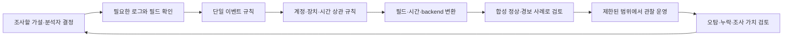

# 탐지 규칙 설계와 검증 | Detection engineering and Sigma

[분야 목차](README.md) · [로그 탐지와 사고 대응](16-로그탐지와사고대응_detection-response.md) · [단말 탐지와 대응](25-단말탐지와대응_endpoint-detection-response.md) · [용어](용어_glossary.md) · [출처와 판본](출처_sources.md)

## 탐지 규칙은 경보 문장보다 검증 가능한 가설입니다

탐지 규칙은 특정 로그에서 관측할 수 있는 행위를 정의하고, 분석자가 확인해야 할 사건 후보를 만듭니다. “로그인이 많이 실패했다”만으로는 운영 가능한 탐지가 아닙니다. 어떤 서비스의 어떤 실패 이벤트를 모으는지, 어떤 시간 안에 무엇을 몇 번 세는지, 정상 업무와 어떻게 구분할지, 경보 뒤에 분석자가 확인할 자료가 무엇인지 정해야 합니다.

Sigma는 로그 분석 규칙을 공통 YAML 형식으로 표현하고 지원되는 backend를 통해 SIEM 검색 질의로 바꾸는 규칙 형식입니다. Sigma 규칙 자체는 로그를 수집하거나 실행하는 엔진이 아니며, 모든 backend에서 같은 결과를 보장하지 않습니다. 대상 플랫폼의 필드 이름, 시간창·집계 기능, 변환 파이프라인과 변환 결과를 확인해야 합니다. [Sigma 규칙 명세 v2.1.0](https://github.com/SigmaHQ/sigma-specification/blob/v2.1.0/specification/sigma-rules-specification.md)



설계 흐름은 ATT&CK 기법 이름을 골라 규칙을 복사하는 데서 끝나지 않습니다. ATT&CK는 관측 가능한 행위와 자료원을 탐색하는 참고 분류입니다. 조직에서 해당 로그를 실제로 수집하는지, 규칙이 필요한 사건을 구분하는지, 결과를 조사할 팀과 절차가 있는지 확인해야 합니다. [MITRE ATT&CK Enterprise](https://attack.mitre.org/matrices/enterprise/)

## 먼저 어떤 결정을 돕는 탐지인지 정합니다

탐지 설계 전에 분석자가 경보를 받았을 때 어떤 행동을 해야 하는지 적습니다. 예를 들어 “단일 사용자 실패 횟수를 셉니다”는 신호 정의입니다. “같은 계정에 짧은 시간 동안 실패가 몰리면 계정 잠금·기기·IP·서비스 계정 설정을 확인합니다”는 조사 가설과 후속 질문입니다.

| 설계 질문 | 명시할 내용 | 이 정보가 필요한 이유 |
| --- | --- | --- |
| 관측 대상 | 로그인 실패, 권한 변경, 프로세스 실행, 파일 변경 등 실제 이벤트입니다. | 로그 이벤트 하나를 공격 그 자체로 잘못 부르지 않게 합니다. |
| 분석 단위 | 계정, 호스트, 소스 IP, 업무 서비스 또는 이들의 조합입니다. | 집계 키에 따라 같은 활동이 하나의 묶음이 될지 여러 묶음이 될지 달라집니다. |
| 시간 기준 | 이벤트 발생 시각인지 수집 시각인지, 시간대와 지연 이벤트를 어떻게 다루는지 정합니다. | 서로 다른 수집기의 시계와 전달 지연 때문에 사건 순서가 달라질 수 있습니다. |
| 양성 조건 | 횟수, 서로 다른 계정 수, 사건 순서, 위험 자산·계정 조건입니다. | 규칙이 어떤 행위 가설을 잡는지 재현할 수 있습니다. |
| 예상 정상 활동 | 비밀번호 오입력, 배치 작업, 서비스 계정, 공유 출구 IP 등입니다. | 합법적 활동과 공격성 징후를 구별하는 조사 기준입니다. |
| 조사 자료 | 계정·장치·로그온 유형·실패 이유·원본 이벤트·연결 경보입니다. | 경보가 실제 판단과 조치로 이어지게 합니다. |
| 대응 권한 | 관찰만 하는지, 담당자 검토 후 계정을 제한하는지 정합니다. | 경보가 자동 차단으로 바뀌면서 생기는 업무 중단을 막습니다. |

단일 실패 이벤트와 반복 실패 상관 규칙은 다른 목적을 가집니다. 첫 규칙은 기본 사건을 정규화하고 수집을 확인합니다. 두 번째는 시간창과 집계 키로 사건 후보를 줄입니다. 낮은 수준 이벤트 자체를 곧바로 계정을 차단하는 자동화로 연결하지 않습니다.

## Windows 로그인 실패 로그에서 수집 범위를 확인합니다

Windows 보안 이벤트 4625는 로그인 실패를 기록합니다. Microsoft 문서의 예에는 `TargetUserName`, `TargetDomainName`, `LogonType`, `IpAddress`, `Computer` 등 필드가 나타납니다. 이벤트는 시도가 발생한 컴퓨터에 기록될 수 있으며, 도메인 컨트롤러·서버·워크스테이션의 감사 설정과 로그 전달 범위를 함께 확인해야 합니다. 이벤트 생성만으로 SIEM에 전송되는 것은 아닙니다. [Microsoft Event 4625](https://learn.microsoft.com/en-us/previous-versions/windows/it-pro/windows-10/security/threat-protection/auditing/event-4625)

| 필드 | 조사에서의 용도 | 해석할 때 확인할 점 |
| --- | --- | --- |
| `TargetUserName` | 로그온에 실패한 계정을 구분합니다. | 짧은 이름만 쓰면 서로 다른 도메인의 같은 이름을 합칠 수 있습니다. |
| `TargetDomainName` | 대상 계정이 속한 도메인이나 장치 이름을 함께 확인합니다. | 로컬 계정·잘 알려진 주체·도메인 계정의 표기가 다를 수 있습니다. |
| `Computer` 또는 정규화된 장치 필드 | 실패가 기록된 시스템과 업무 서비스를 구분합니다. | 원본 XML과 SIEM의 필드명이 `ComputerName`, `host.name` 등으로 다를 수 있습니다. |
| `IpAddress` | 네트워크에서 온 시도의 원격 주소를 살펴봅니다. | `127.0.0.1`, 빈 값, NAT 주소처럼 공격자 위치를 그대로 나타내지 않는 값도 있습니다. |
| `LogonType` | 대화형·네트워크·서비스 등 로그온 맥락을 구분합니다. | 정상 배치·서비스 동작과 원격 접근은 같은 실패 횟수라도 의미가 다릅니다. |
| `Status`·`SubStatus` | 실패 사유의 세부 코드와 인프라 문제를 구분하는 데 도움을 줍니다. | 암호 오류, 없는 계정, 잠금, 로그온 서버 장애는 서로 다른 조사 방향을 갖습니다. |

원본 이벤트 필드가 분석 플랫폼에 어떤 이름으로 들어가는지 확인한 뒤 Sigma의 `logsource`와 집계 필드를 정합니다. Sigma의 taxonomy와 pipeline은 필드명 변환을 표현할 수 있지만, 모든 변환기가 모든 값·집계 기능을 지원하는 것은 아닙니다. backend가 지원하지 않는 조건을 조용히 삭제하지 않는지 확인합니다. [Sigma 규칙 명세 v2.1.0](https://github.com/SigmaHQ/sigma-specification/blob/v2.1.0/specification/sigma-rules-specification.md), [Sigma 상관 규칙 명세 v2.1.0](https://github.com/SigmaHQ/sigma-specification/blob/v2.1.0/specification/sigma-correlation-rules-specification.md)

## 단일 이벤트와 두 가지 상관 규칙을 분리해 표현합니다

다음 YAML은 직접 작성한 교육용 예시입니다. Sigma 명세의 단일 규칙과 상관 규칙 형식에 맞춰 4625 실패 이벤트, 동일 계정의 반복 실패, 한 출구 IP에서 여러 계정에 실패하는 경우를 분리합니다. 5분·8회 값은 구조 설명용 가정이며 운영 임계값이 아닙니다.

가독성을 위해 세 개의 YAML 문서를 `---`로 이어서 보여드립니다. 실제 Sigma 저장소에 둘 때에는 문서마다 별도 `.yml` 파일로 저장하고, 상관 규칙의 참조 이름이 단일 이벤트 규칙의 `name`과 일치하는지 확인합니다.

```yaml
title: Windows Failed Logon Event  # 단일 실패 이벤트의 이름입니다.
id: 5e2eb938-1731-4c31-9015-04f526f74bd1  # 규칙을 다른 문서에서 참조하는 고유 ID입니다.
name: windows_failed_logon  # 상관 규칙에서 읽기 쉬운 이름으로 참조합니다.
status: test  # 실제 환경에서 조정이 필요한 시험 상태입니다.
date: 2026-11-04  # 예시를 작성한 날짜입니다.
description: Windows 보안 로그의 4625 실패 이벤트를 기본 신호로 다룹니다.  # 규칙 범위입니다.
logsource:  # 규칙이 읽는 로그 범주를 지정합니다.
  product: windows  # Windows 이벤트를 대상으로 합니다.
  service: security  # Windows Security 로그를 대상으로 합니다.
detection:  # 이벤트에서 찾을 조건을 시작합니다.
  selection:  # 기본 선택 조건의 이름입니다.
    EventID: 4625  # 계정 로그인 실패 이벤트를 선택합니다.
  condition: selection  # 선택 조건과 일치하는 이벤트 하나를 반환합니다.
fields:  # 분석 화면에 함께 보여 줄 정보의 예입니다.
  - TargetUserName  # 실패한 계정을 표시합니다.
  - TargetDomainName  # 계정의 도메인 또는 장치 이름을 표시합니다.
  - LogonType  # 로그인 유형을 표시합니다.
  - IpAddress  # 원격 주소가 수집된 경우 표시합니다.
  - Status  # 실패 코드 확인을 돕습니다.
falsepositives:  # 단일 실패만으로 경보를 확정하지 않을 이유입니다.
  - 비밀번호 오입력, 만료된 저장 자격 증명, 잘못 설정된 서비스 계정  # 정상 원인을 기록합니다.
level: informational  # 사건 표식이며 단독 보안 경보로 쓰지 않습니다.
---
title: Repeated Failed Logons for One Account  # 같은 계정에 실패가 몰리는 상황입니다.
id: 74ac3ff9-00dc-48d9-bb83-c448f635f11e  # 상관 규칙의 고유 ID입니다.
status: test  # 임계값과 필드 매핑을 검증할 상태입니다.
description: 한 호스트에서 같은 도메인 계정의 실패 이벤트 수를 집계합니다.  # 상관 가설입니다.
correlation:  # 여러 단일 이벤트를 집계합니다.
  type: event_count  # 일치 이벤트 수를 셉니다.
  rules:  # 앞에서 정의한 단일 이벤트 규칙을 사용합니다.
    - windows_failed_logon  # ID 대신 정의한 이름으로 규칙을 참조합니다.
  group-by:  # 각각 따로 세어야 하는 계정·호스트 키입니다.
    - TargetUserName  # 같은 계정 이름으로 묶습니다.
    - TargetDomainName  # 같은 이름의 다른 도메인 계정을 분리합니다.
    - ComputerName  # 실패가 기록된 호스트별로 집계합니다.
  timespan: 5m  # 이벤트를 묶는 이동 시간창입니다.
  condition:  # 시간창 안에서 경보 후보가 될 기준입니다.
    gte: 8  # 8회 이상이라는 교육용 기준입니다.
falsepositives:  # 반복 실패를 만들 수 있는 정상 원인입니다.
  - 저장 암호가 만료된 업무 서비스 또는 로그인 폭주를 일으킨 자동 작업  # 조사 단서입니다.
level: medium  # 사람의 검토가 필요한 수준으로 둡니다.
---
title: Failed Logons Across Multiple Accounts from One Address  # 한 주소에서 여러 계정을 시도하는 상황입니다.
id: b4d39a2e-0484-4376-89df-196288661b8d  # 두 번째 상관 규칙의 ID입니다.
status: test  # 환경별 필드와 정상 트래픽을 검증할 상태입니다.
description: 한 호스트에서 같은 원격 주소로 실패한 서로 다른 계정 수를 집계합니다.  # 분산 계정 시도 가설입니다.
correlation:  # 서로 다른 이벤트 값을 셉니다.
  type: value_count  # 이벤트 총수가 아니라 고유 필드값 수를 셉니다.
  rules:  # 동일한 기본 로그인 실패 사건을 사용합니다.
    - windows_failed_logon  # 단일 이벤트 규칙을 다시 참조합니다.
  group-by:  # 주소와 대상 호스트의 조합마다 따로 집계합니다.
    - IpAddress  # 원격 IP 주소별로 묶습니다.
    - ComputerName  # 로그인 실패가 관측된 호스트별로 묶습니다.
  timespan: 5m  # 이 시간 안의 실패를 비교합니다.
  condition:  # 서로 다른 대상 계정의 수를 평가합니다.
    field: TargetUserName  # 값이 서로 다른 계정 이름을 셉니다.
    gte: 8  # 8개 이상은 교육용 값입니다.
falsepositives:  # 주소를 공유하는 정상 행위가 생길 수 있습니다.
  - NAT·프록시를 거치는 대규모 로그인이나 조직의 인증 시험  # 출구 주소 공유를 고려합니다.
level: medium  # 자동 차단이 아니라 분석자 검토를 뜻합니다.
```

상관 규칙은 단일 이벤트를 새로 만드는 것이 아니라 이미 정의한 규칙의 결과를 시간·그룹별로 묶습니다. Sigma 명세의 `event_count`는 이벤트 수를, `value_count`는 그룹마다 특정 필드의 서로 다른 값 수를 셉니다. backend가 시간창의 경계, 그룹 키와 고유값 수를 지원하지 않으면 변환 결과만 보고 기능이 구현됐다고 간주하지 않습니다. [Sigma 상관 규칙 명세 v2.1.0](https://github.com/SigmaHQ/sigma-specification/blob/v2.1.0/specification/sigma-correlation-rules-specification.md)

### 이 예시의 해석

| 합성 상황 | 계정별 실패 규칙 | 여러 계정 규칙 | 다음 확인 |
| --- | --- | --- | --- |
| 한 사용자가 5분 동안 3회 실패합니다. | 8회 기준에 도달하지 않아 상관 경보는 만들지 않습니다. | 서로 다른 계정 수도 적어 경보가 없습니다. | 헬프데스크 문의나 장치 입력 오류를 확인합니다. |
| 같은 계정·도메인·호스트에서 5분 안에 8회 실패합니다. | 계정 실패 경보 후보가 됩니다. | 다중 계정 조건에는 해당하지 않을 수 있습니다. | 서비스 계정·로그온 유형·원격 IP·실패 코드·이전 성공 로그온을 조사합니다. |
| 하나의 외부 주소에서 여러 계정을 짧은 시간에 시도합니다. | 계정마다 임계값 아래면 첫 규칙이 놓칠 수 있습니다. | 고유 계정 수 조건이 충족되면 별도 경보 후보가 됩니다. | NAT·프록시·공용 인증 관문인지, 소스 주소를 신뢰할 수 있는지 확인합니다. |
| 저장 암호가 만료된 서비스가 한 계정으로 반복 실패합니다. | 계정별 경보를 만들 수 있습니다. | 한 계정뿐이면 다중 계정 규칙은 작동하지 않습니다. | 담당 서비스·변경 이력·계정 잠금 영향을 확인하고 필요한 경우 좁은 예외를 검토합니다. |
| 원격 주소 값이 없거나 `127.0.0.1`입니다. | 다른 그룹 키가 있으면 계정별 규칙은 동작할 수 있습니다. | 여러 장치나 내부 경로가 같은 값으로 합쳐질 수 있습니다. | 비어 있는 주소 처리, `LogonType`, 실제 수집 필드와 parser를 점검합니다. |

이 두 상관 규칙은 서로 다른 행동 가설을 봅니다. 계정별 실패 규칙은 한 계정으로 시도가 몰리는 상황을, 주소별 고유 계정 규칙은 한 출구에서 여러 이름을 시도하는 상황을 겨냥합니다. 기준이 너무 높으면 느리고 분산된 시도를 놓칠 수 있고, 너무 낮으면 오입력·공용 NAT·정상 배치 작업이 경보를 채울 수 있습니다. 계정만 그룹 키로 쓰면 여러 호스트의 실패가 한데 모일 수 있으므로 `ComputerName`을 넣을지 업무 흐름에 따라 결정합니다.

## Sigma 변환은 문법 검사와 현장 적용의 시작점입니다

Sigma의 `logsource`는 규칙이 어떤 제품·서비스·로그 종류를 기대하는지 표현합니다. `selection`과 `condition`은 한 이벤트 안에서 찾을 조건이고, 상관 문서는 여러 이벤트를 묶는 시간창·그룹·집계 기준을 정의합니다. 규칙의 field 이름이 실제 SIEM에서 어떤 이름으로 저장되는지는 별도의 mapping 또는 processing pipeline에 달려 있습니다.

pySigma는 규칙을 읽고 질의로 변환하는 Python 라이브러리입니다. 변환 backend와 로그 데이터 모델 pipeline은 별도 플러그인으로 분리되어 있습니다. Sigma CLI도 backend와 필요한 pipeline을 설치해야 질의를 생성할 수 있습니다. Sigma CLI 공식 예제는 Splunk backend와 Sysmon pipeline을 이용해 규칙 디렉터리를 변환합니다. 이 예제를 다른 플랫폼이나 Windows Security Event 4625에 그대로 적용하면 안 됩니다. [pySigma 공식 저장소](https://github.com/SigmaHQ/pySigma), [Sigma CLI 공식 사용법](https://github.com/SigmaHQ/sigma-cli)

```powershell
python -m pip install sigma-cli  # 현재 Python 환경에 Sigma 명령줄 도구를 설치합니다.
sigma plugin list  # 사용할 수 있는 backend와 pipeline 식별자를 확인합니다.
sigma plugin install splunk  # 변환 대상 Splunk backend 플러그인을 설치합니다.
```

공식 Sigma CLI 문서는 `sigma convert -t splunk -p sysmon` 형태로 변환 대상과 pipeline을 지정합니다. 실제 변환에는 그 pipeline도 같은 환경에 설치되어 있어야 하며, 생성된 질의는 대상 SIEM의 필드 추출·시간 필드·인덱스와 일치하는지 검토해야 합니다. 위 명령과 문서의 과정은 도구 사용 예시이며 이 저장소의 교육용 YAML을 변환하거나 실행한 검증 결과는 아닙니다.

backend의 지원 여부는 규칙마다 확인합니다. Sigma 상관 명세는 일부 backend가 원하는 group-by, 집계 조건이나 시간창 경계를 구현하지 못할 수 있다고 설명합니다. 도구가 경고를 내거나 기능을 지원하지 않는 경우 조건이 축약되거나 질의 생성이 실패할 수 있으므로, 결과 질의와 대상 시스템의 동작을 함께 검토합니다. YAML이 파싱된다는 사실은 수집 중인 원본 이벤트와 의미가 맞다는 뜻이 아닙니다. [Sigma 상관 규칙 명세 v2.1.0](https://github.com/SigmaHQ/sigma-specification/blob/v2.1.0/specification/sigma-correlation-rules-specification.md)

## 운영 반영 전에는 입력·출력의 기대값을 대조합니다

| 검증 단계 | 확인할 자료 | 통과 판단의 예 |
| --- | --- | --- |
| 수집 전제 | Security 감사 정책, 이벤트 전달 범위, 보존 기간, 센서·forwarder 상태입니다. | 관리 대상 Windows 장치와 도메인 컨트롤러가 예상 기간 동안 이벤트를 전달합니다. |
| 필드 매핑 | 원본 이벤트 XML, 정규화된 필드, SIEM 검색 결과입니다. | `TargetUserName`, `TargetDomainName`, `ComputerName`, `IpAddress`, `LogonType`이 실제 값과 일치합니다. |
| 문법·변환 | 선택한 Sigma 스키마 버전, backend, pipeline, 변환 경고입니다. | 필수 필드가 남아 있고 집계·시간 조건이 변환 출력에 유지됩니다. |
| 정상 입력 | 타이핑 오류, 만료 서비스 암호, NAT 사용자, 인증 점검 상황입니다. | 정상 작업이 경보를 만들 때 원인을 추적할 이벤트·계정·장치가 표시됩니다. |
| 양성 입력 | 승인된 실습 환경에서 만든 합성 4625 이벤트입니다. | 사전에 정의한 그룹 키·시간창·고유값 기준으로 예상한 규칙만 일치합니다. |
| 경계 입력 | 시간창 직전·직후, 동일 시각, 빈 IP, 도메인 차이, 지연·중복 이벤트입니다. | 제외·포함 동작과 미지원 데이터의 처리 방식이 문서화됩니다. |
| 운영 시범 | 제한된 자산의 분석 전용 경보와 담당자 피드백입니다. | 조사자가 반복 경보를 원인별로 분류하고 좁은 정책 조정 근거를 남깁니다. |

운영에 넣기 전에 규칙 상태를 `test`로 유지하고 일정 기간 관찰합니다. 특정 계정·서비스 전체를 제외 목록에 넣기보다 원인, 대상, 실행 주체, 승인 기간을 좁게 기록합니다. 예외에는 만료일과 검토 책임자를 두고, 필터가 공격과 정상 작업을 함께 지우지 않는지 다시 확인합니다. 규칙 변경은 원본 YAML, 생성 질의, 변경 이력, 기대 결과를 함께 버전 관리합니다.

성과 지표는 경보 개수보다 조사 가치와 누락 위험을 보여야 합니다. 확인된 경보 비율, 정상 원인별 반복 빈도, 센서·필드 결측률, 조사에 걸린 시간, 실제 탐지 시나리오 커버리지를 따로 봅니다. 정답 라벨이 없는 경보를 임의로 오탐으로 세거나, 이벤트가 아예 들어오지 않은 기간을 “위협이 없었다”고 해석하지 않습니다. 자동 계정 잠금이나 IP 차단은 업무 영향을 검토하고 별도 승인·해제·감사 절차를 설계한 경우에만 적용합니다.

## 출처와 예시 범위

- [Sigma Rule Specification v2.1.0](https://github.com/SigmaHQ/sigma-specification/blob/v2.1.0/specification/sigma-rules-specification.md): 규칙 필드·logsource·탐지 선택자·false positive·상태를 확인했습니다.
- [Sigma Correlation Rules Specification v2.1.0](https://github.com/SigmaHQ/sigma-specification/blob/v2.1.0/specification/sigma-correlation-rules-specification.md): `event_count`, `value_count`, 그룹 키, 시간창과 backend 지원 조건을 확인했습니다.
- [SigmaHQ pySigma](https://github.com/SigmaHQ/pySigma): Python 요구 버전·backend와 pipeline의 분리 구조를 확인했습니다.
- [SigmaHQ sigma-cli](https://github.com/SigmaHQ/sigma-cli): 설치·plugin 확인·변환 명령과 backend 예시를 확인했습니다.
- [Microsoft Event 4625](https://learn.microsoft.com/en-us/previous-versions/windows/it-pro/windows-10/security/threat-protection/auditing/event-4625): Windows 로그인 실패 이벤트의 생성 위치와 필드를 확인했습니다.
- [MITRE ATT&CK Enterprise](https://attack.mitre.org/matrices/enterprise/): 행위·전술·기법을 탐색하는 분류 자료로 사용했습니다.

Sigma YAML과 5분·8회 집계 값은 교육을 위해 직접 만든 예입니다. 공식 Sigma 규칙을 복사한 코드가 아니며, 변환기 실행이나 특정 SIEM에서의 탐지·오탐 결과를 뜻하지 않습니다. 운영 적용 전에는 실제 데이터 필드와 backend 기능에 맞춰 검증해야 합니다.

## English

Detection engineering turns an investigation hypothesis into a testable rule over available telemetry. Sigma expresses generic log-source and event-selection logic; correlation rules add grouping, time windows, and event or value counts. Sigma is not a collection agent or a detection engine, and conversion does not prove that a target SIEM has the required fields or supports the same correlation semantics. The Windows 4625 examples and thresholds are educational, authored examples that were not converted or tested in a SIEM.
