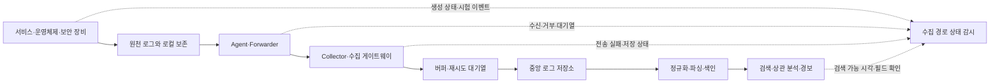

# 보안 로그 수집 파이프라인과 손실 감시 | Security log pipeline integrity

[분야 목차](README.md) · [로그 탐지와 사고 대응](16-로그탐지와사고대응_detection-response.md) · [탐지 규칙 설계와 검증](26-탐지규칙설계와검증_detection-engineering.md) · [용어](용어_glossary.md) · [출처와 판본](출처_sources.md)

## 경보가 없다는 사실만으로 로그 수집이 정상이라고 판단할 수 없습니다

로그를 이용한 탐지는 이벤트가 만들어지고, 원천 장치에 기록되고, 수집기로 전달되고, 해석되어 저장된 뒤 검색될 때 비로소 가능합니다. 중간 단계가 끊기면 실제 활동이 없었던 것처럼 보일 수 있습니다. 따라서 보안팀은 탐지 규칙뿐 아니라 각 원천에서 중앙 저장소까지 자료가 이어지는지도 감시해야 합니다.

로그 경로는 다음처럼 나누어 점검할 수 있습니다.



여기서 수집기 상태가 정상이라는 표시와 로그 내용이 실제로 검색된다는 사실은 서로 다릅니다. 예를 들어 원천 장치의 감사 정책이 꺼졌거나 로컬 로그가 먼저 덮였으면 Agent는 정상이어도 사건이 없습니다. 반대로 중앙 저장소에 원본은 있지만 파서가 바뀌어 필드가 빠졌다면 특정 탐지 규칙만 작동하지 않을 수 있습니다.

국제 협력 기관의 로그 지침은 로그 정책, 중앙 수집·상관 분석, 안전한 보관·무결성, 위협 탐지를 함께 다루고, SIEM 수집 지침은 모든 로그를 한 번에 넣기보다 위험과 분석 목적에 따라 우선순위를 정하고 범위를 단계적으로 늘리라고 권고합니다. [이벤트 로깅과 위협 탐지 지침](https://www.cyber.gov.au/publication/best-practices-for-event-logging-and-threat-detection), [SIEM 수집 우선 로그 실무 지침](https://www.cyber.gov.au/publication/priority-logs-for-siem-ingestion-practitioner-guidance)

## 수집률보다 먼저 어떤 기록이 필요한지 정합니다

로그를 많이 모으는 것만으로 탐지가 좋아지지는 않습니다. 출처별로 무엇을 확인하려고 수집하는지, 담당 주체가 누구인지, 어느 단계까지 도달해야 완료로 볼지 정합니다. 예를 들어 클라우드 관리자 작업을 감시하려면 로그인 이벤트만이 아니라 제어 영역 API 호출, 권한 변경, 로그 설정 변경, 저장소 접근 같은 사건이 실제로 생성되고 보존되는지 확인해야 합니다.

| 정할 항목 | 기록할 내용 | 확인 이유 |
| --- | --- | --- |
| 탐지·조사 목적 | 계정 탈취, 권한 변경, 중요 자료 접근, 장치 설정 변경 등입니다. | 목적이 없으면 양은 많지만 조사에 쓰이지 않는 자료가 쌓일 수 있습니다. |
| 원천과 책임자 | 서비스·장치 이름, 관리 조직, 공급자와 고객의 역할입니다. | 로그 설정과 전달 문제를 어느 팀이 해결할지 분명해집니다. |
| 필수 이벤트 | 성공·실패 인증, 관리자 변경, 정책·로그 설정 변경, 중요 자료 접근입니다. | 원천의 감사 정책과 실제 이벤트를 대조할 기준이 됩니다. |
| 목적지와 보존 | 로컬 로그, 중앙 저장소, 검색 시스템, 보존 기간입니다. | 원천의 순환 덮어쓰기와 중앙 보관의 공백을 발견할 수 있습니다. |
| 개인정보 범위 | 수집 필드, 접근 권한, 마스킹·보존 기준입니다. | 조사 가치와 과도한 개인정보 수집을 함께 통제합니다. |
| 완료 조건 | 검색 가능한 사건, 필수 필드, 허용 지연, 정합성 확인 방법입니다. | 전송 성공 응답만으로 최종 저장을 단정하지 않게 합니다. |

고가치 로그를 먼저 도입하고 건강 상태를 확인한 뒤 범위를 넓힙니다. 외부 노출 서비스, 계정·도메인 관리 시스템, 권한이 높은 관리자 단말, 보안·배포 도구, 중요 데이터 저장소는 보통 우선 검토 대상입니다. 다만 실제 순서는 조직의 자산·위협·업무 위험에 따라 달라집니다. 로그 양과 SIEM 검색·보관 비용도 함께 측정합니다. [SIEM 수집 우선 로그 지침](https://www.cyber.gov.au/publication/priority-logs-for-siem-ingestion-practitioner-guidance)

## 단계별 지표를 함께 보면 끊긴 구간을 좁힐 수 있습니다

| 구간 | 확인할 지표·증거 | 나타날 수 있는 문제 |
| --- | --- | --- |
| 원천 | 감사 정책, 이벤트 생성 수, 최근 이벤트 시각, 무해한 시험 이벤트입니다. | 설정 해제, 역할·정책 변경, 이벤트 범주 누락, 로컬 순환 보존입니다. |
| Agent·Forwarder | 원천별 수신·전달 수, 서비스 가동, 내부 오류, 버퍼 사용량입니다. | 권한 부족, 프로세스 중단, 로컬 큐 포화, 파일 읽기 위치 변경입니다. |
| 네트워크·Collector | 접속·인증 실패, 수신·거부 수, 재시도, Collector별 입력량입니다. | 인증서 만료, 방화벽·라우팅 변경, 수신 한도, 메모리 부족입니다. |
| 대기열·전송 | 현재 큐 크기와 용량, enqueue 실패, 전송 실패, 가장 오래된 항목의 나이입니다. | 저장소 장애, 큐 포화, 재시도 제한, 재시작 뒤 메모리 큐 손실입니다. |
| 파싱·정규화 | 파싱 실패, 필수 필드 존재율, 미지 이벤트 유형, 스키마 변경입니다. | 원천 업데이트, 필드명 변경, 잘못된 타임스탬프·형식입니다. |
| 저장·색인 | 수신 확인, 색인 완료, 거부·중복 제거 수, 검색 가능 시각입니다. | 용량·인덱스 설정, 정책 필터, 필드 매핑 오류, 저장 지연입니다. |
| 탐지·검색 | 무해한 시험 이벤트(canary)의 검색 결과, 규칙 실행 시각, 대상 인덱스·필터입니다. | 시간대·필드 매핑 불일치, 잘못된 범위, 규칙 조건 오류입니다. |

OpenTelemetry 로그 모델은 원천에서 사건이 일어난 `Timestamp`와 수집기가 기록을 관측한 `ObservedTimestamp`를 구분합니다. 두 시각을 비교하면 전달 지연을 살펴볼 수 있지만, 시계 동기화·시간대·원천 시각의 신뢰도가 전제입니다. 시계가 맞지 않으면 음수 지연이나 잘못된 사건 순서가 나타날 수 있습니다. UTC와 일관된 시간 형식을 사용하고 시스템 시계를 검증하라는 공동 지침도 이 이유와 연결됩니다. [OpenTelemetry Logs Data Model](https://opentelemetry.io/docs/specs/otel/logs/data-model/), [로그 시간 일관성 지침](https://www.cyber.gov.au/publication/best-practices-for-event-logging-and-threat-detection)

Collector도 자기 상태를 별도 경로로 내보내야 합니다. OpenTelemetry Collector 내부 계측에는 receiver가 받은·거부한 로그, exporter의 전송·실패·대기열 크기·용량을 나타내는 지표가 있습니다. 배포된 판본과 계측 수준에 따라 지표 이름·제공 여부가 달라질 수 있으므로 실제 버전의 문서를 확인합니다. 누적 counter는 순간값보다 일정 구간의 증가량을 보고, 프로세스 재시작이나 counter 초기화가 있었는지도 함께 봅니다. [OpenTelemetry Collector 내부 계측](https://opentelemetry.io/docs/collector/internal-telemetry/)

## 큐와 재시도는 손실을 줄이지만 영구 보관을 보장하지 않습니다

전송 대상이 잠시 중단되면 메모리 큐와 재시도가 데이터를 기다리게 할 수 있습니다. 그러나 큐 용량이 차거나 재시도 한도를 넘으면 새 자료나 오래된 자료가 버려질 수 있습니다. 프로세스가 재시작되면 메모리 큐가 사라질 수 있고, 디스크 기반 write-ahead log도 저장 장치 고장·공간 부족·잘못된 권한을 견디는 무제한 백업은 아닙니다. Collector 공식 지침은 exporter queue·재시도와 중요 경로의 지속 저장을 다루면서도 각 방식의 손실 조건을 명시합니다. [Collector 복원력과 손실 조건](https://opentelemetry.io/docs/collector/resiliency/)

대기열은 현재 사용량만 볼 것이 아니라 용량 대비 비율, 증가 속도, 가장 오래된 이벤트의 대기 시간, enqueue 실패, 재시도 실패를 같이 봅니다. 예를 들어 큐가 80%여도 빠르게 줄고 있다면 회복 중일 수 있지만, 40%라도 계속 증가하면서 목적지 연결이 끊겼다면 곧 포화될 수 있습니다. 이를 운영 알림으로 만들 때는 실제 처리량과 장애 허용 시간에 따라 경계값을 정합니다. 특정 고정 퍼센트를 모든 조직의 정답으로 사용하지 않습니다.

## 같은 묶음의 기록을 끝까지 대조하는 합성 예시

아래 수치는 기능 설명을 위한 직접 작성한 합성 자료입니다. 수집기의 실제 측정이나 제품 성능 결과가 아닙니다. 같은 시험 묶음에서 각 단계가 고유 이벤트 식별자 기준으로 집계됐고 처리 대기열이 안정된 시점이라고 가정합니다.

| 단계별 수 | 건수 | 계산한 차이 |
| --- | ---: | --- |
| 원천에서 보낸 이벤트 | 1,000 | 기준 수입니다. |
| Collector에서 받은 이벤트 | 980 | 원천과의 차이는 20건입니다. |
| 파싱 실패 | 20 | Collector가 받은 이벤트 중 스키마 해석에 실패한 수입니다. |
| 의도적으로 필터링된 이벤트 | 0 | 해당 시험에서는 제외 규칙이 없습니다. |
| 중앙 저장소에 색인된 이벤트 | 950 | 최종 검색 대상으로 기록된 수입니다. |
| 아직 대기열에 남은 이벤트 | 10 | 아직 최종 저장됐다고 판정하면 안 됩니다. |

이 합성 묶음에서는 `1,000 = 20(Collector 도달 전 차이) + 20(파싱 실패) + 950(색인) + 10(대기열)`로 수량이 맞습니다. 도달 전 차이가 곧바로 네트워크 손실을 증명하지는 않습니다. 집계 구간, 재전송, 중복 제거, 의도된 필터가 다르면 원인 해석이 달라집니다. 운영 지표는 같은 시간 구간·같은 원천 집합인지 맞춘 뒤 비교하고, 가능하면 고유한 시험 ID로 end-to-end 경로를 확인합니다.

```python
def reconcile_batch(sent, received, parse_failed, filtered, indexed, queued):  # def는 묶음별 수량을 대조하는 함수를 정의합니다.
    counts = (sent, received, parse_failed, filtered, indexed, queued)  # 괄호는 단계별 건수를 순서가 있는 튜플로 묶습니다.
    if any(type(value) is not int or value < 0 for value in counts):  # any는 하나라도 조건에 맞으면 참이고, 생성식은 정수형 여부와 음수를 각 값에서 검사합니다.
        raise ValueError("counts must be non-negative integers")  # 잘못된 입력을 예외로 알립니다.
    if received > sent or parse_failed + filtered > received:  # 앞 단계보다 뒤 단계가 커지는 모순을 확인합니다.
        raise ValueError("inconsistent stage counts")  # 모순된 집계는 원인 분류를 중단합니다.
    eligible = received - parse_failed - filtered  # 정상 파싱되어 저장 대상으로 남은 이벤트 수를 셉니다.
    if indexed + queued > eligible:  # 색인과 대기열 합계가 저장 후보 수를 넘는지 확인합니다.
        raise ValueError("downstream counts exceed eligible events")  # 중복·구간 불일치 가능성을 표시합니다.
    return {  # 중괄호는 단계별 차이를 이름과 값으로 묶은 딕셔너리를 만듭니다.
        "before_collector": sent - received,  # 원천 전송과 Collector 수신 사이의 차이를 셉니다.
        "parse_failed": parse_failed,  # 파서가 읽지 못한 이벤트 수를 반환합니다.
        "intentionally_filtered": filtered,  # 정책상 제외한 이벤트 수를 반환합니다.
        "waiting_for_index": queued,  # 목적지로 아직 보내지 못한 대기 이벤트 수를 반환합니다.
        "unaccounted_after_parse": eligible - indexed - queued,  # 색인·대기열 어디에도 없는 차이를 반환합니다.
    }  # 딕셔너리의 끝으로 결과를 완성합니다.

example = reconcile_batch(1000, 980, 20, 0, 950, 10)  # 합성 표의 건수를 함수 입력으로 전달합니다.
# 손계산 결과는 before_collector 20, parse_failed 20, waiting_for_index 10, 나머지 0입니다.  # 이 예시의 결과를 실행 결과와 혼동하지 않도록 설명합니다.
```

이 함수는 시간창의 누적 지표나 재시도된 생산 로그를 그대로 집계하는 도구가 아닙니다. 같은 시험 묶음에서 이벤트 중복·재전송·필터를 확인하고 각 단계의 집계 기준을 맞춘 경우에만 간단한 수량 차이를 보이는 교육용 코드입니다. 실제 운영 자료에서는 counter reset, batching, 여러 파서, 저장소의 중복 제거, 지연 색인 때문에 단계별 건수가 바로 일치하지 않을 수 있습니다.

## 이상 징후가 보이면 마지막으로 정상 확인된 구간부터 좁힙니다

| 관측 | 우선 확인할 구간 | 먼저 확인할 자료 |
| --- | --- | --- |
| 원천 로그도 없고 상태 canary도 없습니다. | 이벤트 생성과 감사 정책입니다. | 업데이트·정책 변경, 원천 서비스 상태, 로컬 로그 순환과 보존량입니다. |
| 원천에는 이벤트가 있지만 Collector 수신 수가 줄었습니다. | Agent·Forwarder·전송 경로입니다. | Agent 오류, 로컬 버퍼, DNS·방화벽·TLS 인증서, Collector receiver 거부 지표입니다. |
| Collector 수신은 유지되지만 파싱 실패가 늘었습니다. | 파서·스키마 변환입니다. | 원천 제품 업데이트, 새 필드·이벤트 유형, 원본과 정규화 결과의 대조입니다. |
| 대기열이 계속 증가하고 enqueue 실패가 생겼습니다. | 목적지 처리량·네트워크·큐 크기입니다. | exporter 오류, 목적지 응답, 처리량 대비 유입량, 디스크와 메모리 여유입니다. |
| 중앙 저장소에는 있지만 SIEM 검색 결과가 없습니다. | 색인·시간 필드·탐지 검색 조건입니다. | 인덱스·보존 정책, 타임스탬프 필드, 정규화된 필드명, 검색 시간대입니다. |
| 정상 로그는 검색되지만 탐지가 작동하지 않습니다. | 규칙과 기준 데이터입니다. | 규칙 버전, 데이터 원본, 필드·집계 조건, 최신 합성 시험 기록입니다. |

한 번에 여러 설정을 바꾸면 복구 원인을 알기 어려워집니다. 가장 마지막으로 정상 확인된 단계와 시각을 찾고, 해당 구간의 변경 기록·오류·대기열을 확인한 뒤 작은 범위에서 수정합니다. 원본 로그를 덮거나 급히 재설치하기 전에 보존 사본과 시각 정보를 확보합니다. OT와 의료·안전 관련 시스템은 로그 전달을 위해 제어망·장치 설정을 바꿀 때 운영·안전 책임자와 영향부터 검토합니다.

## 안전한 수집과 운영 순서

1. 위협 모델과 조사 목적에 맞춰 우선 로그 원천을 정하고 담당자를 지정합니다.
2. 원천에서 이벤트가 생성되는지, 중앙 저장소까지 도달하는지 각 단계의 기준 지표를 정합니다.
3. 인증 정보·토큰·불필요한 개인정보는 최소 수집하고 전송·보관·접근·삭제 권한을 분리합니다.
4. 공격 행위 없이 전달 경로를 확인하는 무해한 고유 시험 이벤트(canary)를 사용해 생성부터 검색까지 도달 여부와 지연을 확인합니다.
5. 별도 시험 환경에서 목적지 지연·Collector 재시작·큐 포화 시 재시도·백업·복구 동작을 확인합니다.
6. 높은 가치의 원천부터 단계적으로 확장하고 수집 범위·비용·보존 기간을 정기적으로 다시 검토합니다.

중앙 저장소는 로그가 로컬 장치에서 덮이기 전에 보존하도록 도울 수 있지만, 그 자체로 무결성이나 기밀성을 보장하지 않습니다. 민감 로그에 대한 최소 권한, 분리된 저장 구간, 접근·삭제 감사, 전송 보호, 복구 가능한 사본을 함께 둡니다. [공동 이벤트 로깅 지침](https://www.cyber.gov.au/publication/best-practices-for-event-logging-and-threat-detection)은 중앙 집계, 무단 수정·삭제 방지와 안전한 전송·저장 원칙을 설명합니다.

## 출처와 적용 범위

- [Best practices for event logging and threat detection](https://www.cyber.gov.au/publication/best-practices-for-event-logging-and-threat-detection): 2024년 8월 22일 게시된 ASD ACSC 주도 국제 공동 지침입니다. 원천 우선순위, 시간 동기화, 중앙 수집, 보존·무결성 내용을 확인했습니다.
- [Priority logs for SIEM ingestion: Practitioner guidance](https://www.cyber.gov.au/publication/priority-logs-for-siem-ingestion-practitioner-guidance): 2025년 5월 27일 게시판입니다. 로그 원천 우선순위, 단계적 도입, 유입량·분석 가치와 수집 건강 확인을 확인했습니다.
- [OpenTelemetry Logs Data Model](https://opentelemetry.io/docs/specs/otel/logs/data-model/): `Timestamp`와 `ObservedTimestamp`의 의미와 로그 데이터 모델을 확인했습니다.
- [OpenTelemetry Collector internal telemetry](https://opentelemetry.io/docs/collector/internal-telemetry/): Collector receiver·processor·exporter·대기열 지표와 계측 수준을 확인했습니다.
- [OpenTelemetry Collector resiliency](https://opentelemetry.io/docs/collector/resiliency/): 큐·재시도·디스크 지속 저장·메시지 큐의 손실 조건과 운영 고려사항을 확인했습니다.

수량 대조 코드는 이 문서를 위해 직접 만든 설명용 코드이며 외부 도구의 구현이나 실제 환경에서 실행한 결과가 아닙니다. 표의 건수도 합성 예시입니다. OpenTelemetry 지표와 구성은 Collector 판본 및 설정에 따라 다를 수 있으므로 실제 배포 판본의 공식 문서를 확인해야 합니다.

## English

Security monitoring depends on the entire path from event generation to searchable records. Monitor source coverage, forwarding, Collector acceptance and refusal, queue pressure, parsing, indexing, timestamps, and a benign end-to-end canary. A retry queue or persistent buffer reduces some failure modes but does not guarantee unlimited retention. The reconciliation code and counts are authored educational examples, not tested measurements or an OpenTelemetry deployment.
