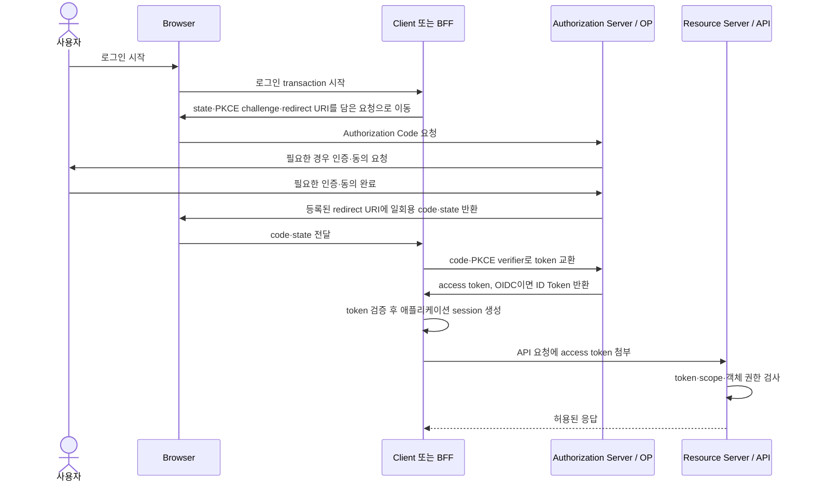

# OAuth 2.0과 OpenID Connect 로그인 보안 | OAuth and OpenID Connect security

[분야 목차](README.md) · [인증과 권한 검사](04-인증과권한검사_identity-access.md) · [기업 계정과 관리자 권한](20-기업계정과관리자권한_enterprise-identity.md) · [비밀정보 수명주기와 CI 자격 증명](28-비밀정보수명주기와CI자격증명_secrets-lifecycle.md) · [용어](용어_glossary.md) · [출처와 판본](출처_sources.md)

## OAuth는 권한 위임이고, OIDC는 로그인에 필요한 신원 정보를 더합니다

OAuth 2.0은 사용자가 허용한 범위 안에서 한 애플리케이션이 다른 API에 접근하도록 권한을 위임하는 framework입니다. OAuth 자체가 사용자의 로그인 신원을 표준화하는 프로토콜은 아닙니다. OpenID Connect(OIDC)는 OAuth 흐름에 `openid` scope와 ID Token을 더해, 인증한 사용자에 관한 신원 claim을 client에 전달합니다. “Google 계정으로 로그인”처럼 신원을 확인할 때는 OAuth만 구현했다고 설명하지 말고 실제로 OIDC를 사용하는지 확인합니다. [OAuth 2.0 Security BCP, RFC 9700](https://www.rfc-editor.org/rfc/rfc9700.html), [OpenID Connect Core 1.0](https://openid.net/specs/openid-connect-core-1_0.html)

역할을 혼동하면 token을 잘못 받아들이기 쉽습니다.

| 주체·자료 | 역할 | 검증 책임 |
| --- | --- | --- |
| 사용자 | 서비스 계정으로 로그인하고 허용할 권한을 결정합니다. | 인증 server가 로그인·동의 절차를 수행합니다. |
| OAuth client / OIDC relying party | 권한 위임을 요청하거나 ID Token을 받아 자체 session을 만듭니다. | `state`, PKCE, OIDC claim과 token 서명을 검증합니다. |
| Authorization server / OpenID Provider | 사용자를 인증하고 authorization code와 token을 발급합니다. | 등록된 client, redirect URI, 사용자 동의와 token 정책을 확인합니다. |
| Resource server / API | 보호된 자료·기능을 제공합니다. | access token의 유효성·대상·scope와 각 객체의 접근 권한을 검사합니다. |
| ID Token | OIDC client가 인증 결과와 subject를 확인하는 token입니다. | `iss`, `aud`, 서명, 만료, 요청한 경우 `nonce` 등을 검사합니다. |
| Access token | resource server에 API 접근 권한을 제시하는 자격 증명입니다. | 대상 API가 발급자와 대상, scope·권한·만료를 검증합니다. opaque token과 JWT 형식이 모두 있으므로 모양만 보고 검증법을 추측하지 않습니다. |
| Refresh token | authorization server에서 새 access token을 요청하는 장기 자격 증명입니다. | 발급자 정책에 따라 회전·sender constraint·만료·폐기를 적용합니다. |

ID Token은 사용자의 신원 claim을 client에 전달하고, access token은 API에 권한을 제시합니다. ID Token을 API 호출용 access token처럼 보내거나, access token의 문자열을 decode한 뒤 검증 없이 로그인에 쓰지 않습니다. OIDC ID Token의 `aud`에는 해당 client의 `client_id`가 포함되어야 합니다. API도 자기 API를 대상으로 발급되지 않은 token을 거부해야 합니다. [OpenID Connect Core의 ID Token 검증](https://openid.net/specs/openid-connect-core-1_0.html), [RFC 9700의 scope·audience 제한](https://www.rfc-editor.org/rfc/rfc9700.html)

## Authorization Code 흐름에서 code는 한 번 쓰고 client에 묶습니다

아래는 browser에서 code를 받아 server가 token endpoint로 교환하는 대표 흐름입니다. 세부 요청·응답은 client 유형과 provider 설정에 따라 달라집니다.

1. Client는 로그인 transaction마다 예측하기 어려운 `state`와 PKCE `code_verifier`를 만듭니다. OIDC 요청에는 transaction마다 다른 `nonce`도 사용하고 나중에 ID Token의 값과 대조합니다.
2. Client는 `code_verifier`를 직접 authorization URL에 넣지 않고 `S256`으로 변환한 `code_challenge`를 authorization server에 보냅니다.
3. Authorization server는 등록된 redirect URI와 요청한 client·scope를 확인하고 사용자 인증과 동의를 마친 뒤 authorization code를 돌려줍니다.
4. Client는 돌아온 `state`가 시작한 transaction과 일치하는지 확인합니다. Server-side confidential client는 token endpoint에 등록된 client 인증을 하고, public client는 client secret을 보안 경계로 간주하지 않습니다.
5. Client는 authorization code와 원래의 `code_verifier`를 token endpoint에 보냅니다. Server는 verifier에서 challenge를 계산해 처음 요청에 묶인 값과 비교하고, 성공한 code는 재사용할 수 없도록 처리합니다.
6. OIDC라면 client는 ID Token의 서명, 정확한 issuer, `aud`, `exp`와 요청에 사용한 `nonce`를 확인합니다. 해당 client 안에서는 검증한 `(iss, sub)`를 계정 식별에 사용할 수 있습니다. `sub`가 pairwise 방식이면 같은 사람도 client별로 다른 값을 받을 수 있으므로 여러 client 사이에서 식별자가 같다고 가정하지 않고, 변경될 수 있는 email 주소만을 고유 계정 키로 삼지 않습니다.
7. API 요청에는 access token을 사용합니다. Resource server는 token 유형에 맞는 방법으로 발급자·대상·scope·만료를 검증한 뒤, [인증과 권한 검사 장](04-인증과권한검사_identity-access.md)에서 설명한 객체별 인가도 수행합니다.

### ID Token의 claim은 각각 다른 조건을 검증합니다

| Claim·검사 | 확인할 의미 | 검증 기준 |
| --- | --- | --- |
| 서명·알고리즘 | 신뢰한 OpenID Provider가 발급한 token인지 확인합니다. | 설정한 issuer의 키로 서명을 검증하고 client가 허용하는 알고리즘만 받습니다. claim을 decode하는 것만으로 서명이 확인되지는 않습니다. |
| `iss` | token을 발급한 provider입니다. | discovery metadata에서 신뢰한 issuer와 정확히 일치해야 합니다. |
| `sub` | 해당 issuer가 부여한 사용자 subject입니다. | 해당 client에서 `(iss, sub)`로 연결합니다. pairwise subject는 client 간 동일하지 않을 수 있습니다. |
| `aud` | ID Token을 사용할 수 있는 client입니다. | 값에 이 client의 `client_id`가 포함되어야 합니다. 여러 audience가 있으면 OIDC 규칙에 따라 `azp`도 확인합니다. |
| `exp` | token 만료 시각입니다. | 현재 시각이 만료 시각 이전인지 확인하고, 시계 오차는 필요한 최소 범위만 허용합니다. |
| `iat`·`auth_time` | token 발급 시각과 사용자가 인증한 시각입니다. | `max_age`를 요청했다면 `auth_time`이 요구한 최근 인증 조건을 만족하는지 확인합니다. |
| `nonce` | 이 인증 요청에 발급된 응답인지 확인합니다. | 요청에 nonce를 보냈다면 ID Token claim이 같은 transaction 값과 정확히 일치해야 합니다. |

이 검증은 신뢰된 issuer 설정과 유지관리 중인 OIDC library를 사용해 수행합니다. 서명 검증이 성공해도 애플리케이션의 객체 권한, 계정 연결 정책, 업무 역할 확인은 별도로 필요합니다. [OpenID Connect Core의 ID Token validation](https://openid.net/specs/openid-connect-core-1_0.html)

Client가 여러 authorization server와 연결된다면 각 transaction에 기대한 issuer를 묶고 응답이 그 issuer에서 왔는지 검증합니다. OAuth Security BCP는 authorization response의 issuer 식별자를 확인하는 방식을 권고하며, 대안으로 provider별로 구별되는 redirect URI를 사용할 수 있다고 설명합니다. Provider 선택이나 token endpoint 주소를 callback query 값만으로 정하지 않습니다. 이 검사가 없으면 client가 A server에서 받은 code를 B server의 token endpoint에 보내는 mix-up attack이 생길 수 있습니다. [RFC 9700의 mix-up 방어](https://www.rfc-editor.org/rfc/rfc9700.html), [RFC 9207의 `iss` 응답 parameter](https://www.rfc-editor.org/rfc/rfc9207.html)

PKCE는 모바일·브라우저처럼 client에 안전한 비밀을 둘 수 없는 public client에서 필수입니다. `code_verifier`는 client가 보관하고, authorization 요청에는 `S256` challenge만 보내므로 중간에서 code만 가로챈 앱은 token 교환을 완료할 수 없습니다. Server-side confidential client에도 code injection 방어를 위해 PKCE를 적용하는 것이 권장됩니다. `plain` 방식은 verifier를 드러내므로 `S256`을 사용합니다. [RFC 7636](https://www.rfc-editor.org/rfc/rfc7636.html), [RFC 9700의 Authorization Code 권고](https://www.rfc-editor.org/rfc/rfc9700.html)

## 브라우저 구조는 token 보관 위치와 요청 경로로 비교합니다

OAuth client에 정적으로 넣은 비밀은 사용자가 받은 앱 파일에서 추출할 수 있습니다. Browser-based JavaScript 앱은 대개 public client이므로 `client_secret`을 코드·환경 변수·bundle에 넣어 confidential secret인 것처럼 사용하지 않습니다. 최근 IETF BCP는 browser 앱의 OAuth 구조를 BFF, token-mediating backend, browser-only public client로 나누어 보안과 구현 부담을 비교합니다. [RFC 10017, OAuth 2.0 for Browser-Based Applications](https://www.rfc-editor.org/rfc/rfc10017.html)

| 구조 | token 보관·API 호출 | 장점 | 주요 부담과 위험 | 선택을 검토할 때 |
| --- | --- | --- | --- | --- |
| Backend for Frontend (BFF) | BFF가 access·refresh token을 server-side session과 연결해 보관합니다. Browser는 cookie로 BFF에 요청하고 BFF가 API를 호출합니다. | token을 browser JavaScript에 직접 노출하지 않습니다. XSS가 token을 읽어 다른 곳에서 재사용하는 위험을 낮춥니다. | BFF 운영·확장·관측 비용이 생깁니다. cookie session의 CSRF 방어가 필요하고 악성 JavaScript가 사용자의 browser를 통해 요청을 보내는 client hijacking까지 막지는 못합니다. | 업무·개인정보·민감 API를 다루고 backend 운영이 가능한 경우 우선 검토합니다. |
| Token-mediating backend | Backend가 authorization code와 refresh token을 관리하지만, browser에 access token을 전달해 browser가 API를 직접 호출합니다. | 모든 API traffic을 backend가 중계하지 않아도 되고 refresh token을 browser에 보관하지 않습니다. | access token이 browser runtime에 있으므로 악성 JavaScript가 훔치거나 사용자 대신 요청을 보낼 수 있습니다. scope downscoping과 CSRF 방어도 필요합니다. | API를 직접 호출해야 하는 제약이 있고 token 노출 위험을 받아들일 수 있는 조건을 검토합니다. |
| Browser-only public client | Browser가 authorization 흐름을 수행하고 token을 보관한 뒤 API를 직접 호출합니다. | 별도 backend 없이 SPA를 구성할 수 있습니다. | 정적 client secret은 보호되지 않습니다. access token이 browser 코드·저장 위치와 XSS 위험에 노출됩니다. public client용 PKCE가 필요합니다. | 공개 데이터 또는 제한된 권한의 API 등 token이 browser에 노출되는 위협을 감당할 수 있는 경우 검토합니다. |

BFF가 항상 전체 보안을 보장하지는 않습니다. BFF session cookie에는 `Secure`, `HttpOnly`, 적절한 `SameSite` 설정을 적용하고, 상태 변경 요청의 CSRF 방어를 선택한 framework·origin 구조와 함께 점검합니다. `HttpOnly`는 JavaScript가 cookie 값을 읽지 못하게 하지만, XSS가 사용자의 browser에서 BFF 요청을 보내는 것까지 막지는 않습니다. 또한 BFF는 browser와 API 사이의 요청·응답을 관측하므로 개인정보 처리와 운영 부하도 설계에 포함합니다. [RFC 10017의 BFF 보안·운영 tradeoff](https://www.rfc-editor.org/rfc/rfc10017.html)

Native app에서는 로그인 화면을 앱 안의 WebView로 직접 띄우기보다 system browser 같은 외부 user-agent에서 authorization을 진행합니다. 그러면 앱이 provider 로그인 비밀번호와 browser cookie를 직접 읽는 경계를 줄일 수 있습니다. 앱도 public client이므로 PKCE를 적용합니다. custom URI scheme redirect는 같은 scheme을 다른 앱이 등록할 수 있어 code 가로채기 위험이 남지만, PKCE는 가로챈 code만으로 token 교환을 끝내지 못하게 합니다. [RFC 8252: OAuth 2.0 for Native Apps](https://www.rfc-editor.org/rfc/rfc8252.html)

## 자주 발생하는 실수는 transaction 경계를 무너뜨립니다

| 잘못된 설정·구현 | 발생 가능한 문제 | 방어 기준 |
| --- | --- | --- |
| redirect URI를 `*.example.com`처럼 넓게 등록하거나 query의 `next` 값을 그대로 redirect합니다. | code·token이 공격자 도메인으로 전달될 수 있습니다. | native app loopback의 가변 port 예외를 제외하고 사전 등록 URI와 정확히 일치시키며 open redirect를 제거합니다. |
| authorization code flow에 PKCE가 없거나 항상 같은 verifier를 씁니다. | 탈취·주입된 code를 다른 client transaction에서 교환할 수 있습니다. | transaction마다 고유한 고엔트로피 verifier를 만들고 `S256`을 강제합니다. |
| callback에서 `state`를 비교하지 않거나 재사용 가능한 값을 둡니다. | 공격자가 만든 authorization response가 피해자 session에 연결될 수 있습니다. | state를 시작 transaction 및 browser session에 안전하게 묶고 한 번 사용한 뒤 폐기합니다. 선택한 protocol profile이 PKCE 기반 CSRF 방어를 지원하는지 확인합니다. |
| OIDC에서 ID Token을 decode만 하거나 `aud`·`iss`·서명을 확인하지 않습니다. | 다른 client나 provider에 발급된 token, 위조·만료된 token을 로그인으로 받아들일 수 있습니다. | 검증된 OIDC library와 provider metadata/JWKS를 사용해 서명과 허용 알고리즘, issuer, audience, 만료, nonce를 확인합니다. |
| access token을 query string, browser history, referer, 로그에 기록합니다. | URL·proxy·분석 도구·log 접근자가 bearer token을 얻을 수 있습니다. | access token을 URI query에 넣지 말고 authorization code 흐름을 사용하며, URL·오류·telemetry에서 민감 값을 제거합니다. |
| access token을 API 대상·scope 제한 없이 여러 resource server에 받습니다. | 한 API에서 유출된 token이 다른 API에도 통할 수 있습니다. | 최소 scope와 명확한 resource audience를 사용하고 API가 자기 대상 token만 허용합니다. |
| 공개 client refresh token을 회전·sender constraint 없이 오래 유지합니다. | 탈취된 refresh token을 반복 사용해 접근을 이어갈 수 있습니다. | authorization server가 refresh-token rotation 또는 sender-constrained token을 지원하는지 확인하고 만료·재사용 탐지·폐기를 설정합니다. |
| 앱 로그아웃을 provider 로그아웃·grant 폐기와 같은 일로 취급합니다. | 로컬 화면을 나가도 다른 session이나 발급된 refresh token이 계속 유효할 수 있습니다. | 로컬 session 만료, provider SSO logout, OAuth grant/token revoke의 범위와 동작을 각각 문서화합니다. |

OAuth 2.0 Security BCP는 redirect URI의 정확한 비교, open redirect 금지, CSRF 방어, public client PKCE, implicit grant 지양, password grant 금지, token 최소 권한과 audience 제한을 권고합니다. `implicit` grant에는 SHOULD NOT, resource owner password grant에는 MUST NOT이라는 서로 다른 규범어를 사용합니다. 기존 제품이 다른 동작을 요구하면 표준 권고를 우회하기 전에 provider·client 유형과 상호운용성 조건을 확인합니다. [RFC 9700](https://www.rfc-editor.org/rfc/rfc9700.html)

## 발급·저장·폐기까지 하나의 인증 생명주기로 봅니다

| 단계 | Client·서비스에서 확인할 내용 |
| --- | --- |
| 등록 | redirect URI, 허용 grant, client 유형, 발급자, scope와 연락 담당자를 기록합니다. |
| 요청 | TLS, `state`, PKCE `S256`, OIDC의 `nonce`, provider 선택과 사용자 동의를 적용합니다. |
| callback | 등록 URI에만 응답하고 code·state를 transaction과 맞춰 검증합니다. URL·referer·로그에 code가 남지 않도록 합니다. |
| token 검증 | ID Token과 access token을 혼동하지 않고 발급자·대상·용도·만료·scope를 알맞은 구성요소에서 확인합니다. |
| session·API | 서버 session과 cookie를 안전하게 다루고, API에서 매 요청의 token 및 객체 권한을 확인합니다. |
| 갱신·회수 | refresh token의 회전·재사용 탐지·만료, provider grant/token 취소, 서비스 session 무효화를 각각 확인합니다. |
| 사고 대응 | 유출된 token·client credential·provider signing key를 구분하고, 영향 범위에 맞춰 revoke·회전·session 폐기를 시행합니다. |

Access token은 대개 bearer credential입니다. 이를 가진 주체가 사용할 수 있으므로 짧은 수명만으로 유출 피해가 사라지지 않습니다. 민감 API에서는 audience와 scope를 줄이고 필요에 따라 sender-constrained token을 검토합니다. DPoP나 mutual TLS는 client와 resource server가 지원하고 키를 안전하게 다뤄야 효과가 있으므로 설정 여부만으로 재사용 방지가 완성되었다고 보지 않습니다. [RFC 9700의 token replay 방어](https://www.rfc-editor.org/rfc/rfc9700.html)

OAuth token revocation endpoint는 client가 refresh token이나 access token의 폐기를 authorization server에 요청하는 표준 방법입니다. 지원 정책과 관련 token·grant의 연쇄 폐기는 provider별 동작도 확인해야 합니다. 로컬 서비스 session은 별도로 만료·폐기해야 하므로, 사용자의 앱 로그아웃이 provider SSO session 종료나 모든 token 폐기를 자동으로 뜻하지 않습니다. [RFC 7009: OAuth 2.0 Token Revocation](https://www.rfc-editor.org/rfc/rfc7009.html)

## 출처와 적용 범위

- [RFC 9700: Best Current Practice for OAuth 2.0 Security](https://www.rfc-editor.org/rfc/rfc9700.html): 현재 OAuth 보안 best practice와 공격 유형·완화 조치를 확인했습니다. RFC의 대문자 규범어 MUST·SHOULD 의미를 임의로 바꾸지 않았습니다.
- [RFC 6749: The OAuth 2.0 Authorization Framework](https://www.rfc-editor.org/rfc/rfc6749.html): authorization code, client 유형, endpoint와 기본 token 역할을 확인했습니다.
- [RFC 7636: Proof Key for Code Exchange by OAuth Public Clients](https://www.rfc-editor.org/rfc/rfc7636.html): `code_verifier`, `code_challenge`, `S256`와 token endpoint 검증 흐름을 확인했습니다.
- [OpenID Connect Core 1.0](https://openid.net/specs/openid-connect-core-1_0.html): ID Token의 `iss`, `sub`, `aud`, `exp`, `nonce`와 client 검증을 확인했습니다.
- [RFC 10017: OAuth 2.0 for Browser-Based Applications](https://www.rfc-editor.org/rfc/rfc10017.html): 2026년 8월 발행된 IETF BCP의 browser-only, token-mediating backend, BFF 비교와 token 저장 위험을 확인했습니다.
- [RFC 8252: OAuth 2.0 for Native Apps](https://www.rfc-editor.org/rfc/rfc8252.html): 모바일 앱에서 외부 user-agent와 authorization code + PKCE를 사용하는 기준을 확인했습니다.
- [RFC 7009: OAuth 2.0 Token Revocation](https://www.rfc-editor.org/rfc/rfc7009.html): refresh token·access token 폐기 요청과 발급자의 연관 token 처리 가능성을 확인했습니다.
- [RFC 9207: OAuth 2.0 Authorization Server Issuer Identification](https://www.rfc-editor.org/rfc/rfc9207.html): 응답 `iss`와 등록된 issuer를 비교해 multi-provider mix-up을 막는 기준을 확인했습니다.
- [OWASP OAuth 2.0 Cheat Sheet](https://cheatsheetseries.owasp.org/cheatsheets/OAuth2_Cheat_Sheet.html): 구현 점검 관점에서 PKCE·state·issuer와 운영상 주의점을 대조했습니다.

이 글은 protocol 흐름과 설계 선택을 설명하며 특정 provider의 설정값·SDK 사용법·운영 환경을 대신하지 않습니다. JWT 서명 검증, key rotation, state 저장소와 cookie 설정은 검토한 표준을 지원하는 유지관리 중인 library를 사용하고, 실제 provider의 discovery metadata·지원 claim·token 정책에 맞춰야 합니다.

## English

OAuth 2.0 delegates access to APIs; OpenID Connect adds an identity layer for login. Use Authorization Code with PKCE, exact redirect URI matching, transaction-bound CSRF protection, and strict token validation. Keep ID Tokens, access tokens, and refresh tokens separate. For browser applications, compare a BFF, token-mediating backend, and public browser client by token exposure, operational cost, and CSRF/XSS risk. This chapter explains protocol design and does not replace provider-specific configuration or a maintained protocol library.
