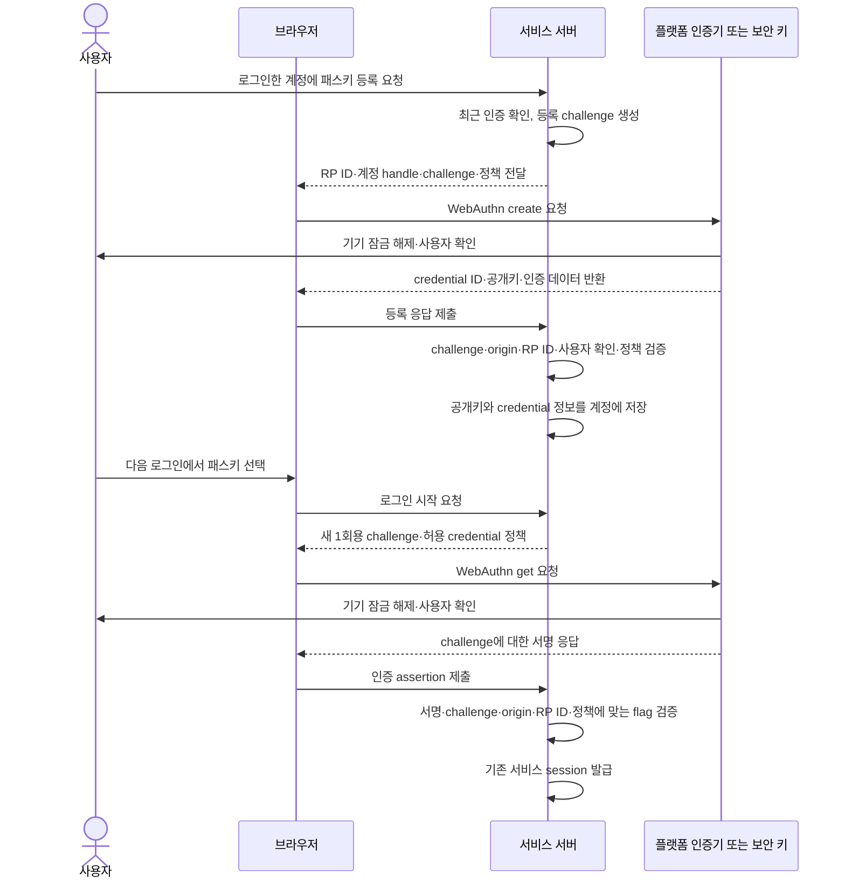

# 패스키와 WebAuthn 인증 | Passkeys and WebAuthn

[분야 목차](README.md) · [인증과 권한 검사](04-인증과권한검사_identity-access.md) · [OAuth와 OpenID Connect](30-OAuth와OpenIDConnect인증_oauth-oidc-security.md) · [용어](용어_glossary.md) · [출처와 판본](출처_sources.md)

## 패스키는 비밀번호 대신 공개키로 서비스에 로그인합니다

비밀번호 방식에서는 서비스가 보관한 검증값과 사용자가 입력한 비밀번호를 대조합니다. 패스키에서는 인증기 쪽에 개인키가 남고, 서비스는 등록 과정에서 받은 공개키를 보관합니다. 로그인할 때 서버가 만든 새 challenge에 대해 인증기가 서명하면 서버가 공개키로 확인합니다. 로그인 비밀을 사이트에 입력하거나 전송하지 않으므로 가짜 사이트가 비밀번호나 일회용 코드를 받아 중계하는 피싱 경로를 줄입니다.

FIDO Alliance는 passkey를 discoverable FIDO credential을 가리키는 사용자 친화적 표현으로 씁니다. WebAuthn은 브라우저와 인증기, relying party 사이의 공개키 인증 API와 protocol을 정의하며 passkey만을 뜻하지는 않습니다. WebAuthn 자격 증명에는 사용자 이름을 미리 입력하지 않아도 인증기를 통해 계정을 찾을 수 있는 discoverable credential과, 사용자 이름이나 계정 정보를 먼저 받아 해당 credential을 찾는 방식이 있습니다. [FIDO Alliance의 passkey 사용자 지침](https://fidoalliance.org/wp-content/uploads/2023/05/FIDO-Alliance-UX-Guidelines-for-Passkey-Creation-and-Sign-ins.pdf), [W3C WebAuthn Level 3](https://www.w3.org/TR/webauthn-3/)

공개키는 잠금장치의 자물쇠처럼 서버에 두고, 개인키는 열쇠처럼 인증기에서 서명에 사용합니다. 공개키를 알아도 개인키를 계산해 로그인 응답을 만들 수는 없습니다. 실제 보안은 공개키 암호만으로 완성되지 않습니다. 서버가 신선한 challenge, 예상한 사이트 origin, RP ID, 사용자 동작, 서명을 모두 확인하고 등록·복구 경로도 보호해야 합니다.

## 등록과 로그인을 서로 다른 ceremony로 검증합니다

`ceremony`는 WebAuthn 등록이나 인증에 필요한 한 번의 challenge-response 절차입니다. 브라우저가 기기에서 성공 응답을 받았다는 사실만으로 서버 로그인을 허용하지 않습니다. 서버는 자신이 시작한 transaction의 기대값과 응답의 서명·사이트 정보를 대조합니다.

### 등록: 공개키를 계정에 안전하게 묶습니다

1. 사용자가 이미 로그인한 상태에서 새 credential을 요청합니다. 계정에 패스키를 추가하는 작업은 계정 탈취에 바로 쓰일 수 있으므로 최근의 강한 인증이나 기존 인증기의 재확인을 요구하는 것이 좋습니다.
2. 서버는 암호학적으로 안전한 난수로 challenge를 만들고, account session과 연결해 짧은 시간 동안 한 번만 사용할 수 있게 저장합니다. W3C는 challenge에 최소 16바이트의 난수를 권고합니다.
3. 서버가 RP ID, 불투명한 사용자 handle, 허용 알고리즘, 사용자 확인 정책과 challenge를 browser에 전달합니다. 사용자 handle에는 이메일·로그인 ID처럼 개인을 직접 식별할 정보를 넣지 않습니다.
4. Browser는 WebAuthn `create()` 절차를 요청하고 운영체제나 보안 키가 공개키 credential을 생성합니다. 사용자가 생체 정보로 확인하더라도 일반적인 WebAuthn 인증 과정은 그 생체 특징값을 relying party에 전달하지 않습니다. 인증기 내부에서 기기 잠금 해제나 사용자 확인에 쓰입니다.
5. 서버는 응답 유형이 등록인지, challenge가 해당 session에서 시작했고 만료·재사용되지 않았는지, origin이 허용 목록과 일치하는지 확인합니다. 이어 RP ID hash와 응답 형식, 공개키 자료, 사용자 존재·필요한 경우 사용자 확인 flag, 등록 정책을 검증합니다.
6. 검증이 끝나면 credential ID, 공개키, 알고리즘, 계정 연결 정보, 필요한 credential metadata를 저장합니다. 개인키는 등록 응답으로 서버에 전달되지 않습니다. 동기화형 passkey라면 플랫폼의 credential provider가 암호화된 credential을 다른 기기에 제공할 수 있으므로, “개인키가 서비스로 전송되지 않는다”는 말이 “어떤 외부 동기화 경로도 없다”는 뜻은 아닙니다.

### 로그인: 서버 challenge에 대한 서명을 확인합니다

1. 서버가 새로운 challenge를 발행해 브라우저 session 또는 진행 중인 login transaction에 묶습니다. 기존 요청의 challenge를 재사용하지 않습니다.
2. 사용자가 계정을 먼저 선택했다면 서버는 그 계정의 허용 credential 목록을 보낼 수 있습니다. 계정을 먼저 요구하지 않는 흐름에서는 discoverable credential을 이용해 인증기가 사용자 handle과 credential을 선택할 수 있습니다.
3. 인증기는 새 challenge와 RP ID에 대해 서명 응답을 만듭니다. WebAuthn assertion의 서명 대상은 개념적으로 `authenticatorData || SHA-256(clientDataJSON)`입니다.
4. 서버는 credential ID에 연결해 보관한 공개키로 서명을 검증합니다. 더불어 client data의 `type`과 challenge, 허용 origin, authenticator data의 RP ID hash, 선택한 ceremony 방식에 맞는 UP 처리와 정책상 필요한 UV를 검사합니다.
5. 모든 검증이 성공하면 challenge를 소비하고 서비스 session을 만듭니다. 이후 접근할 수 있는 자료와 기능은 로그인 여부와 별도로 객체·작업별 인가를 계속 확인합니다. [W3C WebAuthn RP 검증 절차](https://www.w3.org/TR/webauthn-3/)

| 값 또는 flag | 의미 | 서버 정책에서 확인할 점 |
| --- | --- | --- |
| `challenge` | 서버가 만든 일회용 신선도 값입니다. | 시작 transaction의 값과 정확히 맞고, 만료 전이며, 이미 사용하지 않았는지 확인합니다. |
| `origin` | credential 응답을 만든 웹 문서의 출처입니다. | HTTPS scheme, host, port가 포함된 허용 origin인지 검사합니다. 넓은 와일드카드나 신뢰하지 않는 하위 도메인을 통째로 허용하지 않습니다. |
| RP ID와 `rpIdHash` | credential을 사용할 서비스 도메인 경계입니다. | 응답의 RP ID hash가 서버가 설정한 RP ID와 일치해야 합니다. |
| UP / User Present | 사용자가 인증기에 참여했다는 표시입니다. | 정책상 사용자 동작이 필요한 흐름인지 검사합니다. |
| UV / User Verified | 인증기가 로컬 PIN·생체 확인 등으로 사용자를 확인했다는 표시입니다. | 업무의 보증 수준이 요구하면 UV를 요청하고 응답 flag도 확인합니다. UP와 UV는 서로 다른 조건입니다. |
| `signCount` | 일부 인증기가 credential 사용 때 증가시키는 서명 횟수입니다. | 복제 징후를 보조하는 신호입니다. 값이 0이거나 증가하지 않았다는 이유만으로 복제를 확정하지 않습니다. |
| BE / BS | credential의 백업 가능 여부와 현재 백업 상태입니다. | 동기화형과 기기 고정형의 운영 정책에 필요할 때만 해석합니다. 제품명이나 사용자 화면만으로 상태를 추정하지 않습니다. |

`navigator.credentials.get()`의 명시적 로그인과 discoverable credential을 자동 완성 UI에 연결하는 conditional mediation은 사용자 흐름이 다를 수 있습니다. WebAuthn은 conditional mediation에서는 UP flag 처리 규칙이 달라지므로, 서버가 UP를 모든 응답에서 무조건 필수로 하드코딩하지 말고 요청한 ceremony와 유지관리 중인 library의 검증 규칙을 함께 확인합니다. [W3C WebAuthn의 assertion 검증 절차](https://www.w3.org/TR/webauthn-3/)

## 사용자 확인과 두 번째 요소는 같은 말이 아닙니다

UP는 사용자가 인증기에 참여했는지, UV는 기기에서 PIN·생체 확인 등 사용자 확인을 했는지를 나타냅니다. 보안 키를 터치하는 동작은 사용자 참여를 보여줄 수 있지만, 그 자체가 특정 사람을 확인했다는 뜻은 아닙니다. 반대로 지문이나 얼굴 특징값은 기기 내부의 사용자 확인에 쓰일 수 있으며 relying party가 생체 원본을 받는 인증 방식과는 다릅니다. [W3C의 user presence·user verification 정의](https://www.w3.org/TR/webauthn-3/)

패스키라는 제품 표기만으로 계정 인증의 보증 수준을 판단하지 않습니다. 동작 정책이 사용자 확인을 요구하는지, 인증기 응답에서 UV를 검증하는지, 서비스가 계정 등록·복구·세션까지 같은 위협 수준으로 다루는지 확인해야 합니다. NIST SP 800-63B-4는 syncable authenticator가 AAL2의 여러 요구를 만족할 수 있는 방법을 설명하지만, 모든 패스키가 조건 없이 같은 보증 수준을 갖는다고 말하지 않습니다. 기관은 사용 사례와 위험, 인증기 특성에 맞춰 정책을 정해야 합니다. [NIST SP 800-63B-4의 syncable authenticator 절](https://pages.nist.gov/800-63-4/sp800-63b/syncable/)

## 동기화형과 기기 고정형은 편의와 관리 경계가 다릅니다

기기 고정형 credential은 등록한 보안 키나 플랫폼 장치에 묶여 있어 장치를 잃으면 다른 등록 수단이나 복구 절차가 필요합니다. 동기화형 credential은 passkey provider가 계정에 연결된 기기 사이에서 자격 증명을 복원·사용하도록 지원합니다. 기기를 바꾸거나 잃었을 때 계정 복구가 쉬워지는 대신 동기화 provider 계정과 그 복구 경로가 중요한 보안 경계에 들어옵니다.

WebAuthn Level 3는 backup eligibility(BE)와 backup state(BS)를 별도 flag로 정의합니다. BE는 해당 credential이 다른 기기에서 복원될 수 있도록 만들어졌는지를 나타내며 credential의 속성으로 유지됩니다. BS는 현재 backup 상태라 시간이 지나며 변할 수 있습니다. “동기화할 수 있음”과 “이미 동기화됨”을 구별할 수 있으므로, 둘을 한 상태로 처리하지 않습니다. [W3C의 credential backup state](https://www.w3.org/TR/webauthn-3/), [NIST의 syncable authenticator 요구](https://pages.nist.gov/800-63-4/sp800-63b/syncable/)

| 사용 상황 | 주로 검토할 방식 | 운영 설계 |
| --- | --- | --- |
| 일반 소비자 서비스에서 기기 교체와 분실 복구를 쉽게 제공해야 합니다. | 동기화형 passkey를 선택지로 제공합니다. | provider 계정 복구 보호, passkey 관리 화면, 인증기 추가·삭제 알림, 별도의 안전한 계정 복구를 설계합니다. |
| 관리자·개발·민감 자료 접근을 조직 통제 기기에 제한해야 합니다. | 관리되는 기기 고정형 credential이나 조직 인증기를 검토합니다. | 기기 등록·폐기, 분실 대응, 사용자의 대체 인증기, IdP 정책과 단말 관리 상태를 함께 운영합니다. |
| 공공 웹 서비스처럼 다양한 개인 기기를 지원해야 합니다. | 공개 사용자가 이용할 수 있는 동기화형 방식을 포함해 선택권을 검토합니다. | 소비자 인증기에서 제공되지 않을 수 있는 attestation을 무조건 요구해 더 약한 로그인 수단으로 사용자가 밀려나지 않는지 확인합니다. |
| 장치를 잃어도 업무를 계속해야 합니다. | 사전에 두 번째 passkey 또는 승인된 복구 인증기를 등록하게 합니다. | 주 인증보다 훨씬 약한 SMS·고객센터 절차가 전체 계정 보호를 무너뜨리지 않는지 점검합니다. |

동기화형 passkey가 실제로 동기화됐는지, 어느 기기에 복사됐는지는 서비스가 모두 관찰할 수 있는 정보가 아닐 수 있습니다. 관리 정책은 이용 가능한 BE/BS와 인증기 정보를 실제 지원 범위 안에서 해석해야 합니다. 서비스가 확인하지 못하는 기기 정보나 provider 내부 보안 수준을 확인한 것처럼 표시하지 않습니다.

## 서명 횟수와 attestation을 과도하게 해석하지 않습니다

`signCount`는 일부 인증기에서 assertion이 생성될 때 증가하며, 같은 credential의 복제 사용을 알아보는 보조 신호로 설계됐습니다. 하지만 어떤 인증기는 항상 0을 반환할 수 있고, 인증기 오작동이나 동시 요청의 처리 순서 때문에 이전 값보다 작거나 같아질 수도 있습니다. W3C는 불일치가 복제의 증거가 아니라 조사할 신호라고 설명합니다. 따라서 값이 단조 증가하지 않았다는 사실만으로 정상 계정을 잠그지 말고, 인증기 유형·동기화 상태·이상 로그인 신호와 함께 위험 기반으로 대응합니다. [W3C WebAuthn signature counter 고려사항](https://www.w3.org/TR/webauthn-3/)

Attestation은 등록에 사용한 인증기의 종류나 특성을 확인하는 데 도움이 될 수 있습니다. 조직이 관리하는 특정 하드웨어만 허용해야 하는 상황에서는 신뢰 모델과 공급자 지원을 확인해 사용할 수 있습니다. 반면 공개 서비스를 대상으로 소비자 인증기의 제조사 attestation을 일괄 요구하면 제공되지 않는 인증기가 배제될 수 있습니다. NIST는 broad public-facing 서비스에서 attestation이 없다는 이유만으로 동기화형 인증기를 막지 않도록 설명합니다. 수집하는 attestation 정보의 개인정보 영향과 필요한 운영 목적을 함께 정합니다. [NIST syncable authenticator guidance](https://pages.nist.gov/800-63-4/sp800-63b/syncable/)

## 구현 오류는 암호 연산보다 경계 검증에서 자주 생깁니다

| 잘못된 처리 | 결과 | 바로잡을 기준 |
| --- | --- | --- |
| Browser가 보낸 challenge를 서버가 그대로 기대값으로 삼습니다. | 공격자가 직접 만든 응답과 원래 인증 transaction을 구별하지 못합니다. | 서버에서 challenge를 만들고 session에 묶은 뒤 응답값과 대조하고 한 번 사용하면 폐기합니다. |
| `origin` 검증을 생략하거나 `*.example.com`을 허용합니다. | 공격자가 통제하는 하위 도메인이나 다른 출처에서 만든 응답이 수용될 수 있습니다. | scheme·host·port를 포함해 서비스가 실제 운영하는 origin 목록과 대조합니다. |
| RP ID의 범위를 서비스 전체에 무심코 넓힙니다. | 여러 하위 도메인에서 같은 credential을 사용할 수 있어 하위 도메인 침해가 인증 경계에 영향을 줄 수 있습니다. | 필요한 최소 RP ID를 선택하고 하위 도메인의 소유권·배포·사용자 입력면을 검토합니다. |
| challenge의 유형·계정·브라우저 session을 확인하지 않습니다. | 등록 응답과 로그인 응답을 혼동하거나 계정 간 응답을 바꿔 끼울 수 있습니다. | `webauthn.create`와 `webauthn.get`, server-side transaction·사용자 연결을 검증합니다. |
| 요청에서 `userVerification: "required"`를 보냈지만 응답 UV flag를 확인하지 않습니다. | 사용자 확인을 요구했다고 생각하지만 실제 서버 정책은 확인되지 않습니다. | 라이브러리 검증 결과와 정책상 필요한 UV flag를 모두 확인합니다. |
| 본인 확인 없이 새 패스키를 계정에 연결합니다. | 공격자가 탈취한 기존 session으로 지속적으로 쓸 새 인증기를 추가할 수 있습니다. | 최근 강한 재인증, 계정 소유자 알림, 등록된 인증기 목록과 폐기 기능을 제공합니다. |
| 등록 credential의 `user.id`에 이메일 주소를 그대로 넣습니다. | 사용자 handle이 노출되거나 다른 문맥에서 식별에 쓰일 수 있습니다. | RP별 불투명한 무작위 식별자를 사용합니다. |
| 0 또는 비증가 `signCount`를 복제 확정으로 처리합니다. | 정상 인증기·동기화·동시 요청을 오탐으로 차단할 수 있습니다. | counter를 보조 신호로 사용하고 위험도와 운영 맥락에 따라 재인증·조사합니다. |
| attestation을 공개 서비스의 필수 조건으로 지정합니다. | 지원하지 않는 기기를 막아 사용자가 피싱 가능한 대체 인증으로 이동할 수 있습니다. | 제조사 식별이 실제 요구인지 검토하고, 공공 사용자에게는 지원 가능성과 개인정보 영향을 비교합니다. |
| 패스키 삭제만으로 탈취된 session이 모두 종료된다고 가정합니다. | 이미 만들어진 cookie·access token이 계속 유효할 수 있습니다. | credential 삭제와 별도로 전체 session·refresh token·복구 정보의 폐기 범위를 정의합니다. |

서버 검증은 직접 만든 CBOR·COSE parser와 임의 서명 검사 코드로 구현하지 않습니다. 유지관리 중인 WebAuthn 서버 라이브러리를 선택하고, 서비스의 RP ID·origin·challenge 저장소·UV 정책을 명시적으로 설정한 뒤 표준 test vector와 각 browser·인증기 조합으로 검증합니다. W3C 검증 순서는 서버가 확인할 입력을 정의하지만, 특정 언어 library나 서비스 운영 설정을 대신하지 않습니다.

## 운영자는 등록·사용·복구·폐기를 한 화면에서 관리합니다

계정 보안 화면에는 등록된 passkey의 표시 이름, 등록일, 마지막 사용 시각, 동기화 여부처럼 서버가 실제로 아는 상태를 보여줍니다. 사용자가 분실한 인증기를 제거할 수 있어야 하며, 등록·삭제·복구 변경은 기존 session과 연동해 감사 로그에 기록합니다. 새 credential이 추가되면 기존 연락 채널에 알림을 보내고, 관리자나 고위험 계정은 별도의 검토 흐름을 둡니다.

기기 분실 대응은 인증기만 삭제하는 작업이 아닙니다. 사용자 본인 확인, 기존 session과 refresh token 폐기, passkey provider 계정 복구, 회사 기기 원격 폐기, 대체 인증기 등록을 함께 살핍니다. 복구 담당자는 사용자의 비밀번호나 일회용 코드를 묻는 대신 승인된 신원 확인·복구 절차를 따라야 합니다. 복구가 완료되면 이전 인증기와 session이 여전히 유효한지 확인합니다.

## 점검표

- [ ] HTTPS를 사용하고 RP ID와 허용 origin을 배포 환경별로 고정했습니다.
- [ ] 등록·로그인마다 충분히 무작위인 challenge를 생성하고 session에 묶어 만료·1회 사용 처리합니다.
- [ ] challenge, `type`, origin, RP ID hash, 서명, ceremony에 맞는 UP 처리와 정책상 필요한 UV를 서버 library에서 검증합니다.
- [ ] 새 passkey 등록 전에 계정 소유자를 강하게 재확인하고 등록·삭제 알림을 보냅니다.
- [ ] credential ID와 공개키를 계정에 안전하게 저장하고 user handle에 개인 식별 정보를 넣지 않습니다.
- [ ] device-bound와 syncable 방식의 복구·관리 경계를 구분합니다.
- [ ] 사용자에게 두 번째 인증기와 승인된 복구 경로를 제공하고, 약한 복구 절차가 로그인 보안을 무력화하지 않는지 확인합니다.
- [ ] passkey 삭제·비밀번호 변경·기기 분실 때 session과 token의 폐기 범위를 점검합니다.
- [ ] `signCount`와 attestation은 그 신호가 실제로 제공하는 수준에 맞게 해석합니다.
- [ ] 등록·인증·오류·복구 흐름을 표준 호환성 도구와 실제 지원 대상 기기로 검증합니다.

## 출처와 적용 범위

- [W3C Web Authentication: An API for accessing Public Key Credentials, Level 3](https://www.w3.org/TR/webauthn-3/): 등록·인증 ceremony, challenge, origin·RP ID 검증, UP·UV, sign counter, backup flags와 개인정보 고려사항을 확인했습니다.
- [NIST SP 800-63B-4, Syncable Authenticators](https://pages.nist.gov/800-63-4/sp800-63b/syncable/): backup eligibility/state, 동기화·공유·복구 위험, attestation 사용 범위를 확인했습니다.
- [NIST SP 800-63B-4, Authenticators](https://pages.nist.gov/800-63-4/sp800-63b/authenticators/): 피싱 저항성 정의와 수동 입력 OTP의 한계를 확인했습니다.
- [FIDO Alliance, Synced Passkey Deployment: Emerging Practices for Consumer Use Cases](https://fidoalliance.org/wp-content/uploads/2024/05/Synced-Passkey-Deployment_-Emerging-Practices-for-Consumer-Use-Cases_2024-Final.pdf): 동기화형과 기기 고정형의 사용자·서비스 운영 tradeoff와 복구 고려사항을 확인했습니다.

이 글은 프로토콜 구조와 relying party의 검증·운영 요구를 설명합니다. 표준의 모든 선택지를 특정 제품에 그대로 적용해야 한다는 뜻은 아니며, 실제 구성은 서비스의 RP ID·도메인 구조·위험 수준·인증기 지원과 선택한 유지관리 라이브러리에 맞춰야 합니다. 예제 코드나 완성된 서비스 구현은 포함하지 않았습니다.

## English

Passkeys use public-key credentials to reduce phishing and credential-reuse risks. This chapter explains WebAuthn registration and authentication ceremonies, server-side validation of challenges, origins, RP IDs, signatures and user-verification flags, and the operational differences between device-bound and syncable credentials. Recovery, credential management, signature counters, attestation, and privacy are treated as part of the authentication system rather than as afterthoughts.
