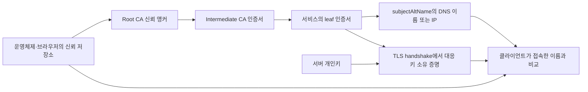

# TLS 인증서와 PKI 운영 | TLS certificates and PKI operations

[분야 목차](README.md) · [암호와 키의 신뢰](03-암호와키의신뢰_cryptography-keys.md) · [Linux와 네트워크 경계](06-Linux와네트워크경계_linux-network.md) · [패스키와 WebAuthn](31-패스키와WebAuthn인증_passkeys-webauthn.md) · [용어](용어_glossary.md) · [출처와 판본](출처_sources.md)

## 인증서는 서버가 제시한 공개키와 이름을 검증하는 자료입니다

TLS 인증서는 서버의 공개키와 서비스 이름, 발급자, 유효 기간, 허용 용도 같은 정보를 발급 CA의 전자서명으로 묶은 X.509 자료입니다. 서버는 그 공개키에 대응하는 개인키를 안전하게 보관하고 TLS handshake에서 소유 증명을 합니다. 인증서는 공개해도 되지만 개인키는 서버 밖으로 내보내거나 Git·이미지·로그에 넣지 않습니다. [TLS 1.3 handshake](https://www.rfc-editor.org/rfc/rfc8446.html)

브라우저가 인증서를 신뢰하는 것은 파일에 “안전” 표시가 있어서가 아닙니다. 신뢰 저장소에서 출발하는 발급 경로를 검증하고, 연결하려던 서비스 이름이 인증서의 이름과 맞는지 확인합니다. 검증은 TLS 연결 상대를 확인하는 일이며, 웹사이트의 사업자·콘텐츠가 안전하다거나 애플리케이션에 취약점이 없음을 보증하지 않습니다. [RFC 5280의 X.509 인증서 경로 검증](https://www.rfc-editor.org/rfc/rfc5280.html), [RFC 9525의 TLS 서비스 이름 검증](https://www.rfc-editor.org/rfc/rfc9525.html)



Root는 신뢰를 시작하는 anchor입니다. Intermediate는 Root 개인키가 자주 사용되는 일을 줄이기 위해 leaf 인증서를 발급하는 중간 CA입니다. 일반적으로 서버는 leaf와 필요한 intermediate chain을 전달하고, 브라우저는 자기 trust store에 있는 anchor까지 유효한 경로를 구성합니다. 같은 leaf도 운영체제·브라우저·애플리케이션의 trust store나 검증 정책이 다르면 결과가 달라질 수 있습니다.

## TLS 검증은 인증서 경로와 서비스 이름을 따로 확인합니다

1. TLS client가 `example.org` 같은 서비스 이름으로 접속을 시작하고, 여러 사이트를 호스팅하는 서버라면 SNI로 원하는 이름을 전달합니다.
2. 서버는 해당 서비스에 맞는 leaf 인증서와 TLS handshake 응답을 보냅니다. 인증서를 제시하는 것만으로 검증이 완료되지는 않습니다.
3. Client는 leaf에서 중간 CA를 거쳐 신뢰한 anchor까지 경로를 구성하고 서명, 유효 기간, CA 제약, key usage·extended key usage 등 적용 가능한 제약을 검증합니다.
4. Client는 접속한 reference identity를 인증서의 `subjectAltName`과 비교합니다. DNS 이름은 DNS SAN, IP 주소는 IP SAN과 맞아야 합니다. RFC 9525는 서비스 이름을 `commonName`으로 검증하는 방식을 더는 유효한 이름 표현으로 인정하지 않습니다.
5. 검증이 성공하면 TLS는 해당 연결에서 암호화·무결성과 서버 인증을 제공합니다. 이후 HTTP 로그인·API 권한·사용자별 접근 제어는 애플리케이션에서 별도로 검사합니다.

`subjectAltName`(SAN)은 인증서가 사용할 수 있는 이름을 담는 확장입니다. 예를 들어 `api.example.org`와 `login.example.org`가 같은 인증서에 들어갈 수 있습니다. 와일드카드는 RFC 9525에 따라 첫 label 전체를 대신하는 형태로만 허용됩니다. `*.example.org`는 `api.example.org`와 매칭될 수 있지만 `a.api.example.org`처럼 두 단계 하위 이름을 자동으로 덮지 않습니다. 발급 전에 실제 가상 호스트·로드 밸런서·CDN이 사용하는 이름만 요청하는 편이 키 노출의 영향 범위를 줄입니다.

인증서 경로가 유효해도, 접속한 이름과 SAN이 다르면 그 서버가 해당 서비스라고 증명되지 않습니다. 반대로 이름이 맞아도 신뢰할 수 없는 발급자, 만료·미래 시작 시각, 잘못된 용도, 중간 인증서 누락 등이 있으면 연결이 실패할 수 있습니다. “인증서가 있다”와 “이 접속에서 이 인증서가 유효하다”를 구분합니다.

## 공개 PKI와 내부 PKI는 신뢰 배포 방식이 다릅니다

공개 CA가 발급한 인터넷 TLS 서버 인증서는 브라우저·운영체제의 공개 trust program이 신뢰 anchor를 배포하는 방식으로 동작합니다. CA/Browser Forum의 Baseline Requirements는 공개 신뢰 서버 인증서를 발급·관리하는 CA의 기준이며, 자체 Root를 운영하는 기업 내부 PKI를 자동으로 규율하는 문서와는 적용 범위가 다릅니다. [CA/Browser Forum Baseline Requirements](https://cabforum.org/working-groups/server/baseline-requirements/requirements/)

내부 서비스에 private CA를 쓰려면 서버에 인증서를 설치하는 일만으로 끝나지 않습니다. 관리 대상 client에 Root 또는 필요한 trust anchor를 안전하게 배포하고, 발급 정책·기기 등록·인증서 갱신·키 침해 대응·퇴사나 장비 폐기 때의 회수를 운영해야 합니다. 신뢰 anchor를 배포하지 않은 외부 장치에는 해당 체인이 저절로 신뢰되지 않습니다.

| 환경 | 발급·신뢰 경계 | 관리자가 먼저 확인할 점 |
| --- | --- | --- |
| 공개 웹 서비스 | 공개 CA와 browser·OS의 Root 프로그램입니다. | SAN의 정확성, 전체 chain 제공, CA 정책, 공개 DNS·HTTP 도달성, 갱신 자동화입니다. |
| 조직 내부 API·기기 | 기업이 관리하는 private CA 또는 workload PKI입니다. | trust anchor 배포, 발급 대상 확인, 인증기 소유권, 종료·회수, 관리되지 않는 client와의 상호운용입니다. |
| 서비스 간 mTLS | 양쪽 서비스가 TLS client/server 인증서를 교환합니다. | 어떤 issuer와 SAN/URI identity를 허용할지, 만료·회전·폐기, 애플리케이션 권한과 서비스 identity의 매핑입니다. |

mTLS에서는 server가 client 인증서와 개인키 소유를 확인할 수 있습니다. 그 결과가 곧 사용자의 역할이나 API 권한을 뜻하지는 않습니다. 인증서의 subject나 SAN을 애플리케이션의 주체·워크로드에 안전하게 매핑하고, 각 요청에서 해당 기능을 허용할지 별도로 판단합니다. 인증서에 담긴 식별자를 검증 없이 HTTP header나 사용자 입력에서 다시 받아들이지 않습니다.

## ACME 자동 발급은 도메인 제어를 증명하고 갱신까지 이어야 합니다

ACME(RFC 8555)는 인증서 발급을 위한 자동화 protocol입니다. ACME client가 CA에 order를 만들고, CA가 제시한 challenge를 만족시켜 domain identifier를 제어한다는 사실을 증명합니다. CA가 유효하다고 판단하면 client는 발급된 certificate chain을 받아 서비스에 배포합니다. 이는 “사이트 콘텐츠를 검사해 안전성을 인증한다”는 과정이 아니라 해당 도메인을 제어할 수 있음을 검증하는 절차입니다.

| Challenge | 제어 증명 방식 | 운영 조건과 권한 경계 |
| --- | --- | --- |
| `http-01` | CA가 도메인의 TCP 80번 HTTP 경로 `/.well-known/acme-challenge/`를 요청해 응답을 확인합니다. | 외부에서 해당 이름으로 올바른 웹 서버에 도달해야 합니다. 여러 backend·proxy·CDN의 경로 전달도 맞아야 합니다. |
| `dns-01` | `_acme-challenge` 아래 TXT record로 challenge 값을 공개합니다. | wildcard 발급에도 쓸 수 있습니다. DNS provider API key가 DNS 전체 변경 권한을 갖지 않도록 zone·record 범위를 줄이고 별도 보관합니다. |
| `tls-alpn-01` | 특수 ALPN protocol로 TLS 연결을 받아 challenge 인증서를 제시합니다. | TLS listener나 load balancer가 challenge 응답을 해당 ACME client에 전달할 수 있어야 합니다. RFC 8737이 추가한 방식입니다. |

HTTP-01과 DNS-01의 세부 절차는 RFC 8555, TLS-ALPN-01은 RFC 8737에서 정의합니다. 세 방식은 도메인 제어 증명 경로와 필요한 운영 권한이 다릅니다. DNS-01 API 자격 증명을 CI의 공용 secret 하나로 넓게 두거나, 실패할 때 검증을 생략하는 방식으로 바꾸지 않습니다. [RFC 8555](https://www.rfc-editor.org/rfc/rfc8555.html), [RFC 8737](https://www.rfc-editor.org/rfc/rfc8737.html)

갱신 자동화는 인증서를 발급하는 것에서 끝나지 않습니다. 운영팀은 도메인별 서비스 owner, 인증서와 private key의 배포 위치, 갱신 client와 ACME account, challenge 권한, 교체·reload 절차를 관리합니다. 갱신이 성공한 뒤 실제 listener가 새 leaf와 full chain을 제공하는지 확인하고, 서비스 검증까지 성공했을 때만 이전 인증서를 정리합니다. 자동화 실패를 만료 직전까지 감지하지 못하지 않도록 갱신 실패와 만료 임박을 각각 감시합니다.

### 갱신 배포 점검 순서

1. `example.org`가 어떤 서비스·listener·CDN에서 사용되는지 인벤토리로 확인합니다.
2. 발급 도구가 사용하는 ACME account key와 DNS API credential을 서비스 개인키와 별도로 관리합니다.
3. 갱신 전 challenge에 필요한 DNS·HTTP·TLS 경로가 실제 외부 CA에서 확인 가능한지 살핍니다.
4. 새 certificate chain과 key가 서로 맞는지 검증하고, SAN·발급자·기간·용도를 확인합니다.
5. 새 자료를 서비스가 기대하는 경로와 권한으로 설치하고, 설정 검사 후 안전한 reload 절차를 수행합니다.
6. client 관점에서 chain·hostname 검증이 통과하는지 확인하고, 모든 frontend가 새 certificate를 제공하는지 확인합니다.
7. 실패하면 기존 유효한 certificate로 복구하고 원인을 분리해 기록합니다. 개인키 compromise라면 기존 인증서 사용 중단과 CA revocation을 별도로 요청합니다.

## 폐기와 Certificate Transparency는 다른 문제를 다룹니다

인증서가 유출되거나 이름·소유 정보가 잘못되면 CA에 폐기를 요청하고, 서버에서 그 인증서와 대응 키를 더는 제공하지 않도록 교체합니다. 인증서 폐기는 서비스의 기존 session, access token, mTLS 인증서 복제본을 자동으로 제거하지 않습니다. 키 유출 사고라면 새 키 쌍 생성, 새 인증서 발급, 모든 배포 지점 교체, 기존 인증서 폐기, 연동 session·자격 증명 점검을 함께 수행합니다.

CRL은 CA가 폐기된 인증서 목록을 배포하는 방식이고, OCSP는 특정 인증서 상태를 묻는 protocol입니다. Client와 TLS stack마다 상태를 조회하고 응답이 없거나 불확실할 때 처리하는 방식이 다를 수 있으므로, “CA에서 revoked 상태로 바뀌면 전 세계 client가 즉시 차단한다”고 가정하지 않습니다. 중요 내부 서비스는 검사 실패·미확인 응답·통신 불가를 어떤 정책으로 취급할지 client와 서비스 별로 정하고 검증합니다. [RFC 5280 CRL profile](https://www.rfc-editor.org/rfc/rfc5280.html), [RFC 6960 OCSP](https://www.rfc-editor.org/rfc/rfc6960.html)

Certificate Transparency(CT)는 공개 TLS 인증서나 precertificate가 append-only log에 기록됐는지 감시해 잘못 발급된 인증서를 발견하도록 돕습니다. 로그가 misissuance 자체를 방지하거나 자동 폐기하지는 않습니다. 도메인 owner가 소유 도메인의 신규 인증서를 감시하고, 예상하지 못한 발급을 발견하면 CA에 문의하고 영향 범위를 조사해야 합니다. 이 글에서 언급한 RFC 9162는 CT 2.0을 정의하는 IETF Experimental RFC이므로 이를 모든 browser의 현재 CT 구현과 동일하다고 설명하지 않습니다. [RFC 9162: Certificate Transparency Version 2.0](https://www.rfc-editor.org/rfc/rfc9162.html)

## 인증서 진단 명령으로 이름·기간·제공 chain을 확인합니다

아래 명령은 공개 서비스의 TLS 응답이나 가지고 있는 인증서 파일을 읽어 확인하는 예입니다. 접속 대상은 본인이 관리하거나 점검 허가를 받은 서비스로 지정합니다. OpenSSL의 `s_client`는 진단 도구이며, 검증 오류가 나도 기본 동작은 handshake를 이어갈 수 있어 `-verify_return_error`를 포함했습니다. `-showcerts`가 출력하는 것은 서버가 보낸 목록이지 검증이 끝난 인증 경로 자체는 아닙니다. [OpenSSL `s_client` 문서](https://docs.openssl.org/master/man1/openssl-s_client/)

```bash
openssl s_client -connect example.org:443 -servername example.org -verify_hostname example.org -verify_return_error -showcerts
```

| 옵션 | 확인할 내용 |
| --- | --- |
| `-connect` | 접속할 DNS 이름과 TCP port입니다. |
| `-servername` | TLS SNI로 서버에 전달할 DNS 이름입니다. 이름 기반 virtual host에서 올바른 certificate를 고르게 합니다. |
| `-verify_hostname` | 받은 서버 certificate가 지정한 DNS 이름에 유효한지 확인합니다. |
| `-verify_return_error` | chain 검증 오류가 있으면 진행을 중단하도록 합니다. |
| `-showcerts` | server가 보낸 인증서 목록을 표시합니다. 이것만으로 경로 검증이 성공한 것은 아닙니다. |

인증서 파일 자체의 subject, issuer, 시작·만료 일자, SAN을 읽을 때는 다음을 사용합니다. 이 명령은 서명이나 경로 검증이 아니라 파일의 필드를 출력합니다. [OpenSSL `x509` 문서](https://docs.openssl.org/master/man1/openssl-x509/)

```bash
openssl x509 -in leaf.pem -noout -subject -issuer -dates -ext subjectAltName
```

신뢰할 수 있는 Root bundle과 intermediate chain 파일이 이미 있다면 `openssl verify`로 hostname·용도·경로를 확인할 수 있습니다. Root 파일은 같은 server 응답에서 받아 신뢰하는 파일로 바꾸지 말고, 해당 실행 환경이 사전에 신뢰한 CA bundle을 지정합니다. [OpenSSL `verify` 문서](https://docs.openssl.org/master/man1/openssl-verify/)

```bash
openssl verify -CAfile trusted-roots.pem -untrusted intermediates.pem -purpose sslserver -verify_hostname example.org leaf.pem
```

이 명령들은 특정 OS나 browser의 신뢰 저장소와 항상 같은 결과를 내는 것은 아닙니다. 서로 다른 결과가 나면 OpenSSL의 CA bundle, server가 보낸 chain, 인증서 이름, 시스템 시간, browser·OS trust program을 각각 분리해 비교합니다. 인증 검증을 우회하는 `-k`나 검증 비활성화 옵션을 고치는 방법으로 쓰지 않습니다.

## 장애 유형을 발급·배포·검증 경계로 나눕니다

| 관측된 오류 | 흔한 원인 | 확인과 복구 |
| --- | --- | --- |
| 만료·아직 유효하지 않음 | 자동 갱신 실패, 서버 시간 오류, 갱신 후 listener reload 누락입니다. | 서버 시간과 인증서 기간을 확인하고, 새 chain 발급·배포·reload·외부 재검증을 순서대로 합니다. |
| 이름 불일치 | SAN에 빠진 이름, SNI와 virtual host의 연결 오류, IP로 접속하지만 IP SAN이 없습니다. | client가 실제 사용한 DNS·IP identity와 SAN을 비교하고 필요 이름만 포함한 인증서를 다시 발급합니다. |
| 발급자를 신뢰할 수 없음 | 사설 CA root가 배포되지 않았거나 intermediate chain이 누락·오배포되었습니다. | 해당 client가 사용할 신뢰 anchor를 확인하고 서버가 올바른 intermediate를 보내는지 검증합니다. 공개 CA trust를 요구하는 환경에 임의 root를 설치하지 않습니다. |
| ACME HTTP-01 실패 | 80번 port가 막힘, proxy가 challenge 경로를 바꿈, 여러 frontend 중 일부가 응답하지 않습니다. | CA가 조회하는 DNS 이름·주소·경로와 해당 listener의 challenge 전달을 확인합니다. |
| DNS-01 실패 | TXT record 값 누락, propagation 지연, 오래된 값·잘못된 zone, API 권한 오류입니다. | authoritative DNS에서 `_acme-challenge` 값을 조회하고 정리 자동화와 zone scope를 확인합니다. |
| 인증서 폐기 뒤에도 연결됨 | client가 폐기 상태를 확인하지 않거나 기존 session·token이 계속 살아 있습니다. | 사용하는 TLS stack의 revocation 정책과 cache를 확인하고 session·token·mTLS 자격 증명은 별도 폐기합니다. |
| 인증서 진단 성공, 애플리케이션 접근도 허용됨 | TLS 인증을 사용자 권한으로 잘못 취급합니다. | TLS 인증서에 연결된 서비스 주체를 확인하고 HTTP/API 계층에서 작업별 인가를 추가합니다. |

## 출처와 판본

- [RFC 5280: Internet X.509 Public Key Infrastructure Certificate and CRL Profile](https://www.rfc-editor.org/rfc/rfc5280.html): X.509 certificate profile·확장·CRL·certificate path validation을 확인했습니다.
- [RFC 9525: Service Identity in TLS](https://www.rfc-editor.org/rfc/rfc9525.html): DNS/IP 서비스 이름을 SAN에 표현하고 reference identity와 비교하는 규칙, CN-ID 폐기와 wildcard 범위를 확인했습니다.
- [RFC 8555: Automatic Certificate Management Environment](https://www.rfc-editor.org/rfc/rfc8555.html): ACME account·order·HTTP-01·DNS-01·폐기 작업을 확인했습니다.
- [RFC 8737: ACME TLS-ALPN-01 Challenge](https://www.rfc-editor.org/rfc/rfc8737.html): TLS ALPN 기반 domain validation challenge를 확인했습니다.
- [RFC 6960: Online Certificate Status Protocol](https://www.rfc-editor.org/rfc/rfc6960.html): 인증서 상태를 확인하는 OCSP protocol을 확인했습니다.
- [RFC 9162: Certificate Transparency Version 2.0](https://www.rfc-editor.org/rfc/rfc9162.html): append-only 공개 인증서 로그의 감사 목적과 Experimental status를 확인했습니다.
- [CA/Browser Forum Baseline Requirements](https://cabforum.org/working-groups/server/baseline-requirements/requirements/): 공개적으로 신뢰되는 TLS 서버 인증서의 발급·운영 기준과 private enterprise PKI와의 범위를 확인했습니다.
- [OpenSSL `s_client`](https://docs.openssl.org/master/man1/openssl-s_client/), [OpenSSL `x509`](https://docs.openssl.org/master/man1/openssl-x509/), [OpenSSL `verify`](https://docs.openssl.org/master/man1/openssl-verify/): 연결·SAN·기간·검증 경로 진단 명령의 option 동작을 확인했습니다.

## English

TLS certificates bind service names to public keys through X.509 certification paths. This chapter separates chain validation from hostname matching, and connects ACME issuance, least-privilege challenge credentials, renewal deployment, revocation, Certificate Transparency monitoring, and mutual TLS authorization. The OpenSSL commands inspect public endpoint behavior and certificate files; they do not disable verification or replace the trust policy of a target operating system or browser.
