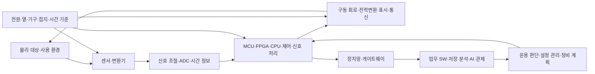

# 시스템으로 읽는 산업과 직무 | Reading industries through systems and roles

[산업 목차](README.md) · [기업과 사업 분야](09-기업과사업분야_company-domain-map.md) · [공통 기술 분류](10-공통기술과세부학습분야_cross-industry-technologies.md)

자동차의 센서, 선박의 기관 감시, 가전의 모터, 발전소의 계측, 병원의 영상 장치는 서로 다른 제품입니다. 그 안에서는 물리량을 관측하고, 신호를 전달·계산하며, 동작시키고 결과를 확인하는 과정이 연결됩니다. 같은 C·Python·FPGA·네트워크 지식도 어느 위치에서 무엇을 맡는지에 따라 업무가 달라집니다.

## 1. 제품을 기능과 경계로 나눕니다

이는 역할의 관계를 설명한 자체 개념도입니다. 모든 제품이 이 구조를 전부 갖거나, 서버의 판단이 즉시 장치 제어로 연결된다는 뜻은 아닙니다. 제품마다 실시간 동작·보호 기능·원격 관제의 경계를 정합니다.

| 나누는 단위 | 뜻 | 처음 적을 항목 |
| --- | --- | --- |
| 제품·설비 | 고객이나 운영자가 실제 사용하는 대상입니다. | 차량·승강기·의료 장비·선박·발전 기기 등입니다. |
| 하위 시스템 | 한 기능을 맡으면서 다른 기능과 경계가 있는 묶음입니다. | 구동·전원·항해·계측·영상·통신·기록 등입니다. |
| 구성요소 | 회로·장치·소프트웨어·데이터의 실제 구현입니다. | 센서, ADC, ECU, PLC, 드라이버, 서버, DB 등입니다. |
| 인터페이스 | 두 구성요소가 정보를 주고받거나 전력·힘을 전달하는 경계입니다. | 전압·단위·데이터 형식·시간·오류 상태·소유권입니다. |
| 요구사항 | 사용 조건에서 만족해야 하는 기능·특성입니다. | 대상·조건·판정 기준과 확인 방법입니다. |

NASA의 [시스템공학 핸드북 부록 D·E](https://www.nasa.gov/reference/system-engineering-handbook-appendix/)는 요구사항과 확인 근거를 연결하는 행렬을 설명합니다. 여기서는 그 구분을 학습의 틀로 사용하며, NASA 절차를 모든 기업의 채용 요건이나 사내 절차로 바꾸지는 않습니다.

## 2. 전자공학과 컴퓨터공학이 만나는 위치

| 계층 | 전자·전기 쪽에서 확인할 일 | 컴퓨터·소프트웨어 쪽에서 확인할 일 |
| --- | --- | --- |
| 관측 | 센서 범위·감도·잡음·입력 회로·기준 전압입니다. | 센서 설정·채널·자료형·보정 판본·유효 상태입니다. |
| 취득 | ADC·클록·트리거·케이블·접지·샘플링 조건입니다. | 버퍼·DMA·드라이버·타임스탬프·누락·오류 반환입니다. |
| 연산 | 신호 경로·가속기·메모리·인터페이스·전력·열입니다. | 알고리즘·수치 표현·스케줄링·동시성·실행 시간입니다. |
| 동작 | 전원·게이트 구동·모터·밸브·표시 소자의 특성입니다. | 명령·상태 전이·상한·복구·실행 권한·완료 확인입니다. |
| 연결 | 물리 인터페이스·노이즈·EMC·배선·절연입니다. | 프레임·프로토콜·재시도·순서·중복·인증·버전입니다. |
| 평가 | 실제 전압·전류·시간·온도·파형·구조입니다. | 입력·기대값·로그·통계·판정·변경 이력입니다. |

예를 들어 ADC에서 `0x800000`을 읽었다는 사실만으로 전압이 확정되지는 않습니다. 기준 전압·gain·코딩 방식·채널·변환 상태가 필요합니다. 이 관계는 [제조사 ADC 드라이버와 계측 사례](../직무와실무기술_job-practice/사례_cases/01-회로와소자의계측코드_circuit-device-measurement.md)에서 원문 C 코드와 함께 읽으실 수 있습니다.

같은 이유로 ‘통신이 된다’도 한 단계의 결과입니다. 전기적 파형이 존재하는지, 올바른 프레임인지, 필요한 의미의 데이터인지, 정한 시점까지 처리됐는지를 따로 봅니다. [UART·CAN·호스트 시험의 공개 코드](../직무와실무기술_job-practice/사례_cases/02-펌웨어와통신의공개코드_firmware-communication.md)에 각 관측 경계가 있습니다.

## 3. 기능·성능·시간·품질은 서로 다른 요구입니다

| 관점 | 설명 | 구분해 볼 예 |
| --- | --- | --- |
| 기능 | 필요한 입력에서 정해진 동작이 나오는지입니다. | 값 계산·상태 전이·지원 명령입니다. |
| 처리량 | 일정 시간에 처리하는 양입니다. | 초당 프레임·제품·요청 수입니다. |
| 지연 | 입력부터 정한 완료 지점까지 걸린 시간입니다. | 센서 취득부터 결과 제공까지의 시간입니다. |
| 실시간성 | 결과가 정해진 기한 안에 나오는지입니다. | 평균이 빨라도 기한을 넘는 실행이 있을 수 있습니다. |
| 정확도·불확도 | 관측값을 기준과 비교하고 얼마나 믿을 수 있는지입니다. | 오프셋·이득·잡음·교정·결선 조건입니다. |
| 신뢰성 | 시간·사용·환경 조건에서 요구 기능을 유지하는 성질입니다. | 열화·정비·반복·재시작·고장 이력입니다. |
| 안전 | 시스템이 만들 수 있는 위해를 다루는 관점입니다. | 위험 분석·보호 기능·독립성·사용 조건입니다. |
| 보안 | 권한·무결성·기밀성·가용성과 공격으로부터의 보호입니다. | 명령 인증·업데이트·접근 경계·복구입니다. |

산업마다 이 항목의 중요도와 확인 방법이 달라집니다. 가전의 영상 재생, 의료 신호 기록, 선박 기관 감시, 제조 설비의 동작은 사용 환경과 실패 영향이 다릅니다. NIST [SP 800-82 Rev. 3의 공개 초록](https://csrc.nist.gov/pubs/sp/800/82/r3/final)은 물리 환경과 상호작용하는 OT에서 성능·신뢰성·안전을 함께 고려하는 이유를 설명합니다.

## 4. 시간은 여러 위치에서 생깁니다

센서가 만든 변화는 변환·버퍼·통신·대기·연산을 거쳐 관측됩니다. 센서의 샘플링 주파수, 네트워크 전송 속도, 화면 갱신 주기는 서로 다른 값입니다.

설명용으로 취득 4 ms, 전달 3 ms, 처리 6 ms, 결과 반영 5 ms가 순차로 걸린다고 가정하면 총 지연은 18 ms입니다. 주기 20 ms와 비교하면 이 한 실행에서는 2 ms의 여유가 있습니다. 이 계산은 실제 차량·선박·발전 장치의 제어 사양이 아닙니다. 단계가 겹쳐 실행되거나 큐가 쌓이는 시스템에서는 단순 합과 별도로 경로·대기·최악 조건을 분석해야 합니다.

시각 동기화는 서로 다른 장치가 기록한 시각을 비교하는 문제입니다. 지연을 줄이는 일과 시계를 맞추는 일은 구분합니다. IEEE의 [TSN 작업반](https://1.ieee802.org/tsn/)과 [802.1AS 개정 프로젝트의 범위 소개](https://1.ieee802.org/maintenance/802-1as-2025-revision-timing-and-synchronization-for-time-sensitive-applications/)는 시간에 민감한 통신·동기화 기술을 설명합니다. 이 링크는 프로젝트 소개이며 규격 전문을 대신하지 않습니다. 관련 기능 이름이 있다는 사실만으로 전체 시스템의 기한·동기 정확도가 보장되지는 않습니다.

## 5. 한 인터페이스에 함께 적을 정보

| 항목 | 필요한 이유 |
| --- | --- |
| 물리 대상·식별자 | 다른 장비·다른 시료·다른 채널의 값을 섞지 않기 위해 필요합니다. |
| 단위·기준점·좌표 | V/mV, 온도 기준, 좌표축·설치 방향이 달라지면 같은 숫자의 의미가 달라집니다. |
| 자료형·폭·부호·코딩 | 정수·실수, signed/unsigned, offset binary 등을 맞춰야 합니다. |
| 측정 시각과 시각의 출처 | 장치의 실제 취득 시각·서버 처리 시각·수신 시각을 구분합니다. |
| 유효성·범위 초과·연결 상태 | 값 0과 값을 얻지 못한 상태를 분리합니다. |
| 소프트웨어·설정·규격 판본 | 같은 제품도 설정·모델·프로그램이 바뀌면 결과가 달라질 수 있습니다. |
| 명령·접수·완료의 의미 | 요청을 받았다는 응답과 실제 동작·저장 완료는 다른 단계일 수 있습니다. |

설비의 PV 시각도 무조건 실제 측정 시각인 것은 아닙니다. 설정과 장치 지원 구현에 따라 의미가 달라집니다. [EPICS 신호와 시각의 사례](../직무와실무기술_job-practice/사례_cases/04-공정설비와패키지의검사사례_process-equipment-package.md)에서 원문 근거와 구체적인 원인 분리를 읽으실 수 있습니다.

## 6. 개발과 검사에서 남기는 결과물

| 단계 | 구체적인 결과물 | 다음 단계가 확인할 내용 |
| --- | --- | --- |
| 요구·아키텍처 | 요구 ID·사용 조건·블록도·인터페이스·판정 기준입니다. | 무엇을 어디까지 만들고 확인하는지입니다. |
| 하드웨어·SW 설계 | 회로·기구·전원·코드·모델·설정과 제약입니다. | 입력 범위·상태·오류·시간·전력의 계약입니다. |
| 단위·모델 시험 | 자극·기대값·관측값·커버리지·실패 입력입니다. | 특정 기능·계산·상태 전이가 맞는지입니다. |
| 통합·벤치·HIL | 연결 구성·조건·원시 파형·실행 이력입니다. | 경계 사이의 동작과 대상에 맞는 관측입니다. |
| 환경·적합성 시험 | 시료·판본·시험 방법·조건과 판정 근거입니다. | 적용 요구에 대한 확인 범위입니다. |
| 생산·시운전 | 조립·설정·교정·검사·인계와 재작업 기록입니다. | 만든 제품·설비가 승인된 구성과 일치하는지입니다. |
| 운용·정비 | 사건·고장·변경·복구·재평가 이력입니다. | 반복되는 조건과 조치의 효과입니다. |

HIL은 hardware-in-the-loop, 실제 제어기 하드웨어를 다른 부분의 모형·시험 환경과 연결하는 방식입니다. 실제 센서·구동부 전체를 갖춘 시험과는 구성·관측 범위가 다릅니다. 어떤 경계가 모형인지 적어야 결과를 사용할 수 있습니다. [기존 하드웨어 검증](../전자컴퓨터공학_ece/14-하드웨어검증_hardware-verification/README.md)과 [검사 판정·기록](../직무와실무기술_job-practice/11-검사결과의판정과기록_test-decisions-evidence.md)에서 그 근거를 더 읽습니다.

## 7. 같은 증상을 만든 원인을 비교합니다

가상의 온도 기록이 일정한 값에서 멈춘 상황을 보겠습니다. 실제 온도가 안정됐거나 센서·통신·기록이 멈췄을 수 있습니다.

1. 같은 시각의 실제 장치 표시·독립 계측·원시 신호를 확인합니다.
2. 변환·취득이 갱신되는지와 값의 유효 상태를 확인합니다.
3. 통신의 연결·새 프레임·큐·순서·시각 정보를 확인합니다.
4. 서버·DB·화면이 새 자료를 반영하는지 확인합니다.
5. 수정한 위치를 적고 알려진 입력 변화와 중단·복구 상황으로 다시 확인합니다.

이 절차는 학습을 위해 구성한 원인 분리입니다. 산업 장치의 실제 조치는 해당 장치와 작업 절차·권한·시험 조건에 맞춰야 합니다. 원인이 기록 경로에 있는데 물리 공정을 바꾸는 일을 피하려면, 관측 경계를 따라 근거를 모아야 합니다.

## 8. 산업·회사·직무·기술을 함께 읽는 방법

먼저 [회사와 사업 분야](09-기업과사업분야_company-domain-map.md)에서 관심 제품을 찾습니다. 다음에는 해당 산업의 하위 시스템을 고르고, [공통 기술 분류](10-공통기술과세부학습분야_cross-industry-technologies.md)에서 필요한 회로·SW·통신·데이터 지식을 읽습니다. 마지막으로 [공개 코드 업무 사례](../직무와실무기술_job-practice/사례_cases/README.md)에서 입력·관측·판정·원인을 연결합니다.

이 경로는 일반적인 학습 연결입니다. 특정 회사의 실제 사내 도구·구성·채용 요건은 해당 판본의 공식 자료에서 따로 확인합니다. 기술 용어를 알고 있다는 사실과 실제 장치에서 검증한 경험도 구분하여 기록합니다.

## 출처와 확인 범위

- NASA Systems Engineering Handbook의 공개 웹 부록 D·E에서 요구사항·검증/타당성 확인의 연결을 읽었습니다.
- NIST SP 800-82 Rev. 3의 공식 공개 초록에서 OT의 범위와 성능·신뢰성·안전의 관계를 읽었습니다. Rev. 4는 확인일 기준 초안으로 표시되어 있어 이번 설명의 근거 판본과 구분했습니다.
- IEEE TSN·802.1AS 작업반의 공개 범위 설명을 읽었습니다. 유료 표준 전문이나 특정 시스템의 적합성 시험을 수행한 자료는 아닙니다.
- 시간 합산·온도 기록 상황·블록도·학습 연결은 자체 설명입니다. 장비 실측이나 특정 기업의 사고 기록을 제시한 것은 아닙니다.

## English

The guide separates products, subsystems, components and interfaces. It links physical sensing and actuation to embedded computing, communications, business systems and verification evidence. Timing, data validity, configuration and completion semantics help distinguish faults in the physical process from faults in acquisition and recording. The diagrams and numerical illustration are authored explanations.
