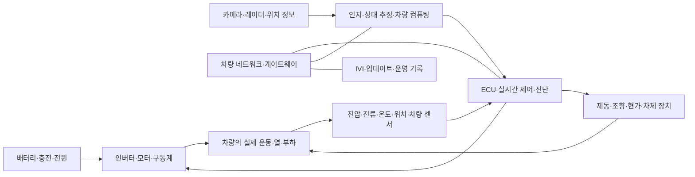

# 자동차·농기계의 전자 시스템과 소프트웨어 | Automotive and agricultural mobility systems

[산업별 목차](README.md) · [가전·디스플레이·광학](02-가전과디스플레이및광학_consumer-display-optics.md) · [차량·설비 통신의 검사](../현장계측과검증_measurement-validation/칩과시스템시험_chip-system-testing/차량과설비통신의고장분리_can-ethercat-modbus.md)

자동차의 전자·컴퓨터공학은 모터를 구동하는 전력 회로부터 센서, 실시간 제어, 영상 인식, 차량 네트워크와 서비스까지 이어집니다. 같은 차 안에서도 모터 전류를 제어하는 MCU와 영상을 처리하는 SoC, 화면을 그리는 응용 프로그램은 입력·시간 제약·오류의 영향이 다릅니다. 농기계는 여기에 작업기·토양·경사·위치 정보의 조건이 더해집니다.

아래 구조와 검사 상황은 공개 자료를 바탕으로 정리한 일반적인 학습 설명입니다. 특정 차종의 내부 회로·소프트웨어 구성이나 회사의 비공개 검사 규격을 그대로 옮긴 자료와 구분합니다.

## 1. 기업에서 제품과 시스템을 나누어 읽습니다

| 기업·사업 | 공식 자료에서 확인한 범위 | 공부할 시스템 |
| --- | --- | --- |
| 현대자동차·기아 | [E-GMP 발표](https://www.hyundai.com/worldwide/en/newsroom/detail/0000000812)와 [기아 플랫폼 소개](https://worldwide.kia.com/en/innovation/performance/platform)는 전동화 플랫폼과 PBV용 플랫폼을 설명합니다. | 에너지·구동·충전, 차량 통합, 진단·업데이트와 사용 목적별 SW입니다. |
| 현대모비스 | [공식 제품](https://www.mobis.com/en/tech/tech.do)과 [사업 소개](https://www.mobis.com/en/aboutus/aboutus.do)는 전동화·제동·조향·센서·IVI·램프 등을 구분합니다. | 구동 모듈, 배터리 시스템, 제어 ECU와 센서·전장 모듈입니다. |
| HL만도 | [Chassis Product](https://www.hlmando.com/en/solution/chassis.do)는 제동·조향·현가를 구분하고, [Steerite-FIT](https://www.hlmando.com/en/solution/ev/by-wire/steerite-fit.do)는 전자식 조향을 설명합니다. | 운전자 입력·차량 상태를 실제 힘과 운동으로 연결하는 제어입니다. |
| 한국타이어앤테크놀로지 | [2025 기술 소개](https://www.hankooktire.com/content/dam/hankooktire/local/pdf/why-hankook/2025_Hankook_Tire_Technology_Introduction_ENG.pdf)는 타이어 연구와 intelligent tire·fleet 기술을 소개합니다. | 재료·기계 시험의 DAQ·모델링, 상태 감시와 타이어 장착 센서 기술을 구분합니다. |
| LS엠트론 | [공식 자율작업 트랙터 발표](https://www.lsholdings.com/ko/media/news/6161346d33756d394970597242657444556c344a2b466c6e6e77584733564b35)는 농지 인식·작업 경로·원격 업데이트를 설명합니다. | 위치 추정, 차량·작업기 제어, 현장 인지와 작업 기록입니다. |

자동차 제조사, 시스템·부품 공급사, 타이어·농기계 기업은 서로 다른 제품 책임과 시험 범위를 가집니다. 예를 들어 영상 인식의 정확도, 제동 장치의 응답, 타이어의 마모 특성은 하나의 ‘자율주행 성능’ 수치로 대체할 수 없습니다. HL만도 사이트가 자율주행 센서·DCU를 [HL클레무브](https://www.hlklemove.com/)로 연결하는 경우도 회사와 제품의 경계를 나누어 읽습니다.

## 2. 자동차를 에너지·정보·운동의 흐름으로 봅니다

이는 역할을 이해하는 일반 블록도입니다. ECU, electronic control unit은 특정 기능의 입력·계산·출력을 담당하는 전자 제어기입니다. MCU는 주변장치와 짧은 주기의 제어에, SoC는 여러 연산·입출력 기능을 묶는 데 사용될 수 있습니다. 실제 기능 배치와 연산기는 차량·제품 세대에 따라 다릅니다.

## 3. 전기차의 배터리·충전·전력 변환

### 측정에서 배터리 상태 추정까지

BMS, battery management system은 셀 전압·전류·온도와 상태를 관찰해 배터리 사용을 관리합니다. 셀은 배터리의 기본 전기화학 단위이고, 팩은 셀·배선·접속·냉각·계측과 보호 기능을 묶은 시스템입니다. 팩 전압 하나가 정상이어도 개별 셀의 편차와 국부 온도는 다를 수 있습니다.

SOC, state of charge는 남은 충전 상태의 추정값입니다. SOH, state of health는 열화에 따른 용량·저항 등의 상태를 다루며, 두 값 모두 센서가 직접 읽는 전압과는 다릅니다. 전류 적산은 흐른 전류를 시간에 따라 누적하는 방법입니다. 전류 센서에 0.1 A의 일정한 오프셋이 있다고 가정하면 10시간 동안 `0.1 × 10 = 1 Ah`의 적산 차이가 생깁니다. 이는 오차가 누적되는 원리를 설명한 자체 계산입니다.

[TI의 배터리 monitor·gauge 구분](https://www.ti.com/document-viewer/lit/html/SSZT466)은 측정 IC와 상태 추정 기능의 역할을 설명합니다. [BMS 측정 동기화 설명](https://www.ti.com/document-viewer/lit/html/SSZT082/GUID-ED625C97-0A37-4A38-B931-6A3DD5FC69B2)은 셀·팩 전압과 전류의 취득 시점도 함께 맞춰야 함을 보여 줍니다.

| 세부 기능 | 입력→처리→결과 | 전자·컴퓨터공학의 세부 업무 | 대표 확인 항목 |
| --- | --- | --- | --- |
| 셀 감시 | 셀 전압·온도→ADC·보정·상태 검사→값과 오류 | 아날로그 입력, 필터, 절연 통신, 레지스터·드라이버 | 채널 순서, 기준값 대비 오차, 단선·누락·갱신 상태입니다. |
| 팩 전류·전압 | 전류 센서·전압 분배→동기 취득→전력·적산 입력 | shunt·Hall 센서, 신호 조정, 시간 동기화 | 영점·gain·온도 변화와 동시 취득 조건입니다. |
| 상태 추정 | 이력·온도·전류·전압→모델·추정→SOC·SOH | 모델링, 수치 계산, 추정 오차·학습 자료의 조건 | 초기 상태·장기 누적·제품 편차에 따른 오차입니다. |
| 셀 밸런싱 | 셀별 상태→편차 판단→셀 간 상태 조정 | 제어 상태·진단, 열·에너지 관리 | 밸런싱 전후 측정, 온도와 운용 조건입니다. |
| 충전·전원 변환 | 외부 전력·배터리·저전압 부하→변환·제어→에너지 전달 | OBC·DC/DC·게이트 구동, 통신·상태 전이 | 전압·전류·리플·효율·발열과 전환 상태입니다. |

OBC는 on-board charger, 차량에 탑재된 충전기입니다. DC/DC는 직류의 전압 수준을 바꾸는 전력 변환기입니다. 차량 충전 전체는 외부 충전 설비·전력 변환·배터리 상태·통신이 함께 결정합니다. 현대차의 2020년 E-GMP 발표에 있는 충전 구조와 당시 성능 조건은 해당 발표의 적용 범위이며, 모든 현재 전기차의 공통 사양으로 읽지 않습니다.

### 같은 경고가 다른 원인에서 생기는 예

배터리 온도 표시가 갑자기 높아졌다는 가상 사례에서는 실제 발열, 센서 접촉·배선, 변환 계수, 통신 값·시각, 채널 매핑이 모두 원인 후보입니다. 정상 기준 입력·독립 온도 측정·원시 ADC·상태와 메시지 이력을 대조해야 합니다. 표시 숫자를 바꾸거나 경고를 지웠다는 결과와 물리적 원인을 해소했다는 결과도 구분합니다.

## 4. 인버터·모터에서 회로와 펌웨어가 만나는 곳

인버터는 배터리의 DC 전력을 모터의 여러 상에 전달할 형태로 바꿉니다. 전력 스위치, gate driver, 전류·전압·위치 계측과 제어기가 함께 작동합니다. PWM, pulse-width modulation은 스위칭 신호에서 켜져 있는 시간의 비율을 조절하는 방식입니다. PWM 신호의 계산과 실제 전류·회전의 응답은 다른 관측입니다.

[TI traction inverter 개요](https://www.ti.com/solution/traction-inverter)는 전력 스위치 제어, 전류·전압 감시와 축 위치 감지를 구분합니다. 아래는 제품별 회로를 따라 만드는 절차가 아니라 개발·평가 업무의 구분입니다.

| 영역 | 실제로 맡는 일 | 관측 장비·자료 | 조사할 수 있는 이상 |
| --- | --- | --- | --- |
| 전력·구동 회로 | 스위치·driver·전원·전류 경로와 열 경로를 설계합니다. | 해당 전압·대역에 맞는 전압/전류 프로브, 전력 분석·온도 자료 | 과도 파형·발열·센서 간섭·변환 손실입니다. |
| 제어 펌웨어 | 샘플링·연산·출력의 주기를 맞추고 모터 상태를 관리합니다. | 타임스탬프·실행 시간·MCU 주변장치·상태 로그 | 주기 초과, 오래된 입력, 포화·상태 전환 오류입니다. |
| 위치·전류 계측 | 센서 신호를 제어에 쓸 수 있는 수로 바꿉니다. | 기준 입력·센서 파형·보정 자료 | 영점·gain·위상·취득 지연의 차이입니다. |
| 통합·검증 | 목표값과 실제 응답, 온도·부하·전원 조건을 비교합니다. | 모터 시험 환경·전력/열 자료·HIL | 부하·속도·환경에 따른 경계와 기능 간 간섭입니다. |

토크는 회전시키는 힘의 효과이고 전류는 전기적 입력입니다. 제어기는 모델과 센서에 근거해 관계를 다루므로, 전류값이 맞는다는 사실만으로 실제 축의 토크가 모두 맞았다고 결론 내리지는 않습니다. 전력·제어의 기초는 [전력전자](../전자컴퓨터공학_ece/31-전력전자에너지_power-energy/README.md), [신호처리·제어](../전자컴퓨터공학_ece/21-신호처리제어_signals-control/README.md), [속도 PI와 포화](../전자컴퓨터공학_ece/22-로봇제어_robotics-boards/해설_notes/속도PI와포화_speed-pi-anti-windup.md)에 연결합니다.

## 5. 제동·조향·현가의 센서와 실시간 제어

제동은 차량의 운동 에너지를 줄이는 장치·제어이고, 조향은 바퀴 방향을 바꾸는 일입니다. 현가는 노면과 차체 사이의 힘·운동을 다루는 suspension입니다. ‘샤시’라는 같은 분류에 있더라도 센서와 구동기, 요구 응답과 실패 영향은 다릅니다. HL만도와 현대모비스의 공식 제품 분류를 이런 구분의 출발점으로 읽습니다.

| 세부 분야 | 입력→처리→출력의 예 | 기초 개념과 전자·SW 역할 | 검증에서 나누는 것 |
| --- | --- | --- | --- |
| 전자식 제동 | 운전자·차량 상태→제동 제어→압력·모터/구동 장치 | 센서·힘/압력의 변환, ECU·통신·진단 | 명령 수신, 실제 작동, 센서 응답과 기계·유압 상태입니다. |
| 회생제동 협조 | 감속 요구·배터리/구동 상태→배분→전기·마찰 제동의 협조 | 에너지 회수와 차량 감속 요구의 경계 | 배터리 수용 조건이 바뀔 때의 상태·응답과 기능 인계입니다. |
| EPS | 조향 입력·차량 상태→보조 제어→전기 모터 보조 | 토크/각도 감지, 전류·위치 제어 | 센서 오프셋, 모터·전원·구동과 기계 마찰의 영향입니다. |
| Steer-by-wire | 운전자·제어 요구→전자 신호·상태 관리→조향 구동과 피드백 | by-wire는 정보를 전기적으로 전달하는 구조를 뜻합니다. | 구성별 고장 감시·백업·인계의 증거입니다. |
| 전자제어 현가 | 차체·휠·노면 관련 상태→제어→감쇠력 등 조정 | 가속도·변위·전류, 추정·상태 관리 | 승차감·접지 관련 지표와 센서·구동기의 응답입니다. |

EPS와 steer-by-wire의 기계적 연결·백업 구조는 제품마다 다릅니다. ‘전자식’이라는 이름만으로 조향축이 모두 없다고 판단하지 않습니다. [HL만도 Steerite-FIT](https://www.hlmando.com/en/solution/ev/by-wire/steerite-fit.do)는 하나의 공개 제품 구조이며, 이를 모든 EPS의 구조로 확대하지 않습니다.

HIL, hardware-in-the-loop은 실제 제어기와 환경의 실시간 모형을 연결하는 시험 방식입니다. 가상 센서·차량 모형에 대한 제어기의 반응과 시간·진단·상태 전이를 볼 수 있습니다. [NI의 HIL 구조 설명](https://www.ni.com/en/solutions/transportation/hardware-in-the-loop/hardware-in-the-loop--hil--test-system-architectures.html)은 실제 제어기·I/O·실시간 모형의 연결을 구분합니다. 모형의 통과와 실제 차량의 모든 조건 통과는 범위가 다르므로 모델·입출력 범위·검사하지 않은 현상도 기록합니다. 실제로 시험하지 않은 HIL 결과를 이 글의 실행 결과로 제시하지 않았습니다.

## 6. ADAS·차량 컴퓨팅·서비스 소프트웨어

ADAS는 advanced driver assistance systems, 운전 보조 시스템입니다. 카메라·레이더 등의 자료에서 주변 상태를 추정하고 경고나 주행 기능과 연결합니다. 영상에 물체가 잘 보이는 것, 물체를 올바르게 인식하는 것, 필요한 시점에 차량 기능이 동작하는 것은 각각 다른 단계입니다. [현대모비스의 ADAS 제품 설명](https://www.mobis.com/en/tech/tech.do)과 [NHTSA의 운전 자동화 구분](https://www.nhtsa.gov/vehicle-safety/automated-vehicle-safety)을 함께 읽으시면 기능과 운전자 역할을 구분할 수 있습니다.

| 세부 기술 | 입력·출력 | 세부 업무와 병목 | 확인할 근거 |
| --- | --- | --- | --- |
| 센서·고속 연결 | 빛·반사·운동→센서의 원시 자료 | 전원·잡음·열·시야·케이블·시간 동기화 | 원시 프레임·센서 상태·시각·누락과 동기 조건입니다. |
| ISP·인식 | 원시 영상→보정 영상·물체/특성 | 노출·왜곡·전처리, 모델·연산 정밀도·메모리 | 같은 입력의 변환 결과, 오류 유형·지연·자원 사용입니다. |
| 센서 융합·상태 추정 | 여러 센서→위치·속도·주변 상태 | 좌표계·취득 시점·불확실성·누락 | 좌표 보정, 실제 취득 시각, 입력이 없어졌을 때의 상태입니다. |
| 차량 컴퓨팅 | 여러 기능의 작업→결과와 서비스 | CPU/GPU/NPU 분할, 메모리·대역폭·스케줄 | 평균 속도뿐 아니라 긴 지연·동시 부하·열 조건입니다. |
| IVI·연결 서비스 | 사용자·미디어·차량 정보→화면·오디오·서비스 | 앱·OS·통신·권한·상태 수명 | 입력·화면 지연, 프로세스 재시작, 네트워크 중단과 복구입니다. |

학습용 시간 계산으로 차량이 20 m/s로 움직이는 동안 자료가 0.1초 늦으면 그 사이 이동한 거리는 `20 × 0.1 = 2 m`입니다. 이 수치는 제동 거리·안전 거리나 특정 제품의 지연 사양이 아닙니다. 서로 다른 시각의 센서 정보를 같은 순간으로 취급할 때 왜 오차가 생기는지 보여 주는 예입니다.

기능 안전과 인식의 불충분함도 구분합니다. [ISO 26262:2018 공개 소개](https://www.iso.org/publication/PUB200262.html)는 전기·전자 시스템의 기능 안전 수명주기를, [ISO 21448:2022 공개 초록](https://www.iso.org/standard/77490.html)은 의도한 기능의 명세·성능 불충분함에 따른 위험을 다룹니다. 여기서는 공개 범위로 두 주제를 구분했으며 유료 규격 전체의 적합성 심사를 수행한 자료로 표시하지 않습니다.

## 7. E/E 아키텍처와 차량 소프트웨어

E/E는 electrical/electronic, 전기·전자 구성입니다. 기능별 ECU를 많이 두는 방식, 여러 기능을 통합한 컴퓨터, 위치별 입출력을 묶는 zonal 구조 등으로 기능과 배선을 배치할 수 있습니다. 연산기 수를 줄여도 센서·구동·전원·네트워크·고장 격리의 문제가 함께 없어지는 것은 아닙니다.

| 계층 | 역할 | 공부할 세부 항목 |
| --- | --- | --- |
| 장치·MCU | 센서 취득과 정해진 시점의 구동·진단 | ADC·PWM·인터럽트·DMA·타이머·watchdog·메모리입니다. |
| 차량 통신 | 여러 제어기·센서·컴퓨터의 정보 전달 | CAN/CAN FD·LIN·Ethernet의 목적, 지연·누락·전기 조건입니다. 모든 차량이 모든 방식을 쓰는 것은 아닙니다. |
| 플랫폼·미들웨어 | 하드웨어·OS와 기능 SW 사이의 계약 | RTE·BSW, 서비스 발견·통신·시간 동기화·진단입니다. |
| 기능 SW | 제어·인지·표시·기록·서비스 | 입력 조건·상태 전이·자료 수명·실행 시간·판본입니다. |
| 개발·운영 체계 | 요구·빌드·시험·배포·진단의 연결 | 재현 가능한 빌드·trace·실패 입력·업데이트·롤백입니다. |

[AUTOSAR Classic](https://www.autosar.org/standards/classic-platform/)은 응용·RTE·기본 SW의 계층을, [Adaptive](https://www.autosar.org/standards/adaptive-platform)는 마이크로프로세서 기반 응용을 위한 서비스·API와 실행 환경을 설명합니다. Classic을 ‘C 언어’, Adaptive를 ‘C++ 언어’와 같은 뜻으로 외우지 않습니다. 플랫폼은 기능·계약·실행 환경의 분류이며 언어만으로 제품 구조를 알 수 없습니다. 여기서는 공개 개요의 구조를 사용했고, 특정 회사가 모든 제품에 같은 플랫폼·릴리스를 채택한다고 추정하지 않았습니다.

C·C++은 장치 접근·실시간 코드·성능 경로·플랫폼 구현에, Python은 시험 입력·로그·계측·자료 분석·도구 연결에 쓰일 수 있습니다. 실제 코드의 한 예는 [Zephyr 공식 C·Python 시험 해설](../직무와실무기술_job-practice/사례_cases/02-펌웨어와통신의공개코드_firmware-communication.md)입니다. 이는 RTOS와 시험 구조의 공개 예제이며 양산 차량의 AUTOSAR 코드를 재현한 자료가 아닙니다.

## 8. 타이어·노면과 센서·데이터의 연결

타이어는 고무·보강재·구조·열·접촉을 다루는 기계·재료 제품입니다. 전자·컴퓨터공학은 시험기 계측, 진동·소음 분석, 시뮬레이션·최적화, 제조 검사와 상태 감시에 참여합니다. 모든 타이어 제품에 센서가 내장됐다고 이해하지 않습니다.

| 구분 | 실제 대상 | 전자·데이터 기술 | 해석할 때의 경계 |
| --- | --- | --- | --- |
| 타이어 연구·시험 | 하중·변형·온도·마모·소음·진동 | 힘/변위/온도 센서·DAQ·신호처리·모델 | 시험기 조건과 실제 노면·차량 조건을 구분합니다. |
| 차량 TPMS | 타이어 공기압 감시 시스템 | 휠·밸브 등 센서 기반 직접 측정 또는 휠 속도 등을 이용하는 간접 추정 | 구현에 따라 센서 위치와 관측량이 다릅니다. |
| 타이어 장착 센서·지능형 타이어 | 타이어 내부 부착 등의 센서와 상태 모델 | 변형·운동·온도 등의 취득·무선·전력·추정 | 센서 출력이 곧 마찰계수·마모의 직접 측정이라는 뜻은 아닙니다. |
| Fleet 서비스 | 여러 차량의 타이어·운행 상태 | 장치 식별·기간별 기록·모델·정비 서비스 | 누락·재장착·교체·차량 ID와 실제 장치의 대응을 확인합니다. |

[NHTSA TireWise](https://www.nhtsa.gov/vehicle-safety/tires)는 공기압·마모·TPMS 등의 역할을 설명합니다. 한국타이어의 [2025 자료 50쪽](https://www.hankooktire.com/content/dam/hankooktire/local/pdf/why-hankook/2025_Hankook_Tire_Technology_Introduction_ENG.pdf#page=50)은 TMS, tire-mounted sensor와 tire health·fleet 분야를 소개합니다. 그 자료만으로 소개한 모든 기술의 차종별 상용 장착·성능을 확정하지 않았습니다.

예를 들어 ‘같은 도로에서 진동이 늘었다’는 가상 현상은 타이어 상태, 노면·속도·하중, 센서 부착·시간 동기화·필터가 모두 후보입니다. 같은 시험 조건의 원시 시계열·차량/타이어 ID·기준 센서와 대조해야 합니다. [센서·계측](../전자컴퓨터공학_ece/37-센서계측_sensors-instrumentation/README.md)과 [신호처리·제어](../전자컴퓨터공학_ece/21-신호처리제어_signals-control/README.md)가 이 분석의 기반입니다.

## 9. 트랙터·농기계에서는 작업의 품질도 측정합니다

농기계는 이동 경로를 따르는 일과 작업기를 통해 토양·작물에 일을 하는 부분이 결합됩니다. GNSS는 위성항법, RTK는 기준 정보를 이용해 위치 오차를 줄이는 기법입니다. 위치의 정확도, 장애물 인지, 실제 작업 품질은 서로 다른 항목입니다.

| 세부 시스템 | 입력→처리→출력 | 구체적인 검사 대상 |
| --- | --- | --- |
| 위치·자세 추정 | GNSS·관성·휠 정보→좌표·자세 추정→제어 입력 | 좌표계·안테나 위치·시각, 신호 손실·다중경로와 추정 상태입니다. |
| 주행·작업 경로 | 작업 경계·위치·작업 폭→경로·상태→주행/작업 요구 | 경계 인식·작업 중첩/누락과 상태 전환입니다. |
| 작업기 제어 | 엔진/구동·유압·작업기 상태→제어→작업 동작 | 명령과 실제 위치·부하·작업 속도의 대응입니다. |
| 인지·감시 | 주변 센서·운전자/장치 상태→판단→표시·기능 상태 | 가려짐·먼지·조도·경사·지형의 변화입니다. |
| 원격 기록·업데이트 | 작업·장치 이력→전송·판본 관리→서비스 | 오프라인 기록·시간·기계/작업기 ID·업데이트 상태입니다. |

LS엠트론의 2026년 7월 [비정형 농지 자율작업 발표](https://www.lsholdings.com/ko/media/news/6161346d33756d394970597242657444556c344a2b466c6e6e77584733564b35)는 경계 주행을 바탕으로 작업 경로를 만들고 해당 기능을 OTA로 제공한다고 설명합니다. 발표된 적용 조건과 회사가 제시한 수치를 전체 농지·기계의 보장 성능으로 바꾸지 않습니다. 농기계의 작업 자동화 단계를 승용차의 주행 자동화 단계와 같은 평가 체계로 단순 비교하지도 않습니다.

정밀살포처럼 작업 대상의 인식과 구동을 함께 다루는 기술은 [정밀살포 리뷰](../제품기술분석_product-technology/농업과식품_agriculture-food/정밀살포의약제절감과잡초관리_precision-spraying.md)로 이어집니다. 이 글은 농기계의 전자 시스템 관점을 설명하며 특정 작물·약제·작업 설정을 제안한 자료는 아닙니다.

## 10. 공부와 실무 결과물을 연결하는 순서

1. 전압·전류·힘·각도·압력·영상 중 관측할 대상을 하나 고릅니다.
2. 센서의 원시 출력에서 물리량·추정 상태까지의 변환을 설명합니다.
3. MCU·차량 컴퓨터·호스트 시험 PC·서버 중 코드의 실행 위치를 나눕니다.
4. 같은 증상을 만드는 물리·취득·통신·해석 오류를 비교할 시험을 정합니다.
5. 시료·배선/설정·시간·판본·원시값·오류·재시험을 묶은 기록을 남깁니다.

| 공부할 기반 | 산업에서 확인할 결과물 |
| --- | --- |
| [회로·전자](../전자컴퓨터공학_ece/09-회로전자공학_circuits-electronics/README.md), [ADC/DAC](../전자컴퓨터공학_ece/32-혼성신호-ADC-DAC_mixed-signal-data-converters/README.md) | 센서·전원 경로와 오차·대역폭의 설명입니다. |
| [펌웨어·RTOS](../전자컴퓨터공학_ece/17-펌웨어-RTOS_firmware-rtos/README.md), [인터페이스](../전자컴퓨터공학_ece/20-인터페이스통신_interfaces-communications/README.md) | 시점·버퍼·메시지·오류 상태의 시험입니다. |
| [비전](../전자컴퓨터공학_ece/43-컴퓨터비전_computer-vision/README.md), [AI 평가](../전자컴퓨터공학_ece/46-AI응용에이전트평가_ai-agents-evaluation/README.md) | 입력·정답·운영 조건을 나눈 오류 분석입니다. |
| [출처가 있는 계측 코드](../직무와실무기술_job-practice/사례_cases/01-회로와소자의계측코드_circuit-device-measurement.md) | 제조사 원문의 설정·측정·readback·오류 반환 해석입니다. |

## 출처와 확인 범위

공식 사업·제품 페이지, 표준기관의 공개 소개, 반도체 제조사의 기술 개요를 직접 확인했습니다. 한국타이어의 2025 기술 소개는 50쪽의 intelligent tire·fleet 자료를 원문 화면으로 대조했습니다. 기업 발표의 시장 우위·미래 목표·수치 전체를 보편적 성능으로 사용하지 않았습니다. HIL·물리 시험·차량 SW 빌드·실차 측정은 수행하지 않았고, 이 글의 수치 예제는 명시한 자체 계산입니다. 새 C·Python 코드를 만들어 양산 코드로 표시하지 않았으며 공개 코드 해설은 기존 원문·라이선스가 있는 사례로 연결했습니다. 확인 기준일은 2026-10-26입니다.

## English

This guide separates vehicle energy conversion, battery monitoring, chassis control, perception, computing, networks and services. It also covers tire research, vehicle TPMS, tire-mounted sensing and agricultural machinery as distinct engineering scopes. Supplier product pages establish business relevance; general architectures and hypothetical fault-isolation examples do not establish a particular vehicle's internal design. Stated calculations are educational examples, and no vehicle or hardware tests are reported.
