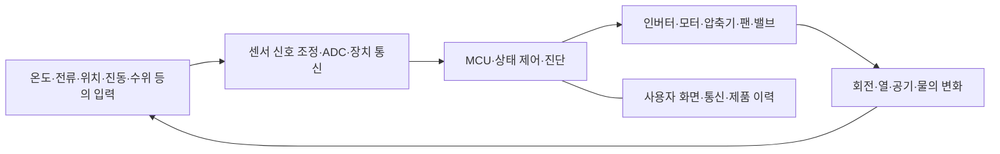

# 가전·디스플레이·광학의 전자 시스템 | Appliances, displays and optical systems

[산업별 목차](README.md) · [자동차·농기계](01-자동차와모빌리티_automotive-mobility.md) · [센서·계측 기초](../전자컴퓨터공학_ece/37-센서계측_sensors-instrumentation/README.md)

가전은 온도·공기·물·회전 같은 물리적 대상을 제어하고, 화면은 디지털 정보를 빛으로 바꾸며, 카메라는 빛을 데이터로 바꿉니다. 제품에 AI나 네트워크 기능이 들어가도 센서·전원·구동·시간·자료의 의미를 먼저 맞춰야 합니다. 제품 제어기, 영상 처리 SoC, 사용자 앱과 클라우드는 서로 다른 실행 위치입니다.

이 글은 제품군의 구조와 개발·검사의 관점을 다룹니다. 공통 원리는 기존 기초·계측·제품·기술 분석으로 연결하고, 산업별로 달라지는 입력·출력·병목·검사 대상을 설명합니다.

## 1. 완제품·패널·모듈의 역할

| 기업·영역 | 공식 자료에서 확인한 범위 | 전자·컴퓨터공학에서 연결할 내용 |
| --- | --- | --- |
| LG전자 HS | [현재 기업 소개](https://www.lg.com/global/about-lg/corporate-information/)의 Home Appliance Solution은 생활·주방 가전, 부품·로봇·스마트홈을 다룹니다. | 센서·전력·모터·제품 상태 제어와 연결 서비스입니다. |
| LG전자 MS | 같은 소개의 Media Entertainment Solution은 TV·모니터·오디오·상업용 디스플레이와 webOS를 다룹니다. | 영상·음성 처리, SoC·메모리·화면 구동, 플랫폼·앱·콘텐츠입니다. |
| LG전자 ES | Eco Solution은 공조·열·에너지 관련 솔루션을 다룹니다. | 압축기·인버터·센서·열 제어와 건물·설비 관리입니다. |
| LG전자 VS | [Vehicle Solution 소개](https://www.lg.com/global/mobility/about-our-company/who-we-are)는 차량용 솔루션을 다룹니다. | 가전·화면 기술과 겹치는 부분을 [자동차 문서](01-자동차와모빌리티_automotive-mobility.md)에서 차량 조건에 맞춰 읽습니다. |
| LG디스플레이 | [공식 OLED 구조 설명](https://www.lgdisplay.com/eng/product/tv-display/transparent-oled)과 [OLED EX 발표](https://www.lgdisplay.com/eng/company/media-center/latest-news?contentId=4978)는 발광 구조와 구동 알고리즘의 역할을 보여 줍니다. | 패널 소자·배선·구동·광학 특성·공정·전기/광학 검사입니다. |
| LG이노텍 | [광학솔루션](https://www.lginnotek.com/product/op/01/list.do?locale=en)은 카메라·3D sensing·actuator·LiDAR를 구분합니다. | 광학·센서·구동 IC·펌웨어·정렬·모듈 검사를 연결합니다. |

LG전자의 HS·MS·VS·ES 명칭은 현재 공식 사업 소개를 기준으로 했습니다. LG디스플레이의 패널 사업, LG이노텍의 모듈 사업, LG전자의 완제품·플랫폼 사업을 같은 회사의 한 부서처럼 묶지 않습니다. 각 회사의 소유·공급 관계를 추정해 기술 연결의 근거로 사용하지 않았습니다.

## 2. 세탁기·청소기·냉장고의 센서와 구동

### 제품이 물리량을 읽고 동작하는 순서

ADC는 전압을 디지털 수로 바꾸는 기능입니다. 상태 제어는 ‘문 잠금 확인→조건 준비→동작→완료’처럼 현재 상태에 따라 가능한 동작을 정하는 방식입니다. 같은 목표 회전수라도 하중·마찰·공급 전압이 다르면 필요한 전류와 온도가 달라집니다.

| 제품·세부 기술 | 입력→처리→출력 | 개발·검사에서 확인할 값 |
| --- | --- | --- |
| 세탁·건조 구동 | 전류·회전·부하 관련 정보→제어→모터·드럼 동작 | 회전·전류·진동·동작 상태와 부하 조건입니다. |
| 청소기·로봇 | 압력/거리/운동·전류→제어·인지→흡입·이동·브러시 | 흡입과 모터 부하, 바퀴·센서·주변 환경의 구분입니다. |
| 냉장·보관 | 온도·문·운전 상태→열 제어→압축기·팬·밸브 | 목표/실제 온도·시간·소비전력·주변 조건입니다. |
| 물·조리 관련 가전 | 온도·수위·유량·입력 상태→제품 상태 관리→가열·펌프·밸브 | 측정 오차·누락·상태 전이와 실제 열·물의 응답입니다. |
| 스마트 부품 | 모터/압축기 상태·전자 신호→driver·제어→구동 | 전원·스위칭·전류·발열·기계 부하입니다. |

LG의 [인버터 기술 설명](https://www.lg.com/global/newsroom/lg-story/beyond-news/lg-inverter-technologys-critical-role-in-creating-the-worlds-best-home-appliances/)은 모터·압축기의 속도 제어를 공통 원리로 설명합니다. 속도를 조절할 수 있다는 사실과 모든 조건에서 소비전력이 줄어든다는 주장은 다릅니다. 비교에는 같은 부하·동작 목표·환경·시간·측정 경계가 필요합니다.

### 같은 진동 증가를 나누는 사례

세탁기의 진동이 커졌다고 가정하면 하중 불균형, 설치·기계 상태, 모터 구동, 센서·취득 경로가 후보입니다. 같은 부하·속도·설치 조건에서 진동과 전류·회전·시간을 함께 비교합니다. 진동 센서를 바꾼 뒤 숫자가 달라졌다면 감도·부착 방향·단위·샘플링도 확인해야 합니다. 이는 학습용 원인 분리 예이며 실제 특정 제품의 불량 기록은 아닙니다.

## 3. 공조·히트펌프·열 관리

히트펌프는 전기를 열로 바꾸는 저항 히터와 작동 원리가 다릅니다. 냉매·압축기·열교환기 등을 이용해 한쪽에서 열을 받아 다른 쪽으로 옮깁니다. 인버터 구동은 압축기의 운전 속도를 바꿔 요구 열량에 대응하는 수단입니다. [LG의 히트펌프 원리](https://www.lg.com/us/residential-hvac/heat-pump/how-it-works)와 [압축기 속도 제어 설명](https://www.lg.com/global/business/insights/compressor-motor/blog/making-the-right-choice-for-efficiency-and-comfort/)에서 이 역할을 확인할 수 있습니다.

| 세부 시스템 | 입력과 출력 | 전자·SW의 구체적인 역할 |
| --- | --- | --- |
| 센서·취득 | 온도·압력·유량·전류→유효한 측정값 | 교정·입력 범위·배선·단위·시각·센서 이상을 확인합니다. |
| 압축기·팬 구동 | 제어 요구→전력 회로→회전·공기 이동 | 전류·속도·발열과 부하를 연결합니다. |
| 열 제어 | 목표 온도·부하·환경→제어 상태→운전 요구 | 온도 변화가 전기 신호보다 느린 시간 지연과 상태 전이를 다룹니다. |
| 실내·실외 협조 | 장치 상태·통신→통합 제어→제품 운전 | 센서·동작·오류 정보의 시점·대상·유효성을 맞춥니다. |
| 건물·설비 관리 | 여러 기기의 상태→운영 SW→감시·기록·운용 판단 | 장치 ID·장소·이력·통신 중단과 계측·운전 정보를 연결합니다. |

COP, coefficient of performance는 정한 경계에서 옮긴 열량과 투입 일의 비입니다. 예를 들어 같은 기간에 열 3 kWh를 옮기는 데 전기 1 kWh를 썼다고 가정하면 COP는 3입니다. 에너지를 새로 만든다는 뜻이 아니라 외부의 열을 함께 옮긴 결과입니다. 외기·실내·제상·부하와 시간 조건이 다르면 같은 기기의 값도 달라질 수 있습니다.

온도 표시가 일정하다고 실제 열 부하가 일정한 것도 아닙니다. 센서 위치·평균 처리·통신 갱신과 열 자체의 변화를 나누어 조사해야 합니다. 설비 여러 대의 감시·기록 문제는 [공정·설비 신호 사례](../직무와실무기술_job-practice/사례_cases/04-공정설비와패키지의검사사례_process-equipment-package.md)의 값·상태·시각 구분으로 이어집니다.

## 4. 스마트홈·제품 플랫폼·원격 서비스

네트워크 기능은 장치가 스스로 수행하는 제어와 사용자가 원격으로 요청하는 기능을 연결합니다. API는 다른 프로그램이 정해진 방식으로 기능·데이터를 주고받는 접점입니다. 응답을 받았다는 사실, 명령이 접수됐다는 사실, 물리적 동작이 끝났다는 사실은 구분해야 합니다.

[LG ThinQ API 공개 발표](https://www.lg.com/global/newsroom/news/home-appliance-solution/lg-opens-thinq-api-to-foster-smart-home-innovation/)는 개인 사용자용 API와 기업 파트너용 API를 구분하고 가전·건물 관리의 연결을 설명합니다. 개별 모델·지역·API 판본의 지원 기능은 해당 개발 문서에서 확인합니다.

| 계층 | 맡는 일 | 대표적인 오류와 조사 자료 |
| --- | --- | --- |
| 제품 제어기 | 센서·모터·제품 상태를 다룹니다. | 실제 동작·원시 입력·오류 상태·펌웨어 판본입니다. |
| 통신 모듈 | 네트워크 접속과 메시지 전달을 담당합니다. | 접속·재연결·중복·지연·장치 ID입니다. |
| 앱·클라우드 | 계정·장치·사용자 요청·기록을 연결합니다. | 권한·요청 ID·상태 시각·화면 표시와 서버 기록입니다. |
| 운영·업데이트 | 새 프로그램·설정과 제품 상태를 맞춥니다. | 적용 판본·중단·재시작·되돌림·오프라인 이력입니다. |

가상 사례로 앱이 ‘동작 중’이라고 표시하지만 제품은 이미 종료됐을 수 있습니다. 장치의 실제 상태, 통신의 마지막 갱신, 서버 상태, 앱 캐시를 순서대로 비교하면 조사할 경계를 나눌 수 있습니다. [공식 DB·AI 예제의 기록 해설](../직무와실무기술_job-practice/사례_cases/05-AI와제조IT의평가사례_ai-manufacturing-it.md)은 중복 수신과 입력 데이터의 의미를 다루는 공통 자료입니다.

## 5. TV·모니터의 영상·메모리·화면 경로

영상 파일이나 네트워크 스트림이 화면에 바로 전압으로 전달되지는 않습니다. 압축 해제, 영상 처리, 그래픽 합성, 프레임 버퍼·화면 출력과 패널 구동이 연결됩니다. frame은 한 장의 영상이며, buffer는 다음 단계가 쓸 데이터를 보관하는 공간입니다.

| 단계 | 입력→처리→출력 | 전자·컴퓨터공학의 세부 대상 |
| --- | --- | --- |
| 입력·복호 | 스트림/외부 입력→압축 해제→영상 프레임 | 입출력·프로토콜·codec·오류·시간 정보입니다. |
| 영상 처리 | 프레임→색·해상도·노이즈·명암 처리→표시 데이터 | SoC/DSP/GPU, 연산 정밀도·메모리 대역폭입니다. |
| 그래픽 합성 | 앱·영상·UI surface→합성→화면 | 버퍼 소유권·동기·입력 처리·렌더링입니다. |
| 전송·타이밍 | 표시 데이터→화면 타이밍·고속 링크→패널 입력 | 링크·clock·동기·TCON·전원입니다. |
| 패널 구동 | 타이밍·화소값→driver·TFT→빛 | 전압/전류·배선·소자·광학 특성입니다. |

일반 대역폭 계산으로, 3840×2160 화소·초당 120장·화소당 24 bit의 비압축 RGB를 가정하면 순수 화소 데이터는 약 23.89 Gbit/s입니다. 한 프레임을 한 번 저장하는 데이터율로는 약 2.986 GB/s입니다. 실제 링크의 blanking·부호화·압축과 메모리의 읽기·쓰기·중간 버퍼 트래픽은 별도입니다. 따라서 이 계산을 HDMI의 필요한 전송속도나 DRAM 실효 대역폭으로 그대로 사용하지 않습니다.

120 Hz의 프레임 간격은 약 8.33 ms이지만 입력부터 눈에 보이는 변화까지의 지연이 항상 8.33 ms인 것은 아닙니다. 입력 처리·버퍼·영상 모드·구동·화소 응답의 지연이 더해집니다. 시간·지연과 처리량은 다른 측정 항목입니다.

### webOS 공개 구조로 플랫폼을 읽습니다

[webOS OSE의 Graphics and Input](https://www.webosose.org/docs/guides/core-topics/graphics-input/graphics-input-overview/)은 Wayland client와 화면 합성·입력을 다루는 Luna Surface Manager를 설명합니다. [LS2 소개](https://www.webosose.org/docs/guides/getting-started/introduction-to-ls2-api/)는 프로세스 사이의 서비스 요청·응답을 설명합니다. 프로세스는 실행 중인 프로그램의 단위이고, IPC는 inter-process communication, 프로세스 간 통신입니다.

이 공개 구조에서 C/C++ native service, JavaScript 기반 앱·서비스, graphics와 시스템 API의 관계를 공부할 수 있습니다. [공식 API reference](https://www.webosose.org/docs/reference/)가 구분하듯 OSE API와 상용 webOS TV·Signage API의 호환성을 일괄 가정하지 않습니다. 공개 OSE가 특정 LG TV 전체 소프트웨어와 동일하다고 표시하지도 않습니다.

## 6. LCD·OLED·micro-LED와 구동 회로

### 빛을 만드는 층과 빛을 제어하는 층

| 분류 | 빛이 나오는 방식 | 구동·검사에서 달라지는 점 |
| --- | --- | --- |
| TFT LCD | 뒤의 광원에서 나온 빛을 액정·광학 구조로 조절합니다. | backlight·액정 전압·구동 타이밍·광학 누설을 나누어 봅니다. |
| OLED | 유기 발광 소자가 전류에 따라 빛을 냅니다. | 화소 전류·편차·열화·보상과 전원·광학을 연결합니다. |
| micro-LED | 작은 무기 LED를 발광 화소로 사용합니다. | 구동·배치·접속·소자 편차·검사와 제조 수율이 연결됩니다. |
| mini-LED backlight LCD | 작은 LED를 LCD 뒤의 광원으로 사용합니다. | backlight zone의 제어와 LCD 화소의 제어를 구분합니다. |

[ADI의 TFT LCD·OLED·micro-LED 기본 설명](https://www.analog.com/en/resources/analog-dialogue/articles/automotive-displays-part-1.html)과 [LG디스플레이의 자발광 구조 설명](https://www.lgdisplay.com/eng/product/tv-display/transparent-oled)을 근거로 한 구분입니다. OLED·LCD는 표시 원리의 분류이고 LTPS·oxide·LTPO 등은 화소를 구동하는 TFT backplane 기술과 연결됩니다. backplane은 화소를 선택·유지·구동하는 회로 바탕입니다.

### TCON·DDIC·TFT의 역할

TCON, timing controller는 들어온 영상 정보를 패널을 갱신할 타이밍·구동 흐름에 연결합니다. source driver는 열 방향의 화소 데이터에 해당하는 전기 신호를 만들고, gate driver는 행을 선택하는 역할을 맡을 수 있습니다. TFT는 thin-film transistor, 박막 트랜지스터로 화소의 전기적 상태를 제어합니다. DDIC, display driver IC는 화면 구동 IC를 가리키며 실제 기능의 통합 위치는 패널·모듈에 따라 달라집니다.

[TI TIDA-01613, 2.1절 Figure 1](https://www.ti.com/lit/ug/tidudp8/tidudp8.pdf)은 LCD의 TCON·source/gate driver·bias·backlight 관계를 보여 주는 참조 구조입니다. TIDUDP8의 발행 표기인 2018년 1월 판본에서 개념을 읽었으며 현재 모든 모듈이 그 부품·결선을 쓴다는 뜻은 아닙니다.

| 세부 분야 | 개발 대상 | 대표 관측과 불량 원인 분리 |
| --- | --- | --- |
| 패널·공정 | TFT·발광/액정·배선·접속·봉지 | 전기적 open/short, 화소·행/열 패턴, 재료·형상·환경 이력입니다. |
| 구동·전원 | timing·driver·bias·전원 공급 | 화면 패턴과 rail·clock·동기·전류의 관계입니다. |
| 보상·영상 | 화소 편차·표시 곡선·열화·입력 처리 | 원시/보상 결과·패턴·온도·시간·판본입니다. |
| 광학·표시 품질 | 휘도·색·반사·균일도·화소 응답 | 계측 geometry·주변광·패턴·면적·시간 조건입니다. |

LG디스플레이의 [2021 OLED EX 발표](https://www.lgdisplay.com/eng/company/media-center/latest-news?contentId=4978)는 발광 재료와 알고리즘을 함께 설명합니다. 보상이라는 말은 차이를 관찰하거나 추정해 구동값에 반영하는 범주를 뜻하며, 여기서 비공개 보상 회로·학습 알고리즘을 추정해 만들지는 않았습니다. 자발광이라고 모든 전원·화소 편차와 열화가 사라지는 것도 아닙니다.

발광 구조의 제품별 비교는 [OLED·micro-LED 리뷰](../제품기술분석_product-technology/기기와모빌리티_devices-mobility/표시판의발광구조_oled-microled2026.md), 기판·굴곡·봉지의 연결은 [폴더블 리뷰](../제품기술분석_product-technology/기기와모빌리티_devices-mobility/폴더블의화면과접힘_foldables2026.md)에 두었습니다.

## 7. 휘도·색·균일도와 시간 특성의 검사

휘도는 관측 방향에서 보이는 면의 빛을 나타내며 단위는 cd/m², nit입니다. 조도는 표면에 들어오는 빛의 양을 면적으로 나눈 값이며 lux를 씁니다. 화면의 휘도와 실내 조도를 같은 값으로 취급하지 않습니다. [Konica Minolta의 Photometry 정의](https://www.konicaminolta.com/instruments/knowledge/light/concepts/04.html)에서 단위를 대조할 수 있습니다.

| 검사 | 장비·입력 | 측정·해석의 핵심 |
| --- | --- | --- |
| 휘도·색 | 분광복사계·색도계·정해진 표시 패턴 | 위치·관측각·주변광·예열·패턴 면적과 색 좌표입니다. |
| 균일도·mura | imaging colorimeter·카메라·면 패턴 | 화면 내 위치별 차이와 검사기 자체의 보정·정렬입니다. mura는 얼룩처럼 보이는 공간적 불균일을 뜻합니다. |
| 픽셀·행/열 이상 | 검사 패턴 발생기·광학/전기 검사 | 입력 데이터·구동·소자·접속 중 반복되는 위치를 나눕니다. |
| 시간·응답 | 광 센서·오실로스코프·동기 입력 | 입력·표시 타이밍과 실제 광출력의 시간 관계입니다. |
| 전력·열 | 전력 분석·전류/전압 계측·온도 자료 | 표시 내용·밝기·환경·시간에 따른 소비와 온도입니다. |

같은 화면도 작은 밝은 창과 전체 밝은 화면의 부하가 다릅니다. peak brightness라는 한 숫자를 전체 화면의 지속 휘도로 읽지 않습니다. [LG디스플레이 투명 OLED 사양](https://www.lgdisplay.com/eng/product/tv-display/transparent-oled)처럼 APL 조건에 따라 표시된 휘도를 구분한 예를 볼 수 있습니다. APL은 average picture level, 표시 내용의 평균적인 밝기 수준과 관련된 조건입니다.

가상의 세로줄 불량을 조사한다면 입력 패턴·source 데이터·clock·전원·구동·패널 위치를 비교합니다. 특정 영상에서만 생기는지, 고정 패턴에서도 같은 열에 남는지, 케이블·입력 경로와 함께 변하는지 나누어 봅니다. 화면의 사진 한 장만으로 TCON·driver·패널 중 하나를 확정하지 않습니다.

## 8. 카메라 모듈·광학·AF/OIS·3D sensing

카메라는 광학계가 만든 상을 이미지 센서가 전기 신호로 바꾸고 디지털 처리로 연결하는 시스템입니다. LG이노텍의 [제품 구성](https://www.lginnotek.com/product/op/01/list.do?locale=en)과 [핵심기반기술](https://www.lginnotek.com/solution/technology.do)은 광학·센서·actuator·제어·모듈 검사의 연결을 보여 줍니다.

| 세부 분야 | 입력→처리→출력 | 전자·컴퓨터공학의 역할 |
| --- | --- | --- |
| 광학·정렬 | 장면의 빛→렌즈·기구→센서 면의 상 | 광학 모델·공차·정렬·온도·모듈 검사와 연결됩니다. |
| 이미지 센서 | 광자→전하·증폭·ADC→원시 화소값 | 전원·노이즈·노출·고속 출력·제어 레지스터입니다. |
| AF | 영상·거리·위치 정보→초점 제어→렌즈 구동 | 초점 판단·위치 제어·driver·응답과 상태입니다. |
| OIS | 흔들림·위치 정보→보정 제어→렌즈/센서 이동 | 관성·위치 센서, 시간 동기화·폐루프 제어입니다. |
| 광학 줌 | 배율 요구→렌즈군 위치 제어→광학 배율 | 다중 구동·정렬·초점·위치 편차의 협조입니다. |
| ToF·3D sensing | 방출한 빛과 돌아온 신호→거리 추정→depth map | 광원·수광·시간/위상 정보·보정·주변광 처리입니다. |

AF는 autofocus, 자동 초점이며 OIS는 optical image stabilization, 광학식 손떨림 보정입니다. AF·OIS·줌은 모두 렌즈 움직임과 관계되지만 목적·입력·움직임의 방향이 다를 수 있습니다. [LG이노텍의 actuator 인터뷰](https://www.lginnotek.com/news/insightsView.do?idx=182&locale=en&rowSize=9)는 이 기능의 협조를 설명합니다. [ToF 제품 소개](https://www.lginnotek.com/product/182/detail.do?category1=op&category2=02&locale=en)는 광원·수광으로 거리 정보를 얻는 기능을 설명합니다. 여기서는 그 안의 비공개 구동 알고리즘을 구현하거나 추정하지 않았습니다.

## 9. ISP·카메라 소프트웨어·고속 인터페이스

ISP는 image signal processor, 이미지 신호 처리기입니다. 센서의 원시 데이터는 표시용 RGB 영상과 다를 수 있으며 black level·잡음·렌즈 음영·색 배열·색 변환 등의 처리를 거칩니다. demosaic은 색 필터 배열의 표본에서 여러 색 성분을 구성하는 처리이고, 같은 원시 영상도 알고리즘·보정값·정밀도에 따라 결과가 달라집니다.

[libcamera의 공개 아키텍처](https://docs.libcamera.org/master/libcamera_architecture.html)는 장치별 pipeline handler와 IPA, image processing algorithms를 구분합니다. AE·AWB·AF는 각각 자동 노출·자동 백색 균형·자동 초점이며, CPU의 알고리즘과 하드웨어 ISP·통계 수집이 제어 고리를 만들 수 있습니다. 이것은 공개 카메라 stack의 구조이지 특정 LG이노텍 모듈의 내부 SW 채택 정보가 아닙니다.

| 경계 | 실제 업무 | 조사할 실패 |
| --- | --- | --- |
| 센서 설정 | 노출·gain·화소 형식·읽기 모드·시간을 맞춥니다. | 프레임 형식·채널·화소 순서·노출 조건 불일치입니다. |
| 고속 링크 | 이미지 자료를 호스트·SoC에 전달합니다. | 링크 오류·프레임 누락·전원·clock·신호 조건입니다. |
| 버퍼·드라이버 | 취득·처리·전달의 소유권과 순서를 관리합니다. | 오래된 프레임·덮어쓰기·길이·stride·타임스탬프 문제입니다. |
| ISP·3A | 원시값·통계→보정·자동 조절→처리 영상 | 색·밝기·초점의 변화와 보정·모델 판본입니다. |
| 응용·AI | 영상·메타데이터→인식/표시/저장→결과 | 전처리 불일치·누락·지연·메모리·연산 정밀도입니다. |

[MIPI CSI-2 공식 개요](https://www.mipi.org/specifications/csi-2)는 센서에서 프로세서로 이미지 자료를 전달하는 고속 인터페이스를 설명합니다. 이미지 전송과 센서 설정 제어의 역할도 구분합니다. 공식 공개 페이지의 v4.2 표시는 2025년 12월 판본을 가리키며, 여기서는 회원용 전문 전체나 제품별 규격 적합성을 검토했다고 표시하지 않았습니다.

렌즈를 바꾸어도 같은 위치의 얼룩이 남으면 센서·보정·조명의 후보가 남고, 특정 초점 위치에서만 선명도가 나빠지면 광학·정렬·구동 조건의 후보가 생깁니다. 검은 프레임과 균일한 조명의 원시 자료, 표시용 영상을 나누어 비교하면 아날로그·디지털·광학의 경계를 조사할 수 있습니다. 색·선명도·depth의 오류를 모두 AI 모델 오류로 분류하지 않습니다.

## 10. 카메라·광학 검사의 측정량

| 검사 분야 | 장비·자료의 예 | 측정량과 남길 조건 |
| --- | --- | --- |
| 센서 특성 | 제어된 조명·dark frame·원시 데이터 | 감도·시간/공간 노이즈·포화·선형성과 노출·온도·gain입니다. |
| 렌즈·모듈 | 차트·정렬 장치·거리/초점 조건 | 해상·대비·왜곡·시야·위치별 편차입니다. |
| 구동 | 위치·각도 관련 계측·전류·영상 | AF·OIS·줌의 응답·위치·반복·진동 조건입니다. |
| 전기·전송 | 전원/clock 계측·프레임·장치 로그 | rail·기동·전류·오류·시각·누락입니다. |
| 모듈·환경 | 온도·기계 조건·시료 이력 | 전후 광학·전기·기능 변화와 제품/방법 판본입니다. |

MTF, modulation transfer function은 공간적으로 촘촘해지는 무늬의 대비를 광학계가 얼마나 전달하는지 보는 개념입니다. [Edmund Optics의 MTF 기초](https://www.edmundoptics.com/knowledge-center/application-notes/optics/introduction-to-modulation-transfer-function/)는 해상과 대비의 관계를 설명합니다. 화소 수가 많다는 사실과 렌즈·초점·센서·처리를 포함한 시스템의 실제 세부 무늬 재현은 다릅니다. 노이즈·감도 지표와 광학의 선명도·왜곡 지표도 목적을 나눕니다.

[EMVA 1288 공식 다운로드](https://www.emva.org/standards-technology/emva-1288/emva-standard-1288-downloads-2/)는 이미지 센서·카메라의 특성화를 위한 Release 4.0 Linear·General을 구분합니다. 선형 모델의 적용 전제와 전처리의 영향을 확인하는 기준이며 렌즈·AF·OIS 전체를 인증하는 공통 시험이라는 뜻은 아닙니다. 영상 필터·좌표·보간의 원리는 [컴퓨터 비전](../전자컴퓨터공학_ece/43-컴퓨터비전_computer-vision/README.md)에서 이어집니다.

## 11. 기초에서 실무 기록으로 이어지는 경로

| 시작할 기초 | 제품에서 확인할 결과물 |
| --- | --- |
| 회로·전력·제어 | [회로](../전자컴퓨터공학_ece/09-회로전자공학_circuits-electronics/README.md), [전력전자](../전자컴퓨터공학_ece/31-전력전자에너지_power-energy/README.md), [제어](../전자컴퓨터공학_ece/21-신호처리제어_signals-control/README.md)로 센서·구동·응답을 설명합니다. |
| 펌웨어·시스템 | [RTOS](../전자컴퓨터공학_ece/17-펌웨어-RTOS_firmware-rtos/README.md), [임베디드 Linux](../전자컴퓨터공학_ece/18-임베디드Linux_embedded-linux/README.md)로 상태·메모리·프로세스·통신을 나눕니다. |
| 영상·자료 | [비전](../전자컴퓨터공학_ece/43-컴퓨터비전_computer-vision/README.md), [GPU](../전자컴퓨터공학_ece/24-GPU구조_gpu-architecture/README.md), [AI 평가](../전자컴퓨터공학_ece/46-AI응용에이전트평가_ai-agents-evaluation/README.md)로 입력 형식·변환·병목을 설명합니다. |
| 계측·검증 | [계측기](../현장계측과검증_measurement-validation/계측기_instruments/README.md)와 [공개 계측 코드](../직무와실무기술_job-practice/사례_cases/01-회로와소자의계측코드_circuit-device-measurement.md)로 설정·원시값·판정을 연결합니다. |

결과물은 ‘가전 SW를 압니다’라는 목록보다 시료·설정·원시 입력·처리 판본·측정량·원인 후보·대조 결과의 연결입니다. 예를 들어 화면 지연을 조사했다면 입력 시점·영상 경로·광출력 시점을 나누고, 카메라 색 문제를 조사했다면 원시 화소·보정·ISP·표시 경로를 나누어 설명합니다.

## 출처와 확인 범위

LG전자 사업 소개·ThinQ/API·인버터 설명, LG디스플레이의 공개 구조·발표·사양, LG이노텍의 제품·기반기술·actuator 설명을 확인했습니다. TI·ADI의 구동 개요와 webOS OSE·libcamera·MIPI·EMVA·Konica Minolta의 공개 문서는 각 절의 원리·용어·판본 범위로 사용했습니다. 회원용 규격·사내 SW·제품 전체 회로를 확보한 것으로 표시하지 않았습니다.

이 글의 COP·영상 데이터율·프레임 간격은 명시한 가정의 자체 계산입니다. 제품 실측·광학 시험·환경 시험·카메라/TV SW 실행은 수행하지 않았습니다. 코드 설명은 원문과 이용 조건이 확인된 공개 사례로 연결합니다. 그 사례가 특정 가전·디스플레이·카메라의 내부 구현을 보여 주는 것은 아닙니다. 확인 기준일은 2026-10-26입니다.

## English

This guide connects appliance sensing and actuation, HVAC, connected services, video processing, panel drivers, optical modules, camera pipelines and measurement. It separates finished products, panels and modules, and distinguishes source code architectures from vendor adoption claims. Display principles, TFT backplanes, link protocols and optical metrics are treated as separate layers. Stated calculations are educational examples; no product measurements or software execution are reported.
