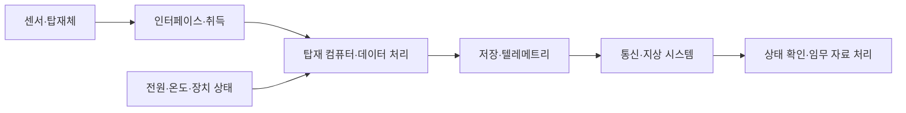

# 방산전자와 항공우주의 시스템 기술 | Defense electronics and aerospace systems

[산업별 목차](README.md) · [해양·조선](04-해양조선과선박시스템_marine-shipbuilding.md) · [직무와 실무 기술](../직무와실무기술_job-practice/README.md)

방산·항공우주에서는 전자 장치 하나가 플랫폼의 전원·센서·컴퓨터·통신·정비 체계와 함께 동작합니다. 전차의 상태 계측, 항공기의 탑재 전자, 위성의 데이터 처리에 공통 기반이 있지만 적용 환경과 검증 근거는 다릅니다. 공개된 사업·시스템 구성을 바탕으로 전자·컴퓨터공학이 맡는 일을 나누어 읽습니다.

## 1. 플랫폼·탑재 장비·부품·검증을 나눕니다

| 구분 | 주로 만드는 것 | 전자·컴퓨터공학의 연결 |
| --- | --- | --- |
| 지상 플랫폼 | 차량의 이동·전력·상태 감시와 탑재 장비 통합입니다. | 전원 분배, ECU·센서 인터페이스, 실시간 통신, 고장 기록과 정비가 연결됩니다. |
| 항공 플랫폼 | 기체·추진·탑재 장비·운용 지원의 통합입니다. | 탑재 컴퓨팅, 표시 장치, 계측·통신, 하드웨어·소프트웨어 개발 보증이 연결됩니다. |
| 센서·통신 장비 | RF·광학·영상·통신과 관련된 전자 장비입니다. | 아날로그 회로, ADC·DAC, FPGA·DSP, 데이터 전달과 장치 자체 진단을 다룹니다. |
| 우주 발사체·위성 | 우주 운송·관측·통신 등의 임무를 수행하는 시스템입니다. | 탑재 전원·컴퓨터·계측·지상국·데이터 관리와 환경 시험이 연결됩니다. |
| 부품·제작·정비 | 전자 보드·배선·커넥터·조립·시험·수명 관리입니다. | 부품 추적, 생산 검사, 환경 시험, 교정·판본·정비 이력의 관리입니다. |

미사일 등 유도무기는 공개 사업 분류에서 항법·센서·탑재 전자·통신·추진 등의 여러 분야가 만나는 제품군으로 소개됩니다. 여기서는 제품군과 직무의 위치를 구분하고, 전자 계측·신뢰성·제작 품질에 공통으로 필요한 개념을 연결합니다. 구체적인 학습 사례는 일반 탑재 장치와 민간 우주 시스템의 데이터·검증을 중심으로 설명합니다.

### 기업을 시스템의 역할로 읽습니다

| 기업·공개 자료 | 자료에서 확인한 범위 | 이 글에서 공부할 연결 |
| --- | --- | --- |
| [한화시스템 사업 소개](https://www.hanwhasystems.com/en/business/index.do) · [우주·항공](https://www.hanwhasystems.com/en/business/defense/space.do) | 방산전자·ICT, 우주 센서와 항공 탑재 장비의 사업 구분입니다. | 센서·컴퓨팅·통신·표시와 장치 간 통합입니다. |
| [LIG 디펜스&에어로스페이스 공식 소개](https://www.ligdefenseaerospace.com/main.do) | 공식 헤더와 유도무기·해양·감시정찰·지휘통제통신·항공전자 등의 사업 분류입니다. | 센서·통신·탑재 전자·체계 통합과 수명 지원의 분업입니다. |
| [한화의 항공우주·방산 사업](https://www.hanwha.com/industries/aerospace-and-defense.do) | 한화에어로스페이스 등의 항공엔진·지상 플랫폼·발사체 관련 사업을 소개합니다. | 기계·추진 분야와 계측·전자·제작 시험이 만나는 접점입니다. |
| [현대로템 지상 사업](https://www.hyundai-rotem.co.kr/ko/business/defense/content.do) | 전차·차륜형 차량 등 지상 플랫폼의 개발·생산 분야입니다. | 차량 전자·전력·상태 감시·시스템 통합의 관점입니다. |
| [KAI 2025 지속가능성 보고서](https://m.koreaaero.com/EN/data_file/2025_KAI_Sustainability_Report_ENG.pdf) | 고정익·회전익·기체·운영 지원과 우주 관련 사업을 나눈 판본입니다. | 항공기 체계·탑재 장비·제작·정비의 분업입니다. |

위 표는 공개 사업의 대응 관계입니다. 항공기 제작사와 탑재 센서 공급사, 엔진 제작사와 전자 보드 공급사를 하나의 직무로 합치지 않습니다. 각 회사가 특정 공개 소프트웨어를 채택했다는 정보는 아래 학습 자료의 출처와 구분합니다.

그림 1. 2026년 9월 미 해군이 공개한 F-35C의 항공모함 착함 사진입니다. 기체와 갑판 운용의 모습을 볼 수 있지만 레이더 안테나나 센서 내부를 보여 주지는 않습니다. 센서와 정보 통합은 [F-35 센서 구성 설명](https://www.lockheedmartin.com/f35/news-and-features/f35-sensor-fusion-in-focus.html)에서 따로 확인하실 수 있습니다. 사진은 [DVIDS 공개 자료](https://www.dvidshub.net/image/9922155/uss-carl-vinson-cvn-70-conducts-flight-operations)이며 원문은 공개 도메인으로 표시되어 있습니다.

## 2. 전차·장갑차 등 지상 플랫폼의 탑재 전자

차량 전자, vetronics는 차량 안에서 전원·센서·컴퓨터·표시·통신을 연결하는 전자 시스템을 가리킵니다. 자동차 ECU와 닮은 기반이 있지만 진동·오염·온도·케이블·정비·장치 교체 등 적용 조건을 별도로 다루어야 합니다. 지상 플랫폼에서 전기적 고장이 기계적 현상처럼 보이거나, 통신 장애가 센서 고장처럼 보일 수 있는 이유도 이 연결에 있습니다.

| 세부 분야 | 입력→처리→출력 | 기초 개념과 확인할 문제 |
| --- | --- | --- |
| 전력 분배·변환 | 전원 입력→변환·분배·상태 감시→각 탑재 장치 공급입니다. | 전압 강하·리플·기동 부하·접촉 저항과 장치 리셋의 관계를 봅니다. |
| 상태 센서·계측 | 온도·압력·전류·회전 등의 신호→신호 조절·ADC→상태 정보입니다. | 센서 범위·기준 전압·필터·교정·단위와 채널 대응을 확인합니다. |
| 탑재 컴퓨팅 | 장치 메시지→실시간 작업·진단→표시·기록·연동 정보입니다. | 평균 속도와 마감 시간, 큐의 적체, 오류 상태의 전달을 구분합니다. |
| 차량 네트워크 | 여러 제어기·센서→메시지 전송·해석→소비자 장치입니다. | 전기적 전달, 메시지 길이·순서, 수신 시각과 정보의 유효성을 함께 봅니다. |
| 표시·인간 인터페이스 | 장치 상태→단위·경보·유효성 처리→사용자 화면입니다. | 오래된 값·미수신 값·현재 정상값이 같은 화면으로 보이지 않는지 확인합니다. |
| 배선·기구·정비 | 장치·하네스·커넥터→연결·고정·교체→지속 동작입니다. | 진동 후 접촉 변화, 실드·접지, 교체 장치의 설정·판본을 추적합니다. |

예를 들어 화면의 온도가 일정하다고 가정하면 실제 온도가 안정된 경우와 마지막 수신값이 그대로 남은 경우가 모두 가능합니다. 센서 입력·ADC·통신 프레임·수신 큐·화면의 순서로 관측 위치를 나누어야 합니다. 이는 자체 구성한 진단 상황이며 실제 군용 플랫폼의 내부 구성이나 고장 사례를 옮긴 것은 아닙니다.

관련된 공개 코드는 [ADI 계측 드라이버와 SMU 사례](../직무와실무기술_job-practice/사례_cases/01-회로와소자의계측코드_circuit-device-measurement.md), [Zephyr UART·CAN 사례](../직무와실무기술_job-practice/사례_cases/02-펌웨어와통신의공개코드_firmware-communication.md)에서 읽으실 수 있습니다. 이 예제는 센서 취득·통신의 기초이며 특정 지상 플랫폼의 통신 규격을 확인한 자료는 아닙니다.

## 3. RF·광학 센서에서 디지털 정보까지

센서는 물리적 현상을 정보로 바꾸는 장치입니다. RF는 radio frequency, 무선 신호를 다루는 주파수 영역입니다. 광학 센서는 빛을 전기 신호로 바꿉니다. 센서 시스템의 품질은 소자 하나의 이름보다 입력 신호·아날로그 회로·변환·연산·동기·열 조건이 어떻게 연결되는지에 달려 있습니다.

| 세부 분야 | 전자공학의 일 | 컴퓨터공학의 일 | 대표 관측 |
| --- | --- | --- | --- |
| 안테나·RF 전단 | 안테나·필터·증폭·주파수 변환의 연결입니다. | 장치 설정·검사 순서·측정 자료의 관리입니다. | 주파수 응답·반사·입력 레벨·잡음·온도입니다. |
| 광학·적외선 수광 | 광학계·검출기·구동·아날로그 신호 취득입니다. | 영상 형식·시간·불량 픽셀·보정 자료의 처리입니다. | 노출·균일성·포화·암전류·프레임 누락입니다. |
| 데이터 변환 | ADC·DAC와 샘플링·클록·기준 전압입니다. | 비트 폭·부호·정렬·버퍼·채널 ID 처리입니다. | 입력 대비 디지털 코드·스펙트럼·타이밍입니다. |
| FPGA·DSP | 병렬 데이터 경로·인터페이스·메모리 연결입니다. | 알고리즘의 정수화·자원·지연·검증 환경입니다. | 기대값 대비 출력·오버플로·처리량·지연입니다. |
| 장치 통합 | 전원·냉각·접지·차폐·기구 연결입니다. | 상태·오류·판본·시간 정보의 일관성입니다. | 개별 장치와 통합 후 결과 차이입니다. |

샘플링은 연속 신호를 일정 시점에서 수로 읽는 과정입니다. 충분히 빠르게 읽지 않으면 높은 주파수 성분이 낮은 주파수처럼 보이는 aliasing이 생길 수 있습니다. 다만 샘플링 속도만 높여도 입력 잡음·클록·포화·대역폭 문제가 해결되는 것은 아닙니다. 기초는 [샘플링과 aliasing](../전자컴퓨터공학_ece/21-신호처리제어_signals-control/해설_notes/샘플링과aliasing_sampling-aliasing.md)에서 이어집니다.

AESA는 여러 능동 송수신 소자를 배열로 사용해 전자적으로 방향성을 형성하는 안테나 방식입니다. 개별 회로와 배열 전체의 전원·클록·열·교정이 연결되는 분야로 이해하시면 됩니다. 세부 파동 원리와 공개 기술의 비교는 기존 [AESA·GaN 리뷰](../제품기술분석_product-technology/방산전자_defense-electronics/능동위상배열레이더와질화갈륨_aesa-gan2026.md)에 연결하고, 여기서는 회로·FPGA·소프트웨어·시험의 업무 경계를 중심으로 봅니다.

## 4. 항공전자와 개발 보증

항공전자는 avionics이며 항공기에 들어가는 전자 장비·컴퓨팅·표시·통신 등을 다룹니다. 기능이 한 번 실행됐다는 증거와, 정해진 요구사항·설계·구현·검증 과정을 따라 만들었다는 증거가 함께 필요합니다.

FAA의 [AC 20-115D](https://www.faa.gov/regulations_policies/advisory_circulars/index.cfm/go/document.information/documentID/1032046)는 항공 소프트웨어 개발 보증에서 ED-12C/DO-178C 등을 인정하는 경로를 설명합니다. [AC 20-152A, 2022-10-07, 1–2절](https://www.faa.gov/documentLibrary/media/Advisory_Circular/AC_20-152A.pdf)은 항공 전자 하드웨어와 ED-80/DO-254의 연결을 설명합니다. 이는 각각의 적용 조건을 가진 FAA의 수용 가능한 입증 방법이며 모든 군용·우주 장치에 같은 절차가 자동 적용된다는 뜻은 아닙니다. 유료 표준 전문을 읽은 것으로 표시하지 않았습니다.

| 개발 단계 | 확인할 질문을 실제 결과물로 바꾼 내용 |
| --- | --- |
| 요구사항 | 입력·출력·허용 시간·오류 상태와 적용 환경을 명확하게 적습니다. |
| 설계 | 기능을 하드웨어·소프트웨어·인터페이스에 배정하고 의존 관계를 남깁니다. |
| 구현 | 승인한 요구와 설계에 대응하는 코드·RTL·회로와 판본을 관리합니다. |
| 검증 | 정상·경계·오류 조건의 기대 결과와 실제 결과를 대조합니다. |
| 형상 관리 | 시험한 바이너리·설정·도구·보드가 어느 판본인지 재구성할 수 있게 합니다. |
| 변경·문제 보고 | 알려진 결함·변경 영향·재검증 범위를 추적합니다. |

추적성은 요구사항 하나에서 설계·구현·시험 근거를 따라갈 수 있는 관계입니다. 시험이 많아도 무엇을 확인한 시험인지 연결되지 않으면 요구 충족을 설명하기 어렵습니다. 반대로 모든 코드 줄이 실행됐다는 기록만으로 모든 잘못된 입력과 시스템 상호작용을 검증한 것도 아닙니다.

항공 장비에서는 RTOS의 스케줄, 태스크 간 메시지, 메모리·버퍼 수명, 장치 입력과 시간 기준이 함께 중요합니다. 기존 [펌웨어·RTOS](../전자컴퓨터공학_ece/17-펌웨어-RTOS_firmware-rtos/README.md), [실시간 대기·마감 시간 사례](../설계와검증사례_engineering-cases/뮤텍스대기와마감시간_rtos-priority-inversion.md)를 해당 장비의 요구사항과 연결해 읽습니다.

## 5. 민간 발사체·위성의 탑재 컴퓨팅

NASA의 [2026 Small Spacecraft Avionics, Introduction·Avionics Architecture](https://www.nasa.gov/smallsat-institute/sst-soa/small-spacecraft-avionics/)는 탑재 컴퓨터, 명령·데이터 처리, 비행 소프트웨어와 탑재체 전자를 나누고 임무별 구조를 비교합니다. 위성·관측 장치에서 전자·컴퓨터공학의 접점을 읽는 자료로 사용합니다.

이 그림은 관측 자료와 장치 상태의 흐름을 단순화한 자체 설명입니다. 특정 기체의 비행 제어 구성이나 실제 전송 경로를 재현한 그림은 아닙니다.

| 하위 분야 | 구체적으로 만드는 것 | 전자·컴퓨터공학의 관측 항목 |
| --- | --- | --- |
| 탑재 컴퓨터 OBC | 프로세서·메모리·버스·보드의 컴퓨팅 기반입니다. | 처리 시간·메모리 사용·재시작·장치 접근과 부품 판본입니다. |
| 명령·데이터 처리 CDH | 장치 간 정보 전달·자료 보존·상태 취급입니다. | 메시지 식별·유효성·순서·시각·버퍼 경계입니다. |
| 비행 소프트웨어 FSW | 탑재 기능을 실행하는 소프트웨어와 환경입니다. | 요구·스케줄·상태 전이·오류 처리·형상·시험 근거입니다. |
| 탑재체 데이터 | 카메라·과학 계측기 등의 자료를 다룹니다. | 센서 설정·프레임 형식·교정·자료량·손실 여부입니다. |
| 전력·열 계측 | 전원과 온도 상태를 관측·기록합니다. | 순간 부하·전원 변화·접합/보드 온도와 장치 상태의 대응입니다. |
| 지상 시험·운용 지원 | 전기 지상 지원 장비와 데이터 처리 환경입니다. | 장치 ID·시간·시험 입력·수신·해석·기록의 연결입니다. |

CPU를 빠르게 바꾸면 관측 자료를 더 많이 처리할 여지가 생기지만, 전력·방열·메모리·통신·신뢰성의 조건도 달라집니다. 실시간 작업과 대량 영상 처리가 자원을 공유한다면 최고 연산량뿐 아니라 바쁜 조건의 지연과 자원 경쟁도 살펴야 합니다. 제품의 ‘고성능’이라는 표현을 그대로 임무 적합 판정으로 바꾸지 않는 이유입니다.

## 6. 텔레메트리·지상국·자료 저장

텔레메트리는 떨어져 있는 장치의 측정·상태 정보를 전달하는 것입니다. 과학 영상, 장치 온도, 오류 카운터, 소프트웨어 이벤트는 모두 데이터이지만 생성 주기·중요도·처리 경로는 다를 수 있습니다. 지상에서 숫자를 받는 일과 그 숫자가 어떤 시각·설정의 어떤 물리량인지 해석하는 일도 구분합니다.

| 단계 | 데이터가 갖춰야 할 의미 | 주로 확인할 문제 |
| --- | --- | --- |
| 생성 | 센서·채널·장치 판본·취득 시각입니다. | 서로 다른 시료·설정의 값이 섞이는 문제입니다. |
| 포장·전달 | 메시지 형식·길이·순서와 상태입니다. | 프레임 누락·중복·형식 변경·유효하지 않은 값입니다. |
| 저장 | 생성량·보존 조건·공간·오류 상태입니다. | 공간 부족·중단·재시작에서 잃은 자료를 파악하는 일입니다. |
| 수신·해석 | 소프트웨어 사전·단위·보정 판본입니다. | 같은 비트열을 다른 물리량으로 읽는 문제입니다. |
| 분석 | 원시 자료와 가공 결과의 대응입니다. | 보정·필터·집계가 어떤 자료를 바꾸거나 제외했는지 확인하는 일입니다. |

가정한 관측 장치가 1 MiB/s의 자료를 10분 생성하면 원시 자료량은 `1 × 600 = 600 MiB`입니다. 통신 중단 구간에 저장 공간이 충분한지 생각하는 간단한 계산입니다. 파일·패킷 부가 정보, 압축, 실제 관측 주기와 장치 사양은 넣지 않았습니다. 이 수치는 특정 발사체·위성의 공개 사양이나 측정 결과가 아닙니다.

기초 구현 문제는 기존 [프레임 길이·바이트 순서](../설계와검증사례_engineering-cases/이진프레임의길이와바이트순서_c-frame-bounds.md), [시간 초과·재시도](../설계와검증사례_engineering-cases/시간초과뒤늦은쓰기와재시도_block-io-timeout-retry.md), [업데이트 중단·롤백](../설계와검증사례_engineering-cases/중단된업데이트의슬롯선택과롤백_firmware-ab-update.md)에서 읽습니다. 이 호스트·임베디드 학습 사례를 실제 비행 장치의 승인된 절차로 해석하지 않습니다.

## 7. 우주 환경에서 달라지는 부품·열·신뢰성

### 방사선과 전자 부품

NASA는 전자 부품의 방사선 영향을 SEE, TID, TNID 등으로 나누어 설명합니다. SEE는 입자 하나의 상호작용으로 생길 수 있는 사건, TID는 누적 이온화 선량의 영향입니다. TNID는 총 비이온화 선량을 뜻하며 반도체 격자 원자가 제자리에서 벗어나는 변위 손상과 관련됩니다. 비트 상태가 바뀌는 현상과 기능 정지·영구 손상은 같은 오류가 아니므로 검출·기록·복구·부품 평가의 근거도 달라집니다. [NASA JSC Radiation, Avionics Radiation Hardness Assurance](https://www.nasa.gov/reference/jsc-radiation/), [NASA NEPP의 전자 부품 방사선 연구](https://nepp.nasa.gov/pages/Radiation.cfm)

| 수준 | 학습할 개념 | 확인할 근거 |
| --- | --- | --- |
| 부품 | 누적 열화·일회성 사건·부품 편차입니다. | 해당 부품·판본·시험 조건의 자료입니다. |
| 메모리·연산 | 오류 검출·정정과 계산 결과의 유효성입니다. | 검출 가능한 오류 종류와 남는 실패 조건입니다. |
| 소프트웨어 | 작업 진행 확인·재시작·상태 보존입니다. | 오류가 기록되고 어느 상태로 복구되는지입니다. |
| 시스템 | 공통 원인과 여러 장치의 의존성입니다. | 전원·클록·통신·설정이 실제로 얼마나 독립적인지입니다. |

같은 소프트웨어와 같은 전원을 공유하는 컴퓨터 두 대는 특정 공통 오류에 함께 영향을 받을 수 있습니다. 장치 수를 늘린 사실과 독립성이 확보된 설계 근거를 나누어 보아야 합니다. 기존 [워치독·리셋 기록](../설계와검증사례_engineering-cases/작업진행을확인하는워치독과리셋기록_watchdog-health-reset.md)과 메모리 오류 설명은 이 관계의 기반을 제공합니다.

### 열과 기구 환경

진공에서 외부 공기가 대류로 열을 옮기는 지상 조건을 그대로 기대할 수는 없습니다. 부품에서 구조물로 전달되는 전도와 표면의 복사가 중요해집니다. 전자 보드의 전력 사용·발열 위치와 기구의 열 경로가 서로 맞아야 합니다. [NASA 2026 Thermal Control의 진공 열 전달 설명](https://www.nasa.gov/smallsat-institute/sst-soa/thermal-control/)

진동 시험은 단순히 기기가 켜지는지 보는 것에 그치지 않습니다. 시험 전후 커넥터·배선·접속·구조·파형·기능과 기록의 변화를 함께 봅니다. 열 시험도 공기 온도·보드 온도·소자 온도와 실제 부하를 구분해야 결과를 설명할 수 있습니다. 열의 기초는 [패키징·열 설계](../전자컴퓨터공학_ece/36-패키징열설계_packaging-thermal/README.md)에 연결합니다.

## 8. 공개 소프트웨어를 읽는 경로

| 자료 | 실제로 공개된 대상 | 읽을 개념과 사용 범위 |
| --- | --- | --- |
| [NASA cFS 공식 소개](https://etd.gsfc.nasa.gov/capabilities/core-flight-system/) · [공식 저장소](https://github.com/nasa/cFS) | 재사용 가능한 우주 소프트웨어 프레임워크와 관련 구성요소입니다. | 앱·운영체제 추상화·플랫폼 지원·메시지·이벤트의 경계를 읽습니다. 적용하려는 배포물·서브모듈·라이선스·시험 범위를 따로 확인합니다. |
| [NASA/JPL F Prime의 구조](https://fprime.jpl.nasa.gov/overview/powerful-swa/) · [공식 저장소](https://github.com/nasa/fprime) | 컴포넌트·포트·토폴로지로 구성하는 임베디드 프레임워크입니다. | 기능 단위와 인터페이스, 호출 스레드·큐·실행 문맥, 시험 구성을 나누어 읽습니다. |
| [기존 공개 코드 사례](../직무와실무기술_job-practice/사례_cases/README.md) | 제조사 드라이버·프로젝트 공식 예제와 출처·사용 조건입니다. | C·Python을 읽는 기초, 측정·오류·결과의 대응을 익힙니다. |

F Prime에서 컴포넌트는 기능을 담는 단위, 포트는 단위 사이의 인터페이스, 토폴로지는 연결 구조입니다. 공식 설명은 실행 방식에 따라 호출한 스레드에서 일하거나 큐·별도 스레드를 사용하는 차이를 보여 줍니다. 따라서 포트 연결 그림만 아니라 누가 언제 실행하고 메시지를 어디에 보관하는지도 함께 읽어야 합니다.

cFS 저장소를 확인한 2026-10-26의 README에는 `v7.0.2rc1`을 release candidate로 표시합니다. RC는 정식 릴리스 전 후보 판본입니다. 공개 저장소가 있다는 사실과 특정 판본의 임무 승인·실제 기체 사용은 서로 다른 근거입니다. 이 글에서는 새 C·Python 비행 코드를 만들거나 해당 프레임워크를 빌드·실행한 결과를 제시하지 않았습니다.

## 9. 업무·시험과 남길 결과물

다음은 역할별 학습 상황을 구성한 표입니다. 실제 기업의 결함 발생 기록과는 구분합니다.

| 역할과 상황 | 장비·자료 | 원인 분리와 결과물 |
| --- | --- | --- |
| 회로·전원: 부하가 바뀔 때 장치가 재시작합니다. | 전원·전자부하·오실로스코프·보드 상태 로그입니다. | 전압·리셋·소프트웨어 이벤트를 같은 시각으로 맞추고 전원 경로·부하·기록 상태를 나눕니다. |
| FPGA·펌웨어: 센서 자료 일부가 누락됩니다. | 기대 입력·파형·버퍼·장치/수신 로그입니다. | 입력 누락과 변환·전달·큐·소비자 문제를 구분하고 최초 차이가 생긴 경계를 남깁니다. |
| 시스템 시험: 개별 장치는 정상인데 통합 후 값이 다릅니다. | 인터페이스 문서·시료·설정·시간·원시 값입니다. | 단위·부호·판본·좌표·시각·전기적 조건을 대조합니다. |
| 환경·품질: 시험 전후 특정 채널만 변합니다. | 시료 ID·채널·계측 조건·접속·기능 기록입니다. | 측정 경로와 시료 변화를 나눌 기준 대조와 재검사 범위를 정합니다. |
| 지상 SW·데이터: 그래프는 정상인데 자료가 오래됐습니다. | 생성·수신 시각·판본·연결/오류 상태입니다. | ‘최근에 받음’과 ‘최근에 측정됨’을 구분하고 누락 구간을 표시합니다. |

입력·출력·시간·조건·기대 동작·원시 결과를 연결하는 습관은 분야가 달라도 재사용됩니다. 장비 설정·소프트웨어 판본·시료를 남기는 방법은 [검사 결과의 판정과 기록](../직무와실무기술_job-practice/11-검사결과의판정과기록_test-decisions-evidence.md)에서 이어집니다.

## 출처와 확인 범위

- 기업의 사업 구분은 위에 연결한 공식 사업 소개와 KAI 2025 보고서의 공개 사업 본문을 확인했습니다. 계열사의 모든 사내 조직·도구·공급 계약을 확인한 목록은 아닙니다.
- FAA AC는 20-115D의 공식 상태·설명과 20-152A의 목적·적용 설명을 사용했습니다. DO-178C·DO-254 전문의 모든 목표를 요약한 자료는 아닙니다.
- NASA 자료는 2026 Small Spacecraft Avionics의 구성·구조 설명, Thermal Control의 열 전달, JSC/NEPP의 방사선 영향 구분을 읽었습니다. 원문에 나온 공급사 비교·구체 성능 수치는 옮기지 않았습니다.
- cFS·F Prime은 공식 소개·README·구조 설명을 확인했습니다. 코드 발췌·추정 구현·기체 연결·비행 시험은 수행하지 않았습니다.

기준일은 2026-10-26입니다. 표·흐름도·업무 상황·자료량 계산은 이해를 위한 자체 설명입니다.

## English

This guide separates ground-platform electronics, sensors, avionics, civilian spacecraft computing and support engineering. It connects power, acquisition, real-time software, interfaces, telemetry, radiation and thermal conditions to observable evidence and engineering handoffs. Public company descriptions, FAA assurance guidance and NASA frameworks are identified separately from authored learning scenarios. The data-volume example is an educational calculation.
