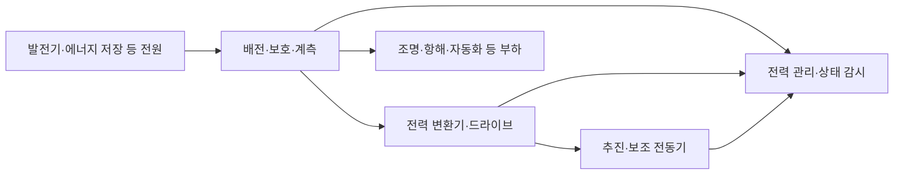

# 해양·조선의 전자와 선박 시스템 | Marine electronics and shipbuilding systems

[산업별 목차](README.md) · [방산전자·항공우주](03-방산전자와항공우주_defense-aerospace.md) · [공개 코드 업무 사례](../직무와실무기술_job-practice/사례_cases/README.md)

조선에서는 선체를 만드는 일과 함께 발전·배전·추진·기관·항해·통신·자동화·데이터를 통합합니다. 선박을 건조하는 과정에도 CAD·생산 계획·로봇·검사·물류와 소프트웨어가 쓰입니다. 전자·컴퓨터공학의 업무를 선박 안의 시스템, 선박과 육상의 연결, 조선소의 설계·생산으로 나누어 읽습니다.

## 1. 선박 종류와 기업의 역할

| 대상 | 시스템에서 달라지는 요구 | 전자·컴퓨터공학의 연결 |
| --- | --- | --- |
| 상선·여객선 | 화물·승객·항로·운용 부하에 맞는 전력·추진·감시입니다. | 전력 변환·통합 자동화·항해 센서·통신·상태 관리입니다. |
| LNG·가스 운반선 | 화물과 연료를 정해진 상태로 감시·관리하는 시스템입니다. | 온도·압력·수위·가스 계측, 제어·보호, 화물/기관 데이터의 추적입니다. |
| 해양플랜트·작업선 | 해상 작업과 발전·설비·운용 위치·하중의 연계입니다. | 분산 제어·전력 관리·위치·구조·기계 상태 계측입니다. |
| 특수선 | 목적에 맞는 탑재 장비·전력·통신·기구의 통합입니다. | 전자 장비와 선박 기반 시스템의 전기·열·정보 인터페이스입니다. |
| 조선소 | 설계에서 가공·블록·의장·조립·검사로 이어지는 생산입니다. | CAD·PLM·생산 관리·자동화·품질 데이터와 설계 변경 관리입니다. |

### 공개 사업 자료에서 확인한 연결

| 기업·자료 | 확인한 사업 범위 | 관련 기술 |
| --- | --- | --- |
| [한화오션](https://www.hanwha.com/companies/hanwha-ocean.do) | 상선·해양플랜트·특수선과 관련 서비스입니다. | 선박 시스템 통합·자동화·화물·구조·생산 데이터입니다. |
| [한화엔진](https://www.hanwha.com/companies/hanwha-engine.do) | 대형 저속 선박 추진 엔진, 부품·기술 서비스, SCR입니다. | 기관 계측·전자 제어·상태 진단·배출 저감 장치와 검증입니다. |
| [HD한국조선해양](https://www.hd-ksoe.com/kr/brand-story/company/company-overview/contents) | 조선·해양플랜트·엔진/기계·에너지의 R&D·엔지니어링과 중간지주 역할입니다. | 선박·추진·수명 관리와 설계·생산 기술의 연결입니다. |
| [HD현대마린솔루션의 HiCONiS](https://www.hd-marinesolution.com/kr/business/digital/integrated-control/contents) | 선박 통합제어와 IAS·PMS·화물·연료 관련 솔루션을 소개합니다. | 장치 제어·감시·경보·정보 통합과 운용 지원입니다. |

공식 명칭은 HD한국조선해양입니다. 그룹의 연구·사업 관리 역할과 실제 선박을 건조하는 조선사, 엔진·제어 장치·운용 서비스를 공급하는 회사는 구분해서 보아야 합니다. 같은 그룹에 속한다는 이유만으로 모든 선박의 장비·통신·소프트웨어가 같다고 추정하지 않습니다.

그림 1. 한화 공식 기업 소개의 한화오션 관련 선박 이미지입니다. 선박 전체의 크기와 갑판·선체 구성을 보는 자료이며 특정 선종이나 탑재 시스템을 식별하는 도면은 아닙니다. [한화오션 사업 소개](https://www.hanwha.com/companies/hanwha-ocean.do)

## 2. 발전·배전·전기추진

### 기계 추진과 전기추진의 차이

기계식 추진은 엔진의 기계적 출력을 축계 등의 경로로 추진기에 전달합니다. 전기추진은 전원에서 공급한 전력을 변환해 추진 전동기를 구동합니다. 엔진·발전기·배터리·전력 변환기·전동기를 어떤 조합으로 쓰는지는 선박의 목적과 설계에 따라 다릅니다.

이 그림은 일반적인 전력 흐름을 설명하는 자체 구성입니다. AC·DC 배전과 실제 보호·분리 구조를 하나로 정한 설계도가 아닙니다.

| 세부 기술 | 기본 원리 | 대표 확인 항목 |
| --- | --- | --- |
| 발전·전원 계측 | 전원을 만드는 장치와 실제 부하의 상태를 측정합니다. | 전압·전류·주파수·전력과 변화 시각입니다. |
| 배전·보호 | 여러 부하에 전력을 공급하고 이상이 미치는 범위를 관리합니다. | 차단·경보·공급 경계와 설정·구성의 일치입니다. |
| 주파수 변환기·인버터 | 전력 반도체의 스위칭으로 전동기에 필요한 전기 상태를 만듭니다. | 전류·전압·열·스위칭 영향과 전동기 응답입니다. |
| 전동기·드라이브 | 전기 에너지를 회전과 기계적 출력으로 바꿉니다. | 속도·토크 관련 값·전류·진동·온도와 부하 조건입니다. |
| 에너지 저장 | 충전·방전과 상태 관측을 전력 수요에 연결합니다. | 에너지·전력·온도·셀/모듈 상태와 운용 기록입니다. |
| 육상 전원 연결 | 선박과 항만 전력 계통을 연결합니다. | 전압·주파수·접지·전력 변환 등 계통 사이의 조건입니다. |

전동기용 가변 주파수 드라이브(VFD, variable frequency drive)는 공급 주파수 등을 조절해 전동기의 속도·부하를 실제 수요에 맞추는 데 쓰입니다. 선박의 펌프·팬 같은 보조기기에도 적용할 수 있습니다. [IMO GreenVoyage2050의 주파수 제어 전동기 설명](https://greenvoyage2050.imo.org/technology/frequency-controlled-electric-motors/), [ABB의 선박용 드라이브](https://new.abb.com/drives/segments/marine)

육상 전원과 선박의 전압·주파수가 다르면 변환과 접속 조건을 맞추어야 합니다. [ABB의 shore-to-ship 변환기 설명](https://new.abb.com/power-converters-inverters/grid-interconnections/shore-to-ship-converters)은 선박과 육상 계통 사이의 주파수 변환을 다룹니다. 주파수 하나가 맞았다는 사실만으로 전체 접속 조건을 만족하는 것은 아니므로 전력 시스템의 요구와 검증 범위를 함께 봅니다.

### PMS와 에너지 관리는 다른 부하를 함께 봅니다

PMS는 power management system, 전력 관리 시스템입니다. 전원·배전·부하의 상태와 요구를 함께 취급합니다. 에너지 관리는 여기에 일정 기간의 연료·저장 에너지·운용 효율 같은 관점을 연결할 수 있습니다. [ABB PEMS](https://new.abb.com/marine/systems-and-solutions/digital/control-and-monitoring/PEMS)와 [Kongsberg PMS](https://www.kongsbergmaritime.com/products/electrical-power-system/energy-products/power-management-systems/K-Power-PMS/)의 공개 설명에서 이런 통합 관계를 확인할 수 있습니다.

전력은 어느 순간의 일률이고 에너지는 시간에 걸쳐 사용한 양입니다. 큰 순간 부하와 긴 시간의 소비량을 같은 지표로 비교하면 배터리·발전기·운용 조건을 잘못 해석할 수 있습니다. 기초는 [전력전자·에너지](../전자컴퓨터공학_ece/31-전력전자에너지_power-energy/README.md)와 [부하 변화의 과도 응답](../전자컴퓨터공학_ece/31-전력전자에너지_power-energy/해설_notes/부하변화의과도응답_buck-transient.md)에 연결합니다.

## 3. 엔진·화물·배출 저감의 계측과 제어

대형 엔진은 기계 장치이지만 제어·계측·진단을 위한 전자 시스템과 함께 동작합니다. 회전·온도·압력·진동 등의 상태를 관측하고, 장치 요구와 실제 상태를 비교하며, 고장·정비 이력을 관리합니다. 기관 소프트웨어를 이해할 때도 먼저 어떤 물리량을 어디에서 측정하는지 알아야 합니다.

| 하위 시스템 | 입력·관측 | 제어·정보 처리의 역할 | 시험·분석의 관점 |
| --- | --- | --- | --- |
| 엔진 전자·상태 감시 | 회전·압력·온도·장치 상태입니다. | 여러 센서의 값·상태·시각을 연결합니다. | 센서·취득·통신 이상과 실제 기계 상태를 나눕니다. |
| 연료 관련 설비 | 공급 상태와 장치·배관의 계측입니다. | 대상 설비의 제어·감시·보호 기능을 연결합니다. | 설정·표시·실제 장치 상태의 대응을 확인합니다. |
| 냉각·윤활·보조기기 | 온도·압력·유량·펌프 상태입니다. | 요구 부하와 공급 상태를 맞추고 이력을 남깁니다. | 기계 성능 저하·센서 변화·단위·통신 문제를 구분합니다. |
| 화물 감시 | 탱크의 온도·압력·수위 등입니다. | 채널·탱크·상태·경보의 관계를 유지합니다. | 계측 위치·정의·교정·시각과 실제 화물 상태를 함께 봅니다. |
| SCR 등 배출 저감 | 관련 장치·배출·운용 상태의 계측입니다. | 환경·기관·보조 설비 데이터를 연결합니다. | 측정 방법·부하·시료·시간과 기준을 구분합니다. |

SCR는 selective catalytic reduction, 선택적 촉매 환원입니다. 한화엔진은 [공식 소개](https://www.hanwha.com/companies/hanwha-engine.do)에서 선박용 NOx 저감 시스템을 사업으로 구분합니다. 환경 성능을 평가할 때는 장치 이름뿐 아니라 연료·운용 부하·분석 방법·시험 조건이 필요합니다.

전자·컴퓨터 직무가 만드는 결과물에는 센서 회로·입출력 보드·임베디드 소프트웨어·통신 인터페이스·시운전 기록·상태 분석 도구가 있습니다. 기계·전기·제어·환경 담당자가 같은 엔진 번호·시점·판본을 기준으로 기록을 연결해야 서로 다른 조건의 결과를 비교하는 일을 줄일 수 있습니다.

## 4. IAS·경보·분산 I/O

IAS는 integrated automation system, 통합 자동화 시스템을 뜻합니다. 여러 기관·설비의 감시와 제어를 연결합니다. AMS는 alarm monitoring system, 경보 감시 시스템이라는 뜻으로 쓰이며, 제품에 따라 통합 범위와 명칭이 다를 수 있습니다. PLC·분산 I/O·네트워크·운용 화면은 이 흐름의 구성요소입니다.

[HiCONiS 공식 제품 설명](https://www.hd-marinesolution.com/kr/business/digital/integrated-control/contents)은 통합 플랫폼에 IAS·PMS·화물·연료 관련 기능을 연결하는 예입니다. 공급사의 기능 소개와 실제 특정 선박의 승인된 구성·성능은 다른 근거로 확인합니다.

| 층 | 기능 | 흔히 혼동하는 부분 |
| --- | --- | --- |
| 센서·트랜스미터 | 물리량을 전압·전류·디지털 신호로 바꿉니다. | 센서 값과 실제 공정량의 단위·교정 관계입니다. |
| I/O·제어기 | 신호를 취득·처리하고 장치와 연동합니다. | ADC 코드·범위 초과·채널 오류와 정상 측정값입니다. |
| 산업 네트워크 | 장치와 서버 사이에서 상태·자료를 전달합니다. | 정상 수신과 최근에 생성된 유효 정보는 다릅니다. |
| 경보·화면 | 값·상태·경보를 운용자가 읽는 형태로 표시합니다. | 경보 발생·확인·해제와 실제 현상 종료는 같은 사건이 아닙니다. |
| 기록·분석 | 사건과 시계열을 저장하고 비교합니다. | 같은 이름의 값이라도 취득·전달·수신 시각이 다를 수 있습니다. |

시간 정보는 특히 중요합니다. 값의 시각이 센서에서 측정한 시각인지, 제어기가 처리한 시각인지, 육상 서버가 받은 시각인지 구분해야 합니다. 서로 다른 장치의 시각을 그대로 정렬하면 실제 인과관계와 다른 그래프가 나올 수 있습니다. [설비 신호·PV 시각의 공개 코드 사례](../직무와실무기술_job-practice/사례_cases/04-공정설비와패키지의검사사례_process-equipment-package.md)는 이 의미를 읽는 학습 자료이며 선박에서 EPICS를 쓴다는 채택 근거는 아닙니다.

산업 통신의 프레임·timeout·오류 상태·종단 문제는 [CAN·EtherCAT·Modbus의 고장 분리](../현장계측과검증_measurement-validation/칩과시스템시험_chip-system-testing/차량과설비통신의고장분리_can-ethercat-modbus.md)에서 공부합니다. 특정 선박이 어느 프로토콜을 쓰는지는 장비 인터페이스·네트워크 구성으로 별도 확인합니다.

## 5. 항해 센서와 해상 레이더

항해 장비는 서로 다른 물리량을 관측합니다. 화면에서 같은 위치 근처에 표시된다는 이유만으로 같은 종류의 원자료인 것은 아닙니다. 센서의 목적·좌표·시각·유효 상태를 알아야 정보를 함께 사용할 수 있습니다.

| 장치·자료 | 무엇을 관측하거나 제공하나요 | 전자·소프트웨어의 핵심 |
| --- | --- | --- |
| GNSS | 위성 신호를 이용한 위치·시각 정보입니다. | 안테나·수신·위치/시각 상태·자료 갱신과 기준 좌표입니다. |
| 자이로·관성 센서 | 회전·가속과 이를 이용한 자세·방향 관련 정보입니다. | 센서 오차·누적 드리프트·좌표 변환·다른 관측과의 일치입니다. |
| 해상 레이더 | 반사 전파를 이용해 주변 반사체에 관한 정보를 관측합니다. | RF·안테나·수신·디지털 처리·표시와 관측 조건입니다. |
| AIS | 다른 장치가 송신하는 선박 식별·위치·항행 관련 정보입니다. | 수신·식별·갱신·메시지 의미와 다른 관측과의 차이입니다. |
| 속도·수심·음향 계측 | 물·해저·선체 운동과 관련된 정보를 제공합니다. | 매질·음속·설치·기준점·자료 해석과 상태입니다. |
| ECDIS·전자해도 | 공식 해도와 위치 등 항해 정보를 화면에 연결합니다. | 해도 자료·갱신·표시·경보·센서 입력의 의미입니다. |

[IMO의 AIS 설명](https://www.imo.org/en/ourwork/safety/pages/ais.aspx)은 식별·위치 등 정보를 다른 선박과 육상에 자동 제공하는 기능을 설명합니다. AIS의 타선 정보는 해당 선박이 송신한 자료이고 레이더는 반사 신호를 관측하므로, 수신되지 않는 AIS 정보를 곧바로 주변에 물체가 없다는 뜻으로 읽을 수는 없습니다. [Kongsberg의 항해·위치 제품 분류](https://www.kongsberg.com/what-we-do/ocean-space/navigation-positioning/)도 GNSS·관성·음향·카메라 등의 서로 다른 센서를 구분합니다.

ECDIS는 electronic chart display and information system, 전자해도 표시·정보 시스템입니다. [IMO MSC.530(106), 2022년 채택, 7절](https://wwwcdn.imo.org/localresources/en/KnowledgeCentre/IndexofIMOResolutions/MSCResolutions/MSC.530%28106%29.pdf)은 레이더·AIS 정보를 ECDIS에 연결할 때의 표준 맥락을 설명합니다. 이 글은 해당 시스템의 항해 운용 절차를 대신하는 자료가 아니라 전자·정보 시스템의 관계를 읽는 안내입니다.

같은 선박의 센서도 설치 위치가 다릅니다. 안테나 위치·선체 기준점·선수 방향·센서 자체 좌표가 다르면 이를 일관된 정의로 해석해야 합니다. 또한 heading, 선체가 향하는 방향과 course, 이동 방향은 다른 물리적 의미를 가집니다. 센서의 기준과 시간 정보를 맞추는 일이 화면을 연결하는 일보다 먼저입니다.

## 6. 선박·육상 데이터와 자율운항

선박 안의 제어 주기와 위성·육상 통신을 통한 자료 전달은 같은 경로가 아닙니다. 연결이 느리거나 끊어지는 상황에서도 선내 장치의 상태·책임 범위와 자료 보존을 정의해야 합니다. 원격 감시, 운용 보조, 원격 제어, 자율 기능은 각각 사람이 맡는 일과 시스템이 맡는 일을 따로 확인합니다.

[IMO의 e-navigation 설명](https://www.imo.org/en/ourwork/safety/pages/enavigation.aspx)은 선박과 육상의 해양 정보를 수집·통합·교환·표시·분석하는 관계를 다룹니다. [한화오션의 2024-02-21 공식 HS4 발표](https://www.hanwha.com/newsroom/news/press-releases/hanwha-ocean-launches-smart-ship-solution-to-help-shipowners-reduce-carbon-emissions.do)는 연료 사용·운항 자료와 CII 모니터링을 스마트십 플랫폼에 연결한 공급사 사례입니다. 당시 기술 개발·적용 계획의 발표를 모든 인도 선박의 현재 실측 성능으로 확대하지 않았습니다.

| 데이터 업무 | 구체적인 문제 | 확인할 근거 |
| --- | --- | --- |
| 수집 | 장비별 단위·채널·주기가 다릅니다. | 장치 정의·교정·자료 형식과 유효 상태입니다. |
| 선내 저장 | 통신 중단 중에도 자료가 생깁니다. | 보존 공간·손실·중단·재전송 이력입니다. |
| 육상 전달 | 중복·지연·순서 변경이 생길 수 있습니다. | 생성/수신 시각·실행 ID·자료 버전입니다. |
| 분석 | 운항·기상·부하·제품 상태가 함께 바뀝니다. | 비교 기간·운용 조건·자료 품질과 모델 적용 범위입니다. |
| 의사결정 지원 | 예측값과 실제 상태의 의미가 다릅니다. | 근거·담당자 판단·승인·조치·후속 확인입니다. |

2026-05-22 IMO는 비강제 MASS Code를 채택했으며 적용 개시일을 2026-07-01로 설명합니다. 적용 대상은 SOLAS Chapter 1의 적용을 받는 화물선입니다. 이 발표는 안전·보안·환경 보호와 원격 운용·사람의 책임을 함께 다룹니다. 2030년 강제 코드 채택·2032년 발효는 같은 발표에 제시한 향후 목표입니다. [IMO의 채택 발표·로드맵과 적용 범위 각주](https://www.imo.org/en/mediacentre/pressbriefings/pages/imo-adopts-mass-code.aspx)

따라서 자율운항 기능 시연, 특정 조건의 운용 보조, 선박 전체의 자율 운용은 같은 주장으로 읽지 않습니다. 개발자는 기능 경계·운용 조건·사람과 시스템의 책임·시험 근거를 구체적으로 연결해야 합니다.

## 7. 조선소의 CAD·PLM·생산 데이터

배는 많은 부품·배관·케이블·기자재를 장기간에 걸쳐 설계·조립하는 제품입니다. 한 장의 그림보다 설계 자료·변경·생산·설치·검사의 대응 관계가 중요합니다. 배관을 이동하면 간섭·지지·케이블·장비 접근·작업 순서 등 여러 정보가 함께 바뀔 수 있습니다.

| 기술 | 의미 | 전자·컴퓨터공학의 세부 업무 |
| --- | --- | --- |
| CAD | computer-aided design, 컴퓨터를 이용한 형상·설계입니다. | 전장 배치·장비·케이블·공간·간섭과 형식 변환입니다. |
| CAE | computer-aided engineering, 공학 해석입니다. | 열·구조·전자기·유동 모델의 입력·메시·수치해와 검증입니다. |
| PLM | product lifecycle management, 제품 수명주기 자료 관리입니다. | 부품·BOM·도면·개정·승인·변경의 관계입니다. |
| 생산 관리·MOM/MES | 계획·현장 실행·실적·품질의 정보 관리입니다. | 작업·장비·블록·부품·검사·재작업의 식별과 상태 전이입니다. |
| ERP·조달 | 자재·구매·재고·원가·납기를 연결합니다. | 설계 수요와 구매·입고·생산 실적의 기준 단위를 맞춥니다. |
| 자동화·로봇 | 가공·용접·운반·검사 등 작업을 수행합니다. | 센서·구동·제어·경로 데이터·기계 상태·안전 인터페이스입니다. |
| 디지털 트윈 | 실제 대상과 대응시키는 모델·자료의 연결입니다. | 대상 식별·판본·측정·가정·모델 오차와 갱신 관계입니다. |

Siemens는 [2026-02-16 공식 발표](https://news.siemens.com/en-us/hd-hyundai-selects-siemens-xcelerator/)에서 HD한국조선해양의 설계·생산 통합 플랫폼 우선 협력사 선정을 설명하고 CAD·PLM·제조·자동화·시뮬레이션의 데이터 연결을 제시합니다. 발표에 있는 2030년 조선소 사업 목표와 계획된 플랫폼을 이미 모든 현장에 완성된 시스템으로 서술하지 않았습니다.

다음은 데이터의 일치가 깨지는 학습 상황입니다.

| 상황 | 원인 후보 | 확인할 자료 |
| --- | --- | --- |
| 도면의 케이블과 현장 케이블 표기가 다릅니다. | 개정·설치 반영·태그 대응의 차이입니다. | 도면·BOM·변경 승인·설치·검사 이력을 대조합니다. |
| 부품 수량이 생산 진행과 맞지 않습니다. | 대체품·재작업·중복 실적·단위 차이입니다. | 부품/작업 ID와 최초·재작업 이력을 나눕니다. |
| 가상 모델은 간섭이 없는데 현장에 문제가 있습니다. | 실제 설치·좌표·공차·모델 갱신의 차이입니다. | 모델 판본·실측·현장 변경과 모델의 가정을 맞춥니다. |
| AI 검사 점수는 좋은데 특정 작업의 불량을 놓칩니다. | 학습/평가 중복·조건 차이·라벨·검출 범위입니다. | 작업·제품·시기별 자료와 실제 누락·오검출을 봅니다. |

이 표는 특정 조선소 사고나 사내 절차의 전사가 아닙니다. 구현의 기반은 [데이터베이스·데이터 공학](../전자컴퓨터공학_ece/40-데이터베이스데이터공학_databases-data-engineering/README.md), [제조 IT의 중복 사건 기록](../직무와실무기술_job-practice/사례_cases/05-AI와제조IT의평가사례_ai-manufacturing-it.md), 해석의 기반은 [수치해석의 검증](../전자컴퓨터공학_ece/50-과학시뮬레이션_physical-scientific-simulation/README.md)에서 연결합니다.

## 8. 기계·선체 상태 감시와 검사

MHM은 machinery health monitoring, 기계 상태 감시이고 SHM은 structural health monitoring, 구조 건전성 감시입니다. 진동·온도 등 기계의 상태와 선체의 하중·변형·구조 응답은 관측 대상이 다릅니다. 센서·운용 기록·모델·현장 검사를 함께 사용해 상태를 해석합니다.

[ABS의 Smart Functionality 소개](https://ww2.eagle.org/en/innovation-and-technology/data-and-digitalization/smart-functionality-marine-offshore.html)와 [2025 Smart Functions Guide, Structural Health Monitoring](https://ww2.eagle.org/content/dam/eagle/rules-and-guides/current/other/307-guide-for-smart-functions-for-marine-vessels-and-offshore-units-2025/307-smart-guide-jan25.pdf)는 센서 관측과 물리/데이터 모델·분석의 연결을 구분합니다. 센서 수가 많다는 사실만으로 모든 구조 위치와 고장 형태를 직접 관측하는 것은 아닙니다.

| 분야 | 관측·분석할 대상 | 함께 확인할 조건 |
| --- | --- | --- |
| 회전 기계 | 진동·온도·회전·전류 등입니다. | 부하·속도·설치·센서·기준 상태입니다. |
| 구조 계측 | 변형률·가속·하중·환경과 운항 상태입니다. | 위치·방향·온도 보정·교정·자료의 시간 관계입니다. |
| 구조 해석 | 형상·재료·하중·경계 조건의 모델입니다. | 실제 설치·운용과 모델 가정·오차의 차이입니다. |
| 제작·접합 검사 | 용접·접합·치수·재료·표면·내부 상태입니다. | 검사 방법·검출 가능한 결함·시료 위치·판정 기준입니다. |
| 정비 판단 지원 | 상태 추세·경보·점검·교체 이력입니다. | 모델 예측과 확인된 손상, 조사·조치 후 결과입니다. |

예를 들어 변형률 값이 달라지면 구조 손상 외에 하중·온도·센서 접착·배선·교정 변화도 후보입니다. 같은 운용 조건과 기준 측정·검사로 원인을 나누어야 합니다. 구조 모델의 예측과 센서 값이 맞지 않는 경우에도 센서만 또는 모델만 맞다고 먼저 정하지 않습니다.

## 9. OT 보안과 선박 시스템의 복구

OT는 operational technology, 실제 장치·설비의 동작과 연결되는 기술입니다. 선박에서는 네트워크의 가용성과 자료의 무결성이 장치 상태·운용 판단에 영향을 줍니다. 사무용 파일 서버와 추진·기관·감시 시스템의 영향 범위를 함께 구분해야 합니다.

IACS는 E26을 선박의 cyber resilience, E27을 탑재 시스템·장비의 cyber resilience로 나눕니다. [IACS의 개정 발표](https://iacs.org.uk/news/iacs-ur-e26-and-e27-press-release)는 이전 2024-01-01 적용일의 원판을 철회하고 개정 요구사항을 2024-07-01 이후 건조 계약 신조선에 적용하는 관계를 설명합니다. 선박 종류·크기·선급 규칙의 적용 범위는 해당 판본과 함께 확인합니다. [ClassNK의 E26/E27 안내](https://www.classnk.or.jp/hp/en/activities/cybersecurity/ur-e26e27.html)도 선박·장비와 관련 문서의 역할을 구분합니다.

| 업무 | 다루는 내용 | 남길 근거 |
| --- | --- | --- |
| 자산·구성 관리 | 장치·소프트웨어·판본·연결 관계입니다. | 실제 설치 구성과 승인 자료의 대응입니다. |
| 접근·원격 지원 | 계정·역할·허용 작업·연결 경계입니다. | 작업 주체·목적·승인·접속·종료 기록입니다. |
| 업데이트·변경 | 새 판본의 적용·시험·복구 조건입니다. | 변경 영향과 시험한 바이너리·설정의 식별입니다. |
| 감시·대응 | 이상 상태·서비스 중단·자료 손상의 관측입니다. | 실제 영향·관측 시각·조치·복구와 누락 자료입니다. |
| 백업·복구 | 구성·프로그램·자료를 다시 사용할 수 있는 상태로 복원합니다. | 저장 파일의 존재 외에 복원 내용과 실제 필요한 상태의 일치입니다. |

보안과 신뢰성은 서로 연결되지만 같은 증명을 뜻하지는 않습니다. 값의 체크섬은 전송 오류를 찾는 데 도움이 될 수 있어도 그 값이 승인된 주체가 보낸 것인지까지 증명하지는 않습니다. 기반 개념은 [보안·암호·하드웨어 신뢰](../전자컴퓨터공학_ece/38-보안암호하드웨어신뢰_security-cryptography/README.md)에서 공부합니다.

## 10. 실무 시험의 단계와 결과물

| 단계 | 시험 대상 | 전자·소프트웨어에서 남길 결과 |
| --- | --- | --- |
| 제작 공장 시험 FAT | 공급할 장치·패널·기능입니다. | 시료·장비·배선·설정·입출력·정상/오류 기대값과 원시 결과입니다. |
| 탑재·통합 시험 | 선박에 연결한 전원·네트워크·장치입니다. | 인터페이스·채널·태그·개정·실제 연결과 상태의 대응입니다. |
| 항내·해상 시운전 | 정한 조건에서 통합된 선박 시스템입니다. | 부하·환경·운용 상태·시간축과 계약한 확인 범위입니다. |
| 운용·정비 | 실제 사용 중의 성능·상태 변화입니다. | 원래 기준과 달라진 조건·이상·점검·조치·후속 확인입니다. |

장비에는 DMM·오실로스코프·전력 분석기·신호 교정기·DAQ·네트워크 기록 도구·진동 계측 등이 포함될 수 있습니다. 어떤 장비가 필요한지는 입력·측정량·전압/전류·대역폭·절연·동시성·시료와 시험 목적에 따라 정합니다. 실제 계측 연결과 기초는 [현장 계측과 검증](../현장계측과검증_measurement-validation/README.md), 판정·불확도·재시험 기록은 [검사 결과의 판정과 기록](../직무와실무기술_job-practice/11-검사결과의판정과기록_test-decisions-evidence.md)을 읽으시면 됩니다.

공개 장치 드라이버·계측·데이터 예제는 인터페이스와 데이터 처리 방식을 읽는 참고자료입니다. 해당 예제가 조선사·장비사의 사내 소프트웨어나 실제 채택 정보를 입증하지는 않습니다.

## 출처와 확인 범위

- 기업의 사업 범위는 한화·HD한국조선해양·HD현대마린솔루션의 공식 공개 본문을 확인했습니다. 조선소·엔진·제어 장치의 역할을 구분하고 비공개 계열사 계약을 추정하지 않았습니다.
- 선박 전력은 IMO GreenVoyage2050·ABB·Kongsberg의 공개 원리·기능 설명을 읽었습니다. 효율·절감률의 홍보 수치를 실제 선박의 측정값으로 사용하지 않았습니다.
- 항해·데이터는 IMO AIS·e-navigation·MSC.530(106)의 관련 설명, MASS는 2026-05-22 공식 채택 발표와 향후 로드맵을 기준으로 합니다.
- 조선소 디지털화는 Siemens의 2026-02-16 발표, 상태 감시는 ABS 2025 Guide의 SHM 구성 설명, 사이버 요구는 IACS의 개정·적용 설명과 ClassNK 안내를 확인했습니다. 관련 표준의 모든 시험 요구사항을 전사한 자료는 아닙니다.

기준일은 2026-10-26입니다. 표·흐름도·원인 분리 상황은 자체 학습 설명이며, 실제 선박·기관·네트워크를 운용하거나 시험한 결과는 없습니다.

## English

The guide connects marine power and propulsion, engine and cargo instrumentation, integrated automation, navigation sensors, ship–shore data, digital shipbuilding, condition monitoring and OT resilience. Public product descriptions and dated announcements remain separate from authored engineering scenarios. Existing circuit, control, software and validation notes supply the shared foundations; no proprietary ship-control code or unperformed commissioning results are claimed.
