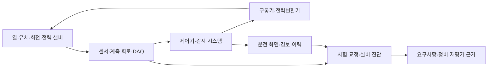

# 원자력·발전·전력망의 전자와 컴퓨팅 | Nuclear power, generation and electrical grids

[산업별 목차](README.md) · [산업 자동화·플랜트·기계](06-산업자동화와플랜트및기계_industrial-automation-machinery.md) · [전력전자 기초](../분야_topics/31-전력전자에너지_power-energy/README.md)

발전 산업에서 전자·컴퓨터공학은 전기를 만드는 발전기만 다루지 않습니다. 온도·압력·진동을 읽는 계측 회로, 전력변환기, 설비의 상태를 판단하는 제어기, 운전 화면과 기록 서버, 계통 해석과 정비 데이터가 서로 연결됩니다. 같은 Python 분석이라도 발전 계획을 비교하는 계산과 현장의 제어 주기를 검증하는 계산은 입력·시간 범위·책임이 다릅니다.

이 글은 공개된 시스템 구성과 검증 관점을 설명합니다. 실제 발전소의 제어 설정값·운전 절차는 각 시설의 승인된 설계·절차에 속합니다. 아래 진단 상황과 숫자는 따로 표시한 학습용 예이며 실제 발전소에서 얻은 측정 결과가 아닙니다.

## 1. 발전 방식을 기술의 연결로 나눕니다

| 세부 분야 | 에너지가 전기로 이어지는 경로 | 전자·컴퓨터공학이 맡는 대상 |
| --- | --- | --- |
| 원자력 발전 | 원자로의 열, 열 전달 계통, 터빈·발전기 등으로 이어집니다. 구체적인 열 전달 구조는 노형에 따라 다릅니다. | 계측제어 I&C, 운전 정보, 기능 분리·검증, 전원·통신·기록과 설비 상태 진단입니다. |
| 가스터빈·복합화력 | 연료의 열로 회전력을 만들고 발전기를 구동합니다. 복합화력은 배기가스의 열도 다른 열사이클에 이용합니다. | 회전기 계측, 전기·제어 시스템, 열·성능 데이터 분석, 상태 감시와 시험 자동화입니다. |
| 증기터빈·수력·양수 | 증기 또는 물이 터빈을 돌려 회전력을 전달합니다. 양수는 물의 위치에너지를 저장 수단으로 사용합니다. | 속도·진동·유량·전기량 계측, 발전기·구동 설비, 조건별 성능·정비 분석입니다. |
| 풍력 | 바람, 블레이드·회전축, 발전기와 전력변환을 연결합니다. | 센서·구동기, 전력전자, 구조·전기·제어의 연성 해석과 상태 감시입니다. |
| 태양광·ESS | 태양전지 또는 저장장치의 직류 전력을 변환해 부하·계통에 연결합니다. | DC/DC·인버터, 전류·전압·온도 계측, 에너지 관리, 계통 연계와 장치 간 통신입니다. |
| 송전·배전·마이크로그리드 | 전기를 변압·전송·분배하고 수요·공급과 전압·주파수를 맞춥니다. | 전력계측, 통신·시각, 보호·감시, 조류 계산, 분산자원·저장장치의 운용 계획입니다. |

두산에너빌리티의 공식 사업 메뉴에는 원자력, 가스터빈, 복합화력, 수력·양수, 풍력과 ESS가 구분되어 있습니다. [발전 사업과 가스터빈 시험 인프라](https://www.doosanenerbility.com/en/business/gas_turbine_infra), [원자력 주기기·MMIS](https://www.doosanenerbility.com/en/business/nuclear_large)를 확인하면 장치 제작·제어·시험·서비스의 범위가 이어지는 모습을 볼 수 있습니다. 이 구분을 근거로 회사의 모든 직무가 모든 시스템을 직접 개발한다고 해석하지는 않습니다.

## 2. 에너지 경로와 정보 경로를 함께 읽습니다

센서는 물리적 현상을 전기 신호로 바꾸고, 제어기는 그 정보를 바탕으로 정해진 동작을 계산하며, 구동기는 전기 명령을 실제 힘·유량·회전으로 바꿉니다. 운전 화면과 서버는 이 과정의 상태·경보·이력을 제공합니다. 표시 화면이 정상이라는 사실과 실제 센서·장치가 정상이라는 사실은 별도로 확인해야 합니다.

그림은 일반적인 정보 관계를 단순화한 자체 설명입니다. 개별 발전소의 제어·보호 계통 배치도가 아닙니다. 보호 기능과 일반 운전·감시 기능은 적용되는 안전 중요도와 설계 요건에 따라 별도로 다루어야 합니다.

### 신호가 지나오는 경로

| 단계 | 기본 개념 | 실무에서 확인할 내용 |
| --- | --- | --- |
| 센서 | 온도·압력·진동·전류 같은 물리량을 전기 신호로 표현합니다. | 측정 대상·범위·설치 위치·환경 조건과 센서 상태입니다. |
| 신호 조절 | 작은 신호를 증폭·필터링하거나 전기적으로 절연합니다. | 이득·대역폭·오프셋·접지·과입력과 채널 간 영향입니다. |
| DAQ·ADC | data acquisition은 자료 취득이며, ADC는 아날로그 값을 숫자로 바꾸는 장치입니다. | 변환 속도·필터·기준 전압·코딩·취득 시각과 오류 상태입니다. |
| 통신·시각 | 장치의 값과 상태를 다른 장치·서버에 전달합니다. | 지연·순서·누락·재접속·데이터 품질·시각의 출처입니다. |
| 제어·판정 | 입력과 요구 기능의 관계를 계산합니다. | 유효하지 않은 입력의 처리, 실행 시간, 상태 전이와 계산의 적용 조건입니다. |
| 기록·분석 | 관측과 판단을 나중에 다시 확인할 수 있게 저장합니다. | 태그·장치 ID·단위·설정 판본·원시값·상태·정비 이력입니다. |

ADC 원문 코드를 읽으며 준비 비트·오류 반환·단위를 구분하는 방법은 [회로·소자 계측 사례](../직무와실무기술_job-practice/사례_cases/01-회로와소자의계측코드_circuit-device-measurement.md), 서버에 보이는 값과 실제 취득 시각의 차이는 [공정·설비 신호 사례](../직무와실무기술_job-practice/사례_cases/04-공정설비와패키지의검사사례_process-equipment-package.md)에 연결했습니다.

## 3. 원자력의 I&C와 검증

I&C는 instrumentation and control, 계측제어입니다. 원전에서는 운전 상태를 알리는 정보, 일반적인 제어, 안전에 중요한 기능의 역할과 상호 영향을 구분합니다. 디지털 시스템을 도입하면 계산·기록·자가진단의 가능성이 늘어나지만 소프트웨어·구성·통신과 변경 관리도 함께 검토해야 합니다. [미국 NRC의 Digital I&C 소개](https://www.nrc.gov/reactors/digital)는 이러한 기능과 디지털 전환의 검토 범위를 설명합니다.

### 전자·컴퓨터 직무로 나누어 보는 대상

| 세부 기술 | 기초에서 이해할 점 | 개발·검증 결과물 |
| --- | --- | --- |
| 계측 채널·현장 전자 회로 | 센서·전원·절연·필터·ADC가 한 측정값을 만듭니다. | 채널 요구사항, 회로·입출력 목록, 교정과 환경 조건의 시험 기록입니다. |
| 제어·감시 플랫폼 | 프로그램의 주기·통신·진단·상태 관리가 장치와 연결됩니다. | 기능 명세, 실행 시간·오류 처리·구성 판본의 근거입니다. |
| 운전 정보·MMIS | 사람이 보는 화면·경보와 시스템의 실제 상태를 연결합니다. | 화면 요구, 단위·표시·경보·이력의 일치와 사용성 검토입니다. |
| 디지털 하드웨어·펌웨어 | CPU·FPGA·메모리·I/O와 소프트웨어의 경계가 있습니다. | 하드웨어·펌웨어 요구, 인터페이스, 버전·변경 영향과 시험 추적입니다. |
| 독립 검토·형상 관리 | 만든 사람의 설명을 다른 검토자가 근거와 함께 따라갈 수 있어야 합니다. | 요구사항–설계–시험 대응, 변경 승인·기준선·불일치 처리 기록입니다. |

두산에너빌리티의 [원자력 사업 설명](https://www.doosanenerbility.com/en/business/nuclear_large)은 대형 주기기와 MMIS를 나누어 소개합니다. 이 자료에서 MMIS는 운전·제어·감시·계측과 비상 안전 기능을 포함하는 I&C 시스템을 뜻합니다. 위 표의 ‘운전 정보·MMIS’ 행은 그중 사람에게 정보를 제공하는 부분을 읽기 위해 나눈 항목이며, MMIS 전체를 표시 화면만으로 정의한 것은 아닙니다. 원전 관련 지원이라고 해도 주기기 제작·품질·계측제어·전기·소프트웨어의 직접 담당 대상은 다를 수 있습니다.

### 중복·독립성·다양성은 다른 개념입니다

중복은 같은 기능을 수행할 수단을 둘 이상 두는 관점입니다. 독립성은 한 부분의 고장·간섭이 다른 부분의 필요한 기능을 훼손하는 경로를 줄이는 관점입니다. 다양성은 서로 다른 특성을 통해 같은 원인에 함께 실패할 가능성을 줄이는 관점입니다.

같은 프로그램 두 개가 같은 잘못된 요구사항을 구현했다면 하드웨어가 두 개여도 동일한 조건에서 실패할 수 있습니다. 이를 공통원인고장, common cause failure의 관점으로 검토합니다. 단순히 장치 수가 늘었다는 이유로 각 고장의 확률을 독립이라고 놓고 곱할 수는 없습니다. [IAEA SSG-39, 4.28–4.40절](https://www-pub.iaea.org/MTCD/Publications/PDF/Pub1694_web.pdf#page=64)은 독립성·공통원인고장·다양성의 관계를 다룹니다.

### 요구사항부터 시험까지 연결합니다

설계가 문서와 일치하는지 확인하는 검증, verification과 최종 용도·요구를 만족하는지 확인하는 타당성 확인, validation을 구분합니다. 요구사항을 작성하고 나중에 시험만 덧붙이는 것이 아니라, 각 요구를 어떻게 관찰·판정할지 함께 정합니다. 변경이 생기면 하위 설계와 이전 시험에 미치는 영향을 추적합니다. [SSG-39의 2.14–2.24절·그림 1–2](https://www-pub.iaea.org/MTCD/Publications/PDF/Pub1694_web.pdf#page=27)는 이 수명주기와 V&V의 연결을 설명합니다.

이 글에서는 그 관리 원리를 읽으며 실제 시설의 보호 설정이나 운전 절차를 구성하지 않습니다. 표준 문서의 소개와 일부 절을 읽은 것, 특정 시스템의 안전 적합성을 입증한 것은 서로 다른 결과입니다.

## 4. 가스터빈·증기터빈·회전기의 계측

회전 설비에서는 열·유체·기계 상태와 전기 출력이 함께 바뀝니다. 온도가 올랐다는 증상 하나만으로 냉각·부하·센서 중 원인을 확정하기 어렵습니다. 같은 회전수·부하·주변 조건을 맞춰 비교하는 일이 중요합니다.

| 세부 분야 | 주요 관측 | 전자·컴퓨터 기술의 역할 |
| --- | --- | --- |
| 회전축·베어링 | 진동·회전수·위상·온도입니다. | 센서 전치 회로, 동시 취득, 파형·스펙트럼·조건별 추세를 연결합니다. |
| 열·유체 계통 | 온도·압력·차압·유량입니다. | 센서 보정·시간 지연·통신 상태·에너지 수지와 모델의 차이를 확인합니다. |
| 발전기·전동기 | 전압·전류·주파수·전력과 온도입니다. | 전력계측·전력전자·상태 감시를 부하 조건에 연결합니다. |
| 제어·구동 경로 | 명령·실제 위치·응답 시간입니다. | 제어기·통신·구동기의 어느 경계에서 응답이 달라졌는지 나눕니다. |
| 시험·서비스 | 성능·진동·온도·경보와 정비 이력입니다. | 시험 조건 자동 수집, 데이터 동기화, 이상 후보 분석·정비 후 재평가를 수행합니다. |

두산에너빌리티는 창원에 가스터빈의 full-speed/full-load 시험 인프라를 보유한다고 [공식 소개](https://www.doosanenerbility.com/en/business/gas_turbine_infra)에서 설명합니다. 이 정보는 회전·전기 부하를 포함한 시험 역량의 공개 근거이며 특정 시험의 파형·허용값을 제공한 자료는 아닙니다.

### 진동에서 바로 고장 이름을 고르지 않습니다

RMS는 신호 제곱의 평균에 제곱근을 취한 크기 지표입니다. 스펙트럼은 신호에 어떤 주파수 성분이 들어 있는지 보는 표현입니다. 같은 RMS라도 성분의 위치와 시간 변화는 다를 수 있습니다. 회전수에 비례하는 성분, 주변 기계의 영향, 센서 부착·케이블의 잡음이 함께 나타날 수 있습니다.

| 관측한 현상 | 나눌 원인 | 추가로 맞출 조건 |
| --- | --- | --- |
| 특정 부하에서만 진동이 증가합니다. | 실제 하중 변화·구조 응답·제어 동작이 후보입니다. | 회전수·부하·온도와 동일한 센서 위치를 맞춥니다. |
| 센서 교체 뒤 크기가 일정 비율로 바뀝니다. | 실제 변화 외에 감도·단위·변환 계수가 후보입니다. | 센서 감도·DAQ 설정·교정과 기존 원시 파형을 비교합니다. |
| 여러 채널이 같은 시각에 비정상값을 보입니다. | 공통 전원·취득·통신 사건이 후보입니다. | 독립 계측과 장비·네트워크 사건을 같은 시간축에 놓습니다. |
| 저속 기록에는 변화가 없지만 빠른 현상이 의심됩니다. | 평균·샘플링·필터가 변화를 가렸을 수 있습니다. | 원래 취득 속도와 저장된 자료의 시간 해상도를 구분합니다. |

이 표는 원인 분리를 위한 자체 학습 사례입니다. 실제 설비의 진단 규칙이나 특정 주파수만으로 고장을 확정하는 기준표가 아닙니다. [샘플링과 aliasing](../분야_topics/21-신호처리제어_signals-control/해설_notes/샘플링과aliasing_sampling-aliasing.md), [센서·계측](../분야_topics/37-센서계측_sensors-instrumentation/README.md)을 먼저 읽으면 취득과 해석의 경계를 이해하기 쉽습니다.

## 5. 풍력·태양광·ESS의 전력전자와 모델

전력변환기는 반도체 스위칭을 이용해 전압·전류·주파수의 형태를 바꿉니다. 풍력의 기계적 변화와 발전기의 전기적 변화, 태양광의 일사량과 DC 전력, 배터리의 에너지 상태를 계통과 연결합니다. 입력·출력의 전력만 보면 손실·열·전류 제한·에너지 잔량을 놓칠 수 있습니다.

### 세부 분야

| 기술 | 다루는 입력과 출력 | 함께 알아야 할 개념 |
| --- | --- | --- |
| 발전기·전력변환기 | 회전·전기 에너지와 DC/AC 전압·전류입니다. | 스위칭, 필터, 손실·온도·정격과 전류 제한입니다. |
| 풍력의 연성 해석 | 바람·파도·구조·전기·제어의 상호 영향입니다. | 기계와 전기 모델의 시간 간격·좌표·단위·초기 조건입니다. |
| 태양광·MPPT | 일사량·온도에 따라 달라지는 전류·전압 특성입니다. | maximum power point tracking은 조건에 따라 달라지는 최대 출력 지점을 찾는 관점입니다. |
| ESS·PCS | 저장장치의 DC 에너지와 계통의 AC 전력입니다. | PCS는 power conversion system이며 배터리 관리·전력변환·상위 에너지 관리의 역할을 구분합니다. |
| 계통 연계 | 계통 전압·위상·주파수와 장치 응답입니다. | 동기화, 유효·무효전력, 제한·보호와 다수 장치의 상호작용입니다. |

미국 에너지부의 [인버터와 계통 서비스 설명](https://www.energy.gov/cmei/systems/solar-integration-inverters-and-grid-services-basics)은 DC/AC 변환과 전압·주파수 지원, 제어 가능한 에너지원의 필요성을 연결합니다. 출력 명령을 바꿀 수 있다는 것과 필요한 시간 동안 실제 에너지를 공급할 수 있다는 것은 다릅니다.

### Grid-following과 grid-forming

Grid-following은 외부 계통의 전압·위상 정보를 기준으로 동작하는 관점이고, grid-forming은 장치가 전압 파형의 기준 형성에 참여하는 관점입니다. 이름만으로 모든 계통 조건의 안정성을 보장하지는 않습니다. 전류 한계, DC 측 에너지, 다른 발전기·인버터와의 상호작용, 고장 후의 응답 조건을 함께 봅니다. [Sandia의 GFM/GFL droop 비교 연구 소개](https://www.sandia.gov/research/publications/details/grid-forming-and-grid-following-inverter-comparison-of-droop-response-2022-06-01/), [전력망 형성 인버터의 응답과 한계](../제품리뷰_reviews/전력망과분산에너지_grid-distributed-energy/전력망형성인버터의응답과한계_grid-forming-inverters.md)에서 비교 범위를 이어 읽으실 수 있습니다.

### 전력과 에너지의 단위

전력은 어느 순간의 전달 속도이며 W·kW·MW로 표시합니다. 에너지는 일정 시간 동안 전달한 양이며 Wh·kWh·MWh로 표시할 수 있습니다. 가정한 장치가 2 MW를 15분 동안 일정하게 공급하면 이상적인 전달 에너지는 `2 MW × 0.25 h = 0.5 MWh`입니다. 손실·허용 운용 범위·보조기기·제한을 제외한 단위 계산이며 실제 저장장치의 필요한 명판 용량을 정한 값은 아닙니다.

## 6. 송배전·전력망과 컴퓨터공학

발전기와 부하 사이에는 변압기·전선·변환기·개폐기 등 물리 설비와 통신·계측·운용 시스템이 있습니다. 컴퓨터 모델은 어느 설비가 연결되어 있는지, 어느 조건의 전압·전류를 계산하는지, 실제 기록과 모델의 판본이 맞는지를 관리해야 합니다.

| 세부 분야 | 주된 기술 문제 | 필요한 결과물 |
| --- | --- | --- |
| 전력계측·상태 감시 | 여러 지점의 전압·전류·주파수와 시각·품질이 맞는지 확인합니다. | 교정·시각 출처·통신 상태·단위가 포함된 원시 자료입니다. |
| 조류 계산·계통 모델 | 연결 구조와 발전·부하 조건에서 전압·전력 흐름을 계산합니다. | 모델의 기준 용량·단위·계통 구성·가정과 수렴 결과입니다. |
| 분산자원·마이크로그리드 | 발전·소비·저장장치가 함께 바뀔 때 운용 조건을 맞춥니다. | 시간별 자료·장치 제약·제한 조건을 포함한 계획·평가입니다. |
| 전력변환·HVDC·보상 | 전력의 전달·변환과 전압 지원을 다룹니다. | 소자·제어·열·계통 모델을 연결한 조건별 응답입니다. |
| 통신·정보 시스템 | 장치 ID·값·경보·이력을 전달하고 일관되게 저장합니다. | 인터페이스 계약, 지연·누락·재전송·접근 기록입니다. |
| 전력기기 시험 | 절연·온도·기계·전기적 요구를 구분하여 확인합니다. | 대상 정격·시험 방법·계측 구성·판정 근거입니다. |

한국전기연구원의 [스마트그리드 연구 소개](https://www.keri.re.kr/kor/contents/research-06-01-01.do?gotoMenuNo=research-06-01)는 분산자원·전력변환·마이크로그리드·전력망 실증을 구분합니다. [시험·인증을 포함한 기관 소개](https://www.keri.re.kr/)에서는 연구와 제3자 시험을 별도의 활동으로 읽을 수 있습니다.

정상 상태의 조류 계산, 수초·수분의 운용 계획, 빠른 전기적 과도 현상의 해석은 모델의 시간 범위가 다릅니다. 정적 계산이 수렴했다고 빠른 제어 상호작용까지 안정하다고 결론 내리지 않습니다. 같은 ‘시뮬레이션’이라는 말에서도 모델의 방정식·시간 범위·단순화 가정을 먼저 확인해야 합니다.

## 7. 설비 진단·AI·디지털트윈

두산에너빌리티의 [AI Innovation](https://www.doosanenerbility.com/en/about/tech_innovation)은 PreVision, 분석 솔루션과 디지털트윈을 소개합니다. 이는 실제 공급사의 사업·제품 근거입니다. 특정 설비의 진단 정확도나 모든 고장을 예측한다는 결론으로 확대하지 않습니다.

디지털트윈은 실제 설비와 연결된 모델·자료를 이용해 상태를 설명하고 비교하는 구조입니다. 보기 좋은 3D 화면과, 현재 설비의 구성·보정·시간·모델을 맞춘 트윈은 다릅니다. 장치 교체·정비·센서 판본이 바뀌었는데 모델이 그대로면 그래프가 그럴듯해도 의미가 어긋날 수 있습니다.

### 학습용 이상 조사

가정한 펌프의 소비 전력이 과거보다 높게 보인다고 생각해 봅니다. 원인 후보는 부하·유량 변화, 기계 상태, 센서의 범위·단위 변경, 자료 결합 오류입니다.

1. 같은 장치·같은 운전 구간인지 확인합니다. 장치 이름만 같고 실제 교체된 설비일 수 있습니다.
2. 전력뿐 아니라 해당 현상을 설명할 부하·유량·온도·속도 조건을 맞춥니다.
3. 정비·센서 교체·변환 계수 변경과 시간 관계를 봅니다.
4. 독립 측정과 비교해 실제 변화인지 취득·집계 변화인지 나눕니다.
5. 모델은 사용한 입력·학습 기간·새 기간의 오차를 함께 보고합니다.

모델이 어느 센서 값을 중요하게 사용했다는 결과는 조사 단서입니다. 그 센서가 실제 고장의 원인이거나 값을 바꾸면 해결된다는 인과 증명은 아닙니다. [공식 AI 예제와 데이터 누출](../직무와실무기술_job-practice/사례_cases/05-AI와제조IT의평가사례_ai-manufacturing-it.md), [공장의 디지털트윈과 검증](../제품리뷰_reviews/반도체와산업컴퓨팅_chips-industrial/공장의디지털트윈과검증_industrial-digital-twins.md)에 원리와 구체적인 대조가 있습니다.

## 8. 장비·시험·소프트웨어를 연결합니다

| 검토 대상 | 시험·분석 수단의 예 | 해석에서 구분할 것 |
| --- | --- | --- |
| 센서·채널 | 교정기·DMM·DAQ·기준 시료, 원시 전기량과 표시값의 대조입니다. | 장치의 실제 변화와 단위·환산·결선 오류입니다. |
| 제어기·입출력 | 요구에 맞춘 모의 입력·출력 관측, 주기·상태·오류 기록입니다. | 계산 통과와 전체 현장 인터페이스의 정상입니다. |
| 회전기·전력기기 | 부하·환경 조건과 동기화한 전기량·진동·온도 측정입니다. | 조건이 다른 측정값·모델값을 섞지 않습니다. |
| 통합 시스템 | FAT·SAT·통합 시험과 추적 가능한 시험 항목입니다. | 공장 구성·현장 결선·실제 상위 시스템의 범위입니다. |
| 상태 진단·AI | 기간·제품·설비를 나눈 평가, 원시 기록과 독립 관측입니다. | 학습 점수·운영 오류·원인 규명의 차이입니다. |

FAT는 factory acceptance test, 공급·제작 단계의 구성에서 요구를 확인하는 시험이고, SAT는 site acceptance test, 현장에 설치한 구성에서 확인하는 시험입니다. 실제 범위와 책임은 계약·명세·시험 계획에 따라 정합니다. [IEC 62381:2024의 공개 범위](https://webstore.iec.ch/en/publication/67572)는 FAT·FIT·SAT·SIT와 당사자의 책임·시험 계획을 다룹니다. 공개 소개만 읽고 전문의 모든 점검표를 수행했다고 표시하지 않습니다.

### 언어와 공개 도구를 쓰는 위치

| 도구·언어 | 맡길 수 있는 일 | 확인할 원문 |
| --- | --- | --- |
| C/C++·HDL·실시간 플랫폼 | 장치 I/O, 통신·버퍼·타이밍과 디지털 하드웨어를 구현·검증합니다. | [출처가 있는 장치·호스트 코드 사례](../직무와실무기술_job-practice/사례_cases/README.md)에서 원문·라이선스·실행 범위를 읽습니다. |
| Python·SQL | 시험 기록·시계열·데이터 품질·재계산과 보고를 연결합니다. | [AI·제조 IT 평가 사례](../직무와실무기술_job-practice/사례_cases/05-AI와제조IT의평가사례_ai-manufacturing-it.md)에 공식 예제와 로컬 재계산이 있습니다. |
| OpenFAST | 풍력의 공력·수력·구조·서보/전기 시스템이 결합된 동적 모델을 분석합니다. | [공식 문서 v5.0.0](https://openfast.readthedocs.io/en/main/)의 개요·모델·시험 자료입니다. |
| PyPSA | 전력 흐름과 시간별 발전·저장·투자의 제약을 모델링하고 분석합니다. | [공식 문서](https://docs.pypsa.org/latest/)의 power flow·optimization·storage 범위입니다. |

공개 분석 도구를 읽는 것과 해당 발전소의 승인된 제어 플랫폼을 수정하는 일은 범위가 다릅니다. 여기서는 새 제어 코드를 작성하거나 위 회사가 이 공개 도구를 채택했다고 추측하지 않습니다.

## 출처와 확인 범위

| 출처 | 이 글에서 확인한 내용 |
| --- | --- |
| [두산에너빌리티 원자력·MMIS](https://www.doosanenerbility.com/en/business/nuclear_large) · [가스터빈 시험](https://www.doosanenerbility.com/en/business/gas_turbine_infra) · [AI Innovation](https://www.doosanenerbility.com/en/about/tech_innovation) | 공개 사업·시스템·시험 인프라와 디지털 솔루션의 범위입니다. |
| [NRC Digital I&C](https://www.nrc.gov/reactors/digital) | 공개 검색 본문의 기능·디지털 시스템·소프트웨어와 독립성 검토 설명입니다. 직접 열기에서는 접근 제한이 있었습니다. |
| [IAEA SSG-39, 2016](https://www-pub.iaea.org/MTCD/Publications/PDF/Pub1694_web.pdf) | 2.14–2.24절의 수명주기·V&V, 4.28–4.40절의 독립성·공통원인고장·다양성을 읽었습니다. 전문을 번역·복제한 자료가 아닙니다. |
| [미국 에너지부 인버터 개요](https://www.energy.gov/cmei/systems/solar-integration-inverters-and-grid-services-basics) · [Sandia GFM/GFL 연구 소개](https://www.sandia.gov/research/publications/details/grid-forming-and-grid-following-inverter-comparison-of-droop-response-2022-06-01/) | 인버터·계통 서비스와 비교 조건을 확인했습니다. 연구의 개별 파형·성능 수치를 전재하지 않았습니다. |
| [한국전기연구원 스마트그리드](https://www.keri.re.kr/kor/contents/research-06-01-01.do?gotoMenuNo=research-06-01) | 전력변환·분산자원·마이크로그리드와 실증의 연구 분류입니다. |
| [IEC 62381:2024](https://webstore.iec.ch/en/publication/67572) | 공개 소개에서 공장·현장·통합 시험의 범위와 시험 계획의 목적을 확인했습니다. |
| [OpenFAST](https://openfast.readthedocs.io/en/main/) · [PyPSA](https://docs.pypsa.org/latest/) | 공식 개요·목차에서 해석 대상과 공개 도구의 역할을 확인했습니다. 코드를 복제하거나 계산을 실행하지 않았습니다. |

기준일은 2026-10-26입니다. 기술의 연결·흐름도·고장 가설·단위 예제는 자체 설명입니다. 실제 발전소 운전·장비 측정·계통 해석을 수행한 결과는 없습니다.

## English

This guide connects nuclear I&C, rotating generation equipment, renewable converters, storage and electrical grids to electronics, real-time computing, measurements and engineering evidence. It distinguishes instrumentation, operational control, safety-related responsibilities, information systems and diagnostic models. Company pages establish business scope; public standards and technical sources support the conceptual explanations. Numerical examples are authored unit calculations, not plant settings or measurements.
