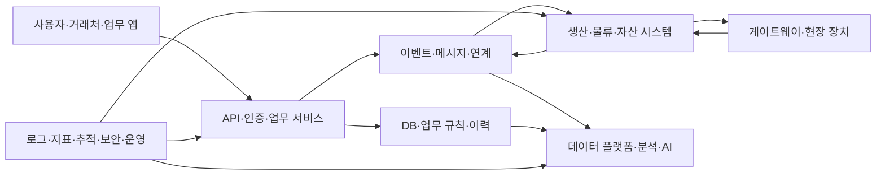

# 기업 IT·데이터센터·통신 | Enterprise IT, data centers and communications

[산업 목차](README.md) · [산업자동화](06-산업자동화와플랜트및기계_industrial-automation-machinery.md) · [공통 기술 분류](10-공통기술과세부학습분야_cross-industry-technologies.md)

기업 IT는 업무 화면을 만드는 일에서 서버·데이터·보안·공장·물류·통신의 운영까지 이어집니다. 데이터센터에서는 그 소프트웨어가 실제 CPU·GPU·메모리·네트워크·전력·냉각을 사용합니다. 따라서 프로그램의 기능, 데이터의 의미, 하드웨어 자원과 운영 상태를 함께 읽어야 합니다.

LG CNS의 [공식 서비스 목록](https://www.lgcns.com/en)은 AI·데이터·클라우드·인프라·데이터센터·보안·기업 솔루션·스마트팩토리·물류·도시 서비스를 나누고 있습니다. 포스코DX의 [IT 서비스](https://www.poscodx.com/kor/business/itService)와 [EIC](https://www.poscodx.com/kor/business/eicEngineering)는 업무 IT와 현장의 전기·계장·컴퓨터가 연결되는 예입니다. 아래 기술 설명은 이런 사업을 이해하는 일반 원리이며 특정 고객의 사내 구성을 추정한 자료가 아닙니다.

## 1. 업무 시스템에서 물리 현장까지

자체 개념도이며 실제 제품에서 경계와 배치는 달라집니다. 현장 장치의 빠른 제어는 해당 제어기에서 수행하고, 업무 시스템은 계획·작업·결과·이력을 연결하는 경우가 많습니다. [산업자동화 본문](06-산업자동화와플랜트및기계_industrial-automation-machinery.md)에서 PLC·DCS·SCADA·MES·ERP의 역할을 더 읽으실 수 있습니다.

| 하위 분야 | 다루는 입력과 출력 | 핵심 기술과 확인할 결과 |
| --- | --- | --- |
| ERP·업무 서비스 | 주문·회계·구매·인사·재고 등의 거래와 승인 상태입니다. | 업무 규칙·트랜잭션·권한·기준정보·변경 이력입니다. |
| 공급망·물류 | 입고·위치·작업·포장·출하와 장치 사건입니다. | WMS/WCS 연계, 식별자·상태 전이·작업 순서·예외 복구입니다. |
| 데이터 플랫폼 | 서로 다른 DB·파일·장치·서비스의 자료입니다. | 수집·스키마·변환·중복 제거·품질·접근 권한·계보입니다. |
| 클라우드·플랫폼 | 앱·작업·컨테이너·저장·네트워크 자원입니다. | 배포·자원 제한·상태·확장·장애 복구·구성 관리입니다. |
| AI 서비스 | 학습/검색 자료·모델·질문·도구 호출입니다. | 평가 분리·전처리·검색 근거·지연·자원·운영 추적입니다. |
| 인프라·데이터센터 | 서버·스토리지·스위치·광링크·전력·열입니다. | 병목·가용성·용량·장애 영역·전력/냉각 조건입니다. |
| 통신 시스템 | 사용자·장치의 음성·영상·데이터와 제어 정보입니다. | 무선/유선 접속·전송·코어·망 관리와 서비스 품질입니다. |

## 2. API 응답과 업무 완료는 다를 수 있습니다

API는 프로그램 사이에 요청과 응답을 주고받는 계약입니다. 어떤 주소와 형식으로 요청하고, 권한·오류·재시도·완료를 어떻게 표현하는지 정합니다. HTTP 응답이 왔다는 사실과 공장 작업·재고 갱신·장치 동작이 끝났다는 사실은 별도 계약일 수 있습니다.

예를 들어 물류 장치가 상자를 인수했다고 가정합니다. 서버 응답을 받기 전에 연결이 끊어지면 요청자는 실제 인수 여부를 모를 수 있습니다. 같은 요청을 다시 보내면 같은 작업의 재확인인지, 두 번째 작업 지시인지 구분해야 합니다. 이는 자체 구성한 업무 상황입니다.

멱등성은 같은 요청을 여러 번 적용했을 때 의도한 최종 효과가 한 번 적용한 것과 같은 성질입니다. [RFC 9110 9.2.2절](https://www.rfc-editor.org/rfc/rfc9110.html#section-9.2.2)은 HTTP 메서드의 멱등성과 재시도 조건을 정의합니다. 이 원리는 요청 식별자·업무 상태·DB 제약과 함께 구현해야 합니다. 응답 문자열을 같게 반환하는 것만으로 실제 작업의 중복 실행을 막을 수는 없습니다.

| 경계 | 인터페이스의 확인 항목 |
| --- | --- |
| 요청자→서비스 | 요청 ID·버전·권한·입력 형식·기한입니다. |
| 서비스→DB | 원자적 변경 범위·키·제약·중복·동시 수정입니다. |
| 서비스→장치 | 접수·실행·완료의 상태와 대응하는 장치 사건입니다. |
| 중단→복구 | 마지막으로 확정된 상태·재확인·재전달·취소의 의미입니다. |

실제 공개 SQL 예제는 [제조 IT의 중복 사건 기록](../직무와실무기술_job-practice/사례_cases/05-AI와제조IT의평가사례_ai-manufacturing-it.md)에 있습니다. DB의 충돌 처리 원문과, 제조 사건에 적용하기 위해 따로 정해야 할 키·정책을 구분해 읽습니다.

## 3. 메시지·이벤트·장치 데이터

이벤트는 발생한 일을 표현한 자료입니다. 작업 시작·완료·오류·검사 결과 등이 해당합니다. 메시지는 그 자료나 명령을 전달하는 단위입니다. 메시지 전달 시스템이 같은 자료를 다시 보내는 상황과, 실제 장치가 새로운 사건을 만든 상황을 식별자로 구분해야 합니다.

MQTT는 broker를 통해 topic별 메시지를 전달하는 프로토콜입니다. broker는 발행자와 구독자를 연결하는 서버이고, topic은 어떤 메시지 흐름인지 구분하는 이름입니다. OASIS [MQTT 5.0의 4.3절](https://docs.oasis-open.org/mqtt/mqtt/v5.0/os/mqtt-v5.0-os.html)은 QoS별 전달 계약을 다룹니다. QoS의 계약 범위와 이후 DB 기록·실제 장치 동작의 완료 범위는 함께 확인해야 합니다.

| 항목 | 데이터에서 뜻하는 것 | 흔한 혼동 |
| --- | --- | --- |
| 사건 시각 | 사건에 붙은 시각과 그 출처입니다. | 서버 수신 시각을 실제 장치 동작 시각으로 쓰는 경우입니다. |
| 순서 번호·사건 ID | 동일 사건·재전송·새 사건을 나누는 정보입니다. | 순서 번호의 초기화·wrap·장치 교체를 무시하는 경우입니다. |
| 스키마 | 필드 이름·타입·단위·필수 여부의 계약입니다. | 같은 숫자 필드가 새 판본에서 다른 단위를 갖는 경우입니다. |
| 품질·유효성 | 센서·전송·변환 상태입니다. | 결측·취득 실패를 정상적인 0으로 저장하는 경우입니다. |
| 보존·계보 | 원본에서 어느 변환을 거쳐 결과가 만들어졌는지입니다. | 집계값만 남아 다른 사람이 분모·조건을 확인할 수 없는 경우입니다. |

통계·AI 분석의 기초는 [데이터 공학](../전자컴퓨터공학_ece/40-데이터베이스데이터공학_databases-data-engineering/README.md), 시각·상태는 [설비 신호 수집 사례](../직무와실무기술_job-practice/사례_cases/04-공정설비와패키지의검사사례_process-equipment-package.md)로 이어집니다.

## 4. 클라우드·컨테이너·플랫폼의 역할

컨테이너는 애플리케이션과 필요한 실행 환경을 묶고 자원·격리를 관리하는 단위입니다. 그 묶음을 어느 서버에서 몇 개 실행하고, 상태·접속·저장을 어떻게 유지할지는 별도의 플랫폼 작업입니다.

Kubernetes는 control plane과 worker node로 구성됩니다. control plane은 API·상태·배치를 관리하고, node 쪽은 컨테이너 실행과 서비스 연결을 맡습니다. [공식 Components 문서](https://kubernetes.io/docs/concepts/overview/components/)에서 API server·etcd·scheduler·controller·kubelet·runtime의 위치를 확인할 수 있습니다.

| 하위 기술 | 처음 이해할 내용 | 업무에서 확인할 결과 |
| --- | --- | --- |
| 운영체제·가상화 | 프로세스·주소 공간·권한·자원 격리입니다. | CPU·메모리·I/O 사용과 간섭·제한입니다. |
| 컨테이너 이미지 | 실행 파일·라이브러리·설정의 판본입니다. | 같은 입력으로 다시 배포할 수 있는지입니다. |
| 배치·자원 관리 | 어느 node에서 얼마의 자원을 사용할지입니다. | 정상 부하·혼잡·장애 때의 대기·기동·제한입니다. |
| 저장·복제 | 상태와 파일·DB를 남기는 방식입니다. | 재시작 뒤 데이터·일관성·복구 시점입니다. |
| 네트워크·서비스 | 프로그램 주소·연결·부하 분산의 경계입니다. | 연결 실패·기한·재시도·인증·정책입니다. |
| 배포·복구 | 새 판본을 적용하고 문제가 있으면 되돌리는 과정입니다. | DB·설정·모델과의 호환성, 되돌릴 범위입니다. |

자동으로 프로세스를 다시 실행하는 기능과 서비스가 올바르게 복구된 결과는 구분합니다. 재시작한 앱이 오래된 설정·중복 작업·일관성 없는 자료를 사용하면 정상 기동 표시만으로 충분하지 않습니다. [클라우드·분산 시스템](../전자컴퓨터공학_ece/41-클라우드분산시스템_cloud-distributed/README.md)의 복제·quorum·실패 조건을 함께 읽습니다.

## 5. 데이터센터의 하드웨어와 AI 계산

| 시스템 | 전자·컴퓨터공학의 세부 기술 | 성능·운영에서 확인할 항목 |
| --- | --- | --- |
| CPU 서버 | 컴퓨터 구조·메모리 계층·NUMA·PCIe·전원·보드입니다. | 연산·메모리·I/O 중 어디서 기다리는지입니다. |
| GPU·가속기 | 병렬 연산·데이터 배치·메모리·호스트 연결·통신입니다. | 실제 작업의 정확도·지연·처리량·자원 사용입니다. |
| 메모리 | DDR·HBM·메모리 제어·ECC·접속·열입니다. | 대역폭과 용량·정정 사건·조건별 오류입니다. |
| 저장장치 | NVMe·파일시스템·DB·캐시·복제입니다. | 요청 패턴·영속성·지연 분포·복구 범위입니다. |
| 스위치·광링크 | 패킷 처리·SerDes·광변환·케이블·링크입니다. | 손실·혼잡·전송 오류·기준면·부하 조건입니다. |
| 전력·냉각 | 배전·변환·전원 공급·전력 계측·팬·액체 냉각입니다. | 부하·온도·냉각 경로·정비·공통 장애입니다. |

AI 작업은 가속기만 빨라진다고 같은 비율로 빨라지지 않습니다. 데이터를 읽고 변환하며 장치 메모리로 옮기고 여러 장치의 결과를 합치는 시간이 들어갑니다. all-reduce는 여러 계산 참여자의 값을 합쳐 각 참여자가 결과를 갖게 하는 집단 연산의 한 종류입니다. NVIDIA [NCCL의 Collective Operations](https://docs.nvidia.com/deeplearning/nccl/user-guide/docs/usage/collectives.html)는 참여자·자료형·개수와 연산의 계약을 설명합니다. 여기서는 공개 API의 역할을 참고하며 특정 기업의 내부 GPU 구성을 지정하지 않습니다.

관련 원리와 제품은 [GPU 구조](../전자컴퓨터공학_ece/24-GPU구조_gpu-architecture/README.md), [CUDA 성능](../전자컴퓨터공학_ece/25-CUDA성능최적화_cuda-performance/README.md), [HPC](../전자컴퓨터공학_ece/42-고성능병렬계산_hpc-parallel/README.md), [액체 냉각](../제품기술분석_product-technology/제조와인프라_manufacturing-infrastructure/데이터센터의액체냉각_liquid-cooling2026.md), [CPO 광통신](../제품기술분석_product-technology/제조와인프라_manufacturing-infrastructure/스위치칩가까이배치하는광통신_co-packaged-optics2026.md)으로 이어집니다.

## 6. 유선·무선·위성 통신을 계층으로 나눕니다

| 하위 분야 | 직접 다루는 대상 | 연결할 기술 |
| --- | --- | --- |
| 단말·기지국 RF | 안테나·필터·증폭·변환·클록과 실제 신호입니다. | 전자기학·RF·회로·잡음·스펙트럼·변조 품질입니다. |
| 베이스밴드 | 변조·부호화·신호 추정·디지털 처리입니다. | DSP·FPGA/가속기·수치 표현·시간 처리입니다. |
| 전송망 | 기지국·시설·데이터센터 사이의 연결입니다. | Ethernet·광링크·라우팅·동기·용량·혼잡입니다. |
| 코어·망 서비스 | 접속·세션·정책·서비스와 운용 상태입니다. | 서버·가상화·분산 SW·DB·관측·보안입니다. |
| 위성·비지상 연결 | 이동하는 통신 구간과 지상망의 연결입니다. | 링크·안테나·시간·이동성·게이트웨이·지상 서비스입니다. |
| 시험·망 운영 | 신호·트래픽·사건·고객 품질의 대응입니다. | 장비 계측·프로토콜·부하·로그·원인 분석입니다. |

위성 링크의 지연, 무선 신호 품질, 서버 응답 지연은 서로 다른 관측입니다. 같은 ‘통신 문제’라도 어느 구간의 오류인지 분리해야 합니다. [통신 이론](../전자컴퓨터공학_ece/30-통신이론무선시스템_communications-wireless/README.md), [이동통신·위성 직접 연결](../제품기술분석_product-technology/통신과센서_communications-sensing/이동통신과위성직접연결_5g-advanced-ntn2026.md), [해저 광통신](../제품기술분석_product-technology/통신과센서_communications-sensing/코히런트광통신과해저케이블_coherent-submarine2026.md)에서 해당 구간의 원리·조건을 더 읽습니다.

## 7. 로그·지표·추적으로 장애를 읽습니다

로그는 사건의 기록, 지표는 시간에 따른 수치 관측, trace는 한 요청이 여러 구성요소를 지나는 경로를 보는 자료입니다. [OpenTelemetry의 Signals](https://opentelemetry.io/docs/concepts/signals/)는 이 관측 방식을 구분합니다.

예를 들어 물류 작업의 응답이 느려졌다고 가정합니다. 전체 지연 지표에서 변화 시점을 찾고, trace에서 기다리는 서비스를 확인하며, 로그와 DB 이력에서 같은 요청 ID의 상태를 확인합니다. 장치 구간이 포함된다면 장치의 실제 동작·통신·시각 자료도 필요합니다. 이는 자체 구성한 원인 분석 예입니다.

| 증상 | 나눌 원인 | 확인할 증거 |
| --- | --- | --- |
| 평균은 정상인데 일부 요청이 오래 걸립니다. | 큐·락·저장장치·재시도·개별 작업량입니다. | 지연 분포·요청별 경로·대기 위치입니다. |
| 서버는 정상인데 현장 작업이 안 끝납니다. | 장치·게이트웨이·상태 연결·완료 계약입니다. | 실제 장치 사건과 동일 작업 ID의 인계입니다. |
| 새 판본 뒤 AI 응답만 달라집니다. | 모델·전처리·검색·자료·정밀도·권한입니다. | 같은 입력의 각 단계 결과와 판본입니다. |
| 복구 뒤 실적이 늘어납니다. | 누락 보충과 중복 재처리가 후보입니다. | 원본 사건 수·고유 ID·최초/최종 상태입니다. |

## 8. 언어와 담당 결과물

| 업무 | 언어·도구가 맡는 위치 | 남길 결과물 |
| --- | --- | --- |
| 장치·시스템 구현 | C/C++·드라이버·런타임·네트워크 라이브러리 등이 실제 자원과 인터페이스를 다룹니다. | 자원 수명·오류·동시성·시간 계약과 시험입니다. |
| 업무 서비스 | Java·Go·C#·Python·JavaScript 등은 시스템에 맞게 API·규칙·화면을 구현할 수 있습니다. | 요구·입출력·권한·트랜잭션·복구의 검증입니다. |
| 데이터·AI | SQL·Python과 모델 도구가 수집·변환·평가·분석을 연결합니다. | 데이터 정의·분할·근거·판본과 평가 결과입니다. |
| 운영 자동화 | 배포·구성·관측 도구가 시스템 상태를 바꾸고 기록합니다. | 적용 대상·검증·롤백·실패·변경 이력입니다. |

이 표는 일반적인 기술 배치입니다. 어느 회사·직무가 어떤 언어를 필수로 요구하는지는 해당 공고와 공식 자료에서 확인합니다. 프로그램의 입력·처리·출력은 [출처가 있는 사례](../직무와실무기술_job-practice/사례_cases/코드출처와이용조건_CODE_SOURCES.md)에서 확인하실 수 있습니다.

## 출처와 확인 범위

LG CNS·포스코DX의 공식 사업·서비스 목록을 읽고, RFC 9110의 멱등성, MQTT 5.0의 전달 계약, Kubernetes의 구성요소, OpenTelemetry의 관측 신호, NCCL의 집단 연산에 관한 공개 문서를 확인했습니다. 사업 목록은 실제 내부 구성·채용 요건·제품 성능을 입증하는 자료와 구분했습니다. 사례·흐름도는 자체 설명이며 실서비스 부하 시험이나 고객 시스템 측정을 수행한 결과가 아닙니다.

## English

The guide connects enterprise workflows, events, APIs and databases to cloud platforms, AI computing, physical data-center infrastructure and communications. It separates request acceptance from business completion, protocol delivery from application effects, and process restart from valid recovery. Existing code cases and technical notes provide the detailed foundations.
