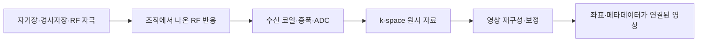
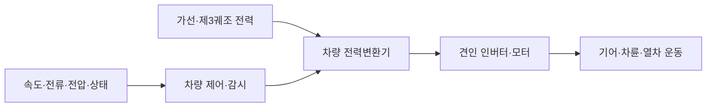

# 의료·철도·도시 기반시설의 전자 시스템 | Medical, railway and urban infrastructure systems

[산업 목차](README.md) · [공통 기술 분류](10-공통기술과세부학습분야_cross-industry-technologies.md) · [의공학·의료 AI](../전자컴퓨터공학_ece/62-의공학의료AI_medical-engineering/README.md)

의료 장비는 생체 신호와 영상을, 철도는 차량·선로·운행 상태를, 도시 기반시설은 교통·물·환경·구조물의 변화를 다룹니다. 모두 센서·전력·계산·통신을 사용하지만 같은 숫자나 메시지를 얻었다고 같은 수준의 판단을 할 수 있는 것은 아닙니다. 무엇을 실제로 측정했고, 어떤 가정으로 변환했으며, 결과를 어디에 사용하는지를 연결해야 합니다.

이 글은 공개 자료로 시스템의 원리와 개발·검사 업무를 설명합니다. 의료 분야는 계측·영상·정보 시스템의 공학적 구조를 다루며 진단·치료나 환자 연결 절차를 다루지 않습니다. 철도·도시 설비도 실제 운용 설정을 바꾸는 방법 대신 구성요소와 관측 경계를 설명합니다.

## 1. 같은 기술이 다른 결과물로 이어집니다

| 산업·세부 분야 | 입력→처리→출력 | 전자·컴퓨터공학의 주요 대상 |
| --- | --- | --- |
| 생체 신호 장치 | 작은 전기·광학 신호→증폭·표본화·처리→파형·특징 | AFE·ADC·잡음·시간·신호 유효성·기록입니다. |
| MRI·초음파 | 물리적 반응→다채널 수신·재구성→영상 | RF·음향·변환기·동기 취득·대용량 연산입니다. |
| 의료 정보·SW | 영상·메타데이터·요청→저장·교환·분석→표시·결과 | 식별·좌표·단위·상호운용·사용 목적에 맞는 평가입니다. |
| 철도 차량 | 전력·운전자/운행 요구·차량 상태→제어→견인·제동·객실 기능 | 전력변환·모터·실시간 제어·TCMS·장치망입니다. |
| 철도 신호·통신 | 위치·선로·운행 정보→열차 보호·운행 관리→허용 범위·제어 | 차상/지상 기능·무선·위치·시간·상태 전이입니다. |
| 도시 교통 | 차량·보행자·도로 상태→검지·집계·제어→신호·정보 | 센서·영상·제어기·통신·식별·시간·관제입니다. |
| 수처리·환경 | 물리·화학적 상태→센서·분석·기록→추세·설비 운용 정보 | 계장·교정·SCADA·자료 품질·공정과 측정의 구분입니다. |
| 구조물 계측 | 진동·변형·위치→동기 취득·모델→응답·상태 평가 자료 | DAQ·신호처리·구조 모델·기록장치 상태 감시입니다. |

이 분류는 제품·업무를 읽는 틀입니다. 특정 회사가 모든 하위 기술을 직접 만들거나 같은 플랫폼을 채택한다는 의미는 아닙니다. 실제 기업·사업 연결은 [기업과 사업 분야](09-기업과사업분야_company-domain-map.md)에 두었습니다.

## 2. 생체 신호의 AFE·ADC·펌웨어

### 작은 신호를 수로 바꾸기 전에 하는 일

AFE, analog front end는 센서와 디지털 처리 사이에서 신호를 받아 증폭·필터링·변환에 연결하는 아날로그 전단입니다. ECG는 심장 활동과 관련된 전기 신호의 기록이며, PPG는 빛을 이용한 혈액량 변화 관련 신호의 관측입니다. 신호가 만들어지는 원리가 달라 같은 필터·센서·판정 기준을 그대로 옮기지 않습니다.

[TI SBAA567, 2022년 11월](https://www.ti.com/document-viewer/lit/html/SBAA567)은 웨어러블 ECG용 AFE의 계측 증폭기·필터·ADC·FIFO·SPI/I²C를 설명합니다. 부품의 공개 신호 경로를 읽는 자료이며 그 부품 하나가 완제품의 임상 성능을 입증하지는 않습니다.

| 경계 | 기초 개념과 역할 | 검사에서 남길 자료 |
| --- | --- | --- |
| 신호 입력 | 원하는 두 입력의 차이와 함께 들어온 공통모드 신호를 나눕니다. 공통모드는 두 입력에 비슷하게 실린 성분입니다. | 신호 모의기·기준 입력의 조건, 입력 범위·편차·포화 상태입니다. |
| 증폭·필터 | gain은 입력 변화에 대한 출력 변화의 비율입니다. 필터는 주파수별 통과 특성을 정합니다. | 주파수별 응답·잡음·DC 오프셋·큰 입력 뒤 회복입니다. |
| 표본화·ADC | 연속 신호를 일정 시점의 수로 바꿉니다. anti-aliasing은 표본화 뒤 다른 주파수로 섞여 보일 성분을 줄이는 역할입니다. | 샘플링·기준 전압·코딩·유효 상태·변환 지연입니다. |
| FIFO·장치 통신 | FIFO는 먼저 들어온 표본을 먼저 꺼내는 버퍼입니다. 신호 취득과 CPU의 읽기 시점을 분리할 수 있습니다. | 표본 수·순서·overflow·누락·인터럽트·읽은 시각입니다. |
| 처리·기록 | 수치 파형에 보정·필터·특징 추출을 적용하고 원시 자료와 연결합니다. | 처리 판본·단위·원시/처리 결과·결측·장치 식별자입니다. |

ADC의 출력이 24 bit라는 말과 유효한 정보가 항상 24 bit 정확하다는 말은 다릅니다. 잡음·기준 전압·입력 회로·대역폭·환경이 함께 작용합니다. 원리는 [ADC/DAC](../전자컴퓨터공학_ece/32-혼성신호-ADC-DAC_mixed-signal-data-converters/README.md)와 [센서·계측](../전자컴퓨터공학_ece/37-센서계측_sensors-instrumentation/README.md)에서 이어집니다.

가상 벤치 사례로 저장한 파형이 일정 간격으로 끊긴다면 아날로그 신호의 소실, AFE 포화, FIFO overflow, 드라이버·파일 기록 지연을 나눕니다. 모의 입력의 시각·원시 표본·버퍼 상태·파일 레코드 수를 대조하면 ‘생체 현상’으로 해석하기 전에 취득 경로를 조사할 수 있습니다.

## 3. MRI: 자기장·RF·위치 정보·재구성

MRI, magnetic resonance imaging은 자기장과 RF, radio frequency 신호를 이용해 얻은 반응에서 영상을 구성합니다. [미국 NIBIB의 작동 원리](https://www.nibib.nih.gov/science-education/science-topics/magnetic-resonance-imaging-mri)는 강한 자기장, RF 자극과 수신 신호의 관계를 설명합니다. MRI를 카메라처럼 빛을 찍는 장치나 X선을 투과시키는 CT와 같은 장치로 이해하지 않습니다.

그림 1. Philips의 공식 미디어 라이브러리에 공개된 MR 7700 제품 이미지입니다. 자석 보어와 환자 테이블이 있는 MRI 장비의 외형을 볼 수 있지만, 내부 코일·자석 구조나 영상 성능을 보여 주지는 않습니다. [Philips MR 7700 공식 이미지 설명](https://www.philips.com/a-w/about/news/media-library/20220509-philips-mr-7700-product-shot.html)

[Siemens Healthineers MR Basic](https://academy.siemens-healthineers.com/_/en-us/mr-basic/)의 32~47쪽은 k-space·경사자장·송수신·컴퓨터의 관계를 설명합니다. 표시된 유효일은 2018-01-24이며 여기서는 기본 구조를 읽었습니다.

| 하위 시스템 | 입력→처리→출력 | 전자·컴퓨팅의 역할 |
| --- | --- | --- |
| 주자기장·균일도 | 자기장 환경→일정 공간의 자장 특성 | 자장 관련 계측·안정성·환경·보정 자료입니다. |
| RF 송수신 | 정한 RF 자극·반응→수신·증폭·디지털화→다채널 자료 | RF 회로·잡음·채널·동기·수신 동적 범위입니다. |
| 경사자장 | 위치에 따라 달라지는 자장→공간 정보의 부호화 | 구동·타이밍·파형·동기·공간 정확도의 연결입니다. |
| 취득·재구성 | 원시 신호·취득 조건→계산→영상·좌표 | 메모리·연산·수치 표현·알고리즘·판본입니다. |
| 표시·저장 | 영상·공간 정보→표시/전송→검토 가능한 자료 | 영상과 식별·좌표·처리 이력의 일치입니다. |

그림 2. MRI의 신호 취득과 영상 구성 관계를 단순화한 개념도입니다. 실제 펄스 시퀀스, 코일 배치, 재구성 알고리즘을 그대로 나타내는 장비 도면은 아닙니다. [NIBIB의 MRI 원리](https://www.nibib.nih.gov/science-education/science-topics/magnetic-resonance-imaging-mri), [Siemens MR Basic](https://academy.siemens-healthineers.com/_/en-us/mr-basic/)

k-space는 화면의 각 위치를 그대로 배열한 사진이 아니라 영상의 공간 주파수 정보와 연결된 원시 자료 공간입니다. 기본 설명에서는 Fourier 변환의 관계로 영상과 이어집니다. 실제 재구성은 취득 방식·수신 채널·보정·알고리즘에 따라 달라지므로 ‘원시값에 한 번 변환을 하면 어떤 MRI도 완성된다’고 단순화하지 않습니다.

검사 대상도 나눕니다. 알려진 형상의 phantom은 영상 장치의 응답을 보기 위한 시험 물체입니다. [NIST의 MRI phantom 설명](https://www.nist.gov/programs-projects/national-medical-phantom-library-nmpl-nist-branch)은 기하 왜곡·균일도·신호 대 잡음비·해상도 등의 평가 대상을 구분합니다. 수신 이력·원시 자료·기준 물체의 결과·계산 설정을 함께 봐야 하며 선명해 보인다는 인상만으로 취득·재구성의 정확성을 확정하지 않습니다.

예를 들어 같은 원시 자료에서 처리 판본을 바꾼 뒤 작은 구조가 사라졌다면 처리·보정 경로가 후보가 됩니다. 취득마다 원시 자료 자체가 달라진다면 채널·환경·취득 조건까지 조사 범위를 넓혀야 합니다. 이는 원인을 나누기 위한 자체 예시입니다. 의료 AI의 근거 단계는 [측정에서 진단과 치료까지](../전자컴퓨터공학_ece/62-의공학의료AI_medical-engineering/해설_notes/측정에서진단과치료까지_medical-ai-evidence.md)에서 구분합니다.

## 4. 초음파: 왕복 시간·다채널 수신·영상

[NIBIB 초음파 원리](https://www.nibib.nih.gov/science-education/science-topics/ultrasound)는 변환기가 음파를 내보내고 돌아온 반향을 전기 신호로 바꾸는 과정을 설명합니다. 흔히 사용하는 압전 재료는 전기장과 기계적 변형을 연결합니다. 여기서는 영상용 신호 경로를 다루며 조직에 작용하는 치료용 초음파와 목적을 구분합니다.

[ADI의 초음파 수신 경로 설명](https://www.analog.com/en/resources/analog-dialogue/articles/ultrasound-considerations-influence-front-end.html)의 Analog vs. Digital Beamforming 절은 채널별 신호를 시간에 맞춰 합치는 원리를 설명합니다. 아래 표는 디지털 수신 경로의 역할이며 아날로그 합성 방식에서는 ADC의 위치가 달라질 수 있습니다.

| 단계 | 하는 일 | 검사·원인 분리의 대상 |
| --- | --- | --- |
| 변환·송수신 | 전기 신호와 음향 신호를 연결하고 반향을 받습니다. | 채널·대역·송수신 전환과 변환기 상태입니다. |
| 수신 AFE·ADC | 작고 서로 다른 반향을 증폭·필터링·표본화합니다. | gain·잡음·포화·채널 편차·동기입니다. |
| beamforming | 채널별 수신 시각·위상 등을 맞춰 합성합니다. | 지연·채널 순서·좌표·계산 정밀도입니다. |
| 영상 형성 | 반향 자료를 위치·밝기·프레임으로 구성합니다. | 기하·표시 곡선·시간·버퍼·보정입니다. |
| 저장·표시 | 영상·모드·측정 조건을 묶어 전달합니다. | 프레임 누락·식별·공간 척도·처리 판본입니다. |

왕복 시간의 뜻을 보는 자체 계산으로, 음속을 일정한 1,540 m/s, 반향의 왕복 시간을 100 μs로 가정하면 거리는 `1,540 × 0.0001 ÷ 2 = 0.077 m`, 즉 77 mm입니다. 2로 나누는 이유는 소리가 갔다가 돌아온 시간이기 때문입니다. 실제 조직·경로·음속의 조건이 달라지므로 장치 교정이나 임상 측정값을 대신하는 수치가 아닙니다.

공학 벤치에서는 알려진 목표물이 있는 phantom·음향 시험 장치·채널 파형·원시 수신 자료를 연결합니다. 한 구간이 어둡게 보일 때 변환기·수신 채널·음향 경로·합성·표시의 후보를 나눕니다. CPU/GPU/FPGA를 쓴다는 사실보다 채널 수·표본율·지연·메모리 이동 중 무엇이 병목인지가 구현의 핵심입니다.

## 5. DICOM: 영상 파일을 넘어 정보의 의미까지

DICOM은 Digital Imaging and Communications in Medicine입니다. [PS3.1 2026d, 1절](https://dicom.nema.org/medical/dicom/current/output/chtml/part01/chapter_1.html)은 의료 영상과 관련 정보의 통신·관리를 범위로 둡니다. 파일 형식뿐 아니라 네트워크에서 교환할 명령·정보와 적합성 설명도 다룹니다. PACS는 picture archiving and communication system, 영상의 보관·전달·조회와 연결된 시스템입니다.

| 경계 | 맞춰야 할 정보 | 실제로 생길 수 있는 문제 |
| --- | --- | --- |
| 영상 객체 | 화소 자료·표현 형식·장치/검사 식별과 관련 속성 | 화면은 열리지만 다른 검사와 잘못 묶이는 경우입니다. |
| 공간 정보 | 화소 간격·방향·위치·좌표 기준 | 배열의 행/열을 실제 좌우·길이로 잘못 해석하는 경우입니다. |
| 교환·저장 | 지원 서비스·객체·전송 형식·실패 상태 | 연결은 되지만 필요한 객체를 받을 수 없는 경우입니다. |
| 처리·표시 | 원시/파생 자료·변환·표시 조건 | 화면의 밝기 차이를 원래 신호 차이로 오인하는 경우입니다. |
| 식별·운영 | 접근 권한·이력·판본·중단과 복구 | 전송 재시도·객체 대응·업무 상태가 어긋나는 경우입니다. |

[PS3.3 2026d의 Image Plane Module](https://dicom.nema.org/medical/dicom/current/output/chtml/part03/sect_C.7.6.2.html)은 Pixel Spacing·Image Position·Image Orientation을 각각 정의합니다. slice thickness와 인접 slice 중심 사이의 간격도 별도 속성입니다. 배열의 파일 순서나 한 숫자만으로 공간 전체를 복원하지 않습니다.

[PS3.2 2026d, 1절](https://dicom.nema.org/medical/dicom/current/output/chtml/part02/chapter_1.html)은 Conformance Statement의 역할과 범위를 설명합니다. ‘DICOM 지원’이라는 이름만으로 필요한 모든 장치·서비스·객체의 상호운용이 자동 보장되지는 않습니다. 양쪽이 실제로 지원하는 범위와 교환할 정보의 일치를 시험해야 합니다.

## 6. 의료 소프트웨어의 구현·검증·사용 목적

[FDA Digital Health Terms](https://www.fda.gov/medical-devices/digital-health-center-excellence/digital-health-terms)는 SaMD, software as a medical device와 하드웨어를 구동·제어하는 소프트웨어를 구분합니다. 같은 Python·C++·영상 모델이라도 실행 언어가 아니라 의도한 사용과 기능을 봐야 합니다. 모든 건강 관련 앱을 하나의 의료 장비 분류로 묶지 않습니다.

[FDA의 2023년 6월 문서](https://www.fda.gov/regulatory-information/search-fda-guidance-documents/content-premarket-submissions-device-software-functions)는 device software function의 제출 문서에 관한 권고를 다룹니다. 개발 방법 하나를 모든 제품에 강제하는 문서와 구분합니다. [2023-07-20 공식 설명회 기록 3쪽](https://www.fda.gov/media/170714/download)은 verification과 validation을 다음처럼 나눕니다.

| 관점 | 확인할 대상 | 결과물의 예 |
| --- | --- | --- |
| Verification | 개발 단계의 출력이 그 단계의 입력 요구를 만족하는지 확인합니다. | 단위·경계·오류 처리·연동 시험과 요구 대응입니다. |
| Validation | 명세·구현이 사용자 필요와 의도한 사용에 맞는지 근거로 확인합니다. | 실제/모의 사용 환경에서의 기능·사용·통합 근거입니다. |
| AI·자료 평가 | 자료 분할·정답·대상·조건과 오류의 영향을 확인합니다. | 평가 집단·전처리·모델 판본·분모·오류 유형입니다. |
| 유지·변경 | 바뀐 코드·설정·모델이 영향을 준 범위를 확인합니다. | 변경 이유·회귀 시험·판본·남은 제한입니다. |

가상의 영상 처리 시험에서 파일을 모두 읽고 프로그램이 종료됐다는 결과는 영상 정보가 모두 보존됐다는 결과와 다릅니다. 환자 단위 자료 분리, 좌표·단위, 누락된 영상, 경계 입력과 파생 결과의 대응을 따로 봅니다. 임상적으로 도움이 되는지에 대한 근거는 이 소프트웨어 시험과도 구분합니다. [의공학 근거 설명](../전자컴퓨터공학_ece/62-의공학의료AI_medical-engineering/해설_notes/측정에서진단과치료까지_medical-ai-evidence.md)과 [AI 평가](../전자컴퓨터공학_ece/46-AI응용에이전트평가_ai-agents-evaluation/README.md)로 이어집니다.

## 7. 철도 차량의 전력·견인·보조전원

견인은 열차를 움직이는 구동을 뜻합니다. 전동차는 외부에서 받은 전력과 차량 내부 변환·모터·제동·보조 부하를 연결합니다. 노선의 AC/DC 급전 방식과 차량의 전력 구성에 따라 변압·정류·변환의 배치가 달라집니다.

그림 3. 현대로템이 공개한 KTX-청룡 열차 사진입니다. 열차의 차체와 편성 외형을 볼 수 있으며, 차량 하부의 전력변환 장치나 제어 배치를 보여 주는 그림은 아닙니다. [현대로템 KTX-청룡 출고 전 시험 안내](https://www.hyundai-rotem.co.kr/ko/company/press/details.do?seq=2182)

[Siemens Mobility의 traction converter 소개](https://www.mobility.siemens.com/global/en/portfolio/rolling-stock-components/traction-converters.html)는 다양한 전압 시스템과 모듈/장치 형태의 전력변환기를 설명합니다. 다음은 특정 차량의 결선이 아닌 일반 기능 구분입니다.

| 하위 시스템 | 입력→변환·제어→출력 | 계측·검사에서 보는 것 |
| --- | --- | --- |
| 전력 인입·변환 | 노선의 전력→차량 구성에 맞는 변환→DC link 등 | 전압·전류·리플·과도·절연 관련 시험 자료입니다. |
| 견인 inverter·모터 | 전력·토크 요구→스위칭·모터 제어→회전·힘 | 전력·토크·속도·전류·열·응답의 대응입니다. |
| 회생·제동 협조 | 감속 요구·수용 조건→에너지/제동 배분→감속 | 명령·실제 운동·전력 흐름·상태 인계입니다. |
| 보조전원 | 인입/중간 전력→변환→공조·조명·제어 등 | 부하 변화·전압·기동·온도·전원 중단 상태입니다. |

그림 4. 전동 열차의 일반적인 견인·제어 흐름을 나타냈습니다. KTX-청룡의 세부 전장 배선이나 특정 차량의 정확한 부품 연결을 표시하지 않습니다. [Siemens Mobility의 견인 변환기 설명](https://www.mobility.siemens.com/global/en/portfolio/rolling-stock-components/traction-converters.html)

회생제동은 에너지를 전기 경로로 되돌리는 기능이며, 선로·전원·부하의 수용 조건과 다른 제동 기능이 함께 작용합니다. 회생 기능이 있다는 사실만으로 모든 감속에서 전력을 같은 비율로 회수한다고 보지 않습니다. 원리는 [전력전자](../전자컴퓨터공학_ece/31-전력전자에너지_power-energy/README.md)와 [자동차 전동화](01-자동차와모빌리티_automotive-mobility.md)에 연결하고, 철도에서는 급전·편성·다수 장치·장시간 운용 조건을 추가해 읽습니다.

## 8. TCMS·ETCS·CBTC는 같은 말이 아닙니다

TCMS는 train control and monitoring system, 차량의 여러 장치 정보와 제어·감시를 연결하는 시스템입니다. [Europe’s Rail의 2024-06-21 설명](https://rail-research.europa.eu/latest-news/a-next-generation-tcms-for-a-new-generation-of-trains/)은 장치 간·차량 간·차상/지상 정보와 하위 시스템의 관계를 다룹니다. 그 글의 차세대 TCMS는 연구·실증의 결과이며 모든 운행 차량이 같은 구성을 쓴다는 의미가 아닙니다.

| 분류 | 핵심 역할 | 다른 기능과의 경계 |
| --- | --- | --- |
| TCMS | 차량 장치의 정보·상태와 기능을 통합합니다. | 차량 내 통합이라는 범주를 열차 신호 전체와 같은 뜻으로 쓰지 않습니다. |
| ETCS | 지상에서 받은 운행 허용 정보·속도 조건 등을 차상에서 감시하는 유럽 열차 제어 체계입니다. | 철도 통신·운영 규칙을 포함하는 ERTMS 전체와 구분합니다. |
| ATO | 조건이 충족될 때 자동 운행 기능을 수행합니다. | 운행 자동화와 열차 보호의 역할을 구분합니다. |
| 철도 무선 RMR | 열차·지상 사이의 음성·데이터 통신 영역입니다. | 무선 연결 자체와 운행 허용·보호 판단은 다른 기능입니다. |
| CBTC | 통신 기반 열차 제어 체계이며 도시철도 등에 적용됩니다. | ETCS의 다른 이름이나 한 단계 높은 버전으로 취급하지 않습니다. |

[ERA의 ERTMS 소개](https://www.era.europa.eu/domains/infrastructure/european-rail-traffic-management-system-ertms_en)는 ETCS·통신·운영 규칙을 설명하고, [CCS TSI 페이지](https://www.era.europa.eu/domains/technical-specifications-interoperability/control-command-and-signalling-tsi_en)는 ETCS·ATO·RMR의 기술 자료를 구분합니다. [유럽위원회 FAQ](https://transport.ec.europa.eu/transport-modes/rail/ertms/faq-ertms_en)는 ETCS의 movement authority·속도 감시와 ATO·통신의 역할을 풀어 설명합니다. movement authority는 열차에 허용한 이동 범위와 관련된 정보입니다.

[Siemens Mobility의 CBTC 설명](https://www.mobility.siemens.com/global/en/portfolio/rail-infrastructure/mass-transit/communications-based-train-control-system.html)은 Trainguard MT의 양방향 통신·moving block·자동화 기능을 소개합니다. 이는 해당 제품의 공개 설명으로, 모든 CBTC가 같은 무선 방식·용량·운행 간격을 보장한다고 확대하지 않습니다.

## 9. 차상·지상·승강장과 통신의 검사

| 경계 | 정보의 예 | 조사할 오류와 시험 자료 |
| --- | --- | --- |
| 장치→TCMS | 문·공조·전원·제동 등 상태와 진단 | 장치 ID·갱신·유효성·명령/상태 대응입니다. |
| 차량→차량 | 편성 내 제어·감시 정보 | 편성 구성·순서·주소·연결·동기·재기동입니다. |
| 차상→지상 | 상태·정비·운행 관련 자료 | 무선 구간·시각·중단/복구·원본 사건과 수신 기록입니다. |
| 역·승강장 | 안내·문·각종 설비·역무 시스템의 정보 | 요청·접수·완료·설비 상태와 인터페이스 계약입니다. |
| 승객 서비스 | 안내 화면·음성·콘텐츠·접속 서비스 | 표시·전송·권한·자원과 다른 기능의 분리입니다. |

현대로템의 [GTX-A 모니터링 기술 설명](https://tech.hyundai-rotem.com/optimal-operation-of-gtx-begins-with-hyundai-rotems-cutting-edge-smart-monitoring-system/)은 차량 내 Ethernet·TCMS, 상태 기반 유지보수, 차상/지상 전송과 LCD 정보를 연결한 실제 공개 사례입니다. 해당 사례의 수집 주기·장치 수·무선 구성을 모든 열차의 표준으로 옮기지 않았습니다.

검사실에서는 차량/장치 모의 환경·네트워크 분석·시간 기록·I/O 관측·전력/열 자료를 연결할 수 있습니다. 예를 들어 지상 화면이 오래된 값을 보인다는 가상 현상은 차량 센서·TCMS 취득·차상 저장·무선 전송·서버 표시의 여러 위치에서 생길 수 있습니다. 승객용 무선 접속의 성공만으로 열차 보호 통신이 정상이라고 판단하지 않습니다. 원인은 [인터페이스·통신](../전자컴퓨터공학_ece/20-인터페이스통신_interfaces-communications/README.md)과 [차량·설비 통신 검사](../현장계측과검증_measurement-validation/칩과시스템시험_chip-system-testing/차량과설비통신의고장분리_can-ethercat-modbus.md)의 관측 경계로 나눕니다.

## 10. 도시 교통의 검지·제어·관제

차량의 존재, 통과 대수, 속도, 점유 상태, 대기 행렬은 서로 다른 관측·추정량입니다. 한 카메라의 물체 검출 정확도가 곧 교차로 전체의 신호 제어 성능을 뜻하지는 않습니다.

[FHWA Traffic Detector Handbook 제3판, Volume I 2장](https://www.fhwa.dot.gov/publications/research/operations/its/06108/02.cfm)은 루프·자기·영상·레이더 등 검지 방식의 기본 원리를 비교합니다. 2006년 자료의 센서 원리를 사용하며 당시 제품·연락처·시장 현황을 현재 정보로 옮기지 않았습니다.

| 세부 시스템 | 입력→처리→출력 | 확인할 조건 |
| --- | --- | --- |
| 노면·비전 검지 | 차량/보행자 관련 신호→검지·추적→존재·사건 | 설치 위치·시야·가림·날씨·조명·원시 자료입니다. |
| 신호 제어 | 검지·시간·운영 조건→제어 상태→신호 장치 | 상태 전이·기한·출력·실제 표시·장치 오류입니다. |
| 교통 정보 | 검지 사건→집계·추정→교통량·상태 | 차로·방향·기간·중복·누락·분모입니다. |
| 관제·운영 | 장치·구간 정보→화면·이력→운영 판단 | 장치 상태·갱신 시각·지도·작업 이력입니다. |

가상의 비 오는 날 차량 수가 늘어난 기록에서는 실제 통행량, 영상 반사·가림, 추적 ID 분리, 재전송 중복을 각각 확인합니다. 시간대별 원시 검지와 기준 관측을 비교해야 하며 집계 그래프만으로 원인을 확정하지 않습니다. [라이다·레이더·카메라](../제품기술분석_product-technology/통신과센서_communications-sensing/라이다레이더카메라의관측_lidar-radar-vision2026.md)와 [기업 IT의 사건 처리](07-기업IT와데이터센터및통신_enterprise-it-infrastructure.md)를 함께 읽으시면 센서와 기록 양쪽을 볼 수 있습니다.

## 11. 수처리·환경의 센서와 데이터 품질

[EPA Water Sensors Toolbox](https://www.epa.gov/water-research/water-sensors-toolbox)는 pH·수온·전도도·용존산소·탁도·수위·유량 등 서로 다른 측정 대상을 나눕니다. [USGS의 탁도 설명](https://www.usgs.gov/labs/national-water-quality-laboratory/science/science-topics/turbidity)에서 보듯 탁도는 물의 흐림과 관련된 광학적 특성으로 오염 물질 전체를 직접 식별하는 값과는 다릅니다. 한 센서의 정상값만으로 수질 전체가 적합하다고 판단하지 않습니다.

| 측정·설비 | 센서·처리의 대상 | 계측·SW에서 확인할 항목 |
| --- | --- | --- |
| 수위·유량·압력 | 물의 양·흐름·압력과 시간 변화 | 위치·단위·보정·범위·펌프/밸브 상태입니다. |
| pH·전도도·용존산소 등 | 서로 다른 화학·전기·광학적 반응 | 방법·온도·기준·표본·센서 상태입니다. |
| 탁도 | 입자 등에 의한 광학적 응답 | 기준 시료·기포·측정 경로·유량·오염·보정입니다. |
| PLC·SCADA | 장치 신호→변환·제어·기록→화면·이력 | 송수신 범위·유효성·시각·평균·누락·경보입니다. |
| 분석·운영 | 원시값·공정 상태→추세·판단 자료 | 실제 공정 변화와 취득/전송 문제의 분리입니다. |

[EPA 815-B-19-010, 2019년 6월](https://www.epa.gov/sdwa/generating-high-quality-turbidity-data-drinking-water-treatment-plants-support-system)의 4·5절은 탁도계와 SCADA의 범위 맞춤, 평균·기포 영향, 신호 상실·기록 품질을 다룹니다. 계측기 화면과 관제 값의 차이가 공정 변화가 아니라 송수신 변환 범위에서 생길 수 있는 실제 공학적 이유입니다.

가상 원인 분석에서는 현장 표시·원시 출력·수신 값·DB·화면의 단위와 시각을 대조합니다. 순간 변화를 평균값만 남겨 놓으면 그 변화가 희석될 수 있고, 마지막 값을 유지한 상태는 안정된 공정과 다릅니다. 공정 판단에 필요한 자료가 무엇인지 먼저 정한 뒤 취득·집계의 조건을 기록해야 합니다. [설비 신호·시각 사례](../직무와실무기술_job-practice/사례_cases/04-공정설비와패키지의검사사례_process-equipment-package.md)와 [산업자동화](06-산업자동화와플랜트및기계_industrial-automation-machinery.md)에서 공통 구조를 더 읽습니다.

## 12. 건물·교량·구조물의 응답과 장치 상태

SHM은 structural health monitoring, 구조물의 응답을 측정·분석해 상태 평가를 돕는 체계입니다. [USGS의 SHM 설명](https://earthquake.usgs.gov/monitoring/nsmp/buildings/faq.php)은 운동 센서·GPS·기록기·서버와 분석의 관계를 보여 줍니다. 진동의 크기 하나와 구조물의 손상 판정을 같은 것으로 취급하지 않습니다.

| 하위 분야 | 실제 입력과 처리 | 대표 관측·오류 후보 |
| --- | --- | --- |
| 물리 관측 | 가속도·변형·위치 등의 응답 | 센서 부착·축 방향·영점·대역·환경 변화입니다. |
| 동기 취득 | 여러 위치의 시계열을 같은 시간 기준으로 연결합니다. | 클록·타임스탬프·채널·표본 누락·기록 범위입니다. |
| 모델·특성 추정 | 응답에서 진동 모드·층간 변위 등 평가 자료를 구성합니다. | 가정·단위·적분/필터·경계·환경/사용 조건입니다. |
| 장치 상태 감시 | 센서 외에 배터리·저장·CPU·프로세스 상태를 봅니다. | 구조가 조용한 상태와 계측기가 멈춘 상태의 구분입니다. |

USGS가 설명하는 OpenSHM은 구조 응답 분석과 함께 기록기·서버의 배터리·메모리·저장·CPU·온도·프로세스 상태를 전달합니다. 여기서 구조물의 health와 기록 시스템의 health는 다른 관측입니다. 그 공개 구성의 개념을 읽었으며 설치·동작 시험을 수행한 자료는 아닙니다.

가상 사례로 특정 층의 진동 성분이 변했다면 구조적 변화 외에도 센서 방향·부착·온도·사용 하중·시간 동기·필터 판본이 후보입니다. 원시 시계열과 계측기 상태, 같은 조건의 기준 자료를 함께 보아야 합니다. [신호처리·제어](../전자컴퓨터공학_ece/21-신호처리제어_signals-control/README.md)와 [교정·불확도](../전자컴퓨터공학_ece/37-센서계측_sensors-instrumentation/해설_notes/직선교정의불확도_linear-calibration.md)가 이 비교의 기반입니다.

## 13. 언어·장비·실무 결과물을 연결합니다

| 맡을 일 | C·C++·Python 등의 위치 | 남길 근거 |
| --- | --- | --- |
| 신호 취득·장치 제어 | C/C++·펌웨어가 장치 설정·버퍼·타이밍·오류를 다룰 수 있습니다. | 설정 판본·원시 자료·유효 상태·시각·경계 시험입니다. |
| 재구성·신호 처리 | 수치 알고리즘·가속기·메모리 처리를 구현하고 비교합니다. | 동일 입력·기대 결과·오차·지연·메모리 조건입니다. |
| 시험·계측·분석 | Python·계측 API·분석 도구가 입력·자료 수집·대조를 연결할 수 있습니다. | 장비 식별·설정·readback·원시값·판정과 실패 이력입니다. |
| 시스템·정보 연계 | 서버·DB·네트워크·화면이 객체·사건·상태를 관리합니다. | 식별·단위·좌표·시각·중복·완료·복구의 계약입니다. |

언어는 제품 이름이 아니라 코드가 실행되는 위치와 역할로 설명합니다. 출처가 있는 실제 코드의 읽기는 [제조사 계측 코드](../직무와실무기술_job-practice/사례_cases/01-회로와소자의계측코드_circuit-device-measurement.md), [RTOS·통신 공개 코드](../직무와실무기술_job-practice/사례_cases/02-펌웨어와통신의공개코드_firmware-communication.md), [코드 출처와 이용 조건](../직무와실무기술_job-practice/사례_cases/코드출처와이용조건_CODE_SOURCES.md)에 연결합니다. 이 코드가 병원·열차·정수장의 비공개 양산 소프트웨어라고 표시하지 않습니다.

## 출처와 확인 범위

NIBIB·TI·Siemens Healthineers의 공개 원리, DICOM PS3.1·PS3.2·PS3.3의 2026d 지정 절, FDA의 용어·2023년 문서와 설명회, ERA·유럽위원회·Europe’s Rail·Siemens Mobility·현대로템의 공개 설명을 확인했습니다. 도시·환경 분야는 FHWA의 2006년 센서 원리, EPA의 센서 분류와 2019년 탁도 자료 품질 문서, USGS의 SHM 공개 설명을 사용했습니다. 최신 규격 전문·회사 내부 설계·운용 절차를 확보한 것으로 표시하지 않았습니다.

왕복 시간 계산과 원인 분석 상황은 가정을 둔 자체 설명입니다. 의료·철도·수처리·구조 계측 장비를 실행하거나 실측한 결과가 아닙니다. 새 C·Python 실행 코드는 작성하지 않았습니다. 확인 기준일은 2026-10-26입니다.

## English

This guide connects biomedical signal acquisition, MRI and ultrasound reconstruction, DICOM, medical software evidence, railway traction, TCMS, ETCS, CBTC and urban infrastructure sensing. It separates measured signals, derived states, communications and operational decisions. Public vendor examples do not establish universal adoption. The numerical illustration and fault scenarios are authored explanations; no hardware or clinical execution is reported.
