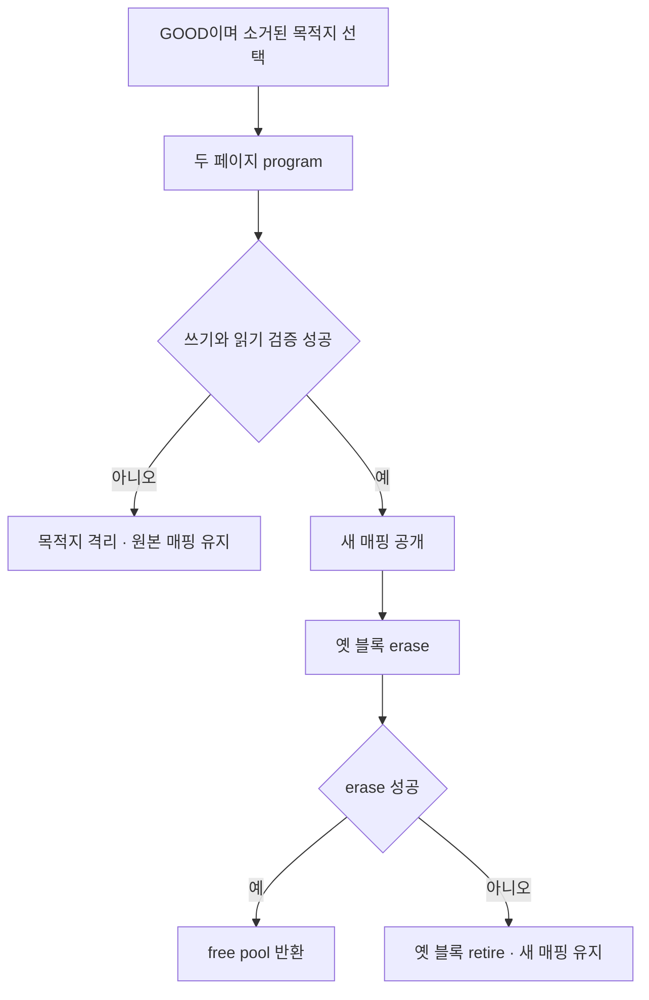

# NAND의 불량 블록과 마모 분산 / NAND bad blocks and wear distribution

[실행 코드와 입력](../예제_examples/실무검증_practical-validation/nand_management/README.md) · [읽기 교란 징후와 이동](읽기교란의징후와데이터이동_nand-read-disturb-scrub.md) · [검증 기록](검증기록_evidence/NAND블록과교란모델검사_20261021.md)

## 1. 논리 주소가 물리 블록과 같을 수 없는 이유

NAND를 바이트 배열처럼 같은 위치에 계속 덮어쓰면 소거 조건·불량 블록·마모를 놓치게 됩니다. 논리 주소는 사용자가 다루는 이름이고 물리 블록은 자료가 놓이는 위치입니다. 관리 계층은 이름을 유지하면서 위치를 바꿀 수 있습니다. 출하 때부터 표시된 불량과 사용 중 생기는 불량도 구분해야 합니다. [KIOXIA의 불량 블록 관리 설명, 2022-09 Rev. 2.0, p. 1](https://www.kioxia.com/content/dam/kioxia/shared/business/memory/mlc-nand/asset/productbrief/KIOXIA_Understanding_Bad_Block_Tech_Brief.pdf)

이 실습은 물리 블록 6개, 블록당 2페이지, 페이지당 4바이트인 합성 Python 모델입니다. 실제 NAND 규격의 크기·명령·ECC·MTD·보드를 실행하지 않습니다. 논리 블록 하나를 물리 블록 하나에 놓고 매번 전체 8바이트를 대체하므로 일반 SSD의 페이지 매핑·부분 쓰기 GC 전체를 구현한 것도 아닙니다.

## 2. erase와 program을 다르게 처리합니다

소거는 블록을 1로 되돌리고 프로그램은 지울 비트를 0으로 만듭니다. 이 제약 때문에 예전 자료가 들어 있는 페이지를 임의 값으로 바꿀 수 없습니다. [Micron TN-29-19 Rev. B, 2010-04, Flash Basics·PROGRAM Operations, pp. 2·14](https://s3-us-west-1.amazonaws.com/ptab-filings%2FIPR2023-00904%2F1035)은 이 원리를 설명합니다. 링크는 제조사 원문이 공개 증거로 보관된 사본이며 최신 제품의 정격 자료가 아닙니다.

| 실제 실행한 논리 동작 | 모델 판정 |
|---|---|
| 소거 상태 FF에서 F0를 프로그램합니다. | 1→0이므로 허용합니다. |
| F0에서 FF로 바꿉니다. | 하위 비트를 0→1로 바꾸려 하므로 ERASE_REQUIRED입니다. |
| F0에서 E0로 다시 프로그램합니다. | 방향은 맞아도 PAGE_ALREADY_PROGRAMMED입니다. |
| 블록 erase 후 AA를 프로그램합니다. | 허용하며 소거 횟수는 1입니다. |

페이지당 program 1회와 페이지 0→1의 순서는 이 모델의 보수적인 제한입니다. 실제 partial-page program 횟수·MLC/TLC의 프로그램 순서·내부 ECC parity와 같은 조건은 부품별로 다릅니다. 비트 방향만 맞으면 어떤 NAND에도 여러 번 덧쓸 수 있다고 일반화하지 않습니다.

## 3. 실패 블록과 free pool

factory bad 블록 5는 처음부터 할당에서 뺍니다. program·erase 실패를 넣으면 GROWN_BAD로 격리합니다. free pool에는 매핑되지 않았고 프로그램된 페이지가 없으며 불량이 아닌 블록만 들어갑니다. 원래 물리 위치를 비웠다는 이유만으로 소거하지 않은 블록을 곧바로 free로 쓰지는 않습니다.

Micron의 NAND FAQ는 program·erase 뒤 상태 확인과 실패 블록의 retire를 설명합니다. Linux MTD 문서도 marker·BBT 관리와 데이터 블록을 구분합니다. 이 모델은 그 차이를 상태값으로 다루며 OOB marker 스캔·영속 BBT 갱신을 구현하지 않습니다. [Micron NAND FAQ의 PROGRAM/ERASE 상태 항목](https://www.micron.com/sales-support/sales/faqs), [Linux MTD의 Bad block table support](https://docs.kernel.org/driver-api/mtdnand.html#bad-block-table-support)

자료 이동의 순서는 직접 그린 다음 흐름과 같습니다.



고정 오류 입력은 원본 블록 0의 `cafebabe`·`11223344`를 목적지 1로 옮깁니다. 첫 페이지 쓰기 후 둘째 페이지 program을 실패시키면 목적지 1은 격리되고 매핑은 여전히 0입니다. 검증 실패도 같습니다. 원본 배열과 원본의 소거 횟수 0을 대조합니다. 실패한 페이지 안에서 일부 비트가 바뀌는 물리 효과는 구현하지 않습니다.

반대로 복사·검증·매핑이 모두 끝난 뒤 옛 블록 erase가 실패하면 매핑 1을 유지합니다. 결과는 MAPPED와 ERASE_FAILED_RETIRED입니다. 새 자료를 이미 확인한 경우와 새 자료를 확인하지 못한 경우를 같은 ‘실패’ 처리로 섞으면 안 됩니다. 복사 전 매핑을 바꾸는 `early-remap` 변이는 목적지 program 실패 시 잘못된 매핑을 남겨 검사에 걸립니다.

## 4. 동적 선택에서 빠져 있는 cold 자료

동적 마모 분산은 새 쓰기에 쓸 free 블록을 고르는 방식입니다. 바뀌지 않는 cold 자료가 낮은 소거 횟수 블록을 계속 차지하면 그 블록은 선택에 참여하지 않습니다. 정적 이동은 이미 자료가 있는 블록도 옮겨 이런 위치를 다시 쓰게 합니다. KIOXIA는 두 방식을 구별하며, Linux UBI의 설명도 낮은 소거 횟수의 used 블록을 높은 소거 횟수의 free 블록으로 옮기는 경우를 다룹니다. [KIOXIA wear leveling, 2023-02 Rev. 1.0, p. 2](https://apac.kioxia.com/content/dam/kioxia/shared/business/memory/mlc-nand/asset/productbrief/KIOXIA_Understanding_Wear_Leveling_Tech_Brief.pdf), [Linux v6.12 wl.c의 7–33행](https://raw.githubusercontent.com/torvalds/linux/v6.12/drivers/mtd/ubi/wl.c)

직접 준비한 초기 상태는 정상 5블록의 소거 이력 `[0,4,4,4,4]`, cold=블록 0, hot=블록 1입니다. 이력은 가정한 시작값이며 앞선 실제 장치 사용을 측정한 값이 아닙니다. 초기 seed 뒤 측정 카운터를 0으로 돌리고 같은 hot 갱신 네 번을 비교합니다.

| 단계 | 동적 선택만 사용합니다. | 정적 이동 후 동적 선택합니다. |
|---|---|---|
| 시작 처리 | cold를 0에 둡니다. | cold를 0→2로 복사하고 0을 소거해 횟수를 1로 만듭니다. |
| hot 갱신 1 | 1→2, 옛 1의 횟수 5입니다. | 1→0, 옛 1의 횟수 5입니다. |
| hot 갱신 2 | 2→3, 옛 2의 횟수 5입니다. | 0→3, 옛 0의 횟수 2입니다. |
| hot 갱신 3 | 3→4, 옛 3의 횟수 5입니다. | 3→0, 옛 3의 횟수 5입니다. |
| hot 갱신 4 | 4→1, 옛 4의 횟수 5입니다. | 0→4, 옛 0의 횟수 3입니다. |
| 최종 정상 블록 이력 | `[0,5,5,5,5]`입니다. | `[3,5,4,5,4]`입니다. |

최대−최소는 5에서 2로 줄었습니다. 전체 소거 횟수 합은 초기 16에서 각각 20·21이므로 정적 이동이 소거를 없앤 것은 아닙니다. 낮은 마모 위치도 사용하게 만들면서 추가 복사·소거 비용을 냈습니다. 임계값 3에서 한 번 이동하는 이번 정책이 모든 입력에서 수명을 늘린다는 결론은 내리지 않습니다. 실제 UBI의 보호 큐·대상 제한·동시성도 구현하지 않습니다.

## 5. write amplification의 분자와 분모

네 번의 성공 호스트 쓰기는 `4×2페이지×4바이트=32바이트`입니다. 동적 비교의 program 발행 자료량은 32바이트입니다. 정적 비교는 cold 블록 복사 8바이트를 더해 40바이트입니다.

$$R_{dynamic}=32/32=1.0,\qquad R_{static}=(32+8)/32=1.25.$$

일반적인 write amplification은 호스트가 쓴 양에 비해 장치 내부 쓰기가 얼마나 늘어나는지 보는 비율입니다. 여기서는 실패 없는 비교 창의 program 시도 바이트를 사용합니다. ECC/OOB·매핑 metadata·초기 seed는 빼고, 읽기·소거 횟수는 별도 기록했습니다. 따라서 이 숫자는 제품 전체 WAF나 실제 NAND 비트 변경량 측정값이 아닙니다. 실패 시도도 분자 카운터에 들어가지만 성공 호스트 쓰기만 분모에 들어가므로, 오류 실험에서 이 비율을 그대로 물리 WAF라고 해석하지 않습니다.

```python
target = min(free, key=lambda i: (blocks[i].erases, i))  # min은 소거 횟수·번호 tuple이 작은 free 블록을 고릅니다.
program_bytes += 8                                     # +=는 두 페이지 program 시도의 자료량을 누적합니다.
host_bytes += 8                                        # 성공한 호스트 쓰기만 별도 분모에 누적합니다.
ratio = program_bytes / host_bytes                     # /는 나눗셈이며 분모가 있는 실패 없는 비교 창에서 계산합니다.
```

설명용 변수명으로 계산을 발췌했습니다. 실제 `Manager`는 `def`로 메서드를 정의하고, `self.mapping` 사전에 논리→물리 대응을 저장합니다. `lambda`는 비교 기준 함수를 짧게 만드는 문법이고 `tuple`의 `(횟수, 번호)`는 앞값부터 비교합니다. `set`은 프로그램한 페이지 번호를 중복 없이 기록합니다.

## 6. 확인 결과와 확인 문제

정상·`-O`에서 두 마모 정책의 목적지 순서·이력·자료량·원본/갱신 자료가 리터럴과 같았습니다. 33개 거부 입력과 0~255 바이트값의 program/erase 경계를 확인했습니다. 후자는 별도 `factory_bad=[]` 구성에서 최대 물리 번호 5와 페이지 0·1을 사용합니다. 다섯 오류 변이는 두 실행 모드 모두 검출됐습니다. 정확한 환경과 해시는 검증 기록에 있습니다.

1. bad 표시가 있는 블록도 비어 있으면 free인가요? 답: 아닙니다. 불량 상태와 매핑·프로그램 여부를 함께 확인합니다.
2. cold 이동 뒤 소거 횟수 차이가 줄면 총 소거 횟수도 줄었나요? 답: 이번 입력에서는 오히려 1회 늘었습니다. 분포와 작업량은 다릅니다.
3. 복사 성공 뒤 옛 블록 erase가 실패하면 새 매핑을 취소해야 하나요? 답: 이 정책은 검증한 새 매핑을 유지하고 옛 블록을 격리합니다.

## English

The model separates factory bad blocks, grown bad blocks and erased free blocks. It enforces 1→0 programming plus a deliberately restrictive one-program-per-page rule. It is not a raw NAND driver. Copy and verification precede mapping publication; failed destinations leave the original mapping and source array intact. An old-block erase failure after publication keeps the verified new mapping and retires the old block.

Starting from assumed erase counts `[0,4,4,4,4]`, four hot updates end at `[0,5,5,5,5]` with dynamic selection. One static cold-data move followed by the same updates ends at `[3,5,4,5,4]`. The spread falls from five to two, while successful-window program-attempt bytes rise from 32 to 40 for 32 host bytes. The ratios 1.0 and 1.25 exclude metadata, seed work and physical failure effects. They demonstrate a policy tradeoff rather than device lifetime or product WAF measurements.

## 출처

- [KIOXIA, Understanding Bad Block Management](https://www.kioxia.com/content/dam/kioxia/shared/business/memory/mlc-nand/asset/productbrief/KIOXIA_Understanding_Bad_Block_Tech_Brief.pdf), 2022-09 Rev. 2.0: p. 1의 초기·사용 중 불량과 대체 관리 설명을 읽었습니다.
- [KIOXIA, Understanding Wear Leveling](https://apac.kioxia.com/content/dam/kioxia/shared/business/memory/mlc-nand/asset/productbrief/KIOXIA_Understanding_Wear_Leveling_Tech_Brief.pdf), 2023-02 Rev. 1.0: pp. 1–2의 마모·동적/정적 방식과 그룹 차이를 읽었습니다.
- [Micron NAND FAQ](https://www.micron.com/sales-support/sales/faqs): PROGRAM/ERASE 후 상태 확인·retire와 제조사 표시 불량 사용 금지를 읽었습니다.
- [Micron TN-29-19 공개 보관본](https://s3-us-west-1.amazonaws.com/ptab-filings%2FIPR2023-00904%2F1035), Rev. B, 2010-04: pp. 2·13–15의 bit 방향·소거·program·partial-page 제한을 읽었습니다. 특정 제품 수치와 그림을 모델로 전재하지 않았습니다.
- [Linux MTD NAND 문서](https://docs.kernel.org/driver-api/mtdnand.html#bad-block-table-support)와 [v6.12 UBI wl.c](https://raw.githubusercontent.com/torvalds/linux/v6.12/drivers/mtd/ubi/wl.c): BBT 구분과 파일 처음의 관리 정책 설명을 읽었습니다. 전체 UBI 구현을 재현하지 않았습니다. 확인일은 2026-10-21입니다.
