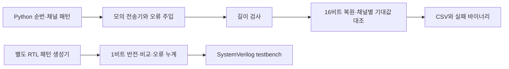

# 프레임 오류를 나누어 검출하는 FPGA 검증 사례 / Detecting frame faults in an FPGA validation exercise

이 사례는 “읽기 함수가 요청한 바이트 수를 반환하면 데이터도 정상인가?”라는 질문을 검증합니다. 8채널의 알려진 값을 생성하고, 바이트 순서·채널 위치·연속성을 각각 망가뜨린 뒤 판정 결과를 비교했습니다. 핵심은 길이가 같은 데이터에서도 프레임 누락을 찾아내는 것입니다. 구현은 [FPGA 프로젝트](../프로젝트_projects/fpga-validation-harness/README.md)에 있으며, 2026-10-21에 실행한 조건과 실패 시도는 [검증 기록](검증기록_evidence/FPGA검증_20261021.md)에 정리했습니다.

이번 입력은 Python이 만든 합성 데이터입니다. FPGA RTL도 PC 시뮬레이터에서 실행했습니다. 물리 보드·ADC·계측기·실제 UART 선로를 사용한 결과나 산업 현장의 장애 복구 경험은 포함하지 않습니다.

## 요구사항과 입출력 경계

대상 [프레임 프로그램](../프로젝트_projects/fpga-validation-harness/offline_fpga_measurement_lab.py)은 교육용으로 정의한 형식을 사용합니다. 한 프레임은 8채널 × 채널당 16비트, 즉 16바이트입니다. 한 번의 요청은 4096바이트이므로 정확히 256프레임이어야 합니다. `uint16`은 0~65535를 담는 부호 없는 정수이며, little-endian은 두 바이트 중 낮은 자리의 바이트가 먼저 온다는 뜻입니다. 제품 SDK나 표준 UART 패킷 형식은 아닙니다.

| 요구사항 | 판정 기준 | 필요한 관측값 |
| --- | --- | --- |
| 읽기 크기를 지킵니다 | 수신 길이가 정확히 4096바이트입니다 | 요청·수신 바이트 수 |
| 정수의 바이트 순서를 지킵니다 | `<8H`로 해석한 값이 기대값과 같습니다 | 최초 오류 프레임·채널·기대값·관측값 |
| 채널 위치를 지킵니다 | 채널마다 서로 다른 상위 비트가 유지됩니다 | 채널 번호와 16비트 값 |
| 프레임이 이어집니다 | 블록·프레임 위치로 계산한 순번과 일치합니다 | 기대 순번과 첫 불일치 |
| 응답 부재를 구분합니다 | 모의 전송기의 timeout 예외를 실패 사유로 남깁니다 | 오류 종류·수신 길이 |

검사 경계는 `MockTransport.read()`가 돌려준 바이트열부터 `check_payload()`의 판정까지입니다. 전기 신호를 샘플링하거나 실제 인터페이스에서 데이터를 읽지는 않습니다. 오류를 넣는 쪽과 판정하는 쪽을 함수로 나누어, 정상 반환과 정상 데이터의 차이를 볼 수 있게 했습니다.

## 구조와 기대값의 의미



Python 프레임의 채널 `c`, 순번 `s`에 대한 값은 `4096*c + (s % 4096)`입니다. 상위 비트는 채널을, 하위 12비트는 순번을 구별합니다. 예를 들어 순번 256의 채널 0은 `0x0100`, 채널 1은 `0x1100`입니다. 채널 0의 전송 바이트는 `00 01`이므로 이를 뒤집으면 `01 00`, 복원한 값은 `0x0001`이 됩니다. 채널을 맞바꾸면 같은 위치에서 `0x1100`이 보입니다. 두 오류는 길이가 같지만 최초 관측값으로 구분됩니다.

위 그림의 두 줄은 독립된 구성입니다. [RTL](../프로젝트_projects/fpga-validation-harness/nexys4_ddr/validation_top.v)은 `sequence XOR 0x5A5A`라는 다른 패턴을 생성하며, Python의 8채널 프레임을 출력하는 모듈이 아닙니다. 두 프로그램을 연결한 FPGA 수집 장치로 해석하면 검증 범위를 벗어납니다.

## 설계 대안과 선택 이유

길이만 검사하면 짧은 읽기는 찾지만, 같은 크기의 바이트 교환이나 채널 교환은 통과합니다. 모든 채널에 같은 상수를 넣으면 채널을 바꿔도 값이 같으므로 위치 검사가 약해집니다. 평균값만 비교하면 데이터 순서를 바꾸는 오류를 놓칠 수 있습니다. 따라서 이 연습은 위치마다 구별되는 값을 생성하고 전부 대조합니다.

CRC를 붙이는 방식도 고려할 수 있습니다. 다만 이 코드에는 CRC가 없습니다. 프레임 내부 손상 검출과 프레임 전체의 누락·재전송 검출은 서로 다른 요구사항입니다. 올바른 CRC가 붙은 프레임 하나를 통째로 잃으면 나머지 프레임의 CRC만으로는 누락을 알 수 없으므로 순번이나 별도 개수 확인도 필요합니다. 실제 센서값처럼 정답을 미리 알 수 없는 입력에는 이 연습의 전수 기대값 비교를 그대로 적용하기 어렵습니다. 패킷 무결성, 순번, 범위 검사, 독립 참조 계측을 목적에 맞게 나누어야 합니다.

## 오류 주입과 실제 관측 결과

각 시나리오는 네 블록을 읽으며, 비정상 입력은 두 번째 블록인 블록 1에서 주입합니다. 새 실행의 총 28블록 중 정상 판정은 20개, 오류 판정은 8개였습니다. 아래 실패 수는 검사기의 고장을 뜻하지 않습니다. 의도한 손상이 거절됐다는 결과입니다.

| 입력 | 네 블록 중 실패 수 | 블록 1에서 관측한 핵심 |
| --- | ---: | --- |
| 정상 | 0 | 4096바이트와 모든 기대값이 일치했습니다 |
| 바이트 교환 | 1 | 프레임 256, 채널 0: `0x0100 → 0x0001` |
| 채널 0·1 교환 | 1 | 프레임 256, 채널 0: `0x0100 → 0x1100` |
| 프레임 하나 누락 | 3 | 프레임 267, 채널 0: `0x010B → 0x010C` |
| 짧은 읽기 | 1 | 4096바이트 요청에 4080바이트를 반환했습니다 |
| 전부 0으로 채움 | 1 | 프레임 256, 채널 0: `0x0100 → 0x0000` |
| timeout | 1 | 예외가 발생했으며 수신 길이는 0이었습니다 |

누락 시나리오는 블록 1의 열두 번째 프레임을 제거하고, 미래 프레임 하나를 뒤에 붙여 길이를 4096바이트로 유지합니다. 따라서 길이 검사는 통과하지만 기대 순번 267에서 실제 268의 값이 나옵니다. 다음 블록도 기대 512 대신 513부터 시작하므로 불일치가 이어집니다. 총 세 블록의 실패는 오류 주입을 세 번 했다는 뜻이 아니라 한 번 생긴 위치 차이가 유지됐다는 뜻입니다. 이 프로그램은 최초 불일치를 기록하며 자동 재동기화는 하지 않습니다.

추가 경계 확인에서는 4095바이트와 4097바이트를 모두 거절했고, 모의 전송기에 15바이트를 요청하면 16바이트 배수 조건으로 예외가 발생했습니다. 원래 `check_payload()`는 과대 길이도 `short_read`라는 같은 사유 이름으로 기록합니다. 따라서 이름만 읽기보다 expected·actual 길이를 함께 확인해야 합니다.

## RTL과 실패 시점 기록으로 확인한 것

[testbench](../프로젝트_projects/fpga-validation-harness/nexys4_ddr/tb_validation_top.sv)는 정상 32샘플과 오류 주입 32샘플을 확인합니다. 주입 구간에서는 순번의 하위 4비트가 15일 때 최하위 비트 하나를 반전하므로 순번 15·31에서 두 오류가 나와야 합니다. `mismatch`와 `error_count`를 함께 대조하고, enable을 끈 동안 개수가 멈추는지와 reset 후 누계·LED가 초기화되는지도 확인합니다. 새 PC 실행에서 64샘플 검사 성공 로그를 얻었습니다.

다만 같은 Icarus 설치의 다른 컴파일 시도들은 진단 없이 `0xC0000005`로 끝났습니다. 동일 내용의 사본과 상대 파일명으로 성공한 실행도 있었지만, 후속 시도에서 실패가 재발했습니다. 따라서 경로 변경으로 문제가 해결됐다고 결론 내리지 않았습니다. RTL 결과와 도구 환경의 반복 실행 문제를 별개로 기록했습니다. Vivado 합성·배치배선·timing closure와 보드 다운로드는 이번 검사에 없습니다.

보조 [ADC 연습](../프로젝트_projects/fpga-validation-harness/validation_lab.py)은 실패 증거를 지우는 reset 전에 저장하는 순서를 확인하는 데 사용했습니다. 정상은 128/128개를 받아 PASS, 누락은 117/128개로 FAIL, 정지는 64/128개로 TIMEOUT이었습니다. offset과 잘못된 unsigned 복원도 FAIL로 검출됐습니다. 네 비정상 실행 모두 snapshot 저장 → reset → close 순서와 최종 정리 상태를 확인했습니다. 이 값은 가상 장치의 상태이며 실측 ADC 성능이 아닙니다.

별도 [UART 호스트 검사](../프로젝트_projects/embedded-validation-lab/host/test_protocol.py) 10개도 FakeSerial로 실행했습니다. 분할 수신·이전 순번·timeout 등을 다루지만 물리 포트를 열지 않습니다. 이 [호스트 코드](../프로젝트_projects/embedded-validation-lab/host/run_validation.py)의 signature는 고정 연산의 기대 결과이지 응답 전체의 체크섬이 아닙니다. `raw.jsonl`도 성공 객체에 호스트 정보를 더해 다시 쓴 기록이므로 실패 바이트까지 모두 보존한 원문 로그와 구분해야 합니다.

## 재현 방법과 남은 검증

저장소 루트에서 실행하며, 매번 새 출력 폴더를 지정합니다. `offline_fpga_measurement_lab.py`의 정상 종료 코드 0은 정상 입력과 의도한 오류의 판정이 기대대로 나왔다는 의미입니다. ADC 연습의 FAIL·TIMEOUT은 각각 종료 코드 1·2이므로 일반 실행 오류와 구별해 읽습니다.

```powershell
$run = Join-Path $env:TEMP ("fpga-check-" + [guid]::NewGuid())
python -B 프로젝트_projects/fpga-validation-harness/offline_fpga_measurement_lab.py --out $run
python -B 프로젝트_projects/fpga-validation-harness/validation_lab.py --scenario timeout --seed 42 --samples 128 --output (Join-Path $run "adc")
```

RTL 사본 실행과 UART 의존성·검사 명령은 [별도 기록](검증기록_evidence/FPGA검증_20261021.md)에 있습니다. 기존 소스·결과를 덮어쓰는 전체 빌드는 실행하지 않았으며, 두 프로젝트의 37개 파일은 실행 전후 경로와 SHA-256이 같았습니다.

현재 패턴은 순번 0과 4096에서 같아집니다. 4096프레임 단위의 위치 변화까지 구별하는 무한 순번이 아닙니다. 또 생성기와 검사기가 `expected_frame()`을 공유하므로 같은 잘못된 형식 정의를 함께 따르면 통과할 수 있습니다. 독립 바이트 벡터와 별도 파서가 추가 검증에 유용합니다. 보조 ADC 판정 함수는 순번 집합·중복·개수를 확인하지만 수신 순서 자체는 검사하지 않아, 순서만 뒤집은 무오차 입력을 받아들이는 것도 확인했습니다. 검출한 오류와 놓칠 수 있는 오류를 구분한 것이 이 사례의 최종 검증 범위입니다.

## English

This software exercise distinguishes payload length, byte order, channel position and frame continuity. Removing one frame while preserving a 4096-byte read was detected at the first shifted sample and in subsequent blocks. Fresh checks also exercised a separate RTL pattern comparator, simulated ADC failure capture and ten mocked UART tests. No physical acquisition or board measurement was performed. One RTL run passed 64 samples; intermittent compiler crashes remain documented rather than treated as resolved.
