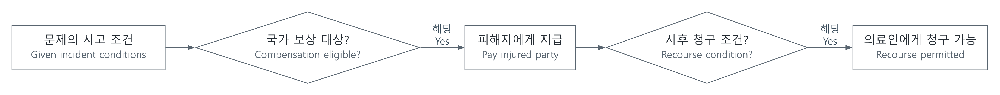

# 공식 기출 분석: 조건의 범위와 비교 대상을 놓치지 않기

[상위 주제](../README.md) · [공식 시험·기출 자료 경로](공식자료_OFFICIAL_SOURCES.md)

[6번 상세 해설](LEET/추리6_COMPENSATION.md) · [28번 상세 해설](LEET/추리28_EXPERIMENTS.md)

이 글은 추리논증 두 문항의 조건과 개념을 연결한 요약입니다. [LEET 실제 기출 목차](LEET/README.md)에서는 언어이해 1~3번과 추리논증 6·28번의 모든 선지 판단·근거 위치를 자세히 읽으실 수 있습니다.

## 원문 위치 | Source location

[법학전문대학원협의회, 2026학년도 LEET 전국순회설명회 자료집](https://akls.kr/uploaded/board/reference01/e2c5adeb5b9aafa5ca1306478d22a6951.pdf), 2025년 4월 발행, 인쇄 pp.10–11 / PDF 6쪽. 자료집이 2025학년도 추리논증 출제문항으로 수록한 6번·28번을 참조합니다. 해당 발췌본에는 책형 표시가 없으므로 임의로 책형을 붙이지 않습니다. 문항과 정답은 이 공식 자료의 표시를 기준으로 대조했습니다. 확인일: 2026-10-19.

The [AKLS official nationwide LEET briefing booklet](https://akls.kr/uploaded/board/reference01/e2c5adeb5b9aafa5ca1306478d22a6951.pdf), published in April 2025, printed pp.10–11 / PDF page 6, identifies the selected items as 2025-academic-year Reasoning and Argumentation questions 6 and 28. It does not state a booklet form, so none is invented here. Item numbers and answers were checked against that official publication on 2026-10-19.

원문과 선택지는 링크에서 읽고 아래의 자체 분석과 대조합니다. 자료집·지문·그림을 이 저장소에 복제하지 않습니다. 아래 설명은 공식 해설을 옮긴 것이 아니라 제시 조건을 구조화한 풀이이며, 가상의 문제 설정을 실제 법률이나 실제 연구 결과로 일반화하지 않습니다.

Read the original questions and choices at the linked source, then compare them with the independent analysis below. The booklet, passages and figures are not reproduced in this repository. These explanations organize the given conditions rather than reproduce an official commentary; fictional rules and hypothetical experimental outcomes are not claims about actual law or empirical findings.

## 한국어

### 1. 6번: 지급 조건과 나중의 청구 조건을 따로 보기

공식 정답은 ⑤, 즉 ㄱ·ㄴ·ㄷ입니다. 이 문제의 핵심은 국가가 피해자에게 돈을 지급하는 조건과, 지급 후 의료인에게 돌려 달라고 할 수 있는 조건을 분리하는 것입니다.

의료사고의 피해 발생을 공통 전제로 두고, `N`을 주의의무 위반, `F`를 주의의무를 다했지만 불가항력으로 발생한 사고로 표시하겠습니다. F는 단순히 모든 ¬N과 같다고 확장하지 않고 문제에서 지정한 경우만 가리킵니다. 세 안의 지급 범위는 각각 F, 전체 피해, N으로 구분됩니다. 사후 청구는 별도의 조건입니다.

| 문제에서 비교하는 경우 | 1안의 국가 보상 | 2안의 국가 보상 | 3안의 국가 보상 |
|---|---|---|---|
| F | 가능 | 가능 | 이 규정의 보상 대상 아님 |
| N | 이 규정의 보상 대상 아님 | 가능 | 가능 |

ㄱ은 표의 F행에서 1안·2안을 비교하면 됩니다. ㄴ은 N행에서 2안·3안을 비교합니다. ㄷ은 주의의무를 다한 경우의 사후 청구를 묻습니다. 2안은 청구 가능 조건을 위반이 있는 경우로 제한합니다. 3안도 위반이 있어 보상한 경우에 관한 규정입니다. 1안의 보상은 과실 책임을 전제로 한 국가의 선지급과 구분됩니다. 따라서 ㄱ·ㄴ·ㄷ을 모두 선택하는 공식 정답과 일치합니다.

여기서 흔한 오류는 `국가 보상 → 언제나 의료인에게 청구 가능`이라고 없는 규칙을 추가하는 것입니다. 또 `~한 경우에 한하여`는 청구의 필요조건을 제한하는 표현이므로, 어떤 행위에 붙은 조건인지 끝까지 묶어서 읽어야 합니다. 돈이 이동하는 두 단계를 다른 화살표로 그리면 섞이기 어렵습니다.

[SVG](../../그림자료_assets/도식_diagrams/official-past-paper-walkthroughs.svg) · [그림 원본 / Diagram source](../../그림자료_assets/도식_diagrams/official-past-paper-walkthroughs.mmd)

직접 작성한 논리 흐름도입니다. 실제 국가배상·의료법 제도를 설명하는 그림은 아닙니다.

### 2. 28번: 가설을 시험하는 비교인지 먼저 확인하기

공식 정답은 ③, 즉 ㄱ·ㄷ입니다. 무엇이 기억률에 영향을 주는지 판단하려면, 비교하는 두 집단에서 어떤 변수가 달라졌고 무엇이 유지되었는지 확인해야 합니다.

원문의 부정적 표정을 N, 중성적 표정을 U라는 설명용 기호로 쓰고, 첫 글자를 학습 시 표정, 둘째 글자를 검사 시 표정으로 두겠습니다. `pNN`은 두 단계 모두 부정적 표정인 조건의 기억률이라는 뜻입니다. 이 약어는 이 글에서 정한 것이며 실제 측정값을 새로 만든 것이 아닙니다.

| 실험 | 비교하는 조건 | 비교에서 확인할 성질 |
|---|---|---|
| 1 | NN 대 UU | 학습·검사 일치는 양쪽에서 유지됨 |
| 2 | NN 대 NU | 학습 표정은 같고 검사 표정·일치 여부가 달라짐 |

실험 1의 비슷한 기억률은, 일치 조건에서 N이 U보다 우세하다는 예측을 약화하므로 ㄱ에 해당합니다. 실험 2는 학습 표정이 모두 N입니다. 그 결과가 비슷하다는 이유만으로 N을 학습한 얼굴과 U를 학습한 얼굴의 차이가 작다고 결론 낼 수 없으므로 ㄴ은 선택하지 않습니다.

ㄷ의 조건은 실험 1에서 차이가 작지만 실험 2에서 일치 조건의 기억률이 더 높다는 것입니다. 설명용 대비를 `Δ표정=pNN−pUU`, `Δ일치=pNN−pNU`로 적으면, 전자는 작고 후자는 양수인 방향의 관찰입니다. 주어진 비교 안에서는 표정 종류보다 학습·검사 일치가 더 중요하다는 B를 뒷받침하므로 ㄷ을 선택합니다. 이것은 원문의 가설 평가이며, 별개 실험의 표본들을 수치적으로 합쳐 효과 크기를 추정했다는 뜻은 아닙니다.

검산은 “어떤 결과든 A를 부정하는가?” 대신 “이 비교가 A의 예측을 직접 겨누는가?”를 묻는 방식입니다. 지지·약화는 참·거짓의 완전한 증명과 다릅니다. 실제 연구라면 표본 수, 무작위화, 변동성·불확도, 효과 크기와 다른 설명을 더 확인해야 합니다. 이 문항에는 그런 수치를 추가하지 않습니다.

## English

### 1. Question 6: separate payment eligibility from later recourse

The official answer is ⑤, selecting ㄱ, ㄴ and ㄷ. The key distinction is between the condition under which the state compensates an injured party and the condition under which it may later recover that payment from the practitioner.

Hold accident-related harm as the shared premise. Let N mean breach of the stated duty, and F the specified unavoidable accident despite due care. F is not expanded into every possible ¬N case. The three proposals cover F, all such harm, and N, respectively; later recourse has its own conditions.

For F, proposals 1 and 2 provide compensation. For N, proposals 2 and 3 provide compensation. These comparisons establish ㄱ and ㄴ. Statement ㄷ concerns recourse after due care: proposal 2 limits recovery to breach cases, and proposal 3 concerns compensation for breach. Proposal 1's compensation should not be confused with an unrestricted advance followed by recovery from the practitioner. Thus all three statements align with the official answer.

A frequent error is inventing `state payment → recovery from the practitioner is always permitted`. A phrase restricting an action to specified cases must remain attached to that particular action. Drawing payment and later recovery as separate arrows helps preserve the distinction. The original flowchart above represents this reasoning structure; it is not a statement of actual medical-liability law.

### 2. Question 28: check whether the comparison tests the hypothesis

The official answer is ③, selecting ㄱ and ㄷ. Before interpreting a memory-rate difference, identify which variables change between groups and which remain fixed.

Use N for the original's negative expression and U for its neutral expression, with the first letter indicating learning and the second testing. Thus pNN denotes the memory rate with a negative expression in both stages. These are explanatory symbols defined here, not standard abbreviations or fabricated observations.

Experiment 1 compares NN with UU: learning/test agreement is maintained in both groups. Experiment 2 compares NN with NU: learning expression is fixed, while test expression and agreement change. Similar rates in experiment 1 weaken the prediction that N outperforms U under matched conditions, supporting ㄱ. Experiment 2 does not compare learning N with learning U. Similar rates there do not establish that the difference between those learning conditions is small, so ㄴ is not selected.

Statement ㄷ combines a small experiment-1 contrast with a higher rate for the matched group in experiment 2. Writing descriptive contrasts as `Δexpression=pNN−pUU` and `Δagreement=pNN−pNU`, the described pattern is a small former contrast and a positive latter contrast. Within the question's comparison, this supports B's emphasis on learning/test agreement over expression category. It does not mean that samples from separate experiments were numerically pooled to estimate an effect size.

A useful check is to ask whether a comparison directly tests a prediction, rather than claiming that any unfavorable-looking result disproves a hypothesis. Support and weakening are different from complete proof or disproof. An actual study would additionally require sample size, randomization, variability and uncertainty, effect sizes, and competing explanations. No such numerical evidence is invented for this item.

## 검증 기록 | Verification record

- 문항 식별·공식 정답: AKLS 자료집 PDF 6쪽의 좌측 6번·⑤, 우측 28번·③을 텍스트와 렌더링으로 대조 / item identifiers and official answers checked in both extracted text and rendered page 6.
- 자체 검토: 6번은 보상·청구 조건을 분리해 각 보기를 대조하고, 28번은 실험별 고정·변경 변수를 분리해 비교 / independent checks separated compensation from recourse, and fixed from changed experimental variables.
- 범위: 선택한 두 문항의 논리 분석이며 회차 전체 분석이나 PSAT·기업 검사 기출 분석으로 표시하지 않음 / scope is these two LEET items, not an entire administration or PSAT/corporate past-paper coverage.
