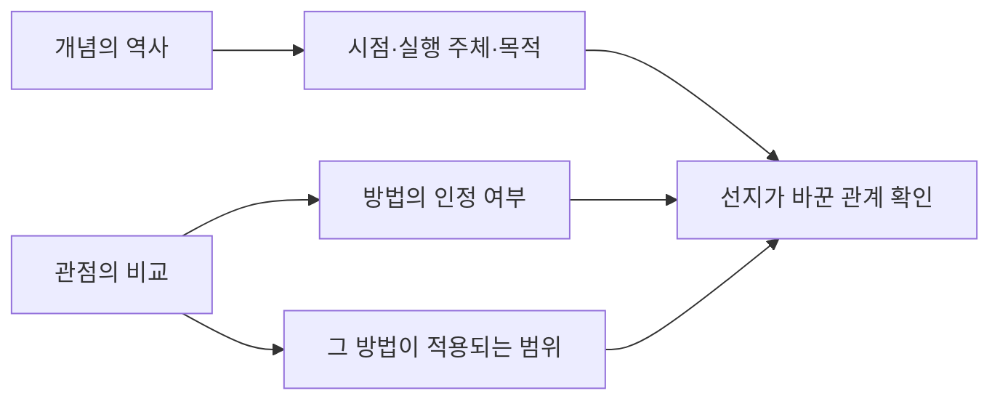

# 개념의 변화와 관점 비교 | Concept Change and Viewpoint Comparison

[자료 식별과 공식 PDF](README.md) · [English](#english)

원문을 곁에 두고 읽는 해설입니다. 아래 표는 선지를 다시 옮긴 문장이 아니라, 각 번호가 유지하거나 바꾼 관계를 표시합니다. 논리 설명에 쓰는 출입·메모·수업 예시는 원문과 별도로 만든 예제입니다.

## 지문의 구조를 잡는 좌표

| 원문 위치 | 읽을 때 남길 관계 |
| --- | --- |
| (가)1 | 이전 의미와 이후 상황의 대비입니다. |
| (가)2 | 의미·목적의 변화입니다. |
| (가)3 | 실행 주체와 평가의 변천입니다. |
| (가)4 | 두 학문의 역할 분담입니다. |
| (나)1 | 기존 대응의 한계입니다. |
| (나)2 | 변혁의 선행 조건입니다. |
| (나)3 | 방법의 적용 범위 확대입니다. |
| (나)4 | 방법의 적용 범위 제한입니다. |

이 구조도에는 검토할 축을 표시했습니다. 같은 용어가 반복되어도 시점과 사용자가 달라지면 의미를 다시 확인해야 합니다. 반대로 의견이 갈려도 방법 자체에 대한 판단과 적용 범위에 대한 판단은 다를 수 있습니다.

## 4번: 필요한 조건의 방향

부적절한 설명을 고릅니다. 공식 정답은 ④입니다.

| 선지 | 지문과의 관계 | 근거 위치 |
| --- | --- | --- |
| ① | 적절: 반대의 지속 시점을 유지합니다. | (가)1 |
| ② | 적절: 혁신의 대상을 유지합니다. | (가)4 |
| ③ | 적절: 기술만으로 부족함을 유지합니다. | (나)1 |
| ④ | 부적절: 과학 정신과 정치 변혁의 선행 방향을 뒤집었습니다. | (나)2 |
| ⑤ | 적절: 비판과 보존을 연결합니다. | (나)4 |

옌푸의 조건은 `정치 변혁이 뿌리내림 → 과학 정신`입니다. ④는 이 선행 관계를 반대로 붙였습니다. 원문과 선지를 화살표로 표시하면 같은 두 개념이 있어도 방향이 다르다는 점이 드러납니다.

예를 들어 “회원증이 있어야 출입할 수 있습니다”라는 자체 조건에서 `출입 가능 → 회원증 보유`가 성립합니다. 회원증이 있어도 시설 휴관 중에는 출입할 수 없는 경우를 생각하면 반대 방향은 자동으로 성립하지 않습니다. ‘선행되어야 합니다’, ‘전제됩니다’, ‘위에서만 가능합니다’는 문장 안에서 비슷한 조건 역할을 할 수 있지만, 그 표현에 붙은 대상까지 보존해야 합니다.

다만 실제 지문을 형식 논리로 옮기는 일은 해석 뒤에 이루어집니다. 누가 그 조건을 주장했는지와 조건의 대상이 무엇인지 먼저 정해야 합니다. 배경의 사건 순서와 어떤 인물이 요구하는 정당화의 순서를 하나로 합치지도 않습니다.

## 5번: 최초 등장이라는 범위

부적절한 설명을 고릅니다. 공식 정답은 ⑤입니다.

| 선지 | 지문과의 관계 | 근거 위치 |
| --- | --- | --- |
| ① | 적절: 이전의 통치 역할입니다. | (가)1 |
| ② | 적절: 선별적 수용을 유지합니다. | (가)2 |
| ③ | 적절: 왕의 역할을 함께 확인합니다. | (가)2~3 |
| ④ | 적절: 실행 주체와 평가를 구분합니다. | (가)3 |
| ⑤ | 부적절: 국가 주권 인식을 『대한매일신보』 때 처음으로 한정했습니다. | (가)2~3 |

⑤는 앞선 『한성순보』의 설명과 충돌합니다. 특정 시점에서 어떤 내용이 보인다는 것과 그때 처음 나타났다는 것은 다릅니다. ‘이르러서야’, ‘비로소’, ‘처음으로’는 이전 구간을 배제하는지 살펴보셔야 합니다.

예를 들어 메모3에 어떤 개념이 적혀 있다고 하겠습니다. 이 사실만으로 ‘메모3에서 그 개념이 처음 등장했습니다’라고 말할 수는 없습니다. 메모1에도 같은 개념이 있으면 최초 주장만 무너지고, 메모3에 그 개념이 있다는 사실 자체는 남습니다. 사건의 존재를 부정하는 반례인지, 최초라는 시간 범위를 부정하는 반례인지 구별하는 이유입니다.

④처럼 주체와 외부 평가가 함께 등장할 때에도 두 층위를 나눕니다. 어떤 행위를 누가 수행하는지와, 다른 사람들이 그 행위를 어떻게 받아들였는지는 서로 다른 정보입니다. 부정적인 평판이 언급되었다고 그 평판이 필자의 확정적 정의라고 보지는 않습니다.

## 6번: 공통 입장과 적용 범위

공통으로 동의할 수 있는 설명을 고릅니다. 공식 정답은 ③입니다.

| 선지 | 지문과의 관계 | 근거 위치 |
| --- | --- | --- |
| ① | 부적절: 양립 불가를 공통 입장으로 넓혔습니다. | (나)3~4 |
| ② | 부적절: 원인 판단을 공통 입장으로 넓혔습니다. | (나)2~4 |
| ③ | 적절: 방법 자체의 인정을 공유합니다. | (나)3~4 |
| ④ | 부적절: 전면 도입의 충분성을 공유하지 않습니다. | (나)4 |
| ⑤ | 부적절: 사상 재구성의 요구를 공유하지 않습니다. | (나)4 |

대립하는 두 입장에도 교집합은 있을 수 있습니다. 여기서는 방법의 인정 여부와 그 방법으로 답할 수 있는 질문의 범위를 따로 놓고 검토합니다. 적용 한계를 말하는 것만으로 방법 자체의 부정이 되지는 않습니다.

다음은 자체 예입니다. 갑은 “측정값으로 장치 상태를 판단할 수 있습니다”라고 말하고, 을은 “측정값은 유용하지만 어떤 위험을 감수할지는 수치만으로 정해지지 않습니다”라고 말합니다. 두 사람이 모두 측정을 쓸모없다고 본다고 읽으면 틀립니다. 또한 두 사람이 모든 결정을 측정으로 해결할 수 있다고 본다고 읽어도 틀립니다. 공통 부분을 찾는 작업은 둘의 차이를 지우거나, 차이 때문에 공통 부분을 없애는 작업이 아닙니다.

공통 동의 문항에서는 한 사람의 설명이 매우 자세하다고 해서 그 사람의 모든 명제를 상대에게도 붙이지 않습니다. 두 번째 입장에 명시된 동의·제한·반대의 범위를 함께 확인해야 합니다.

## 7번: 두 부분의 판단을 분리합니다

적절한 설명을 고릅니다. 공식 정답은 ②입니다.

| 선지 | 지문과의 관계 | 근거 위치 |
| --- | --- | --- |
| ① | 부적절: 후반부의 전통관이 뒤바뀌었습니다. | (나)3 |
| ② | 적절: 두 반대 대상을 맞게 잡았습니다. | (가)4·(나)3 |
| ③ | 부적절: 전반부가 과학의 필요성을 뒤집었습니다. | (가)4 |
| ④ | 부적절: 후반부의 지지를 비판으로 바꾸었습니다. | (나)3 |
| ⑤ | 부적절: 후반부가 철학의 독립을 동의로 바꾸었습니다. | (나)3 |

한 선택지에 두 인물의 판단이 이어져 있으면 앞부분의 익숙한 구절이 뒷부분까지 맞게 만들지는 않습니다. 내용을 두 절로 나누고 각각의 주체, 대상, 찬반 방향을 확인하시면 됩니다. 표에서 ‘전반부’와 ‘후반부’는 이 두 절을 가리킵니다.

형식적으로 A와 B를 함께 단정하는 설명은 둘 다 근거를 가져야 합니다. 자체 예로 “갑은 수업 녹화에 동의하고, 을은 자료 공개를 반대합니다”를 생각하겠습니다. 갑의 동의만 확인한 상태에서는 설명 전체를 받아들일 수 없습니다. 을이 조건부 공개를 지지한다면 앞 절이 맞더라도 뒤 절 때문에 전체가 부적절합니다.

또한 ‘반대한다는 설명에 동의합니다’처럼 부정과 태도가 겹치면, 부정 표현의 개수만 세지 않습니다. 누가 어떤 명제를 반대하는지 풀어 적어야 합니다. 반대의 대상이 바뀌면 문장에 같은 단어가 남아 있어도 입장은 달라집니다.

## 8번: 사례에서 연결할 것은 단어가 아니라 목적입니다

부적절한 반응을 고릅니다. 공식 정답은 ①입니다.

| 선지 | 지문과의 관계 | 근거 위치 |
| --- | --- | --- |
| ① | 부적절: 서로 다른 홍보 목적을 동일시했습니다. | (가)2·보기 |
| ② | 적절: 통치와 생산의 목표를 구분했습니다. | (가)3·보기 |
| ③ | 적절: 가치관에 관한 입장을 적용했습니다. | (가)4·보기 |
| ④ | 적절: 빠진 필요조건을 확인했습니다. | (나)2·보기 |
| ⑤ | 적절: 방법의 적용 한계를 유지했습니다. | (나)4·보기 |

①에서는 수단이 비슷하다는 사실과 해결하려는 문제가 같다는 판단을 나눕니다. 반감과 자신감 부족은 다른 상태입니다. 이 차이를 지우면 같은 행위 명칭을 발견했다는 이유만으로 취지까지 같다고 결론내리게 됩니다.

다음은 별도 예입니다. 두 학교가 모두 설명회를 열더라도, 한 학교는 제도에 대한 오해를 풀려 하고 다른 학교는 동의는 하지만 참여를 망설이는 학생을 독려할 수 있습니다. 같은 수단을 사용한다는 사실만으로 목표나 출발 상태가 같아지지는 않습니다. 사례 적용에서는 `대상·현재 상태·목적·수단·기대 결과` 가운데 무엇을 대응시키는지 적어 보시면 됩니다.

③~⑤의 적절성은 지문 속 관점을 사례에 적용한 판정입니다. 이를 실제 역사적 원인이나 현실 사회의 인과관계를 실증한 결과로 확대하지 않습니다. 특히 인물의 관점에 비추어 사례를 평가하는 질문과, 주어진 사실에서 필연적으로 참인 명제를 도출하는 질문은 요구하는 작업이 다릅니다.

## 9번: 같은 낱말의 문맥별 의미

문맥상 의미가 가까운 것을 고릅니다. 공식 정답은 ②입니다.

| 선지 | 지문과의 관계 | 확인할 의미 |
| --- | --- | --- |
| ① | 부적절 | 현상의 중단입니다. |
| ② | 적절 | 일정 수준에 머묾입니다. |
| ③ | 부적절 | 현상의 중단입니다. |
| ④ | 부적절 | 행동의 중단입니다. |
| ⑤ | 부적절 | 현상의 중단입니다. |

ⓐ의 앞뒤를 포함한 짧은 덩어리를 읽어야 합니다. 낱말 하나가 같다고 문장의 작동 방식까지 같아지지는 않습니다. 여기서는 진행되던 것이 멈춘다는 뜻과, 어떤 한계 이상으로 나아가지 못한다는 뜻을 구분합니다.

별도의 자체 예로 “논의가 초안에 머물렀습니다”를 생각하겠습니다. 초안 작성이라는 행위가 멈추었다는 말보다는 완성 단계에 이르지 못했다는 수준의 제한이 중심입니다. 반면 “회의 도중 소음이 멎었습니다”에서는 진행되던 현상의 중단이 중심입니다. 동의어를 기계적으로 대입하기보다 무엇의 변화나 한계를 설명하는 문장인지 확인해야 합니다.

이 문항에서는 어형과 부정 여부만 비교하지 않습니다. 문장 전체가 긍정형인지 부정형인지와, 해당 낱말이 가진 의미가 같은지는 다른 질문입니다. 부정문에도 동일한 의미의 낱말이 들어갈 수 있으며, 긍정문이라도 뜻은 다를 수 있습니다.

## 정답이 하나로 남는지 다시 확인합니다

| 문항 | 질문의 방향 | 적절한 선지 | 부적절한 선지 | 선택할 답 |
| --- | --- | --- | --- | --- |
| 4 | 부적절한 설명 | ①②③⑤ | ④ | ④ |
| 5 | 부적절한 설명 | ①②③④ | ⑤ | ⑤ |
| 6 | 공통으로 동의할 설명 | ③ | ①②④⑤ | ③ |
| 7 | 적절한 설명 | ② | ①③④⑤ | ② |
| 8 | 부적절한 반응 | ②③④⑤ | ① | ① |
| 9 | 문맥상 가까운 의미 | ② | ①③④⑤ | ② |

각 번호의 원문 근거와 관계를 검토한 뒤, 질문의 긍정·부정 방향에 맞춰 선택 결과를 정답표와 대조합니다. 근거 위치가 같은 오답이라도 잘못된 시점, 적용 범위, 판단 주체처럼 달라진 요소는 따로 남겨야 합니다.

## English

Read this note beside the linked official paper. The option tables identify relational changes rather than republishing the options. The analysis checks prerequisite direction, first-occurrence claims, overlap between competing views, both halves of a compound option, the difference between a shared means and a shared purpose, and a word’s contextual sense. Examples involving entry cards, notes, classes and school briefings are independently constructed illustrations.
