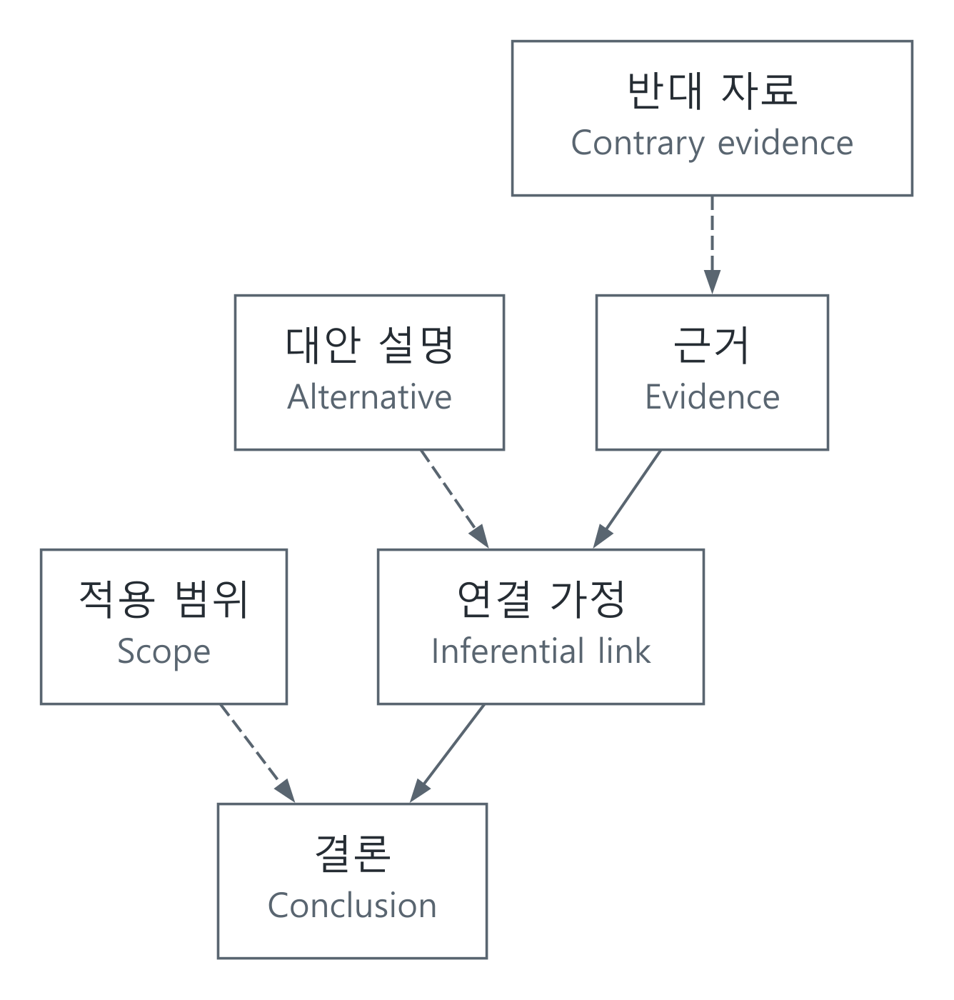

# 논증 독해: 근거·결론·가정과 반론

[추론과 적성시험](../README.md) · [인문·사회와 추론](../개념과판단_CONCEPTS_AND_JUDGMENT.md) · [English](#english)

## 내용을 기억하는 것과 논리를 따라가는 것

글에 나온 단어를 많이 기억해도 필자의 결론을 잘못 읽을 수 있습니다. 논증 독해는 문장을 순서대로 외우는 대신 “무엇을 근거로 어떤 결론을 내리는가”를 따라갑니다. LEET·PSAT의 독해뿐 아니라 논문, 정책 문서, 기술 제안서를 읽을 때도 필요한 구분입니다.

영어 argument는 일상에서 ‘말다툼’을 뜻하기도 하지만 여기서는 근거로 결론을 뒷받침하는 구조입니다. 반대 의견을 강한 어조로 말하는 것과 논증이 성립하지 않는 이유를 밝히는 것은 다릅니다. [Harvard의 논증·반론 설명](https://writingcenter.fas.harvard.edu/counterargument)과 [분석적 질문 안내](https://writingcenter.fas.harvard.edu/asking-analytical-questions)를 함께 참고했습니다.

| 구분 | 읽을 때 붙잡을 질문 |
| --- | --- |
| 쟁점 | 무엇에 답하려는 글입니까? |
| 결론 | 필자가 독자에게 받아들이라고 하는 주장은 무엇입니까? |
| 전제·근거 | 어떤 사실이나 원리를 이유로 제시합니까? |
| 연결 가정 | 그 이유에서 결론으로 가려면 무엇이 더 필요할까요? |
| 범위·한정 | 모든 경우에 해당합니까, 일부에만 해당합니까? 어느 집단·기간·조건입니까? |
| 반론 | 근거·연결·결론 중 어디를 겨냥합니까? |

“따라서” 같은 접속어는 단서지만 접속어만으로 역할을 확정하지 않습니다. 인용한 상대의 결론과 필자 자신의 결론도 구분합니다. 같은 글에서 중간 결론이 다음 논증의 전제가 될 수 있습니다.

## 구조를 작게 모델링하기

논증을 $`P_1,P_2,\ldots,P_n\therefore C`$로 적으면, $`P_i`$는 전제, $`C`$는 결론입니다. 연역적 타당성을 보려면 전제들이 모두 참인 상황에서 결론만 거짓일 수 있는지 묻습니다. 이런 상황이 하나라도 있으면 반례입니다.

$$
\Gamma\models C\quad\Longleftrightarrow\quad
\text{전제 집합 }\Gamma\text{를 모두 만족하는 모든 해석이 }C\text{도 만족한다}.
$$

예를 들어 $`P\Rightarrow Q`$와 $`Q`$만으로 $`P`$를 확정할 수 없습니다. $`P`$가 거짓이고 $`Q`$가 참인 해석이 두 전제를 만족하기 때문입니다. 이 짧은 식은 정의를 확인하는 예이며 기출 문항이 아닙니다. [형식 논리 글](명제와추론_FORMAL_LOGIC.md)의 진리표와 연결해 검사할 수 있습니다.

자연어 논증이 모두 이런 연역 형식은 아닙니다. 관측 자료로 원인을 추정하거나 정책 효과를 예상하는 글에서는 근거가 결론을 얼마나 지지하는지, 대안 설명이 남는지를 살핍니다. “입증되지 않았다”와 “거짓으로 입증되었다”도 다릅니다. 정보가 부족한 상태를 임의로 참·거짓 중 하나로 확정하지 않습니다.

[SVG](../../그림자료_assets/도식_diagrams/argument-reading-and-counterexamples.svg) · [그림 원본 / Diagram source](../../그림자료_assets/도식_diagrams/argument-reading-and-counterexamples.mmd)

직접 구성한 그림입니다. 반론은 결론뿐 아니라 근거의 신뢰성이나 연결 가정에도 향할 수 있습니다.

## 문제의 요구를 바꿔 읽지 않기

| 요구 | 확인할 것 | 혼동하기 쉬운 것 |
| --- | --- | --- |
| 필연적 귀결 판단 | 전제가 허용하는 모든 경우에서 결론이 참인지 확인합니다. | 현실에서 그럴듯하다는 느낌 |
| 논증의 약화 판단 | 반대 근거나 대안이 근거와 결론의 연결을 약하게 하는지 확인합니다. | 결론이 완전히 거짓이어야 한다는 생각 |
| 필요 가정 찾기 | 그 가정을 부정하면 해당 추론이 유지될 수 없는지 확인합니다. | 그 가정 하나만으로 결론이 충분히 도출된다는 주장 |
| 내용 일치 판단 | 원문의 주체·조건·범위·정도가 유지되는지 확인합니다. | 독자가 이미 알고 있는 외부 사실 |

가정의 부정을 이용하는 점검은 원래의 추론 방식과 가정의 의미를 보존해야 합니다. 자연어 문장의 “대체로”, “보통”, “적어도”, “오직”을 기계적으로 부정하면 논증 자체가 달라질 수 있습니다. 필요 가정과 충분 가정도 같은 말이 아닙니다.

## 실제 글을 분석하는 기록 방식

먼저 원문과 발행기관·날짜를 남깁니다. 문장 번호를 붙이고 주장과 이유를 짧게 분리합니다. 다음으로 이유와 결론 사이의 연결을 적고, 그 연결이 허용하는 범위 안에서 반례나 대안 설명을 찾습니다. 판단이 달라지면 어떤 자료가 바뀌어야 하는지도 적습니다. [Harvard의 분석적 질문 안내](https://writingcenter.fas.harvard.edu/asking-analytical-questions)는 자료 안의 긴장과 모호함에서 검토할 질문을 만드는 방법을 설명합니다.

검증은 원문으로 돌아가 주체·양화 표현·인과 방향이 바뀌지 않았는지 확인하는 일에서 시작합니다. 연역식으로 옮긴 부분은 반례나 진리표로, 자료에 의존하는 부분은 표본·비교집단·측정 정의로 따로 확인합니다. 공식 기출 분석에서는 문항의 연도·영역·책형·번호와 최종 정답을 함께 대조합니다. 긴 글의 내용을 하나의 짧은 표어로 바꿔 정답을 찍는 방식보다, 어느 문장에서 어떤 결론이 허용되는지 확인하는 기록이 남아야 합니다.

## English

### Following an argument rather than memorizing words

Remembering vocabulary does not guarantee that a reader identifies an author's conclusion. Argument reading follows the move from reasons to claims. It is useful for LEET/PSAT reading, research papers, policy documents and technical proposals.

An argument here is a reason-supported structure, not a quarrel. A forceful objection is not automatically a logical refutation. The [Harvard counterargument guide](https://writingcenter.fas.harvard.edu/counterargument) and [analytical-question guide](https://writingcenter.fas.harvard.edu/asking-analytical-questions) support the distinctions used here.

Identify the issue, the conclusion the author asks readers to accept, the stated reasons, the additional inferential assumptions, and the population/time/conditions limiting the claim. Locate the target of an objection. Words such as “therefore” are clues rather than a complete role detector. Separate an opponent's quoted conclusion from the author's own claim; an intermediate conclusion can become a premise later.

### A compact model

Write $`P_1,\ldots,P_n\therefore C`$. A deductively valid argument has no interpretation where every premise is true and the conclusion false:

$$
\Gamma\models C\quad\Longleftrightarrow\quad
\text{every interpretation satisfying all of }\Gamma\text{ also satisfies }C.
$$

From $`P\Rightarrow Q`$ and $`Q`$, one cannot conclude $`P`$: $`P`$ false and $`Q`$ true is a counterexample. This small definition check is not a past exam question. The [formal-logic article](명제와추론_FORMAL_LOGIC.md#english) connects it to truth-table checks.

Not every natural-language argument is deductive. Inferring causes or policy effects requires assessing support and remaining alternatives. Failure to establish a claim is not proof that it is false. Insufficient information should not be arbitrarily forced into a true/false answer. The original diagram above distinguishes objections to evidence, inference and scope.

### Respect the question's demand

| Demand | Check | Common confusion |
| --- | --- | --- |
| Must follow | Is the conclusion true in every case allowed by the premises? | Mere plausibility |
| Weaken | Does contrary evidence or an alternative reduce support? | Requiring total disproof |
| Necessary assumption | Can this inference survive the assumption's negation? | Treating the assumption alone as sufficient |
| Match the passage | Are subject, conditions, scope and degree preserved? | Substituting outside knowledge |

A negation check must preserve the meaning of both the assumption and the inference. Mechanical changes to “usually,” “at least,” or “only” can alter the claim. Necessary and sufficient assumptions are distinct.

### A checkable reading record

Record the source, institution and date, number relevant sentences, and separate reasons from claims. State the inferential link, look for permitted counterexamples or alternative explanations, and identify what evidence would change the judgment. Harvard's analytical-question guide discusses questions arising from tensions or ambiguities within sources.

Verification starts by returning to the text: preserve its subject, quantifiers and causal direction. Check formalized deductions with counterexamples or truth tables; check empirical claims through samples, comparisons and measurement definitions. For official past papers, compare the year, section, booklet, question number and final official answer. The record should explain which sentence permits which conclusion rather than reduce a complex passage to a slogan.

## 출처 / Sources

- [Harvard College Writing Center: Counterargument](https://writingcenter.fas.harvard.edu/counterargument) — 근거·가정·결론을 겨냥하는 반론 / objections targeting evidence, assumptions and conclusions.
- [Harvard College Writing Center: Asking Analytical Questions](https://writingcenter.fas.harvard.edu/asking-analytical-questions) — 자료 안의 모순·모호함·대안 분석 / tensions, ambiguities and alternatives within sources.
- [형식 논리와 검증](명제와추론_FORMAL_LOGIC.md) — 타당성·반례의 정의와 공식 논리 교재 / validity and counterexamples with primary logic references.

논증 구조와 반론의 역할을 대조하고, 작은 연역 예는 명제의 참·거짓 해석으로 확인했습니다. / Argument structure and objection roles were cross-checked; the small deduction was checked against its truth assignments.
