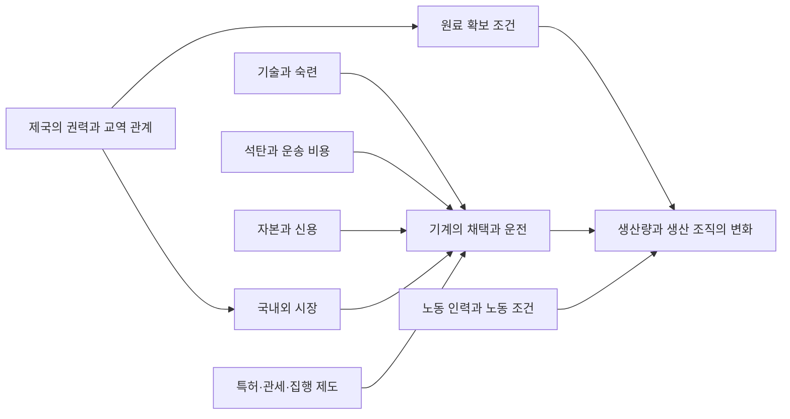

# 산업화의 여러 원인 / Industrialization and Causal Explanations

## 변화의 이름과 원인의 질문

산업화는 기계 사용, 동력, 생산 조직, 산업별 고용과 산출의 관계가 바뀌는 과정입니다. 인과 설명은 어떤 조건이 어떤 경로로 결과를 바꾸었는지 설명합니다. 그 조건이 없었다면 결과가 어떻게 달랐을지도 묻습니다. 이를 반사실 질문이라고 합니다. 과거를 되돌려 실험할 수 없으므로 비교 지역·사업 기록·기계·노동 기록을 함께 읽습니다.

여기서는 18세기 후반~19세기 영국의 생산 변화와 인도 직물의 연결을 다룹니다. 영국의 순서를 모든 사회의 보편 연표로 삼지 않습니다. 생산 증가의 원인과 그 이익·피해가 누구에게 돌아갔는지도 구별합니다.

## 연표와 인과 그림은 다른 일을 합니다

| 연표의 항목 | 확인 자료 | 이 항목만으로 답하지 못하는 질문 |
|---|---|---|
| 약 1750년 코로만델 해안에서 유럽 수출용 면직물 의복을 만들었습니다. | V&A의 「Indian textiles」 중 의복 캡션입니다. | 이 직물의 유행이 영국 기계 투자를 얼마나 바꾸었습니까? |
| 1788년 Boulton & Watt의 회전식 증기기관을 제작했습니다. | Science Museum Group의 소장품 1861-46입니다. | 기계를 살 자금과 운전할 연료는 어떻게 확보했습니까? |
| 1833년 공장법이 제정되었고 1836년 감독 보고서가 나왔습니다. | 영국 국가기록원 교육자료입니다. | 규정이 실제 노동시간과 노동자의 생활을 얼마나 바꾸었습니까? |

이 연표는 시간 순서를 정리합니다. “1750년 직물 수출 → 1788년 기관 → 1833년 법”이라는 배열만으로 앞 항목이 뒤 항목의 충분한 원인이 되지는 않습니다. 충분한 원인은 그것이 있으면 결과가 반드시 생긴다는 강한 주장입니다.

아래 그림은 자체 인과 가설입니다. 화살표는 검토할 경로이며, 역사 자료로 크기를 추정한 결과가 아닙니다.

석탄은 에너지원이지만 채굴·운송 비용이 필요합니다. 기술은 연료와 장비를 일로 바꾸는 방법이며 숙련자가 운전·수리해야 합니다. 자본은 기계·건물·원료에 미리 투입하는 자원이고, 신용은 현재 지출을 미래 수입과 연결합니다. 시장의 수요는 팔릴 가능성을 뜻하지만 실제 판매를 보장하지 않습니다. 제도는 계약·특허·관세·감독 같은 규칙과 집행입니다. 제국은 정치적 지배와 불균등한 권력을 포함하므로 자유로운 교환이라는 말만으로 그 관계를 설명할 수 없습니다.

## 같은 변화에 서로 다른 자료를 대조하기

Science Museum Group의 「Rotative Steam Engine by Boulton and Watt, 1788」에서 제작 정보와 상세 설명을 읽었습니다. 이 기관은 Soho 공장에서 금속 연마 기계 43대를 구동했습니다. 별도 응축기는 증기를 식히는 공간을 실린더와 나누어 반복 가열의 낭비를 줄이는 장치입니다. 기술이 연료 비용에 연결되는 원리입니다. 기관 한 대로 전국 공장이 즉시 증기로 전환했다고 판단하지 않습니다. [기관 1861-46][engine]

또한 회전 운동 장치의 설계에는 다른 특허를 피하려는 목적이 있었습니다. 제도가 설계 선택과 연결된 사례입니다. 그러나 특허의 일반적인 효과를 이 기관 하나로 판단할 수는 없습니다.

노동은 기관의 성능표에서 드러나지 않습니다. 국가기록원의 「1833 Factory Act」 자료집 8~9쪽은 1836년 공장감독 보고서(British Parliamentary Papers, p.353)의 발췌와 전사문입니다. 감독관이 소년들의 진술을 듣고 시간 장부를 확인하러 간 과정이 나옵니다. 소년들은 금요일 오전 6시부터 토요일 오후 4시까지, 식사와 자정의 추가 휴식 등을 제외하고 일했다고 진술합니다. [Source 1 전사문][factory]

경과시간은 `24+10=34시간`입니다. 식사 시간을 몰라 실제 노동시간을 정확히 34시간이라고 할 수 없습니다. 감독관이 전달한 진술이라는 기록 경로도 표시합니다. 이 사료는 특정 사업장의 장시간 노동과 조사 과정이며 전국 평균을 측정한 표가 아닙니다.

V&A의 「Indian textiles」에서는 「A Global Trade」와 「Textiles in a Changing World」 및 의복 캡션을 읽었습니다. 약 1750년 수출용 의복과 영국 기계제 직물·인도 시장·관세 설명을 대조하면 생산지·수요·정치 권력의 관계를 물을 수 있습니다. 박물관의 해설이며 무역 장부로 원인별 기여율을 추정한 결과는 아닙니다. [Indian textiles][textiles]

확인일은 2026-10-21입니다. 기관은 소장품 설명, 노동은 기관 제공 전사문, 직물은 해설과 캡션으로 확인했습니다.

## 풀이된 비교: 석탄만 있으면 산업화합니까?

“석탄이 풍부했기 때문에 산업화했습니다”라는 설명을 검토합니다. 기계가 있어도 운송비가 높거나 자금·판로가 없으면 채택이 제한될 수 있습니다. 석탄 매장 외에 연료 도착 비용, 기관 구입·수리 기록, 판매처와 생산 변화를 함께 살펴야 합니다. 이는 조사할 항목이며 이 글에서 지역별 석탄 가격을 확인한 것은 아닙니다.

반대로 “시장이 커졌으므로 증기기관이 원인입니다”도 성립하지 않습니다. 시장 확대는 기계 투자를 유도할 수 있고, 기계 생산이 가격과 판매량을 바꿀 수도 있습니다. 원인과 결과의 되먹임 가능성이 있습니다. 기술·에너지·노동·자본·시장·제도·제국 중 하나를 지우기보다 어느 산업과 시기의 어느 연결을 자료가 지지하는지 좁혀야 합니다.

## 자체 계산: 총생산과 1인당 산출

다음 A·B는 가상 지역이며 실제 국가·시대의 통계가 아닙니다. 같은 종류·품질의 물건을 같은 단위로 셌다고 가정합니다. 인구와 생산량에 각각 같은 배수를 붙여도 아래 비율은 같습니다.

| 지역 | 처음 인구 | 나중 인구 | 처음 생산량 | 나중 생산량 |
|---|---:|---:|---:|---:|
| A | 100 | 150 | 1,000 | 1,500 |
| B | 100 | 120 | 1,000 | 1,800 |

A의 총생산은 `1,500÷1,000−1=50%` 증가합니다. 처음 1인당 산출은 `1,000÷100=10`, 나중은 `1,500÷150=10`이므로 증가율은 0%입니다. B의 총생산 증가율은 80%이며, 1인당 산출은 `1,800÷120=15`로 50% 증가합니다. `총생산 증가배수÷인구 증가배수`로도 B는 `1.8÷1.2=1.5`입니다.

총량 증가와 1인당 산출 증가는 다릅니다. 1인당 산출도 노동생산성과 같지 않습니다. 후자는 취업자 수나 노동시간 같은 분모가 필요합니다. 분배·물가·건강·여가를 모르면 이 값을 모든 주민의 생활 수준 변화로 옮길 수도 없습니다. 이 표는 실제 산업화 원인을 입증하지 않습니다.

## 확인 문제

1. 1788년 기관 제작이 1833년 법 제정보다 앞선다는 사실만으로 기관이 그 법의 충분한 원인임을 증명합니까?
2. 가상 A의 총생산 증가율이 50%이므로 A 주민 한 명당 산출도 50% 늘었다고 할 수 있습니까?
3. B의 나중 인구가 150이고 생산량이 1,800이면 1인당 산출과 그 증가율은 얼마입니까? 이 값으로 시간당 노동생산성도 계산할 수 있습니까?

답과 해설

1. 증명하지 않습니다. 시간상 선후 외에 노동 환경·정치적 요구·입법 과정 등을 잇는 근거가 필요합니다. 하나의 기관이 법 제정에 충분했다는 주장은 더 강한 검토가 필요합니다.
2. 할 수 없습니다. 인구도 50% 늘었으므로 1인당 산출은 10으로 같습니다.
3. `1,800÷150=12`이며 처음 10보다 20% 증가합니다. 노동시간을 모르면 시간당 노동생산성은 계산할 수 없습니다. 인구와 노동시간은 다른 분모입니다.

## English summary

Industrialization calls for explanations linking technology, coal, labor, capital, markets, institutions, and imperial power. A machine, an inspector's report, and textile records answer different questions. Chronological order alone does not establish causation. The fictional A–B example separates total output from per-capita output and labor productivity.

[engine]: https://collection.sciencemuseumgroup.org.uk/objects/co50948/rotative-steam-engine-by-boulton-and-watt-1788-beam-engine-steam-engine
[factory]: https://cdn.nationalarchives.gov.uk/documents/education/factory-actdoc.pdf
[textiles]: https://www.vam.ac.uk/articles/indian-textiles

[역사 학습 목차](../README.md)
