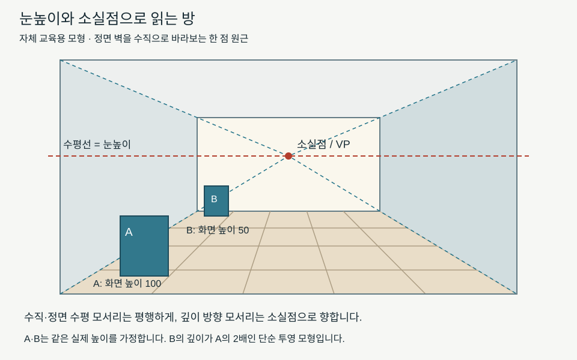

# 공간·원근과 매체 / Space, perspective and materials

평평한 화면에서도 앞뒤·넓이·깊이가 느껴집니다. 겹침, 화면상 크기, 선의 모임, 밝기와 선명도의 차이가 그 단서가 됩니다. 같은 크기의 복제 이미지 두 장을 나란히 놓아도 원작의 크기·재료·표면은 다를 수 있습니다. 표현된 공간과 실제 물질을 함께 읽어 보겠습니다.

## 깊이를 만드는 단서를 나눕니다

한 형상이 다른 형상의 일부를 가리면 겹침 관계를 통해 앞뒤를 읽을 수 있습니다. 화면에서 작게 그려졌다는 사실은 멀리 있다는 단서가 될 수 있지만, 실제로 작은 물체를 가까이 둔 경우도 있습니다. 크기만 보고 실제 거리까지 확정하려면 같은 실제 크기라는 가정 등이 필요합니다.

멀수록 선명도가 약해지거나 색·명도 대비가 달라지는 표현을 대기 원근의 단서로 읽기도 합니다. 이것도 모든 날씨·매체에서 같은 색으로 나타나는 규칙은 아닙니다. 선 원근은 공간의 직선들이 화면에 어떻게 투영되는지 이용합니다. 이 단서들은 함께 쓰거나 일부만 선택할 수 있습니다.

공간을 표현하는 목적도 다양합니다. 위에서 본 배치, 중요한 인물을 크게 그린 구성, 이동하는 시점의 풍경은 하나의 고정 시점으로 본 장면과 다른 정보를 줄 수 있습니다. 한 점 원근에 맞지 않는다는 이유만으로 모든 그림을 틀린 공간이라고 판정하면 표현의 질문을 놓칩니다.

## 자체 그림: 한 점 원근의 방

그림은 정면 벽을 수직으로 바라보는 자체 모형입니다. 수평선은 여기서 관찰자의 눈높이에 해당하는 선입니다. 벽이 가로막은 실내에서도 기하학적 눈높이 선은 설정할 수 있습니다. 실제 바다의 경계가 눈에 보여야만 수평선이 생기는 것은 아닙니다.

소실점은 특정 방향으로 평행한 직선들이 화면에서 모이는 점입니다. 이 그림에서는 화면에 수직인 깊이 방향 모서리들을 연장하면 한 점으로 모입니다. 정면 벽의 수평 모서리와 수직 모서리는 각각 평행하게 남습니다. 모든 종류의 선을 이 점에 모으는 것이 한 점 원근은 아닙니다. [Cleveland Museum of Art의 원근 학습 자료](https://www.clevelandart.org/perspective)는 복도 그림과 소실점을 연결해 관찰하는 활동을 제공합니다.

그림의 바닥에는 깊이 방향 안내선과 가로 안내선이 있습니다. 화면에서 같은 간격으로 그은 가로선이라고 실제 바닥의 같은 길이 간격이 자동으로 되는 것은 아닙니다. 멀어지는 일정한 간격을 투영하면 화면의 간격도 달라집니다. 여기서는 앞뒤 방향을 읽는 보조선으로 사용하며 바닥의 실제 치수를 정한 설계도는 아닙니다.

## 자체 계산: 같은 물체가 작아 보이는 조건

단순한 중심 투영에서 화면 높이는 `h=fH/Z`로 나타낼 수 있습니다. `H`는 실제 높이, `Z`는 시점에서 깊이 방향으로 잰 거리, `f`는 시점과 화면 사이의 거리입니다. 물체의 수직면이 화면과 나란하고 같은 투영 조건이라는 가정을 둡니다.

자체 그림의 수직판 A·B는 같은 실제 높이라고 가정합니다. B의 깊이 `Z`가 A의 두 배이면 화면 높이는 절반이 됩니다. A를 100단위로 그리면 B는 50단위입니다. 이것은 특정 회화의 거리를 실측한 결과가 아니며 모든 사진에서 크기만으로 거리를 알아내는 공식도 아닙니다. 실제 높이와 카메라 조건을 모르면 다른 설명이 남습니다.

단순 모형의 장점은 어떤 가정 때문에 결론이 나왔는지 드러낸다는 점입니다. B가 절반으로 보인다는 관찰만으로 실제 깊이가 두 배라고 거꾸로 결론 내리면 실제 높이가 절반인 경우 등을 빠뜨립니다. 투영의 기하와 작품 해석의 확실성을 같은 것으로 놓지 않습니다.

## 회화·판화·조각·사진의 표면은 다릅니다

매체는 표현을 담는 재료·도구·방식의 조건입니다. 유화에서는 물감의 쌓임과 붓 자국이 화면을 이룹니다. 목판화는 판에 구성한 형상을 종이에 찍은 인쇄물입니다. 한 판에서 여러 장을 찍을 수 있으며, 판화에서 ‘인상(impression)’은 이렇게 찍은 개별 인쇄본을 뜻합니다. 조각은 실제 공간에서 부피·표면·시점의 변화를 경험하게 합니다. 사진은 촬영 위치·화각·노출·인화와 표시 조건을 함께 살펴야 합니다.

[Asian Art Museum의 우키요에 제작 설명](https://education.asianart.org/resources/the-ukiyo-e-woodblock-printing-process/)은 출판자·그림 설계자·조각가·인쇄자의 협업을 다룹니다. 작가 이름 하나만 보이는 목록에서도 실제 제작에 여러 역할이 참여할 수 있습니다. 색판의 인쇄와 물감의 붓 자국은 다른 흔적을 만들기 때문에, 선명한 윤곽을 단순히 붓을 덜 쓴 회화로 설명할 수는 없습니다.

## 실제 두 작품의 공간을 비교합니다

[페르메이르의 《물주전자를 든 젊은 여인》](https://www.metmuseum.org/art/collection/search/437881) 이미지를 보면 창·인물·탁자가 겹치고 왼쪽 빛이 천과 금속의 밝기를 다르게 드러냅니다. [호쿠사이의 《가나가와 해변의 높은 파도 아래》](https://www.metmuseum.org/art/collection/search/45434)에서는 가까운 큰 물결과 작은 산의 크기 대비가 눈에 띕니다. 다음 비교는 자체 관찰입니다. 앞 작품은 실내 물체의 겹침과 빛, 뒤 작품은 큰 윤곽과 크기 차이를 통해 깊이를 읽게 합니다. 둘 다 평면의 작품이지만 공간을 구성하는 단서의 비중이 다릅니다.

미술관은 페르메이르 작품을 캔버스에 유채, 호쿠사이 작품을 종이에 먹과 색을 사용한 목판화로 기록합니다. 웹 화면에서 둘을 같은 너비로 띄우면 이 재료 차이와 실제 크기는 잘 드러나지 않습니다. 사진의 조명이나 디스플레이도 표면과 색의 인상에 영향을 주므로 복제 이미지 관찰과 실물 관찰의 범위를 구별합니다.

원작 크기를 이용한 자체 비교도 가능합니다. Met의 기록에서 페르메이르 작품의 높이는 45.7cm, 호쿠사이 판화는 25.7cm입니다. 높이 비는 `45.7/25.7≈1.78`입니다. 같은 높이로 표시한 두 복제 이미지는 실제 크기의 이 차이를 감춥니다. 이 비율이 작품의 중요성이나 몰입감을 수치화하는 것은 아닙니다.

## 확인 문제

1. 자체 방 그림의 수직 모서리까지 모두 소실점으로 기울여야 합니까?
2. 화면 높이가 절반인 물체는 실제로 반드시 두 배 멀리 있습니까?
3. 웹 화면에서 같은 높이로 본 두 작품은 실물 높이도 같습니까?

답과 이유

1. 아닙니다. 이 모형에서는 정면의 수평선·수직선은 평행하게 남고 깊이 방향 선들이 모입니다.
2. 아닙니다. 같은 실제 높이·같은 투영 조건 등 가정을 확인해야 합니다.
3. 아닙니다. 소장기관의 치수를 확인해야 하며 예의 실물 높이 비는 약 1.78입니다.

## English summary

One-point perspective groups a particular family of receding parallel lines at a vanishing point. Read overlap and scale alongside material, and distinguish the physical object from its digital reproduction.

## 출처와 확인 범위

확인일은 2026-10-21입니다. Cleveland·Asian Art Museum의 교육 본문과 Met 작품 정보·제공 이미지를 확인했습니다. 방 그림·중심 투영 계산·화면 관찰은 자체 구성입니다. 원근을 확인하는 활동과 실제 작품의 제작법·거리·시점을 확정하는 연구는 구분합니다.

[미술 학습](../README.md) · [다음: 양식과 시대의 비교](양식과시대의비교_style-context-and-comparison.md)
