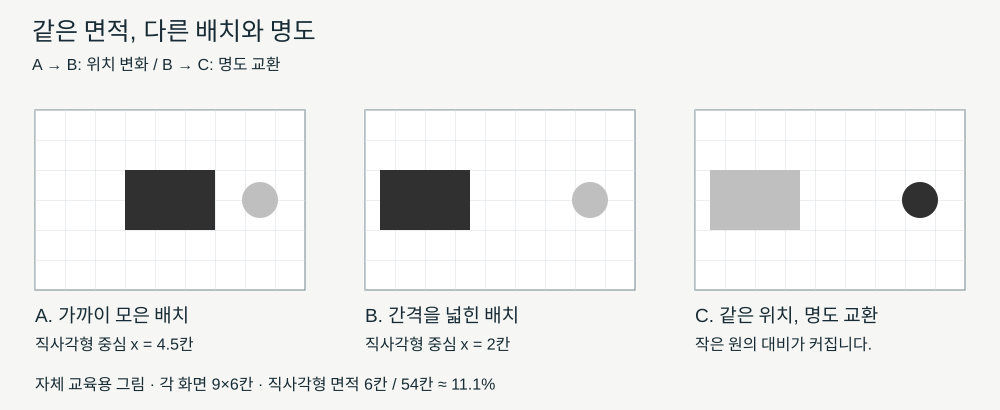

# 선·색·면과 구도 / Line, shape, colour and composition

같은 도형도 어디에 놓고 주변을 얼마나 비우는지에 따라 다르게 보입니다. 구도는 화면 안의 요소를 관계 있게 배치하는 방식입니다. 대상을 알아맞히는 데서 한 걸음 더 나아가, 어떤 선·밝기·크기의 관계가 시선을 이끄는지 설명해 보겠습니다.

## 요소를 구별하면 느낌의 근거가 보입니다

선은 길이와 방향을 가진 흔적입니다. 윤곽을 닫기도 하고, 짧은 흔적의 반복으로 움직임을 만들기도 합니다. 형태를 둘러싼 실제 선이 없어도 밝은 부분과 어두운 부분의 경계가 선처럼 보일 수 있습니다. 직선·곡선, 굵기·길이·방향을 따로 적으면 ‘강렬합니다’보다 구체적인 관찰이 됩니다.

면적을 가진 평면 형상은 원·사각형처럼 기하학적일 수도, 잎이나 물결처럼 불규칙할 수도 있습니다. 입체 형은 높이·너비·깊이를 함께 가집니다. 종이에 그린 원과 실제 공은 다른 대상입니다. 그림 속 공의 입체감도 종이가 물리적으로 부풀었다는 뜻과는 구별합니다. [Getty의 조형 요소 자료](https://www.getty.edu/education/teachers/building_lessons/elements_art.pdf)는 선·평면 형상·입체 형·공간·색·질감을 나누어 설명합니다.

색상은 빨강·파랑 같은 색의 계열이고, 명도는 밝고 어두운 정도이며, 채도는 색이 선명하거나 탁하게 느껴지는 정도입니다. 서로 관련되어도 같은 말은 아닙니다. 파란 부분을 회색으로 바꾸는 것과 같은 파란색의 밝기만 바꾸는 것은 다른 변화입니다. 화면의 빛과 물감의 반사색도 조건이 달라, 디지털 색 혼합을 모든 물감 혼합에 그대로 적용할 수는 없습니다.

질감에는 실제 표면의 성질과 그려진 표면의 인상이 있습니다. 매끈한 종이에 바위를 그려 거칠게 보이게 할 수 있습니다. 복제 이미지에서는 실제 물감 두께를 만질 수 없으므로, 눈에 보이는 붓 자국과 물질의 두께를 확인한 기록을 구별해야 합니다.

## 자체 그림: 한 번에 하나를 바꿉니다

이 그림은 실제 작품에서 추출한 도해가 아닌 자체 교육용 배치입니다. 세 화면은 각각 9×6칸이며 직사각형은 3×2칸입니다. A에서 B로 갈 때 직사각형을 왼쪽으로 옮겼고, B에서 C로 갈 때에는 도형의 위치·크기를 유지한 채 명도를 교환했습니다. 원의 크기는 세 화면에서 같습니다.

A와 B를 비교하면 도형 사이의 간격과 왼쪽 여백이 달라집니다. A의 직사각형 중심은 왼쪽에서 4.5칸, B는 2칸 위치입니다. 면적은 모두 `3×2=6칸`이며 화면 전체의 `6/54≈11.1%`입니다. 차지하는 면적이 같아도 배치의 관계가 달라집니다. 이 수치는 시선의 움직임을 측정한 결과가 아니라 그림의 치수에서 직접 계산한 값입니다.

B와 C는 작은 원의 대비가 달라집니다. C의 원이 먼저 보였다고 기록했다면 흰 배경과 원의 명도 차이를 근거로 들 수 있습니다. 다른 독자가 직사각형의 넓이를 먼저 보았다면 크기와 대비 중 어떤 단서에 주의를 기울였는지 비교합니다. 모든 관객의 첫 시선을 이 그림만으로 예측할 수는 없습니다.

여백은 남아서 쓸모없는 면적이 아니라 요소 주변과 사이에 생기는 형상입니다. B에서는 도형 사이에 길게 열린 공간이 만들어집니다. 중심에 놓였는지보다 다른 요소·화면 가장자리와 어떤 관계를 맺는지 살펴보는 것이 구도 분석에 도움이 됩니다.

## 균형과 강조를 같은 말로 쓰지 않습니다

균형은 크기·색·위치 등의 시각적 무게가 전체에서 어떻게 분포하는지의 문제입니다. 좌우가 같은 대칭도 있지만 다른 요소가 서로 관계를 이루는 비대칭 균형도 있습니다. 강조는 주변과 구별되어 주의를 끄는 부분입니다. 강조된 한 점이 있다고 화면 전체가 반드시 불균형한 것은 아닙니다. [Getty의 구성 원리 자료](https://www.getty.edu/education/teachers/building_lessons/principles_design.pdf)

반복은 비슷한 선·형·색이 다시 나타나는 관계이고, 리듬은 그 반복과 간격·변화가 만드는 시각적 흐름입니다. 같은 요소를 기계적으로 복사한 수와 감상에서 느끼는 리듬을 동일하게 셀 수는 없습니다. 실제로 보이는 간격과 방향부터 적고 그 효과를 설명합니다.

## 실제 작품에서 관찰해 봅니다

[호쿠사이의 《가나가와 해변의 높은 파도 아래》](https://www.metmuseum.org/art/collection/search/45434)는 큰 물결의 휘어진 윤곽과 멀리 있는 작은 후지산의 삼각형을 비교하기 좋은 사례입니다. 미술관 이미지를 보면 위로 말려드는 곡선, 반복되는 물거품의 작은 윤곽, 배의 길고 기울어진 방향을 찾을 수 있습니다. 다음은 이 이미지에 대한 자체 관찰입니다. 큰 물결과 작은 산을 함께 볼 때 크기의 대비가 두드러지고, 물결 안의 열린 공간은 산을 바라보는 길처럼 읽힙니다.

이 해석을 ‘곡선은 언제나 공포를 상징합니다’로 바꾸면 근거가 넓어집니다. 화면에서 물결의 크기와 방향을 관찰하는 일, 긴장감을 느끼는 일, 작가의 의도를 확정하는 일은 서로 다른 주장입니다. 미술관 해설이 원근을 이용해 산을 작게 보이게 했다고 설명하는 부분은 기관의 해설로 구분합니다.

구도 기록은 ‘왼쪽 큰 곡선—아래쪽 길쭉한 배—중앙 뒤 작은 삼각형’처럼 위치와 형상을 함께 적어 보십시오. 이어 그 관계가 어떤 시각적 효과를 주는지 한 문장을 붙입니다. 작품명이 알려 준 사건이나 상징을 먼저 써 놓고 눈에 보이는 요소를 억지로 맞출 필요는 없습니다.

## 확인 문제

1. 자체 그림 A에서 B로 바뀔 때 직사각형의 화면 점유율도 바뀝니까?
2. 작은 원이 더 먼저 보인다면 원의 면적만을 원인으로 확정할 수 있습니까?
3. ‘곡선이 반복됩니다’와 ‘작가는 모든 관객을 불안하게 하려고 했습니다’는 같은 수준의 주장입니까?

답과 이유

1. 바뀌지 않습니다. 6/54로 약 11.1%이며 위치와 여백이 바뀝니다.
2. 없습니다. 명도 대비·위치·주변 요소와 관객의 주의도 살펴야 합니다.
3. 아닙니다. 앞은 화면의 관찰이고 뒤는 작가의 의도와 관객 전체에 대한 추가 근거가 필요한 주장입니다.

## English summary

Separate hue, value and saturation, and distinguish shape from three-dimensional form. The original diagram changes placement and value independently; its area calculation describes geometry, not a measured law of attention.

## 출처와 확인 범위

확인일은 2026-10-21입니다. Getty 자료 두 장의 정의와 Met 작품 정보·제공 이미지를 확인했습니다. 그림과 치수 계산, 작품의 위치·선 관계에 대한 관찰은 자체 예시·분석입니다. 작품 정보와 이미지 이용 조건은 [양식과 시대의 비교](양식과시대의비교_style-context-and-comparison.md)에 모았습니다.

[미술 학습](../README.md) · [다음: 공간·원근과 매체](공간원근과매체_space-perspective-and-materials.md)
