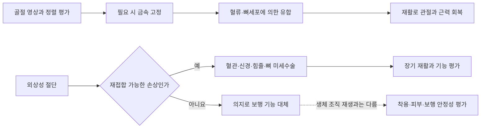

# 지체장애와 의지·이동 보조기술 | Limb difference and mobility technology

## 기능과 필요한 과제

지체장애는 팔·다리·몸통의 기능, 관절 움직임, 근력, 감각, 절단·변형 등 여러 상태를 포괄합니다. 필요한 기술도 손으로 물건을 잡기, 서기, 실내외 이동, 오래 앉아 있기처럼 과제마다 달라집니다. 한 사람에게도 활동과 장소에 따라 의지, 보조기, 수동 휠체어, 전동 휠체어가 함께 필요할 수 있습니다.

## 현재 쓰이는 기술

의지는 소켓·현가부·관절·말단 장치로 이루어집니다. 소켓은 잔존 사지와 의지를 연결하므로 압력 분포, 피부 상태, 땀, 정렬과 움직임 때의 미끄러짐이 착용성과 직접 연결됩니다. 전동 의수의 근전도 제어는 피부 전극이 근육에서 생기는 작은 전압 변화를 읽고, 이를 손가락·손목의 동작 명령으로 바꿉니다. 다관절 의수는 여러 근전도 패턴이나 별도 스위치로 그립을 바꿉니다. 제어 정확도뿐 아니라 전극 위치 변화, 땀과 피로, 무게, 배터리, 물체를 놓치는 안전성도 확인해야 합니다.

하지 의지와 보조기는 무릎·발목의 하중과 관절 운동을 전달합니다. 기계식 무릎은 기구의 저항과 걸림 구조로 안정성을 확보하고, 마이크로프로세서 제어 무릎은 각도·하중 센서와 움직임 정보를 이용해 보행 단계에 따라 저항을 조절합니다. 휠체어는 구동부만큼 좌석·등받이·쿠션 설정이 중요합니다. 체형과 자세를 맞추지 못하면 압력 손상, 통증, 이동 피로가 생길 수 있습니다.

미국 FDA는 DEKA Arm System을 상지 의지의 한 사례로 분류했습니다. 이는 다자유도 의지의 규제·평가 사례이며 모든 사용자가 같은 동작을 얻거나 같은 장치를 이용할 수 있다는 뜻은 아닙니다. 척수손상 사용자를 위한 ReWalk 개인용 외골격도 FDA 자료에서 처방형 장치와 사용 조건이 제시됩니다. 실제 보행은 지정된 사용자 조건과 교육·감독 범위에서 평가해야 합니다.

## 공학적으로 살펴볼 지점

- 기구·재료: 관절 가동범위, 하중 경로, 구조 피로, 소켓 압력, 방수·먼지와 피부 접촉 재료를 봅니다.
- 센서: 근전도, 관절 각도, 관성측정장치(IMU), 발바닥·소켓 하중을 조합할 수 있습니다.
- 제어: 의수는 의도한 그립과 실제 손 동작의 대응을, 하지 장치는 보행 단계 전환과 낙상 위험을 평가합니다.
- 검증: 실험실의 최대 힘뿐 아니라 물체를 잡아 옮기기, 문 열기, 경사로 이동, 배터리 소진과 센서 고장 상황을 시험합니다.

## 앞으로의 연구

연구 중인 방향에는 의지의 촉각을 피부나 신경 자극으로 돌려주는 감각 피드백, 착용 압력을 줄이는 맞춤 소켓, 사용자의 보행에 맞춰 제어를 조정하는 장치, 뇌·신경 신호와 보조기기를 연결하는 폐회로 인터페이스가 있습니다. 일부는 실험실이나 제한된 임상 연구 단계이며 일상 제품으로 널리 쓰이는 기술과 구분해야 합니다. 장기 사용에는 전극 안정성, 수술·감염 위험, 배터리·충전, 정비, 개인 데이터 보호 문제가 함께 남습니다.

## 보조 장치와 손상 회복은 다른 문제입니다

다리를 다친 경우에는 어떤 구조가 손상됐는지 나누어야 합니다. 골절은 뼈의 연속성이 끊어진 상태이고, 인대·힘줄 손상은 관절을 잡거나 근육 힘을 전달하는 조직의 문제이며, 말초신경 손상은 근육으로 가는 신호가 약해진 상태입니다. 척수 손상은 뇌와 다리 사이의 신호 경로가 끊긴 문제입니다. 이 네 경우는 같은 목발이나 의지로 해결되지 않습니다.

골절에서는 영상으로 뼈의 위치와 관절 침범 여부를 확인하고, 필요한 경우 뼈를 맞춘 뒤 금속판·나사·골수강 내 금속정 등으로 안정화합니다. 고정 장치는 뼈가 붙는 동안 움직임과 하중을 제한해 유합이 일어날 조건을 마련합니다. 뼈를 금속이 대신 만들어 주는 것은 아닙니다. 혈관과 뼈세포가 손상 부위로 들어오고, 가골이 형성된 뒤 재형성되는 생물학적 치유가 필요합니다. 큰 결손이나 유합 지연에서는 자가골·동종골 이식 등 다른 치료를 검토할 수 있으며, 감염·혈류·흡연·영양 상태·골다공증도 결과에 영향을 줍니다. 구체적인 고정 방식은 골절 위치와 환자 상태에 따라 다릅니다. [미국 정형외과학회(AAOS)의 골절 안내](https://orthoinfo.aaos.org/en/diseases--conditions/fractures-broken-bones/)와 [고관절 골절 진료지침](https://orthoinfo.aaos.org/globalassets/pdfs/plain-language-summary_hip-fractures-2024.pdf)은 고정 방법이 골절 형태와 상태에 따라 달라지는 이유를 설명합니다.

인대나 힘줄이 크게 파열되면 손상 위치와 조직 상태에 따라 봉합하거나 뼈에 다시 고정하고, 필요한 경우 이식 조직으로 재건합니다. 봉합사·고정 앵커·금속판은 파열된 조직이 다시 붙을 동안 하중을 견디는 구조물이며, 최종 강도와 유연성은 조직 치유와 단계적 재활에 달려 있습니다. 이후 영상에서 뼈의 정렬과 유합 징후를 살피고, 관절 가동범위·근력·균형·보행을 측정해 체중 부하와 훈련을 조정합니다. 특정 장비 하나가 부상을 단독으로 치료하는 것은 아니며, 손상 조직의 수술적 복원과 생물학적 치유, 안전한 재활이 연결되어야 합니다.

말초신경이 끊어졌다면 신경 봉합, 신경 이식 또는 기능을 보완하는 신경 이전술로 재생 축삭이 목표 근육에 도달할 길을 마련할 수 있습니다. 신경은 손상 부위에서 먼 근육까지 자라야 하므로, 거리와 시간, 흉터, 근육이 다시 신호를 받을 수 있는 기간이 중요합니다. 수술 후 근전도와 근력·감각 평가, 작업치료·물리치료를 이어가지만 완전한 회복을 보장하지는 않습니다. [말초신경 재건 임상 리뷰](https://pmc.ncbi.nlm.nih.gov/articles/PMC11542565/)는 손상 종류와 수술 시점에 따른 차이를 정리합니다.

뼈가 크게 없어졌거나 골절이 붙지 않는 불유합에서는 단순히 고정판을 더 강하게 만드는 것으로 충분하지 않을 수 있습니다. Ilizarov 방식의 골 이동술은 외고정 장치로 뼈를 안정화한 뒤 뼈 한쪽을 조금씩 이동시켜 그 사이에 새 뼈가 만들어지도록 합니다. 혈관과 골막이 유지된 조직에서 서서히 자라는 뼈 형성 과정을 이용하는 재건술입니다. 혈관화 비골 이식은 혈관이 연결된 환자 자신의 비골을 결손 부위로 옮겨 길이가 긴 뼈 결손을 연결하는 방법입니다. 미세혈관을 연결하고 고정해야 하며, 이식뼈가 적응해 충분히 튼튼해지는 동안 골절 위험과 장기간 회복을 관리해야 합니다. 두 방법은 어느 하나가 항상 더 낫다기보다 결손 길이, 감염, 피부·근육 손상, 혈류, 환자의 전신 상태와 수술팀 경험에 따라 선택합니다. [하지 장골 결손의 체계적 비교](https://pmc.ncbi.nlm.nih.gov/articles/PMC10762458/)와 [장골 결손 재건의 국제 임상 리뷰](https://pmc.ncbi.nlm.nih.gov/articles/PMC10573364/)에서 수술 방식과 한계를 확인할 수 있습니다.

세포와 생체재료를 함께 쓰는 골조직공학은 앞으로 더 많은 뼈를 재생하려는 연구입니다. 다공성 지지체가 세포가 붙고 자랄 공간을 제공하고, 세포·성장 신호·혈관 형성이 새 뼈를 만들도록 유도하는 구상입니다. 그러나 세포가 살아남고 큰 조직 안쪽까지 혈관이 들어가며, 하중을 견디는 뼈로 성숙하는 문제를 해결해야 합니다. 현재는 연구 재료의 작동이나 소규모 사례를 표준적인 다리 골절 치료로 일반화할 근거가 부족합니다. 2026년 골절 치유 리뷰도 세포·재료 기반 방법의 임상 근거가 질환과 재료별로 이질적이며 관찰 연구에 크게 의존한다고 정리합니다. [골절 치유의 세포·분자 기전과 치료 전략 리뷰 (2026)](https://www.nature.com/articles/s41392-026-02967-z)를 참고할 수 있습니다.

외상으로 다리가 완전히 잘린 경우에는 절단된 부분이 보존되어 있고 혈관·근육·뼈의 손상 정도와 허혈 시간이 적절하다면 미세수술로 다시 붙이는 재접합술을 검토할 수 있습니다. 수술팀은 뼈를 고정하고 힘줄·근육을 잇고, 현미경 아래 가는 혈관과 신경을 연결해 혈류와 신경 신호를 회복시킵니다. 다만 짓눌림이나 뜯김 손상은 혈관이 광범위하게 망가질 수 있어 재접합이 실패하거나 처음부터 불가능할 수 있습니다. 수술로 혈류가 살아나는 것과 감각·근력·관절 기능이 충분히 돌아오는 것도 서로 다른 결과입니다. 이후 여러 차례의 재건수술과 긴 재활이 필요할 수 있으며, 주요 사지 재접합 문헌은 전체 근거가 주로 팔·손 사례에 집중되어 있고 장기 기능 평가도 제한적이라고 지적합니다. [주요 사지 재접합 현황 리뷰 (2026)](https://pmc.ncbi.nlm.nih.gov/articles/PMC13133668/)과 [오슬로대학병원의 재접합 수술 안내](https://www.oslo-universitetssykehus.no/fag-og-forskning/nasjonale-og-regionale-tjenester/nasjonal-behandlingstjeneste-for-akutt-replantasjonskirurgi/)에서 적용 범위와 과정을 확인할 수 있습니다.

재접합이 불가능하거나 질환·감염·암 때문에 절단한 경우에는 빠진 다리의 뼈·관절·근육·감각 신경을 원래대로 다시 자라게 하는 확립된 치료가 없습니다. 이때 의지와 C-Leg 같은 무릎 장치는 빠진 관절 기능을 기계적으로 대신합니다. C-Leg는 센서로 무릎 각도와 하중, 보행 상태를 읽고 마이크로프로세서가 유압 저항을 조절해 넘어짐 위험을 낮추고 보행 환경에 맞춥니다. 이는 보행을 더 안정적으로 만드는 기능 대체이지 절단된 생체 조직의 재생은 아닙니다. 따라서 소켓 압력·피부 손상·보행 속도·경사로와 계단에서의 안정성을 함께 확인합니다. [제조사의 기술 설명](https://corporate.ottobock.com/en/media/media-information/c-leg)과 [사용 설명서](https://spa-prod-commerce.cep.ottobock.com/medias/4997750.pdf)에서 센서와 유압 제어의 역할을 확인할 수 있습니다.

그림 3. 골절의 생물학적 유합, 선택된 외상성 절단의 재접합, 의지에 의한 기능 대체를 구분한 설명도입니다. 특정 환자의 치료 계획이나 수술 순서를 나타내지는 않습니다.

## 실제 제품·연구와 공학 도구

실제 제품의 작동 흐름, 제조사가 공개한 사용 범위, 관련 연구와 개발 도구는 [장애 보조기기와 재활 연구의 실제 제품·개발 도구](실제기기와연구개발도구_engineering-cases-and-tools.md#limb-mobility)에서 이어서 보실 수 있습니다.

## 제품 사진과 작동 원리

그림 1. Ottobock C-Leg 제품 사진입니다. 사진은 [제조사의 C-Leg 안내](https://corporate.ottobock.com/en/media/media-information/c-leg)에서 제공하며, 무릎 의지의 외형을 보여줍니다.

그림 2. 센서 입력에 따라 무릎 관절 저항을 조절하는 일반적인 마이크로프로세서 의지의 개념도입니다. 실제 C-Leg 내부 회로도나 제어 알고리즘을 나타내지는 않습니다.

## English

Mobility technology includes prosthetic limbs, orthoses, wheelchairs and powered exoskeletons. Fit, control, skin pressure, fatigue, battery life and safety in real tasks matter as much as actuator performance. Sensory feedback and neural control remain research directions with different levels of clinical evidence and availability.

Fractures and tendon or nerve injuries may heal through fixation, tissue repair and rehabilitation. Selected traumatic amputations may be treated with microsurgical replantation, although survival of the limb does not guarantee normal function. A prosthesis replaces selected functions when replantation is unsuitable; it does not regrow missing biological structures.

## 출처

- [AAOS, Fractures (Broken Bones)](https://orthoinfo.aaos.org/en/diseases--conditions/fractures-broken-bones/): 골절의 평가와 치료 원리.
- [AAOS, Hip Fractures in Older Adults: Plain Language Summary (2024)](https://orthoinfo.aaos.org/globalassets/pdfs/plain-language-summary_hip-fractures-2024.pdf): 골절 형태별 수술과 회복 관리.
- [Peripheral nerve injury reconstruction: a review](https://pmc.ncbi.nlm.nih.gov/articles/PMC11542565/): 봉합·이식·신경 이전과 재생의 조건 및 한계.
- [Lower-limb segmental bone defects: systematic review and meta-analysis (2024)](https://pmc.ncbi.nlm.nih.gov/articles/PMC10762458/): 골 이동술과 혈관화 비골 이식의 비교 근거.
- [Current Management of Diaphyseal Long Bone Defects (2023)](https://pmc.ncbi.nlm.nih.gov/articles/PMC10573364/): 골 이동과 혈관화 골이식의 재건 원리와 적용 조건.
- [Fracture healing: molecular and cellular mechanisms to therapeutic strategies (2026)](https://www.nature.com/articles/s41392-026-02967-z): 골조직공학과 세포치료의 임상 근거 및 남은 과제.
- [Major limb replantation: current status and perspectives (2026)](https://pmc.ncbi.nlm.nih.gov/articles/PMC13133668/): 재접합술의 미세수술 원리와 장기 기능 평가의 한계.
- [Oslo University Hospital, National Replantation Service](https://www.oslo-universitetssykehus.no/fag-og-forskning/nasjonale-og-regionale-tjenester/nasjonal-behandlingstjeneste-for-akutt-replantasjonskirurgi/): 하지 재접합을 검토할 수 있는 드문 조건과 다학제 치료.

- [대한민국 법제처, 장애인복지법 시행령 별표 1](https://www.law.go.kr/LSW/flDownload.do?bylClsCd=110201&flSeq=159613615&gubun=): 지체장애의 법적 유형 기준.
- [미국 FDA, DEKA Arm System De Novo 결정 자료](https://www.accessdata.fda.gov/cdrh_docs/reviews/DEN120016.pdf): 장치의 분류와 평가 범위.
- [미국 FDA, ReWalk Personal Exoskeleton 6.0 요약](https://www.accessdata.fda.gov/cdrh_docs/pdf22/K221696.pdf): 처방·사용 조건의 예.
- [미국 NIH/NINDS, Spinal Cord Injury](https://www.ninds.nih.gov/health-information/disorders/spinal-cord-injury): 휠체어·보조기·전기자극·로봇재활·BCI 연구.
- [휠체어 처방과 맞춤 좌석에 관한 임상 리뷰](https://pmc.ncbi.nlm.nih.gov/articles/PMC7384540/): 사용자 능력·환경·좌석 맞춤의 중요성.
