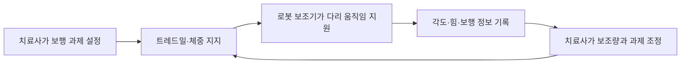

# 뇌병변장애와 운동·의사소통 지원 | Brain-lesion-related motor and communication support

## 기능과 환경

뇌성마비, 뇌졸중, 외상성 뇌손상 등은 움직임·자세·손 기능·말하기·삼킴·감각·인지에 서로 다른 영향을 줄 수 있습니다. 같은 진단명이라도 필요한 지원과 피로 양상은 사람마다 다릅니다. 따라서 한 가지 보조기나 재활법을 유형 전체에 맞는 해법으로 제시할 수 없습니다.

## 현재 쓰이는 기술

자세와 이동을 돕는 맞춤 좌석, 수동·전동 휠체어, 보행기, 보조기, 이동 리프트는 신체와 공간 사이의 부담을 줄입니다. 스위치 입력, 키보드 대체 장치, 시선 추적, 음성 출력 의사소통 기기는 손 움직임이나 발화가 제한된 상황에서 컴퓨터와 대화를 사용할 수 있게 합니다. 보완대체의사소통(AAC)은 그림판, 글자판, 제스처, 음성생성기기처럼 여러 방식을 포함하며, 필요한 사람에게는 말이 일부 가능해도 도움이 될 수 있습니다.

기능적 전기자극(FES)은 피부 전극을 통해 말초 신경과 근육에 전기 자극을 주어 정해진 움직임을 유도합니다. 보행 보조 장치나 상지 재활에서 사용할 수 있지만, 병변 위치·근육 반응·관절 상태·피부 감각에 따라 적용성이 달라집니다. 재활 로봇은 반복 움직임을 지원하고, 센서로 관절 각도·힘·보행 시간을 기록해 훈련량과 동작을 조정합니다. 로봇이 움직임을 만들어 준 횟수만으로 일상생활의 기능 향상을 입증할 수는 없으므로 실제 과제와 피로·통증을 함께 평가합니다.

## 시스템 검증

사용자 입력의 오검출은 의사소통에서 다른 단어를 출력하거나 기기가 원하지 않는 방향으로 움직이는 결과를 만들 수 있습니다. 스위치·시선 입력의 오입력률과 응답 시간, AAC에서 메시지를 찾는 시간, 좌석에서 압력과 자세 변화, 재활 장치의 보조 힘과 멈춤 기능을 시험합니다. 전기자극은 자극 위치와 세기·시간을 통제하고, 안전 한계와 피부 반응을 기록해야 합니다. 의료진과 재활 전문가의 평가 및 사용자의 선택을 기기 로그와 같은 근거로 취급하지 않습니다.

## 연구 중인 방향

보행 로봇·외골격, 뇌-컴퓨터 인터페이스, 전기자극과 움직임 센서를 결합한 폐회로 재활이 연구되고 있습니다. 폐회로란 센서가 실제 움직임이나 신경 신호를 읽고 자극·보조를 상황에 맞춰 조정하는 방식입니다. 아직 소규모 시험이나 특정 질환·기능을 대상으로 한 연구인 경우가 많으므로, 모든 뇌병변이나 모든 보행 문제를 회복시킨다고 확대해서는 안 됩니다. 웨어러블 센서로 가정의 움직임을 측정하는 방식도 임상에서 쓰는 평가를 대체하기보다 실제 활동을 보충해 관찰하는 연구 방향으로 다룹니다.

## 재활 보조와 신경 손상 회복의 현재 근거

뇌병변은 한 가지 상태가 아닙니다. 뇌졸중은 혈관이 막히거나 터져 뇌 조직이 손상되는 사건이고, 뇌성마비는 발달 중인 뇌의 비진행성 손상으로 움직임과 자세에 장기적인 영향을 주며, 척수 손상은 뇌와 몸 사이의 신경 신호 경로를 손상합니다. 따라서 같은 로봇 보행 훈련을 받아도 회복 목표와 가능한 변화가 다릅니다.

허혈성 뇌졸중의 급성기에는 적격 환자에서 혈전용해제나 혈관 내 혈전제거술로 막힌 혈관을 다시 열어 추가 뇌 손상을 줄일 수 있습니다. 이미 죽은 뇌 조직을 되살리는 수술은 아니며, 치료 시간·영상 소견·출혈 위험 등 환자 조건이 중요합니다. 이후 재활은 남아 있는 신경 회로가 반복 과제를 통해 움직임을 다시 학습하도록 돕습니다. 로봇과 기능적 전기자극은 반복 횟수와 운동 범위를 확보하고 기록을 남길 수 있지만, 장치가 움직임을 만들어낸 것과 환자가 일상에서 독립적으로 기능하게 된 것은 별도로 평가해야 합니다. [미국 NINDS의 뇌졸중 치료 안내](https://www.ninds.nih.gov/health-information/stroke/assess-and-treat)는 급성기 혈류 회복 치료와 재활을 구분합니다.

척수 손상에서는 남아 있는 신경 경로와 척수 회로를 활용하려는 연구가 진행됩니다. 2023년 Nature의 뇌-척수 인터페이스 연구는 뇌 피질의 움직임 신호를 해독해 척수 자극을 제어하고, 만성 척수 손상 참가자 한 명이 서고 걷는 능력을 보인 사례를 보고했습니다. 이는 선택된 한 사람을 대상으로 한 초기 임상 개념 증명이며, 일반 진료에서 누구나 사용할 수 있는 치료나 손상된 척수를 재생한 결과로 볼 수 없습니다. [원논문](https://pmc.ncbi.nlm.nih.gov/articles/PMC10232367/)은 참가자 수와 적용 범위를 명시합니다.

또한 2026년 발표된 다기관 무작위 대조 eWALK 시험에서는 만성 척수 손상 참가자 50명이 보행 훈련을 받았고, 경피 척수 자극을 더한 군이 가짜 자극군보다 보행 능력에서 추가 이득을 보이지 않았습니다. 이는 전기 자극 연구 전체가 무효라는 뜻은 아니지만, 작동 원리의 가능성만으로 임상적 효과를 단정하면 안 된다는 사례입니다. 로봇 보행 장치도 반복 훈련을 돕는 도구이며, 손상된 신경 경로를 스스로 복구하지는 않습니다. [eWALK 무작위 대조시험](https://pmc.ncbi.nlm.nih.gov/articles/PMC12995704/)의 주 결과를 함께 확인할 수 있습니다.

뇌성마비는 손상 원인이 진행하지 않는 경우에도 성장에 따라 근육 길이·관절 변형·통증·피로가 달라질 수 있습니다. 물리·작업치료, 근육 긴장 조절, 정형외과 수술, 보조기와 환경 조정을 조합해 각 기능을 개선합니다. 현재 재활 로봇이나 세포치료가 뇌 손상을 되돌려 모든 사람의 운동 기능을 정상화한다고 입증되지는 않았습니다. 연구 성과는 보행 거리, 손 기능, 일상생활 참여, 통증, 피로처럼 실제 목표별로 판단해야 합니다.

## 실제 제품·연구와 공학 도구

실제 제품의 작동 흐름, 제조사가 공개한 사용 범위, 관련 연구와 개발 도구는 [장애 보조기기와 재활 연구의 실제 제품·개발 도구](실제기기와연구개발도구_engineering-cases-and-tools.md#neurological-motor)에서 이어서 보실 수 있습니다.

## 재활 장치 사진과 운동 보조 흐름

그림 1. Hocoma Lokomat 보행 재활 시스템 사진입니다. 출처는 [제조사의 Lokomat 제품 안내](https://www.hocoma.com/us/solutions/lokomat/)입니다. Picture: Hocoma, Switzerland.

그림 2. 보행 재활에서 과제 설정, 로봇 보조, 측정과 치료사 조정이 이어지는 개념도입니다. 실제 Lokomat의 기구 배치나 제어 화면을 나타내지는 않습니다.

## English

Brain lesions can affect posture, movement, communication, swallowing, sensation and cognition in different combinations. Seating, mobility equipment, AAC, switch access, functional electrical stimulation and robotic rehabilitation support specific tasks. Research on exoskeletons and brain–computer interfaces is promising but remains condition- and study-specific.

Acute stroke treatment can restore blood flow in eligible patients, while rehabilitation trains remaining neural pathways. A 2023 brain–spine interface report involved one participant; a 2026 randomized trial found no added walking benefit from transcutaneous spinal stimulation over training alone.

## 출처

- [미국 NINDS, Assess and Treat Stroke](https://www.ninds.nih.gov/health-information/stroke/assess-and-treat): 급성기 혈류 회복 치료와 뇌졸중 재활.
- [Lorach et al., Walking naturally after spinal cord injury using a brain–spine interface, Nature (2023)](https://pmc.ncbi.nlm.nih.gov/articles/PMC10232367/): 한 참가자의 뇌-척수 인터페이스 연구와 적용 한계.
- [eWALK multicentre randomized trial (2026)](https://pmc.ncbi.nlm.nih.gov/articles/PMC12995704/): 경피 척수 자극을 보행 훈련에 더한 효과의 대조시험.

- [대한민국 법제처, 장애인복지법 시행령 별표 1](https://www.law.go.kr/LSW/flDownload.do?bylClsCd=110201&flSeq=159613615&gubun=): 뇌병변장애의 법적 정의.
- [미국 NIH, Cerebral Palsy](https://health.nih.gov/health-topics-a-z/cerebral-palsy): 이동·보조기·의사소통 장치와 치료 접근.
- [미국 NIH/NINDS, Spinal Cord Injury](https://www.ninds.nih.gov/health-information/disorders/spinal-cord-injury): 신경계 운동 손상의 재활·보조 기술 및 연구 범위.
- [미국 NIH/NICHD, Rehabilitative and Assistive Technology](https://www.nichd.nih.gov/health/topics/rehabtech): 재활 로봇·운동 분석·보조기술.
- [ASHA, Augmentative and Alternative Communication](https://www.asha.org/practice-portal/professional-issues/augmentative-and-alternative-communication/): AAC의 방식과 개인별 선택.
