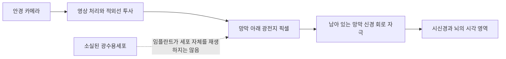
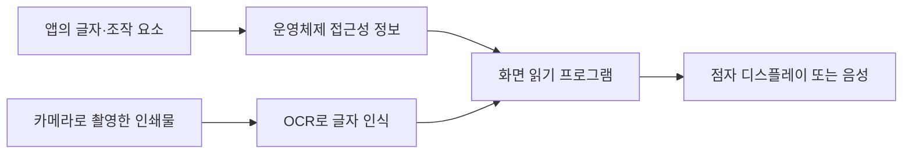

# 시각장애와 정보 접근 기술 | Vision access technology

## 시각 정보가 필요한 과제

시각장애에는 시력·시야의 손실과 시각 정보에 접근하기 어려운 여러 상태가 포함됩니다. 읽기, 화면 사용, 물체 인식, 이동과 길 찾기는 서로 다른 지원을 요구합니다. 확대 기능이 도움이 되는 저시력 사용자와 화면을 음성·점자로 이용하는 사용자는 필요한 인터페이스가 다를 수 있습니다.

## 현재 쓰이는 기술

화면 읽기 프로그램은 화면의 텍스트와 조작 요소를 음성 또는 점자 디스플레이로 전달합니다. 이를 위해 앱은 버튼의 이름, 역할, 상태, 키보드 초점 순서를 접근성 API에 올바르게 제공해야 합니다. 이미지 PDF나 레이블 없는 아이콘은 화면 읽기 프로그램만으로 내용을 알 수 없으므로 문서 OCR, 대체 텍스트, 키보드 조작 지원이 필요합니다.

저시력 지원에는 확대경, 전자 확대기, 글자 크기·대비·색상 조절, 눈부심 감소, 밝기 조절이 있습니다. 카메라 기반 휴대기기는 인쇄물 OCR, 물체·장면 설명, 문자 읽기와 길 찾기 정보를 제공할 수 있습니다. 단, 카메라가 가려진 장애물·신호등·위험 상황을 항상 정확하게 인식한다고 전제해서는 안 됩니다. 길 안내는 점자블록·촉지도·음향 신호와 같은 물리적 접근성을 대체하지 않습니다.

공학적으로는 센서가 받은 장면을 텍스트나 음성으로 변환하고, 화면 읽기·점자 출력에서 짧은 시간 안에 필요한 정보로 전달하는 것이 핵심입니다. 주변 소음 때문에 음성이 들리지 않을 때에는 점자·진동 출력이 대안이 됩니다. 위치 정보와 카메라 영상이 외부 서버로 전송될 수 있으므로 온디바이스 처리, 사용자 동의, 정보 삭제와 보안이 함께 고려되어야 합니다.

## 연구와 이용 범위

망막 전극으로 시각 신경계를 자극하는 망막 보철은 특정 장치·질환·사용자 조건에서 연구와 제한적 규제 경로를 거친 사례가 있습니다. 이는 정상 시력을 복원하는 장치가 아니며, 현재 일반적인 시각 보조 수단처럼 제공되는 기술로 표현하지 않습니다. 널리 이용되는 지원은 점자·화면 읽기·확대·OCR·접근 가능한 콘텐츠와 보행 훈련 등이며, 인공지능 장면 설명은 환경과 모델에 따라 오류가 생길 수 있습니다.

## 평가 방법

글자 인식 정확도뿐 아니라 읽기 속도, 표·수식 탐색, 메뉴 접근, 음성·점자 전환 시간, 실내외 안내 오류, 위험한 오안내, 주변 사람의 도움 없이 완료한 과제를 평가합니다. 화면 읽기 사용자는 키보드와 모바일 터치 등 실제 입력 방식으로 시험에 참여해야 합니다. 자동 접근성 검사만으로 사용자 경험을 검증할 수 없습니다.

## 시각 정보를 실제로 다시 만들려는 치료

시각을 회복시키는 접근은 손상 위치에 따라 달라집니다. 망막의 특정 유전자 결함이 원인이고 살아 있는 망막 세포가 남아 있다면 유전자 치료가 결함 경로를 보완할 수 있습니다. 미국 FDA가 승인한 LUXTURNA는 양쪽 RPE65 유전자 변이가 확인된 망막 이영양증 환자를 대상으로 합니다. 정상적인 시력을 누구에게나 되돌리는 치료가 아니며, 다른 원인의 시각장애에 적용되지 않습니다. 치료 벡터가 망막 세포에 기능성 RPE65 유전 정보를 전달해 시각회로의 특정 생화학 단계를 돕는 방식입니다. [FDA 적응증과 제품 정보](https://www.fda.gov/vaccines-blood-biologics/cellular-gene-therapy-products/luxturna)를 확인할 수 있습니다.

광수용세포가 넓게 소실된 건성 황반변성의 지도모양 위축에서는 망막 아래에 놓는 PRIMA 광전지 임플란트가 중심 시각을 일부 복원하려는 접근입니다. 안경의 카메라가 영상을 받고, 안경의 적외선 프로젝터가 이를 망막 아래 임플란트에 비춥니다. 임플란트의 픽셀은 빛을 전기 신호로 바꾸어 남아 있는 망막 회로를 자극합니다. 즉 손상된 광수용세포를 다시 자라게 하는 치료가 아니라, 빛 감지 기능을 작은 전자 배열로 대체하는 방식입니다. NEJM 임상시험에서 38명이 이식받았고, 12개월 평가가 가능한 32명 중 26명(81%)이 미리 정한 임상적으로 의미 있는 시력표 개선 기준을 충족했습니다. 이는 해당 질환과 시험 조건에 국한된 결과이며, 자연 시력을 정상 수준으로 회복했다는 뜻은 아닙니다. 제조사는 유럽에서 지도모양 위축으로 심하게 시력이 저하된 성인을 대상으로 승인됐으며, EU/EEA 밖에서는 아직 판매 승인을 받지 않았다고 안내합니다. [NEJM 임상시험](https://www.nejm.org/doi/abs/10.1056/NEJMoa2501396), [PRIMA 작동 원리와 적용 범위](https://primasicht.de/en/)를 함께 확인할 수 있습니다.

안전성 결과도 성능과 함께 읽어야 합니다. 시험에서는 중대한 이상사례 26건이 19명에게 기록됐고, 21건은 수술 후 2개월 안에 발생했으며 이 중 20건은 발생 후 2개월 안에 해소됐습니다. 모든 사건의 원인이 임플란트라고 단정할 수는 없습니다. 연구에서 개선된 것은 중심 시각이며 평균 주변 자연 시력은 기준선과 비슷했습니다. [NEJM 논문](https://www.nejm.org/doi/abs/10.1056/NEJMoa2501396)은 평가 시점과 안전성 결과를 함께 제시합니다.

그림 3. PRIMA의 공개된 원리를 단순화한 설명도입니다. 전자 임플란트가 남아 있는 망막 회로에 정보를 전달하는 경로를 보여주며, 정상 시력이나 모든 시각장애의 회복을 뜻하지 않습니다.

광유전학은 빛에 반응하는 단백질을 망막 세포에 발현시켜 남아 있는 세포가 빛 신호를 전기 신호로 만들도록 하려는 연구입니다. 세포 종류와 자극 파장·안경 장치·신호 해석이 맞아야 하며, 임상시험 결과와 허가된 치료를 구분해야 합니다. 시신경이나 시각 피질 자체가 손상된 경우에는 망막 임플란트가 정보 전달 경로를 해결하지 못하므로, 피질 자극 연구처럼 손상 부위를 우회하는 접근이 별도로 연구됩니다. 아직 점자·화면읽기처럼 보편적인 접근 기술과 같은 수준의 시각 회복 기술은 아닙니다.

## 실제 제품·연구와 공학 도구

실제 제품의 작동 흐름, 제조사가 공개한 사용 범위, 관련 연구와 개발 도구는 [장애 보조기기와 재활 연구의 실제 제품·개발 도구](실제기기와연구개발도구_engineering-cases-and-tools.md#vision-access)에서 이어서 보실 수 있습니다.

## 점자 기기 사진과 정보 접근 흐름

그림 1. 화면의 글을 촉각 점자로 읽는 HumanWare Brailliant BI 40X 제품 사진입니다. 출처는 [제조사 제품 지원 페이지](https://www.humanware.com/en-usa/support/brailliant-bi-40x/)입니다.

그림 2. 화면의 접근성 정보와 카메라 OCR이 화면 읽기 프로그램을 거쳐 점자·음성으로 전달되는 개념도입니다. 실제 제품별 연결 방식과 지원 기능은 다를 수 있습니다.

## English

Vision access includes screen readers, refreshable braille, magnification, contrast controls, OCR and camera-based description. Interfaces must expose accessible labels and keyboard focus, while navigation systems need careful evaluation of missed hazards and privacy. Retinal prostheses are specialized and limited technologies, not a general restoration of normal vision.

Cause-specific treatments include RPE65 gene therapy and a photovoltaic retinal implant for central vision loss from geographic atrophy. These approaches target narrow diagnoses; the implant stimulates surviving retinal pathways rather than regenerating photoreceptors or restoring normal sight.

## 출처

- [미국 FDA, LUXTURNA](https://www.fda.gov/vaccines-blood-biologics/cellular-gene-therapy-products/luxturna): 양쪽 RPE65 변이 망막 이영양증에 한정된 승인 적응증.
- [PRIMA pivotal study, New England Journal of Medicine (2025)](https://www.nejm.org/doi/abs/10.1056/NEJMoa2501396): 지도모양 위축 환자 대상 망막 임플란트 임상 결과.
- [PRIMA implant system](https://primasicht.de/en/): 광전지 임플란트와 특수 안경의 작동 원리와 적용 범위.
- [MCO-010 optogenetic therapy study, PubMed](https://pubmed.ncbi.nlm.nih.gov/40838197/): 광유전학 접근의 임상 연구 단계.

- [대한민국 법제처, 장애인복지법 시행령 별표 1](https://www.law.go.kr/LSW/flDownload.do?bylClsCd=110201&flSeq=159613615&gubun=): 시각장애의 법적 유형 기준.
- [미국 NIH/NEI, Low Vision](https://www.nei.nih.gov/eye-health-information/eye-conditions-and-diseases/low-vision): 확대, 화면 설정과 시각 재활.
- [미국 FDA, Argus II 망막 보철 HDE 기록](https://www.accessdata.fda.gov/scripts/cdrh/cfdocs/cfhde/hde.cfm?id=h110002): 특정 질환·사용자 조건의 역사적 허가 사례.
- [WHO·UNICEF, Global Report on Assistive Technology](https://www.who.int/publications/i/item/9789240049451): 보조기술을 제품과 서비스로 함께 보는 근거.
