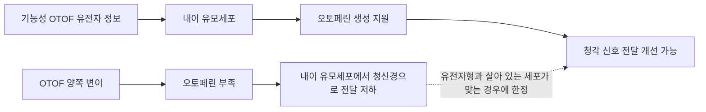

# 청각장애와 소리·자막 접근 기술 | Hearing access technology

## 청각과 의사소통의 차이

청각장애에는 소리의 크기를 듣기 어려운 상태뿐 아니라 말소리를 구별하기 어려운 상태와 평형기능의 문제가 포함됩니다. 따라서 소리를 증폭하는 기기만으로 모든 의사소통과 환경 접근 문제가 해결되지는 않습니다. 자막, 수어, 문자 알림, 시각·진동 경보와 소음 환경 조절이 함께 필요할 수 있습니다.

## 현재 쓰이는 기술

보청기는 마이크로폰으로 소리를 받아 주파수별로 처리하고, 귀에 전달할 음압을 조절합니다. 방향성 마이크와 잡음 억제는 목표 발화와 배경 소음을 구분하는 데 도움을 줄 수 있지만, 혼잡한 소음이나 여러 사람이 겹쳐 말하는 상황에서는 성능이 제한됩니다. 청력 검사와 맞춤 조정, 피팅 후 재평가가 필요합니다.

인공와우는 외부 마이크로폰과 음성처리기가 소리를 분석하고, 송신 코일을 통해 내부 수신기로 정보를 전달합니다. 내부 전극 배열은 달팽이관 안의 여러 위치를 전기 자극해 청신경에 신호를 전달합니다. 보청기가 소리를 키우는 것과 달리 손상된 내이 구조 일부를 우회합니다. 자연 청력을 되돌리는 장치는 아니며, 기기 조정과 청각 재활, 개인별 학습이 필요합니다.

강의실·회의실의 자막, 음성-문자 변환, 청각 보조 루프, FM/원격 마이크는 말소리를 직접 보청기나 인공와우로 전달해 주변 소음의 영향을 줄일 수 있습니다. 초인종·화재 경보·아기 울음 알림은 빛·진동·스마트폰 통지로도 알려야 합니다. 평형기능 문제에는 보행 보조, 낙상 예방, 전정 재활과 환경 조정이 관련됩니다.

## 공학적 검증과 다음 연구

자막 시스템은 단어 오류율뿐 아니라 자막 지연, 화자 식별, 전문 용어·방언·잡음 환경의 오류를 봅니다. 자동 자막의 오류가 안전 안내나 의료 정보를 바꿀 수 있으므로 중요 상황에는 재확인 경로를 둡니다. 인공와우는 전극 채널별 자극, 맵핑, 전력과 무선 링크, 수술·피팅 이후 장기 관리를 포함하는 시스템입니다.

연구 방향에는 개인별 청각 프로필에 맞춘 보청기 신호처리, 인공와우의 영상 기반 전극 위치·자극 설정, 실시간 자막과 다중 감각 경보가 있습니다. 수어 인식·생성 모델은 수어의 문법과 지역·개인 차이를 보존하고, 수어 사용자의 참여를 바탕으로 평가해야 합니다. 음성 인식 결과를 수어와 동등한 대화로 간주하거나 보청기·인공와우가 모두에게 적합하다고 단정하지 않습니다.

## 손상 원인을 겨냥하는 유전자 치료와 인공와우

청각을 회복하려는 치료도 손상된 부위와 원인에 따라 달라집니다. 2026년 미국 FDA는 양쪽 OTOF 유전자 변이로 심도 이상의 감각신경성 난청이 생긴 소아·성인에게 Otarmeni(lunsotogene parvec-cwha)를 승인했습니다. OTOF 유전자는 내이 유모세포가 청신경에 신호를 전달할 때 필요한 오토페린 단백질을 만드는 데 관여합니다. 치료는 두 개의 AAV 벡터가 기능성 유전자 정보를 내이 유모세포에 전달해 오토페린 생산과 신호 전달을 돕습니다. 이는 특정 유전자형·내이 상태에 해당하는 치료이며, 소음성 난청·노화성 난청·청신경 손상 등 모든 난청에 적용되는 치료가 아닙니다. FDA가 공개한 근거는 단일군 임상시험의 소아 24명 중 효과 평가가 가능했던 20명에서 80%가 청력 개선을 보인 결과입니다. 장기 지속성, 말·언어 발달 결과도 계속 확인해야 합니다. [FDA 승인 자료](https://www.fda.gov/news-events/press-announcements/fda-approves-first-ever-gene-therapy-treatment-genetic-hearing-loss-under-national-priority-voucher)에서 대상과 근거를 확인할 수 있습니다.

그림 3. OTOF 관련 난청의 원인과 승인된 유전자 치료의 작동 경로를 단순화했습니다. 모든 난청이 유전자 치료로 회복된다는 뜻은 아닙니다.

인공와우는 유전자 치료와 다른 방식으로 청각을 대체합니다. 외부 음성처리기가 소리를 주파수·시간 정보로 나누고, 코일과 내부 수신기가 정보를 전달하면 달팽이관 전극이 청신경을 전기 자극합니다. 손상된 유모세포의 기능 일부를 우회하지만, 자연 청력이나 정상적인 소리 해석을 그대로 되돌리지는 않습니다. 기기 선택, 수술 후 맵핑과 청각 재활에 따라 말소리 이해 결과가 달라집니다. OTOF 유전자 치료가 가능한 환자에게 인공와우와 치료 순서를 어떻게 정할지는 청력검사·유전자검사·해부학적 조건을 고려한 전문 평가가 필요합니다. [NIDCD 인공와우 설명](https://www.nidcd.nih.gov/health/cochlear-implants)은 우회 자극과 자연 청력의 차이를 설명합니다.

## 실제 제품·연구와 공학 도구

실제 제품의 작동 흐름, 제조사가 공개한 사용 범위, 관련 연구와 개발 도구는 [장애 보조기기와 재활 연구의 실제 제품·개발 도구](실제기기와연구개발도구_engineering-cases-and-tools.md#hearing-access)에서 이어서 보실 수 있습니다.

## 인공와우 외부 처리기와 신호 흐름

그림 1. Cochlear Nucleus 8의 외부 음성처리기 사진입니다. 이 사진은 몸 바깥에 착용하는 부품을 보여주며, 이식부나 전극을 보여주는 사진은 아닙니다. 출처는 [제조사의 Nucleus 8 안내](https://www.cochlear.com/us/en/home/products-and-accessories/cochlear-nucleus-system/nucleus-sound-processors/nucleus-8)입니다.

그림 2. 인공와우의 일반적인 소리 신호 경로를 단순화한 개념도입니다. 전극 수·배치와 신호 처리 방식은 제품에 따라 다릅니다.

## English

Hearing access combines hearing aids or cochlear implants with captions, remote microphones, induction loops and visual or vibration alerts. A cochlear implant processes sound and electrically stimulates the auditory nerve; it does not restore normal hearing. Fitting, communication preferences and real-world noise conditions are part of the system.

In 2026, the FDA approved an AAV gene therapy for severe OTOF-related hearing loss in a narrowly defined group. It delivers functional OTOF information to inner-ear hair cells; it is not a treatment for all forms of deafness.

## 출처

- [미국 FDA, Otarmeni approval announcement (2026-04-23)](https://www.fda.gov/news-events/press-announcements/fda-approves-first-ever-gene-therapy-treatment-genetic-hearing-loss-under-national-priority-voucher): OTOF 유전자형, 작동 기전, 승인 근거와 추적 조건.
- [대한민국 법제처, 장애인복지법 시행령 별표 1](https://www.law.go.kr/LSW/flDownload.do?bylClsCd=110201&flSeq=159613615&gubun=): 청각장애의 법적 유형 기준.
- [미국 NIH/NIDCD, Cochlear Implants](https://www.nidcd.nih.gov/health/cochlear-implants): 구성 부품과 신호 처리 원리, 자연 청력과의 차이.
- [미국 NIH/NIDCD, Assistive Devices for Hearing, Voice, Speech, or Language Disorders](https://www.nidcd.nih.gov/sites/default/files/Documents/publications/AssistiveDevices-508.pdf): 원격 마이크·유도루프·보조기기.
- [WHO·UNICEF, Global Report on Assistive Technology](https://www.who.int/publications/i/item/9789240049451): 보조기술 접근과 서비스 체계.
