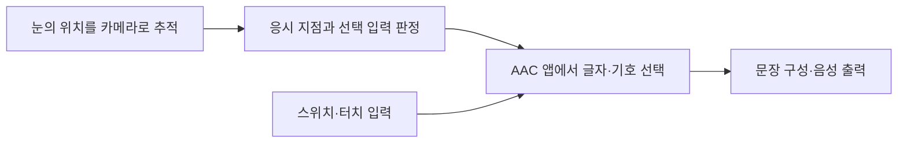

# 언어장애와 보완대체의사소통 | Speech and communication technology

## 의사소통을 지원하는 목표

언어장애는 말소리 산출, 발성, 말의 명료도나 언어 사용에 영향을 줄 수 있습니다. 말하기 어려움이 사고·이해·의사 표현의 부재를 뜻하지는 않습니다. 기술은 당사자가 선호하는 방식으로 질문하고, 선택하고, 대화에 참여할 수 있도록 접근 경로를 넓히는 데 목적이 있습니다.

## 현재 이용되는 보조 기술

보완대체의사소통(AAC)은 말과 글을 보완하거나 대체하는 여러 방식입니다. 그림·글자판, 수어·제스처, 음성생성기기와 태블릿 앱이 있으며, 입력 방식은 직접 터치, 키보드, 스위치 순차 선택, 머리 포인터, 시선 추적 등이 있습니다. 음성생성기기는 선택한 글자·단어·상징을 합성 음성으로 출력합니다. 자주 쓰는 문장, 이름과 발음, 개인의 말투를 저장할 수 있어야 하지만, 사용자의 표현을 미리 정한 선택지로만 제한하지 않도록 어휘 편집과 새 표현 추가 기능도 필요합니다.

입력 장치는 운동 범위·시력·피로·인지 부담과 작업 환경에 맞춰 선택합니다. 시선 추적은 눈의 반사와 동공 위치를 카메라로 측정해 화면 선택을 추정합니다. 스위치 스캐닝은 화면 요소를 차례로 강조하고 사용자가 스위치를 누를 때 선택합니다. 정확도 외에 선택 시간, 오입력 수정, 눈 피로, 실내 조명 변화, 휠체어 자세의 영향을 확인해야 합니다.

## 음성 신경보철은 연구 단계입니다

2023년 Nature의 한 임상시험 사례에서는 심한 마비가 있는 참가자의 운동·발화 시도와 관련된 뇌 피질 신호를 고밀도 전극으로 기록하고, 딥러닝 모델로 글자·합성 음성·얼굴 애니메이션을 생성했습니다. 논문은 단일 참가자에서 분당 78단어 중앙값과 단어 오류율 25%를 보고했습니다. 이는 특정 참가자·설정에서의 임상 연구 결과이지, 일반 판매 중인 음성 생성 장치나 다양한 언어장애에 대한 보편 성능이 아닙니다. 뇌 수술, 전극 장기 안정성, 교정 자료, 개인정보와 사용자의 의도 확인이 해결되어야 합니다.

음성 은행과 개인 음성 합성은 사용자의 녹음으로 본인에게 익숙한 목소리를 만드는 비침습적 대안이 될 수 있습니다. 목소리 동의·저작권·사칭 방지·데이터 보존 정책이 중요합니다. 합성 음성은 사람의 실제 말하기나 AAC 선택을 대신하는 것이 아니라, 의사 표현 경로를 추가하는 도구입니다.

## 평가 기준

AAC 도입 전후에 의사 전달 성공률, 대화 시작과 응답 시간, 단어 수정 횟수, 하루 사용 시간, 대화 상대·장소별 사용성, 사용자의 피로와 만족도를 확인합니다. 기기 고장이나 충전 부족에도 의사소통을 이어갈 수 있도록 종이판·기본 음성·긴급 호출 같은 대체 경로를 준비합니다.

## 발화 경로를 회복하거나 우회하는 방법

말하기 어려움이 생기는 경로는 구분해야 합니다. 실어증은 뇌 손상 뒤 단어를 찾거나 문장을 이해·구성하는 언어 기능이 달라진 상태이고, 구음장애는 말에 필요한 근육을 조절하기 어려워 발음이 불분명해지는 운동 문제입니다. 발성장애는 성대·후두와 호흡의 문제가 중심일 수 있습니다. 따라서 언어 재활, 발성·조음 훈련, 수술·약물 치료의 대상이 서로 다릅니다. 예를 들어 뇌졸중 뒤 언어치료는 남아 있는 회로를 사용해 말하기·이해·읽기·쓰기 기능을 다시 익히도록 하며, 보완대체의사소통은 의사 표현이 막히지 않도록 별도의 출력 경로를 제공합니다. 재활은 모든 손상을 완전히 원상복구하는 치료와 같지 않습니다. [NINDS의 뇌졸중 회복 자료](https://www.ninds.nih.gov/health-information/stroke/recovery)와 [뇌졸중 개요](https://www.ninds.nih.gov/health-information/stroke/stroke-overview)는 언어장애와 말운동 장애를 구분합니다.

뇌-컴퓨터 인터페이스(BCI) 음성 신경보철은 뇌에서 발화 시도와 관련된 신호를 읽고, 계산 모델이 음소·단어·합성 음성으로 바꾸는 방식입니다. 2023년 Nature의 한 연구는 심한 마비가 있는 단일 참가자에게서 뇌 피질 신호를 해독해 분당 78단어 중앙값의 출력과 25%의 단어 오류율을 보고했습니다. 이는 발화 경로가 손상된 사람의 의사 표현을 우회하는 초기 임상 연구입니다. 뇌의 언어 능력을 새로 만들거나 손상된 뇌 조직을 재생한 것은 아니며, 수술 전극·개인별 학습 데이터·오류 수정·장기 안정성이 필요합니다. [원논문](https://www.nature.com/articles/s41586-023-06443-4)은 실험 대상과 성능 지표를 공개합니다.

따라서 회복 목표는 “말을 다시 낼 수 있는가” 하나로 정하지 않습니다. 이해력, 자발적 문장 생성, 발음 명료도, 대화 참여, 피로와 의사 표현 속도를 각각 평가합니다. 치료로 발화가 일부 회복되어도 AAC를 함께 쓰면 더 빠르고 편안하게 대화할 수 있습니다. BCI 또한 오류가 날 수 있으므로 사용자가 출력 내용을 확인·취소·수정할 수 있는 절차가 필요합니다.

## 실제 제품·연구와 공학 도구

실제 제품의 작동 흐름, 제조사가 공개한 사용 범위, 관련 연구와 개발 도구는 [장애 보조기기와 재활 연구의 실제 제품·개발 도구](실제기기와연구개발도구_engineering-cases-and-tools.md#communication)에서 이어서 보실 수 있습니다.

## 시선 입력 의사소통 기기와 출력 흐름

그림 1. 시선 추적 입력을 지원하는 Tobii Dynavox TD I-Series 제품 사진입니다. 출처는 [제조사의 TD I-Series 안내](https://us.tobiidynavox.com/pages/td-i-series)입니다.

그림 2. 시선·스위치 입력을 AAC 앱의 글자나 기호 선택과 음성 출력으로 연결하는 개념도입니다. 시선 추적은 사용자의 의도를 완벽하게 판정하는 기술이 아니며 선택 취소·수정 경로가 필요합니다.

## English

Augmentative and alternative communication includes communication boards, signs, speech-generating devices, switches and eye-gaze access. The user should be able to create and edit messages rather than being confined to preset choices. Speech neuroprostheses have demonstrated promising results in individual clinical research participants, but are not broadly available communication products.

Speech and language rehabilitation addresses different impairments, while a brain–computer interface can decode attempted speech to bypass a damaged output pathway. Current speech-neuroprosthesis evidence remains limited to small, individualized clinical studies.

## 출처

- [미국 NINDS, Stroke Recovery](https://www.ninds.nih.gov/health-information/stroke/recovery): 뇌졸중 이후 재활과 기능 회복.
- [미국 NINDS, Stroke Overview](https://www.ninds.nih.gov/health-information/stroke/stroke-overview): 실어증과 구음장애 등 뇌졸중 후 언어·말하기 변화.

- [대한민국 법제처, 장애인복지법 시행령 별표 1](https://www.law.go.kr/LSW/flDownload.do?bylClsCd=110201&flSeq=159613615&gubun=): 언어장애의 법적 유형 기준.
- [ASHA, Augmentative and Alternative Communication](https://www.asha.org/practice-portal/professional-issues/augmentative-and-alternative-communication/): AAC 방식, 보조·비보조 입력과 개인별 평가.
- [NIDCD, Assistive Devices for Hearing, Voice, Speech, or Language Disorders](https://www.nidcd.nih.gov/sites/default/files/Documents/publications/AssistiveDevices-508.pdf): 보조기기 개요.
- [Metzger et al., A high-performance neuroprosthesis for speech decoding and avatar control, Nature (2023)](https://www.nature.com/articles/s41586-023-06443-4): 단일 임상시험 참가자의 뇌 신호·음성 출력 연구.
