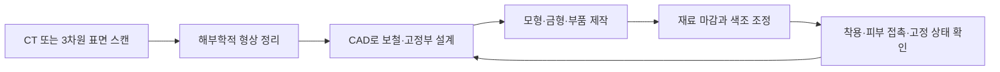

# 안면장애와 맞춤 안면 보철 | Facial rehabilitation and prostheses

## 기능과 맞춤 설계

안면장애는 안면부의 구조·형태 변화와 관련된 법적 장애 유형입니다. 안면부 변화가 시야, 코 호흡, 발성·섭식, 보안경이나 보호구 착용, 피부 보호, 대인 관계에 미치는 영향은 각기 다릅니다. 이 글은 외형을 표준에 맞추는 것을 목표로 삼지 않습니다. 당사자가 원하는 기능과 외형, 관리 편의에 맞춰 선택할 수 있는 재건·보철·접근성 기술을 다룹니다.

안면·악안면 보철은 눈·귀·코·턱 등 결손 부위를 맞춤 보완하는 방법입니다. CT나 광학 3차원 스캔으로 결손과 주변 조직을 측정하고, CAD/CAM으로 보철의 형상과 고정부를 설계합니다. 실리콘 등 유연한 재료로 본체를 제작하고 색조를 주변 피부에 맞춥니다. 뼈에 고정하는 임플란트형 고정 방식은 착용 안정성을 높일 수 있지만, 수술 여부와 관리 방법, 감염·피부 자극 위험을 함께 평가해야 합니다.

재건 수술에서는 영상 기반 계획, 환자 맞춤 절삭 가이드와 임플란트, 미세혈관 조직 이식 등이 사용될 수 있습니다. 이 과정은 외과·치과·보철·영상·재료 분야가 협업합니다. 안면 보철의 목표는 외형만이 아니라 착용과 탈착, 세척, 고정, 표정·씹기·말하기·시야 같은 기능을 포함할 수 있습니다.

## 디지털 제작의 현재와 한계

3차원 스캔은 기존 석고 인상보다 디지털 형상 데이터를 직접 얻는 데 도움을 줄 수 있고, CAD에서 결손의 좌우 대칭과 접촉면을 조정할 수 있습니다. 3D 프린팅은 환자별 해부학 모델, 수술 가이드, 금형과 일부 보철 부품을 제작하는 데 활용됩니다. 그러나 색상·투명도·탄성·피부 접촉면의 밀폐·땀과 얼굴 움직임에 대한 내구성을 모두 만족하는 보철을 바로 출력하는 문제는 여전히 연구 과제입니다. 디지털 제작이 모든 경우에 기존 제작보다 정확하거나 저렴하다고 단정할 수 없습니다.

## 앞으로의 연구

개인별 스캔과 보철을 더 빠르게 반복 설계하는 CAD, 재료의 색·질감·유연성 개선, 고정구의 피부 부담을 줄이는 구조, 조직공학과 재생의학이 연구됩니다. 생체 재료나 세포를 이용해 안면 조직을 완전히 출력하는 기술은 실험·초기 연구와 임상 보철을 구분해야 합니다. 장기 착용, 외관 만족도, 대화·식사 등 실제 기능에 관한 표준화된 결과와 장기 추적 자료가 더 필요합니다.

## 평가 기준

스캔·출력의 기하 오차만 재지 말고 접촉면 압력, 유지력, 착탈 시간, 피부 자극, 세척 주기, 색상 변화, 말하기·섭식·시야의 기능, 당사자의 선호와 장기 교체 비용을 확인합니다. 안면 영상은 개인을 식별할 수 있는 민감 정보이므로 사용 목적과 저장 기간을 정하고, 공유 범위를 제한해야 합니다.

## 신경·근육 재건과 맞춤 보철의 역할

안면신경 손상으로 눈 감기, 미소, 입술 닫기 같은 움직임이 약해진 경우에는 손상 원인과 기간에 따라 신경 봉합·신경 이식·신경 이전술, 힘줄 또는 근육 이전술을 검토할 수 있습니다. 예를 들어 다른 기능이 보존된 안면신경 가지를 이용해 마비된 쪽 근육에 신호가 도달하도록 연결하는 방식이 있습니다. 신경 축삭이 자라 목표 근육에 도달하고 뇌가 새로운 움직임을 학습하는 시간이 필요하므로, 수술 직후 곧바로 정상 표정이 돌아오는 방식은 아닙니다. 감각·눈물·침 분비·청력 등 손상 위치에 따른 다른 기능도 별도로 평가합니다.

광범위한 조직 손실에서는 미세혈관 조직 이식이나 얼굴 이식이 형태와 일부 기능을 함께 복원할 수 있습니다. 얼굴 이식은 여러 조직을 혈관과 신경에 연결하는 복합 이식이며, 면역억제제를 장기간 사용해야 하고 감염·거부반응·혈관 및 신경 합병증과 심리사회적 부담이 따릅니다. Johns Hopkins의 임상 설명과 미국 국립학술원 기준은 이식이 드문 중증 환자에 대한 다학제 치료임을 보여줍니다. [Johns Hopkins 얼굴 이식 안내](https://www.hopkinsmedicine.org/health/treatment-tests-and-therapies/face-transplant), [미국 국립학술원 임상 기준](https://www.ncbi.nlm.nih.gov/books/NBK615580/)을 참고할 수 있습니다. 얼굴 이식을 모든 안면장애의 근본 치료로 일반화할 수는 없습니다.

귀·코·안와 등 결손 부위를 만드는 맞춤 보철은 CT·3차원 스캔과 CAD로 피부 접촉면 및 고정점을 설계하고, 실리콘과 임플란트형 고정구 등으로 제작합니다. 외형과 보호 기능은 복원할 수 있지만, 보철 자체가 신경·근육·눈물샘·후각을 재생하지는 않습니다. 따라서 조직 재건이나 신경 재활이 가능한지 먼저 살피고, 보철은 필요한 기능을 보완하는 선택지로 설명해야 합니다. 제작 후에도 색 변화·접착력·피부 자극·세척과 재제작 주기를 관리합니다.

## 실제 제품·연구와 공학 도구

실제 제품의 작동 흐름, 제조사가 공개한 사용 범위, 관련 연구와 개발 도구는 [장애 보조기기와 재활 연구의 실제 제품·개발 도구](실제기기와연구개발도구_engineering-cases-and-tools.md#facial-rehabilitation)에서 이어서 보실 수 있습니다.

## 맞춤 안면 보철의 디지털 제작 흐름

그림 1. 안면 보철용 귀 형상을 컴퓨터에서 설계하는 연구·제작 현장 사진입니다. 출처는 [Royal Melbourne Hospital과 University of Melbourne의 설명](https://www.thermh.org.au/news/the-rmh-and-university-of-melbourne-o-lab-bring-facial-prosthetics-into-the-future)입니다.

그림 2. 영상 취득부터 맞춤 설계, 제작과 착용 확인까지의 일반적인 작업 흐름입니다. 병원·제작팀마다 사용하는 장비와 순서는 다를 수 있습니다.

## English

Facial rehabilitation may involve reconstructive surgery, patient-specific facial prostheses and digital planning. Imaging or optical scans can inform CAD/CAM, while fit, skin contact, retention, color, function and long-term maintenance remain central. Three-dimensional printing supports models, molds and selected components; direct printing of lifelike flexible silicone prostheses remains a research challenge.

Nerve repair or muscle transfer may restore selected movement after facial paralysis. A face transplant can replace extensive tissue loss in rare cases, but requires nerve regeneration, intensive rehabilitation and lifelong immunosuppression; a prosthesis restores form rather than nerves or muscles.

## 출처

- [Johns Hopkins, Face Transplant](https://www.hopkinsmedicine.org/health/treatment-tests-and-therapies/face-transplant): 얼굴 이식의 목적과 장기 관리.
- [National Academies, Standards of Care for Face Transplantation (2025)](https://www.ncbi.nlm.nih.gov/books/NBK615580/): 얼굴 이식의 환자 선정과 다학제 관리.
- [Facial nerve restoration review (2026)](https://pmc.ncbi.nlm.nih.gov/articles/PMC12901399/): 안면신경 기능 재건의 임상 접근과 근거 범위.

- [대한민국 법제처, 장애인복지법 시행령 별표 1](https://www.law.go.kr/LSW/flDownload.do?bylClsCd=110201&flSeq=159613615&gubun=): 안면장애의 법적 유형 기준.
- [A Contemporary Review of the Role of Facial Prostheses in Complex Facial Reconstruction, PubMed (2023)](https://pubmed.ncbi.nlm.nih.gov/36696329/): 안면 보철, CAD와 3D 제작 방향 및 장기 근거의 필요성.
- [Prosthetics in Facial Reconstruction, PMC (2018)](https://pmc.ncbi.nlm.nih.gov/articles/PMC5790540/): 영상·CAD/CAM과 환자별 보철 계획.
- [Clinical application of additive manufacturing in maxillofacial prosthetics, PMC](https://pmc.ncbi.nlm.nih.gov/articles/PMC13350295/): 3D 제작의 적용 범위와 임상 연구 한계.
