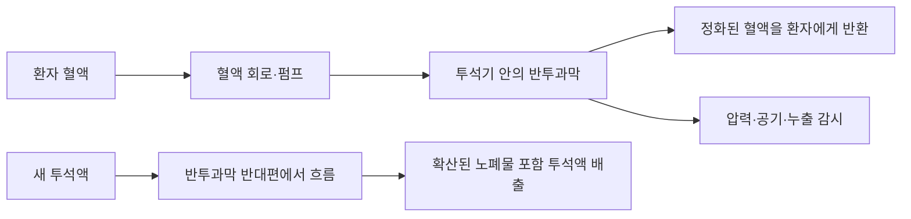

# 신장장애와 투석·신장 보조기술 | Kidney support technology

## 신장 기능을 대신하는 현재 치료 장치

신장장애에서 공학 기술은 신장 기능 전체를 그대로 복제하는 하나의 장치보다, 혈액의 노폐물과 체액을 관리하는 치료 과정에 쓰입니다. 혈액투석기는 혈액을 혈관 통로에서 빼내 투석기 안의 막을 통과시키고 다시 몸으로 돌려보냅니다. 펌프가 혈류를 만들고, 투석액 흐름과 압력·온도·전도도·기포·누출을 감시하는 센서와 안전 차단 회로가 운전을 관리합니다. 압력이나 공기 감지 이상이 생기면 혈액 회로를 안전 상태로 멈추는 것이 핵심 안전 설계입니다.

복막투석은 복막을 반투과성 막으로 이용합니다. 자동 복막투석기(사이클러)는 정해진 시간에 투석액을 주입·체류·배액하며 배액량과 주기를 기록합니다. 연결부의 오염·누출·라인 폐색과 야간 사용의 편의, 장비 알람을 관리해야 합니다. 기기 기록은 의료진의 검사 결과나 임상 판단을 대신하지 않습니다.

## 디지털 관리와 이식

혈액투석 장비의 유량·압력·전도도·온도·알람 로그는 치료 과정의 안전성과 장비 상태를 확인하는 데 쓰입니다. 원격 관리 시스템은 투석 일정, 장비 오류와 환자 보고 정보를 의료진과 공유할 수 있지만, 네트워크 장애 때 치료가 중단되지 않는 절차와 개인정보 보호를 갖춰야 합니다. 신장이식은 장치 공학이 아닌 외과·면역·조직적합성 관리와 연결되는 대체 치료 경로입니다.

## 휴대형·이식형 인공신장 연구

몸에 착용하는 소형 투석기나 이식형 인공신장은 장시간 혈액을 정화하면서 이동성을 높이려는 연구 방향입니다. 이를 위해서는 작은 펌프, 혈액 적합 재료, 막·흡착제, 항응고 관리, 체액·전해질 감시, 열과 전력, 막힘·감염 방지, 폐액 처리와 배터리를 함께 해결해야 합니다. 장치가 작아지는 것만으로 치료 성능과 안전성이 확보되지는 않습니다.

웨어러블 인공신장과 인공신장 이식 구조는 임상시험 또는 초기 시제품 연구로 보고되고 있으며, 일반적인 표준 치료로 널리 이용되는 장치와 구분합니다. 임상시험 등록이나 연구비 지원은 승인·판매·일상 처방의 증거가 아닙니다. 신장 보조 장치는 투석과 이식의 선택을 대신 결정하지 않으며, 치료 선택은 의료진과 환자가 함께 검토합니다.

## 평가 기준

기술 성능은 노폐물 제거량만이 아니라 혈압·체액량·전해질 안정성, 혈관 접근부 합병증, 오염·용혈 위험, 치료 중단률, 가정 사용의 부담, 소모품·수리 접근성, 삶의 질과 장기 임상 결과로 평가합니다. 소형화나 연속 운전이 임상적 이득으로 이어지는지를 별도로 검증해야 합니다.

## 투석 보조에서 장기 기능 대체까지

혈액투석기는 혈액 속 요소·칼륨 등 일부 용질과 여분의 수분을 제거해 신장 기능 일부를 대신합니다. 반투과성 막 양쪽으로 혈액과 투석액이 흐르면 농도 차에 따라 작은 용질이 이동하고, 압력 차가 수분 제거량에 영향을 줍니다. 펌프·압력·공기방울·혈액 누출·전도도 센서는 회로 상태를 감시합니다. 그러나 투석은 신장의 조절 기능 전체나 호르몬 분비를 모두 대신하지 않습니다. 장치의 성능이 좋다는 것과 신장 조직이 회복됐다는 것을 구분해야 합니다.

신장 이식은 기증자의 신장을 연결해 여과·체액 조절 기능을 생체 장기로 대체하는 확립된 치료입니다. 수술 후에도 거부반응과 감염 위험을 낮추기 위한 면역억제와 장기 추적이 필요하며, 모든 환자에게 적합하거나 이용 가능한 것은 아닙니다. 투석은 이식 대기와 이식이 어려운 경우에도 생명을 유지하는 핵심 치료입니다.

유전자 편집 돼지 신장은 면역 거부 원인을 줄이도록 돼지 유전자를 바꾼 뒤 사람에게 이식하는 이종이식 연구입니다. 임상시험과 개별 환자 사례가 시작됐지만, 장기 생존·감염 위험·면역억제 전략이 충분히 확인된 표준 치료는 아닙니다. [NYU Langone의 첫 임상시험 안내](https://nyulangone.org/news/first-gene-edited-pig-kidney-transplant-clinical-trial-begins-nyu-langone-health)와 [이종이식 원논문](https://www.nature.com/articles/s41587-025-02912-5)은 연구 단계와 조건을 설명합니다.

UCSF의 이식형 바이오인공신장은 미세가공 막으로 혈액에서 여과액을 만든 뒤, 생체반응기 속 신장세포가 일부 물질을 재흡수·처리하도록 설계합니다. 이는 단순 투석막보다 신장 생리 기능을 더 가깝게 흉내 내려는 공학적 방향입니다. UCSF 연구팀의 공개 FAQ 기준으로 사람 대상 임상시험은 아직 시작되지 않았으며, 소형 동물 모델에서의 작동과 사람에게 장기 이식했을 때의 치료 효과는 다른 근거 수준입니다. [UCSF Kidney Project의 현황과 작동 원리](https://pharm.ucsf.edu/kidney/device/faq)를 확인해 주세요.

## 실제 제품·연구와 공학 도구

실제 제품의 작동 흐름, 제조사가 공개한 사용 범위, 관련 연구와 개발 도구는 [장애 보조기기와 재활 연구의 실제 제품·개발 도구](실제기기와연구개발도구_engineering-cases-and-tools.md#kidney-support)에서 이어서 보실 수 있습니다.

## 혈액투석 장치 사진과 혈액·투석액 흐름

그림 1. Fresenius Medical Care 6008 CAREsystem 혈액투석 장치 사진입니다. 출처는 [제조사의 6008 CAREsystem 안내](https://freseniusmedicalcare.com/en-gb/healthcare-professionals/haemodialysis/machines/6008-caresystem/)입니다.

그림 2. 혈액과 투석액이 막의 양쪽을 흐르고, 압력·공기·누출을 감시하는 혈액투석의 개념도입니다. 투석액이 혈액과 직접 섞이는 구조가 아닙니다.

## English

Hemodialysis machines pump blood through a dialyzer and monitor pressure, temperature, conductivity, air and leaks. Peritoneal dialysis cyclers automate fluid exchange through the peritoneum. Wearable and implantable artificial kidneys remain research or clinical-trial projects; registration or funding does not imply routine availability.

Kidney transplantation replaces organ function for eligible patients. Gene-edited pig kidneys are entering clinical research, while UCSF’s implantable bioartificial kidney remains preclinical and has not begun human trials.

## 출처

- [NYU Langone, First gene-edited pig kidney transplant clinical trial](https://nyulangone.org/news/first-gene-edited-pig-kidney-transplant-clinical-trial-begins-nyu-langone-health): 유전자 편집 돼지 신장 임상시험의 시작.
- [Nature Biotechnology, gene-edited pig kidney xenotransplantation study (2025)](https://www.nature.com/articles/s41587-025-02912-5): 이종이식의 실험·임상 근거.
- [UCSF Kidney Project, Patient FAQ](https://pharm.ucsf.edu/kidney/device/faq): 바이오인공신장의 작동 원리와 임상시험 전 연구 현황.

- [대한민국 법제처, 장애인복지법 시행령 별표 1](https://www.law.go.kr/LSW/flDownload.do?bylClsCd=110201&flSeq=159613615&gubun=): 신장장애의 법적 유형 기준.
- [미국 NIH/NIDDK, Choosing a Treatment for Kidney Failure](https://www.niddk.nih.gov/health-information/kidney-disease/kidney-failure/choosing-treatment): 혈액투석·복막투석·이식과 각 치료의 역할·한계.
- [NIH RePORTER, Wearable Artificial Kidney 연구 과제](https://reporter.nih.gov/project-details/11124817): 연구 계획의 예. 연구비·시험 계획은 승인 상태와 구분해야 합니다.
- [ClinicalTrials.gov, Wearable Filtrating Artificial Kidney 연구 등록](https://clinicaltrials.gov/study/NCT05906355): 특정 체액 제거 장치 시험의 등록 정보.
