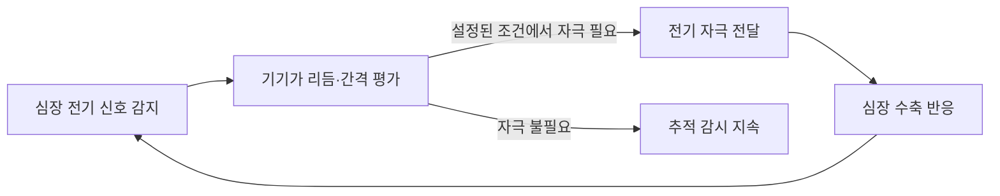

# 심장장애와 삽입형 심장기기 | Cardiac devices and monitoring

## 심장의 전기·기계 기능을 보조합니다

심장장애는 심장의 펌프 기능이나 전기적 리듬에 문제가 생긴 상태와 관련됩니다. 공학 기기는 병을 없애기보다 심박을 보조하거나 위험한 리듬을 감지하고, 혈액 순환을 유지하는 기능을 맡습니다. 어떤 장치가 필요한지는 심장 상태와 치료 목표에 따라 달라집니다.

## 현재 임상에서 쓰이는 장치

심박조율기는 배터리와 전자회로가 들어 있는 발생기와 심장 전극을 통해 전기 신호를 감지하고 필요할 때 자극을 전달합니다. 전통적인 장치는 정맥을 따라 전극선을 심장에 연결합니다. 리드리스 심박조율기는 작은 발생기와 전극을 심장 안에 함께 삽입해 혈관을 지나는 전극선을 줄입니다. 미국 FDA는 단일 심실형과 특정 적응증의 두 심방·심실 기기 조합을 허가했습니다. 이는 모든 환자에게 기존 심박조율기를 대체하는 방식은 아닙니다.

삽입형 제세동기(ICD)는 위험한 부정맥을 감지해 전기 충격 또는 항빈맥 자극으로 교정합니다. 심장재동기화치료(CRT)는 심장 양쪽 심실의 수축 시점을 맞춰 특정 심부전 환자의 펌프 효율을 돕습니다.

심실보조장치(VAD/LVAD)는 심실에서 혈액을 받아 혈관으로 보내는 기계식 펌프입니다. 장치는 혈액이 흐르는 캐뉼라, 회전 펌프, 제어기, 전원과 경보 시스템으로 구성됩니다. 피부를 통과하는 전원선, 배터리 관리, 혈전·출혈·감염·용혈과 장치 고장을 고려해야 합니다. 장치 로그와 원격 전송 데이터는 배터리·펌프·리듬 정보를 확인하는 데 도움을 주지만, 응급 증상을 자동으로 배제하지 않습니다.

## 제어·검증에서 보는 항목

삽입형 장치는 생체 전기 신호가 작고 잡음·동작 인공물이 섞이므로 감지 임계값, 자극 시점, 리드 임피던스, 배터리 상태와 전자파 간섭을 검증합니다. 심박 조율에서는 필요한 때에만 자극하는지, ICD에서는 부정맥을 놓치거나 정상 리듬에 불필요한 충격을 주지 않는지 확인합니다. VAD는 혈류·회전 속도·전력·온도·알람과 기계적 고장 모드를 함께 시험합니다.

## 앞으로의 방향과 한계

연구·개발에서는 심장 신호에 반응해 자극을 조정하는 적응형 기기, 배터리 수명과 통신 안정성, 여러 장치의 동기화, 원격 감시의 보안과 경보 정확도를 다룹니다. 리드리스 심박조율기도 이미 일부 환자군에서 사용되는 기술이므로 미래 제품으로만 분류하지 않습니다. 장치의 사용 범위는 국가의 허가와 질환별 적응증을 확인해야 합니다. 원격 모니터링이나 심박 데이터 분석이 심부전을 치료하거나 갑작스러운 악화를 항상 미리 알린다고 말할 수는 없습니다.

## 실제 제품·연구와 공학 도구

실제 제품의 작동 흐름, 제조사가 공개한 사용 범위, 관련 연구와 개발 도구는 [장애 보조기기와 재활 연구의 실제 제품·개발 도구](실제기기와연구개발도구_engineering-cases-and-tools.md#cardiac-support)에서 이어서 보실 수 있습니다.

## 심박조율기의 감지·자극 흐름

그림 1. 심박조율기의 일반적인 감지와 자극 흐름을 나타낸 개념도입니다. 리드가 있는 기기와 리드리스 기기는 구조가 다르며, 이 그림은 특정 제조사 제품의 내부 배선이나 임상 설정을 나타내지 않습니다. 리드리스 기기 사례는 [미국 FDA의 Micra 승인 안내](https://www.fda.gov/news-events/press-announcements/fda-approves-first-leadless-pacemaker-treat-heart-rhythm-disorders)에서 확인할 수 있습니다.

## English

Pacemakers sense cardiac activity and deliver pacing when needed. Implantable cardioverter-defibrillators detect certain dangerous rhythms, while cardiac resynchronization therapy coordinates ventricular timing in selected patients. Ventricular assist devices use a pump, controller and power source to support circulation. Each device has specific indications, risks and maintenance needs.

## 출처

- [대한민국 법제처, 장애인복지법 시행령 별표 1](https://www.law.go.kr/LSW/flDownload.do?bylClsCd=110201&flSeq=159613615&gubun=): 심장장애의 법적 유형 기준.
- [미국 NIH/NHLBI, Heart Failure Treatment](https://www.nhlbi.nih.gov/health/heart-failure/treatment): CRT, 심실보조장치와 ICD의 역할.
- [미국 NIH/NHLBI, Heart Treatments](https://www.nhlbi.nih.gov/health/heart-treatments-procedures): VAD의 펌프·튜브·전원·제어부와 사용 목적.
- [미국 NIH/NHLBI, How Pacemakers Work](https://www.nhlbi.nih.gov/health/pacemakers/how-it-works): 심박조율기와 CRT의 작동 원리.
- [미국 NIH/NHLBI, Defibrillators](https://www.nhlbi.nih.gov/health/defibrillators): 삽입형·착용형 제세동기의 역할.
- [미국 FDA, First Leadless Pacemaker Approval](https://www.fda.gov/news-events/press-announcements/fda-approves-first-leadless-pacemaker-treat-heart-rhythm-disorders): 리드리스 방식의 구조와 사용 환자 조건.
- [미국 FDA, Aveir DR Leadless System](https://www.accessdata.fda.gov/SCRIPTS/cdrh/devicesatfda/index.cfm?db=pma&id=520981): 두 개의 리드리스 기기를 이용한 특정 두 심방·심실 조율의 허가 사례.
- [미국 NIH/NHLBI, How Defibrillators Work](https://www.nhlbi.nih.gov/health/defibrillators/how-do-defibrillators-work): 원격 모니터링을 통한 기기 사건 정보 전달.
