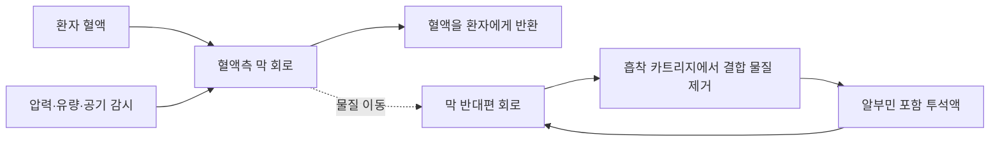

# 간장애와 간 기능 보조 기술 | Liver support technology

## 현재 치료에서 기술이 맡는 역할

간장애는 만성 간질환으로 인한 간 기능 저하와 관련됩니다. 현재 핵심 치료는 원인 질환과 합병증의 관리이며, 상태와 적응증에 따라 간이식이 필요할 수 있습니다. 혈액 검사·영상·생체 신호를 측정하는 장비와 임상정보 시스템은 간 기능과 합병증을 추적하는 데 쓰이지만, 측정이나 모니터링 자체가 간 기능을 회복시키지는 않습니다.

간 보조 장치는 간부전 환자의 혈액 속 일부 독성 물질과 대사 산물을 제거하려는 체외 순환 장치입니다. 알부민 투석(MARS 등)은 알부민과 결합한 물질을 투석·흡착 회로를 통해 제거하도록 설계됩니다. 혈액이나 혈장을 분리해 여과·흡착하는 방식도 연구·임상에서 사용되어 왔습니다. 장치에는 혈액 펌프, 막·흡착 카트리지, 압력·유량 감시, 항응고 관리, 누출·응고 감지와 체외 회로 안전 정지가 포함됩니다.

## 인공간과 바이오인공간을 구분합니다

인공 간 보조 시스템은 여과·흡착·투석과 같은 물리화학적 과정으로 일부 물질을 제거합니다. 바이오인공간은 배양 간세포를 회로에 포함해 대사 기능 일부를 수행하려는 방식입니다. 두 경우 모두 전체 간의 해독·합성·면역·대사 기능을 그대로 대체한다고 보기는 어렵습니다. 장치가 혈중 물질을 줄였다는 결과와 생존율·이식 필요·장기 회복을 개선했다는 결과는 별도로 검증해야 합니다.

## 임상 근거와 연구 방향

체외 간 보조 장치는 일부 의료 환경에서 특정 상황의 지원 목적으로 쓰이지만, 임상 지침은 급성-만성 간부전에서 인공 또는 바이오인공 체외 간 보조를 임상시험 밖에서 일상적으로 사용하는 데 신중한 입장입니다. Cochrane의 2026년 근거 검토는 급성 간부전 대상 연구의 설계와 표본 수에 한계가 있어 효과를 확신하기 어렵다고 설명하며, 바이오인공 간 보조 장치가 현재 시장에서 일반적으로 이용되지 않는다고 보고합니다.

미래 연구는 더 오래 기능하는 간세포 배양, 생체적합 막과 흡착 재료, 혈액 유량 제어, 체외 회로의 응고·감염 감소, 장치가 필요한 환자를 구분하는 임상 평가를 포함합니다. 오가노이드와 조직공학 기반 간 조직도 연구 중이지만 이식 가능한 성숙 간을 제공하는 기술과는 거리가 있습니다. 연구 결과를 표준 치료나 확립된 간 대체 기술처럼 표현하지 않습니다.

## 공학적 평가

물질 제거율뿐 아니라 알부민·세포 성분 손실, 혈액 응고와 용혈, 혈압·전해질 변화, 회로 막힘, 치료 시간, 부작용, 간이식까지의 생존과 장기 생존을 확인해야 합니다. 체외 장치의 전임상 성능과 환자에게 의미 있는 임상 결과를 구분하고, 환자군·중증도·동시 치료를 함께 봅니다.

## 간 보조 회로와 간이식은 기능 범위가 다릅니다

알부민 투석 MARS 같은 체외 간 보조 장치는 혈액 속 일부 알부민 결합 독성 물질을 막을 사이로 이동시키고, 알부민 투석액과 흡착 카트리지로 제거를 돕습니다. 혈액 펌프·투석기·알부민 회로·활성탄 및 이온교환 수지·압력과 응고 감시가 연결됩니다. 단백질 합성, 담즙 생성, 호르몬·영양 대사, 면역 조절 등 간의 모든 일을 대신하는 것은 아닙니다. 따라서 혈중 특정 물질이 감소했다는 사실만으로 간세포가 재생되거나 생존율이 높아졌다고 결론 내릴 수 없습니다. [FDA의 MARS 장치 기록](https://www.accessdata.fda.gov/cdrh_docs/pdf11/K113313.pdf)은 기기의 범위와 안전 조건을 보여줍니다.

말기 간질환에서 간이식은 손상된 장기를 공여 간으로 대체하는 확립된 치료가 될 수 있습니다. 수술 전에는 원인 질환과 다른 장기 상태, 감염·암 위험, 수술 가능성을 평가하고, 이후에는 거부반응과 감염을 관리하며 장기 추적을 합니다. 이식은 간의 생물학적 기능을 장기 단위로 대신하지만 모든 환자에게 가능하지 않고, 공여 장기 수에도 제한이 있습니다. 간이식 지침은 수술 대상 선정과 이식 후 관리가 치료 성과에 중요함을 설명합니다. [EASL 간이식 임상진료지침](https://easlcampus.eu/Documents/easl-clinical-practice-guidelines-liver-transplantation)을 참고해 주세요.

간 오가노이드와 줄기세포 유래 간세포는 약물 반응·질환 모델과 조직 재생을 연구하는 데 쓰이지만, 이식 가능한 크기와 혈관·담관·면역 기능을 갖춘 성숙 간 전체를 만드는 기술과는 다릅니다. 현재 환자 치료와 장기 이식 가능성이 입증된 기술처럼 소개하지 않습니다. 바이오인공간이 임상에서 보인 효과도 대조군, 생존, 이식까지의 연결, 환자군과 부작용을 함께 살펴야 합니다.

## 실제 제품·연구와 공학 도구

실제 제품의 작동 흐름, 제조사가 공개한 사용 범위, 관련 연구와 개발 도구는 [장애 보조기기와 재활 연구의 실제 제품·개발 도구](실제기기와연구개발도구_engineering-cases-and-tools.md#liver-support)에서 이어서 보실 수 있습니다.

## 알부민 투석의 체외 회로 개념도

그림 1. 알부민 투석 회로의 원리를 단순화한 개념도입니다. 일부 알부민 결합 물질을 체외 회로에서 제거하려는 방식이며 간세포나 간 전체를 대체하지 않습니다. 실제 MARS 장치의 배관도나 특정 제품 내부 구성은 [FDA 장치 기록](https://www.accessdata.fda.gov/cdrh_docs/pdf11/K113313.pdf)에서 확인하실 수 있습니다.

## English

Extracorporeal liver support systems use dialysis, filtration or adsorption to remove selected substances from blood. Bioartificial systems add cultured liver cells in an attempt to provide selected metabolic functions. Neither approach reproduces the full liver. Clinical benefit and availability remain limited and should not be inferred from laboratory performance alone.

Liver transplantation can replace broad organ function in selected patients. Albumin dialysis supports removal of some compounds but does not regenerate liver tissue or reproduce the organ’s full metabolic and synthetic roles.

## 출처

- [미국 FDA, MARS 510(k) device record](https://www.accessdata.fda.gov/cdrh_docs/pdf11/K113313.pdf): 알부민 투석 장치의 분류와 안전 정보.
- [EASL Clinical Practice Guidelines on Liver Transplantation](https://easlcampus.eu/Documents/easl-clinical-practice-guidelines-liver-transplantation): 간이식 대상 선정과 이식 후 관리.

- [대한민국 법제처, 장애인복지법 시행령 별표 1](https://www.law.go.kr/LSW/flDownload.do?bylClsCd=110201&flSeq=159613615&gubun=): 간장애의 법적 유형 기준.
- [미국 NIH/NIDDK, Treatment for Cirrhosis](https://www.niddk.nih.gov/health-information/liver-disease/cirrhosis/treatment): 간경변의 원인·합병증 관리와 간이식 고려.
- [EASL Clinical Practice Guidelines on acute-on-chronic liver failure (2023)](https://www.journal-of-hepatology.eu/article/S0168-8278%2823%2900244-1/fulltext): 인공·바이오인공 체외 간 보조의 임상시험 외 일상 사용 권고 범위.
- [Cochrane, Liver support systems for acute liver failure (2026)](https://www.cochrane.org/evidence/CD015059_what-are-benefits-and-harms-liver-support-systems-adults-acute-liver-failure): 효과 근거의 불확실성과 시장 이용 범위.
- [Artificial liver support systems for acute liver failure, systematic review (2019)](https://pubmed.ncbi.nlm.nih.gov/31367162/): 체외 인공·바이오인공 간 장치 연구의 임상·전임상 구분.
