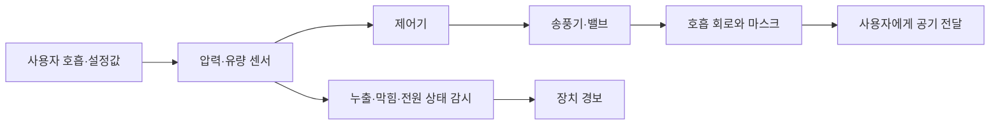

# 호흡기장애와 호흡 보조 장치 | Respiratory support technology

## 호흡을 보조하는 장치

호흡기장애에는 폐와 호흡 기능 저하가 포함되며, 필요한 지원은 원인과 상태에 따라 다릅니다. 산소 농축기와 산소 공급 장치는 흡입 산소를 보충하고, 비침습 양압환기(NPPV)는 마스크를 통해 기도에 압력을 전달합니다. 인공호흡기는 기도에 공기 또는 산소 혼합물을 보내 환기를 지원합니다. 이 장치는 각각 다른 기능을 하므로 산소 공급과 환기를 같은 것으로 설명하지 않습니다.

휴대형 산소 장치와 가정용 환기 장치는 전원·배터리, 산소 공급량, 공기 흐름, 압력·누출·호흡량 측정, 경보, 가습과 필터 관리가 한 시스템에 포함됩니다. 폐 기능이 약하거나 기침이 어려운 사람은 기침 보조 장치나 흉벽 진동 장치로 분비물 배출을 지원받을 수 있습니다. 산소포화도계는 혈중 산소포화도를 추정하지만 이산화탄소 축적을 직접 측정하지 않습니다. 환기 상태는 필요에 따라 호기말 이산화탄소나 혈액검사 등 다른 지표와 함께 평가합니다.

## 횡격막 자극은 대상이 제한된 의료기술입니다

횡격막 조율 장치는 전극과 펄스 발생기로 횡격막을 자극해 들숨을 만들려는 장치입니다. 미국 FDA가 2023년에 승인한 NeuRx Diaphragm Pacing System은 자극 가능한 횡격막이 있고 안정된 높은 경수 손상을 가진 성인 중, 인공호흡기 의존을 줄일 수 있는 특정 환자군을 대상으로 합니다. 이 승인을 모든 호흡기장애에 적용할 수는 없습니다. 전극 삽입, 외부 발생기, 장시간 사용 가능성, 환자별 적합성을 전문 의료진이 평가합니다.

## 제어·안전 검증

환기 장치는 압력·유량·호흡량·산소 농도·누출과 전원 상태를 감시하고, 막힘·회로 분리·정전·센서 이상을 경보해야 합니다. 알람이 사용자의 청각·시각 접근 특성에 맞는지, 보호자나 의료진에게 전달되는지, 네트워크 장애에서도 장치가 안전하게 작동하는지 확인합니다. 환기 설정은 개인의 질환·상태에 따라 의료진이 정하며, 온라인 설명만으로 변경할 수 없습니다.

## 다음 연구

가정용 환기와 산소 장치에서는 더 조용하고 가벼운 전원, 휴대용 배터리, 비침습 인터페이스, 호흡 패턴에 반응하는 제어, 원격 유지관리와 장치 간 자료 연동이 연구·개발됩니다. 폐쇄회로 제어는 센서가 호흡과 가스 상태를 읽어 보조를 자동 조정하는 방식이지만 센서 지연·오차와 급격한 상태 변화를 고려해야 합니다. 자율 제어의 편의성은 고장 시 안전 정지, 사람이 설정을 확인·수정할 수 있는 기능과 함께 검증해야 합니다.

## 실제 제품·연구와 공학 도구

실제 제품의 작동 흐름, 제조사가 공개한 사용 범위, 관련 연구와 개발 도구는 [장애 보조기기와 재활 연구의 실제 제품·개발 도구](실제기기와연구개발도구_engineering-cases-and-tools.md#respiratory-support)에서 이어서 보실 수 있습니다.

## 가정용 인공호흡기 사진과 제어 흐름

그림 1. ResMed Astral 150 환기 장치 사진입니다. 출처는 [제조사의 Astral 제품 안내](https://www.resmed.com/en-us/products/ventilation/astral/)입니다.

그림 2. 센서 측정값을 바탕으로 송풍기·밸브를 제어하고 이상 상태를 경보하는 환기 장치의 개념도입니다. 실제 Astral의 내부 회로도나 개인별 설정을 나타내지 않습니다.

## English

Respiratory support ranges from supplemental oxygen and non-invasive positive-pressure ventilation to mechanical ventilation. These devices perform different functions and monitor pressure, flow, leaks, power and alarms. Diaphragm pacing is approved only for specific patient groups and is not a general treatment for respiratory disability.

## 출처

- [대한민국 법제처, 장애인복지법 시행령 별표 1](https://www.law.go.kr/LSW/flDownload.do?bylClsCd=110201&flSeq=159613615&gubun=): 호흡기장애의 법적 유형 기준.
- [미국 NIH/NHLBI, Respiratory Failure Treatment](https://www.nhlbi.nih.gov/health/respiratory-failure/treatment): 산소요법·NPPV·인공호흡기의 역할과 위험.
- [미국 FDA, NeuRx Diaphragm Pacing System 승인 정보](https://www.fda.gov/medical-devices/recently-approved-devices/neurx-diaphragm-pacing-system-p200018): 2023년 승인, 대상·구성·사용 조건.
- [미국 FDA, NeuRx 안전성·효과 자료](https://www.accessdata.fda.gov/cdrh_docs/pdf20/P200018B.pdf): 해당 장치의 임상 자료와 위험.
