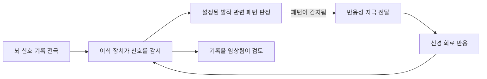

# 뇌전증장애와 발작 감지·신경자극 | Epilepsy monitoring and stimulation

## 측정과 치료를 구분합니다

뇌전증은 반복되는 발작과 관련된 신경계 질환입니다. 뇌전증장애의 등록 분류는 해당 장애정도 판정 기준을 따르며, 진단만으로 등록 상태나 필요한 보조기술을 단정할 수 없습니다. 장치의 역할은 뇌파를 기록하거나 특정 발작을 감지·알림하고, 선별된 환자에게 전기 자극을 주는 등 서로 다릅니다.

## 임상에서 쓰이는 장치

뇌파검사(EEG)는 두피 전극이나 임상적으로 필요한 경우 두개강 내 전극으로 뇌의 전기 활동을 기록합니다. 영상·임상 기록과 함께 발작 유형을 판단하는 진단 과정의 일부이며, 단일 자동 점수로 진단하지 않습니다.

손목형 발작 감지기는 가속도계와 피부전도도(EDA) 같은 생리 신호를 이용해 일부 강직간대발작과 연관된 움직임·자율신경 변화를 감지하고 보호자에게 알릴 수 있습니다. 미국 FDA의 기기 문서는 이러한 처방 기기가 발작 감시를 돕는 보조 수단이며 감지 범위가 지정된 발작 유형에 한정된다는 점을 설명합니다. 손목 움직임이 큰 다른 활동은 오경보를 만들 수 있고, 움직임이 적은 발작은 놓칠 수 있습니다. FDA 분류도 비EEG 생리 신호 장치가 발작 발생을 예측하거나 단독 감시 장치로 쓰이는 것이 아니라고 명시합니다.

약물로 조절되지 않는 일부 환자에게 신경자극 장치가 대안이 될 수 있습니다. DBS는 목표 부위에 지속 또는 프로그램된 자극을 전달합니다. 반응성 신경자극(RNS)은 두개강 내 신호를 지속 감시하고 발작과 관련된 패턴이 감지되면 목표 회로에 자극을 전달합니다. NINDS는 두 방법의 회로 구조와 자극 방식이 다르며 미국 FDA 승인 장치로 개발된 경로를 설명합니다. 국가별 허가와 대상 조건은 별도로 확인해야 합니다.

## 알고리즘과 안전 검증

감지 알고리즘은 민감도만 높이면 오경보가 늘 수 있고, 오경보를 줄이면 실제 발작을 놓칠 수 있습니다. 따라서 실제 발작 수를 분모로 한 민감도, 사용자 하루당 오경보, 발작 유형별 검출률, 알림 지연, 배터리와 연결 안정성을 함께 평가합니다. 가정 환경에서 사용자가 장치를 착용하지 않거나 충전하지 않는 시간도 성능 결과에 포함해야 합니다.

## 미래 방향

EEG·가속도·심박·피부전도 등 여러 신호를 결합하는 개인별 감지, 발작 전 위험 변화 추정, 상태에 따라 자극을 조절하는 폐회로 치료가 연구되고 있습니다. ‘발작 위험 추정’, ‘발작 감지’, ‘발작 예측’, ‘발작 치료’는 서로 다른 기능입니다. 미래 알고리즘의 예측 정확도만으로 발작을 예방한다고 표현하지 말고, 전향적 임상시험에서 안전성과 환자에게 중요한 결과를 확인해야 합니다.

## 발작 초점을 치료하는 수술과 신경자극

뇌전증을 근본적으로 다루려면 발작이 시작되는 신경회로와 원인을 먼저 확인해야 합니다. 약물 두 종류 이상을 적절히 사용했는데도 발작이 조절되지 않으면, 발작 초점이 한 곳으로 확인되는 일부 환자에게 절제술이나 레이저 간질 열치료(LITT)를 고려할 수 있습니다. 수술 전 비디오 EEG, MRI, 신경심리검사와 필요 시 두개강 내 전극으로 발작 시작 위치와 언어·운동·기억 기능의 경계를 확인합니다. 초점 조직을 절제하거나 레이저로 가열해 발작 회로를 줄이는 방식이며, 일부 환자에서는 발작이 크게 줄거나 멈출 수 있지만 재발·인지 변화·성격 변화·수술 합병증 위험이 있습니다. [NINDS 뇌전증 치료 안내](https://www.ninds.nih.gov/health-information/disorders/epilepsy-and-seizures)는 수술 대상과 효과·위험을 설명합니다.

RNS는 발작 초점 주변의 전기 신호를 지속 감시하고, 발작과 연관된 패턴을 감지하면 짧은 자극을 전달하는 반응성 신경자극 장치입니다. 발작 횟수와 심각도를 줄이는 치료 보조기기이며, 병변을 제거하거나 모든 발작을 없애는 장치는 아닙니다. 적용은 특정 난치성 국소 뇌전증과 초점 수 등 허가 조건에 맞는 성인에게 제한됩니다. 치료 효과는 자극 전후의 발작 기록과 삶의 질을 장기적으로 평가해야 합니다. RNS의 FDA 허가 기준은 [PMA 자료](https://www.accessdata.fda.gov/scripts/cdrh/cfdocs/cfpma/pma.cfm?id=P100026)에서 확인할 수 있습니다.

더 급진적인 연구로는 빛에 반응하는 단백질을 특정 신경세포에 발현시켜 빛으로 발작 회로를 억제하는 광유전학이 있습니다. 2025년 연구는 생쥐 모델에서 발작 억제를 시험한 전임상 연구입니다. 이는 사람의 뇌전증을 치료한 결과도, 임상에서 쓸 수 있는 제품도 아닙니다. [Nature Communications 동물 연구](https://www.nature.com/articles/s41467-025-55818-w)처럼 모델 종, 발작 유도 방식, 장기 안전성과 유전자 전달 조건을 확인해야 합니다.

## 실제 제품·연구와 공학 도구

실제 제품의 작동 흐름, 제조사가 공개한 사용 범위, 관련 연구와 개발 도구는 [장애 보조기기와 재활 연구의 실제 제품·개발 도구](실제기기와연구개발도구_engineering-cases-and-tools.md#epilepsy)에서 이어서 보실 수 있습니다.

## 반응성 신경자극 장치 사진과 신호 흐름

그림 1. NeuroPace RNS System의 제품 사진입니다. 출처는 [제조사의 RNS 보도자료 이미지 페이지](https://www.neuropace.com/about-neuropace/press-kit/)입니다.

그림 2. 반응성 신경자극의 감지·자극·기록 과정을 나타낸 개념도입니다. RNS는 특정 약물저항성 국소 뇌전증 환자군을 위한 처방 장치이며, 모든 발작을 감지하거나 멈추는 장치가 아닙니다. 적용 범위는 [미국 FDA 허가 자료](https://www.accessdata.fda.gov/scripts/cdrh/cfdocs/cfpma/pma.cfm?id=P100026)를 확인해 주세요.

## English

EEG supports clinical assessment; wearable sensors may alert caregivers to selected convulsive seizure patterns; responsive neurostimulation detects intracranial patterns and delivers stimulation in selected patients. Detection, prediction and treatment are different functions. Wearable alerts are adjuncts and should not be treated as seizure prevention or as a standalone diagnostic system.

Resective or laser surgery may stop seizures in some patients with a well-localized focus after medication failure. Responsive neurostimulation can reduce seizure burden but does not remove the focus; optogenetic seizure control remains preclinical.

## 출처

- [미국 FDA, RNS System PMA](https://www.accessdata.fda.gov/scripts/cdrh/cfdocs/cfpma/pma.cfm?id=P100026): 반응성 신경자극의 허가 대상과 적응증.
- [Optogenetic seizure suppression in mice, Nature Communications (2025)](https://www.nature.com/articles/s41467-025-55818-w): 사람 대상 치료가 아닌 전임상 연구.

- [대한민국 법제처, 장애인복지법 시행령 별표 1](https://www.law.go.kr/LSW/flDownload.do?bylClsCd=110201&flSeq=159613615&gubun=): 뇌전증장애의 법적 유형 기준.
- [미국 NIH/NINDS, Epilepsy and Seizures](https://www.ninds.nih.gov/health-information/disorders/epilepsy-and-seizures): 진단·치료와 신경자극 연구.
- [미국 NINDS, Brain Stimulation Therapies for Epilepsy](https://www.ninds.nih.gov/sites/default/files/2025-12/dbs-epilepsy_pdf-final_010719_508c.pdf): DBS와 RNS의 차이 및 개발 경로.
- [미국 FDA, EpiMonitor 510(k) 문서](https://www.accessdata.fda.gov/cdrh_docs/pdf23/K232915.pdf): 손목형 EDA·움직임 기반 감시의 적응증과 한계.
- [미국 FDA, 비EEG 생리 신호 기반 발작 감시기기 분류](https://www.accessdata.fda.gov/scripts/cdrh/cfdocs/cfPCD/classification.cfm?id=4143): 감지와 예측 기능의 구분.
