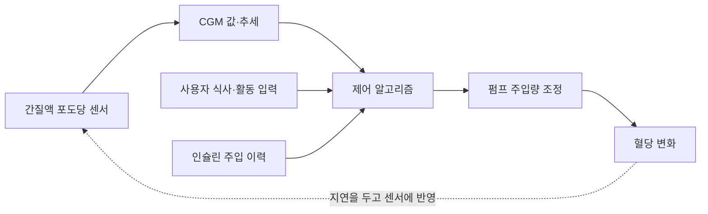

# 췌장장애와 혈당 조절 기술 | Pancreatic function and glucose technology

## 법적 분류와 혈당 관리

2025년 12월 16일 개정된 장애인복지법 시행령 별표 1에는 췌장의 내분비 기능 부전으로 혈당 조절에 장애가 있어 일상생활에 상당한 제약을 받는 경우를 췌장장애 유형으로 추가했습니다. 당뇨병 진단을 받았다는 사실만으로 이 법적 기준에 해당한다고 단정할 수는 없습니다. 등록 여부와 판정은 현행 세부 기준과 의료진 평가에 따릅니다.

췌장의 내분비 기능과 혈당을 지원하는 공학은 센서·계산·약물 전달을 연결합니다. 연속혈당측정기(CGM)는 피부 아래 센서로 세포 사이의 간질액 포도당 농도를 측정하고, 송신기로 값을 앱이나 수신기로 보냅니다. 간질액 값은 혈액 포도당을 추정하는 정보이므로 혈당 변화와 시간 차이가 생길 수 있습니다. 센서 교체 주기, 부착 상태, 온도·압력, 측정 오류와 알림 지연이 사용성에 영향을 줍니다.

## 인슐린 펌프와 자동 인슐린 전달

인슐린 펌프는 저장소의 인슐린을 주입 세트와 캐뉼라를 통해 피하 조직으로 전달합니다. 기저 주입은 시간대에 따른 기본량을, 식사·교정 용량은 별도의 투여량을 다룹니다. 펌프 사용 중 주입관 막힘, 캐뉼라 이탈, 배터리 방전, 통신 단절은 혈당 관리에 영향을 줄 수 있으므로 알람과 대체 관리 계획이 필요합니다.

자동 인슐린 전달(AID) 또는 하이브리드 폐회로 시스템은 CGM, 제어 알고리즘, 인슐린 펌프를 연결합니다. 알고리즘은 최근 혈당 추세와 인슐린 주입 이력을 이용해 펌프의 주입량을 조정합니다. ‘하이브리드’ 시스템은 일부 용량이나 식사 입력에 사용자의 조작이 여전히 필요합니다. 시스템이 췌장 전체 기능을 대체하거나 모든 식사·운동·질병 상황을 알아서 처리하는 것은 아닙니다.

## 제어공학과 안전

이 시스템은 약물 전달에 연결된 폐회로 제어입니다. 센서 값이 지연되거나 틀리면 알고리즘의 계산과 주입 명령도 영향을 받습니다. 인슐린은 과다 투여 시 저혈당을 유발할 수 있으므로 알고리즘은 목표 범위, 주입 제한, 센서 오류 시 동작, 통신 장애, 예측 불확실성에 대한 안전 규칙을 가져야 합니다. 제품별로 호환 가능한 CGM·펌프·소프트웨어 조합과 연령·사용자 조건을 확인해야 하며, 국가마다 허가 범위가 다릅니다.

검증은 목표 혈당 범위 내 시간만 보지 않습니다. 저혈당·고혈당 시간, 중증 사건, 야간 안전, 센서 누락·지연, 주입 중단과 복구, 사용자 개입 빈도, 배터리, 데이터 연결 안정성을 같이 봅니다. 실제 사용자 연구에서는 개인별 필요와 선호, 기술 사용 부담, 교육과 의료진 추적 관리도 평가합니다.

## 다음 연구

연구 방향에는 더 빠르고 정확한 센서, 인슐린과 글루카곤을 함께 제어하는 이중 호르몬 시스템, 주입 중단·오작동을 조기에 감지하는 알고리즘, 더 긴 사용 주기의 센서와 주입 세트가 있습니다. 이중 호르몬 방식은 연구·시험 중인 구성과 이미 허가된 인슐린 단독 시스템을 구분해야 합니다. 알고리즘 성능만으로 사용자가 안전하게 쓸 수 있다는 결론을 내리지 않고, 기기 조합의 임상시험과 허가·사후 감시를 확인합니다.

## 인슐린 제어와 인슐린 생산 세포의 대체

연속혈당측정기와 자동 인슐린 전달(AID)은 센서 값에 따라 주입량을 조절해 혈당을 관리하지만, 췌장의 베타세포를 되살리지는 않습니다. CGM은 간질액 포도당을 측정하고 제어 알고리즘은 지연된 측정값과 직전 인슐린 주입을 바탕으로 펌프를 조절합니다. 센서와 펌프가 정상이어도 식사·운동·감염의 변화를 모두 미리 알 수 없으므로 일부 시스템은 식사 입력과 사용자 확인을 필요로 합니다. 이는 훌륭한 생리 기능 보조이지만 내분비 조직 재생과는 다른 목표입니다.

근본 기능 대체를 목표로 하는 방법은 인슐린을 만드는 췌도 베타세포를 보충하는 것입니다. 미국 FDA는 2023년 반복적인 중증 저혈당을 경험하고 집중 치료에도 충분히 조절되지 않는 일부 성인 제1형 당뇨 환자에게 기증자 췌도세포 치료제 Lantidra를 승인했습니다. 이식 세포는 인슐린을 분비할 수 있지만, 면역 거부와 자가면역 공격을 막기 위한 면역억제의 위험을 감수해야 하므로 널리 쓰이는 첫 치료가 아닙니다. 대상과 위험은 [FDA 승인 정보](https://www.fda.gov/vaccines-blood-biologics/lantidra)에 명시되어 있습니다.

줄기세포에서 만든 췌도세포를 이식하는 방법은 기증 췌장 부족을 줄이고 세포 공급을 늘리려는 연구입니다. 2025년 NEJM zimislecel 1/2상 연구에서는 14명이 12개월 이상 추적 평가를 마쳤고, 주요 용량군 12명 모두 C-펩타이드가 검출되어 이식 세포가 인슐린을 분비하는 근거를 보였습니다. 이 12명은 365일에 중증 저혈당을 겪지 않았고 당화혈색소가 7% 미만이었으며, 그중 10명(83%)은 외부 인슐린을 쓰지 않았습니다. 다만 표본이 작고 추적이 짧으며 참여자는 면역억제를 받았습니다. 따라서 이는 세포 기능을 실제 사람에게서 시험한 중요한 초기 임상 결과이지, 제1형 당뇨를 널리 치료할 수 있게 된 승인 치료는 아닙니다. [NEJM 1/2상 연구](https://www.nejm.org/doi/10.1056/NEJMoa2506549)는 평가군과 결과를 확인하는 원자료입니다.

췌장 이식은 신장 이식과 함께 시행되거나 일부 중증 당뇨 환자에게 고려되지만, 큰 수술과 면역억제가 필요합니다. 반면 AID는 인슐린을 외부에서 공급하면서 혈당을 조절합니다. 따라서 “혈당이 안정되었다”와 “인슐린을 만드는 조직이 회복되었다”를 혼동하지 않아야 합니다. 세포 대체의 다음 과제는 이식 세포를 면역계로부터 보호하면서 산소·영양을 공급하고, 필요하면 제거하거나 교체할 수 있게 하는 장치와 면역조절 기술입니다. 이식 세포가 장기간 기능하고 면역억제 부담을 줄인다는 임상 결과가 충분히 쌓이기 전까지는 연구 가능성과 확립된 치료를 구분합니다.

## 실제 제품·연구와 공학 도구

실제 제품의 작동 흐름, 제조사가 공개한 사용 범위, 관련 연구와 개발 도구는 [장애 보조기기와 재활 연구의 실제 제품·개발 도구](실제기기와연구개발도구_engineering-cases-and-tools.md#glucose-control)에서 이어서 보실 수 있습니다.

## 연속혈당측정 제품 사진과 자동 인슐린 전달 흐름

그림 1. Dexcom G7 연속혈당측정 시스템의 센서 사진입니다. 센서는 피부 아래 간질액 포도당을 측정합니다. 출처는 [제조사의 G7 안내](https://www.dexcom.com/en-SG/dexcom-g7-cgm-system?ipc=US)입니다.

그림 2. CGM·알고리즘·펌프가 연결되는 자동 인슐린 전달의 개념도입니다. 센서값은 혈액 포도당과 시간 차이가 날 수 있고, 일부 시스템에는 식사 입력 등 사용자의 조작이 필요합니다. 제품별 기능과 허가 범위는 다릅니다.

## English

Continuous glucose monitoring, insulin pumps and automated insulin delivery connect sensing, control software and drug delivery. A CGM estimates glucose from interstitial fluid; an algorithm uses its readings and delivery history to adjust insulin. Hybrid closed-loop systems still require user input in some situations and do not reproduce every function of a pancreas. Device compatibility, alarms, failure handling and clinical evidence are essential.

Islet-cell replacement aims to restore insulin secretion rather than calculate replacement doses. Donor-cell therapy is approved in the United States only for selected adults with recurrent severe hypoglycemia; stem-cell-derived islets remain investigational.

## 출처

- [미국 FDA, Lantidra](https://www.fda.gov/vaccines-blood-biologics/lantidra): 일부 성인 제1형 당뇨 환자에 대한 기증 췌도세포 치료의 승인 범위.
- [Zimislecel stem-cell-derived islet therapy trial, New England Journal of Medicine (2025)](https://www.nejm.org/doi/10.1056/NEJMoa2506549): 줄기세포 유래 췌도세포의 초기 임상 연구.

- [대한민국 법제처, 장애인복지법 시행령 별표 1, 2025년 12월 16일 개정](https://www.law.go.kr/LSW/flDownload.do?bylClsCd=110201&flSeq=159613615&gubun=): 췌장 내분비 기능 부전으로 인한 혈당 조절 장애 조항.
- [미국 FDA, What is the pancreas? What is an artificial pancreas device system?](https://www.fda.gov/medical-devices/artificial-pancreas-device-system/what-pancreas-what-artificial-pancreas-device-system): CGM·제어 알고리즘·인슐린 펌프의 구성과 신호 흐름.
- [미국 NIH/NIDDK, Continuous Glucose Monitoring](https://www.niddk.nih.gov/health-information/diabetes/overview/managing-diabetes/continuous-glucose-monitoring): 간질액 센서, 송신기와 앱의 구조.
- [미국 NIH/NIDDK, Artificial Pancreas](https://www.niddk.nih.gov/health-information/diabetes/overview/managing-diabetes/artificial-pancreas): CGM·펌프·알고리즘 기반 자동 전달의 작동 개요.
- [미국 FDA, Types of Artificial Pancreas Device Systems](https://www.fda.gov/medical-devices/artificial-pancreas-device-system/types-artificial-pancreas-device-systems): 저혈당 자동 중단, 인슐린 단독, 이중 호르몬 방식의 차이.
- [미국 FDA, Automated Insulin Dosing System 승인 보도자료](https://www.fda.gov/news-events/press-announcements/fda-clears-new-insulin-pump-and-algorithm-based-software-support-enhanced-automatic-insulin-delivery): 미국에서 허가된 제품 사례와 대상 조건.
