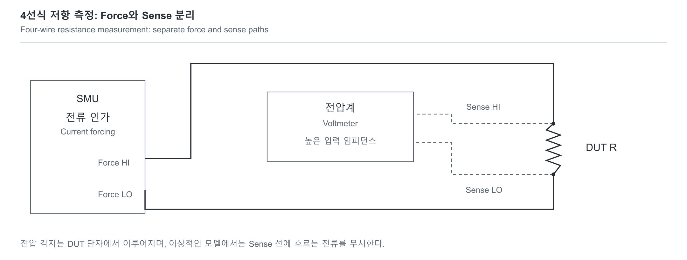

# 계측: 숫자를 읽는 것에서 믿을 수 있는 결과로

[센서와 계측](../README.md) · [계산 모델과 검증](../../../예제_examples/공학기초_foundations/circuits_hardware/README.md)

## 한국어

### 1. 측정기도 회로의 일부입니다

체온계를 잘못 놓으면 같은 사람도 다른 값으로 측정됩니다. 전자 계측도 장비 이름만으로 결과의 정확성이 정해지지 않습니다. 어디에 연결했고, 무엇을 일정하게 만들었으며, 어떤 영향을 보정했는지가 중요합니다. 측정 대상량인 measurand를 먼저 정합니다. 예를 들어 “저항값”만으로는 부족하고 온도·바이어스·측정 단자 위치·시간 조건까지 결과에 영향을 줍니다.

Keithley SMU는 전압 또는 전류를 공급하면서 전압·전류를 측정합니다. probe station은 작은 소자의 pad와 probe를 안정적으로 접촉시키는 장치이며, scope는 시간 파형을 봅니다. 장비마다 역할이 다르고, 측정 범위와 입력 특성을 함께 고려해야 합니다. [Keithley의 저전류·고저항 계측 자료](https://download.tek.com/document/LCHR_E-Handbook_071712.pdf)

### 2. compliance와 Kelvin 연결

전압 source mode에서 current compliance는 허용 전류의 한계입니다. 그 한계에 걸리면 장비가 설정한 전압을 그대로 유지하지 못할 수 있습니다. 전류 source mode의 voltage compliance도 같은 관점입니다. 따라서 sweep 결과에는 설정값만 적지 말고 실제 측정 V·I, compliance 상태, range·settling·적분 시간, 온도와 연결 방식을 기록합니다. 한계에 걸린 점을 정상적인 설정 전압의 I–V 점으로 해석하면 안 됩니다.

2선 저항 측정에서 양쪽 lead 저항을 r₁,r₂, DUT를 R이라고 하면 이상적인 측정값은 `R2w=R+r₁+r₂`입니다. 4선 Kelvin 연결은 force 선으로 전류를 흘리고 DUT 양단의 sense 선으로 전압을 읽습니다. sense 전류가 충분히 작고 연결이 적절하다면 lead 전압 강하의 영향을 크게 줄입니다. sense 위치 사이에 포함된 접촉 저항이나 DUT 내부의 저항까지 사라지는 것은 아닙니다. remote-sense 허용 전압 차이도 장비 규격을 따라야 합니다. [Keithley handbook의 force/sense 설명](https://www.tek.com/en/documents/product-article/keithley-low-level-measurements-handbook---7th-edition)

[SVG](../../../그림자료_assets/도식_diagrams/measurement-loading-uncertainty.svg) · [그림 원본 / Diagram source](../../../그림자료_assets/도식_diagrams/measurement-loading-uncertainty.mmd)

직접 작성한 Kelvin 연결도입니다. 이를 재료의 비저항 측정에서 사용하는 4-point probe와 혼동하지 않습니다. 비저항으로 환산하려면 시료 두께·형상·probe 간격과 보정 계수 등 별도 모델이 필요합니다.

### 3. scope probe가 파형을 바꾸는 정도

측정 전 회로를 Thevenin 전압 VS와 저항 RS로 나타내고, probe 입력을 `RP∥CP`로 근사하겠습니다. scope까지 포함한 유효 입력 모델을 써야 하며, 케이블·접지 인덕턴스는 지금 생략합니다. 그러면

$$\frac{V_m}{V_S}=\frac1{1+R_S/R_P+j\omega R_SC_P}.$$

직류에서는 `Vm/VS=RP/(RS+RP)`입니다. RP가 크더라도 높은 주파수에서 CP의 임피던스가 작아져 부하가 커집니다. pole의 시정수는 `τ=(RS∥RP)CP`, 이 단일 pole의 10–90% 상승 시간은 `ln(9)τ≈2.197τ`입니다. 이 값은 모든 scope·probe의 상승 시간을 보편적으로 나타내는 식은 아닙니다. [Tektronix ABCs of Probes의 loading·상승 시간 설명](https://www.tek.com/en/documents/whitepaper/abcs-probes-primer)

예를 들어 RS=1 kΩ, RP=1 MΩ, CP=10 pF면 직류 오차는 약 −0.10%, 이 단순 모델의 시정수는 약 9.99 ns입니다. 화면에 보이는 느린 에지가 DUT 자체의 에지인지, probe가 바꾼 결과인지 구분해야 합니다.

### 4. 오차와 불확도는 같은 말이 아닙니다

오차는 측정값과 기준값의 차이이고 불확도는 결과에 대한 지식의 한계를 정량화합니다. 알려진 유의한 계통 영향을 보정한 뒤, 보정값에 남는 불확도도 포함합니다. Type A는 반복값 등의 통계적 평가, Type B는 교정·규격·다른 정보에 의한 평가입니다. 이것을 단순히 random/systematic이라는 이름과 일대일 대응시키지 않습니다. [NIST TN 1297 §5](https://www.nist.gov/pml/nist-technical-note-1297/nist-tn-1297-5-combined-standard-uncertainty)

`R=V/I`이고 I≠0이며 작은 불확도에 대한 1차 선형화가 적절하다면

$$u_R^2=\left(\frac{u_V}{I}\right)^2+
\left(\frac{Vu_I}{I^2}\right)^2-
\frac{2V}{I^3}\mathrm{cov}(V,I).$$

독립 입력이면 공분산 항이 0이므로 상대 표준불확도는 `uR/|R|=√[(uV/V)²+(uI/I)²]`입니다. V도 0이 아니어야 이 상대식을 쓸 수 있습니다. 같은 기준 전압이나 보정으로 연결된 입력은 독립이 아닐 수 있습니다. [NIST의 전파 법칙](https://www.nist.gov/pml/nist-technical-note-1297/nist-tn-1297-appendix-law-propagation-uncertainty)

V=1 V, I=1 mA, uV=1 mV, uI=1 μA이며 독립이면 R=1 kΩ, uR≈1.414 Ω입니다. 확장불확도는 `U=kuc`로 표현하지만 k=2가 언제나 정확한 95%를 보장하지는 않습니다. 분포·자유도·coverage 가정을 함께 기록합니다. 교정, zero 조정, 결과의 불확도 평가도 서로 같은 작업이 아닙니다.

### 5. 모델 구현과 검증

`probe_transfer`는 복소 분압을 계산하고 DC 극한, −3 dB pole, 고주파 감쇠를 검사합니다. `resistance_uncertainty`는 공분산을 포함하며 `|cov|≤uVuI`를 확인합니다. 테스트는 독립 입력의 손 계산과 작은 균등분포의 Monte Carlo 표준편차, 비율에서 공통 배율 오차가 상쇄되는 극한을 비교합니다. 1회 계산은 O(1), N회 표본 검사는 O(N)입니다.

이 숫자는 계산 예제이며 실제 계측 기록은 아닙니다. 실측 결과에는 DUT·장비와 교정 상태·배선·환경·설정·원시 V/I·compliance·보정·불확도·반복성을 함께 남깁니다. 그래야 다른 사람이 연결을 재현하고 결과가 그 용도에 충분한지 판단할 수 있습니다.

## English

### 1. The instrument becomes part of the experiment

A misplaced thermometer can report different temperatures for the same person. Electronic measurements likewise depend on more than the instrument name: connection points, controlled conditions and corrections matter. Define the measurand first. A resistance result depends on temperature, bias, terminal locations and timing, rather than being a context-free number.

A Keithley SMU sources voltage or current while measuring voltage and current. A probe station makes controlled contact with small device pads; an oscilloscope observes time-domain waveforms. Their roles, ranges and input characteristics differ. [Keithley low-current/high-resistance guide](https://download.tek.com/document/LCHR_E-Handbook_071712.pdf)

### 2. Compliance and Kelvin connections

In voltage-source mode, current compliance limits the allowed current. Once limiting occurs, the programmed voltage may no longer be maintained. Voltage compliance serves an analogous role in current-source mode. Record measured V and I, compliance status, ranges, settling and integration times, temperature and wiring, not just programmed values. A compliance-limited point cannot be treated as an ordinary point at the requested voltage.

For two-wire resistance with lead resistances r₁ and r₂, the ideal reading is `R2w=R+r₁+r₂`. A four-wire Kelvin connection forces current through one pair and senses voltage directly at the DUT with another. Negligible sense current can greatly reduce lead-drop error. It does not remove contact resistance inside the sense points or resistance belonging to the DUT. Remote-sense voltage limits still apply. [Keithley force/sense reference](https://www.tek.com/en/documents/product-article/keithley-low-level-measurements-handbook---7th-edition)

The original diagram shows force connections and separate voltage-sense connections at the DUT terminals. This is distinct from converting a four-point material-probe measurement into resistivity, which requires geometry, thickness, spacing and appropriate correction factors.

### 3. Probe loading changes the waveform

Approximate the unprobed circuit as Thevenin VS and RS, and the effective probe-plus-scope input as `RP∥CP`. Cable and ground inductance are excluded here. Then

$$V_m/V_S=1/(1+R_S/R_P+j\omega R_SC_P).$$

At DC the divider is `RP/(RS+RP)`. A large RP alone does not ensure small high-frequency loading, because CP impedance falls with frequency. This single-pole model has `τ=(RS∥RP)CP` and a 10–90% rise time `ln(9)τ≈2.197τ`. It is not a universal rise-time formula for every probe or scope. [Tektronix ABCs of Probes](https://www.tek.com/en/documents/whitepaper/abcs-probes-primer)

For RS=1 kΩ, RP=1 MΩ and CP=10 pF, DC attenuation is approximately 0.10% and the modeled time constant is approximately 9.99 ns. A displayed slow edge might therefore reflect instrument loading as well as DUT behavior.

### 4. Uncertainty is distinct from error

Error is a difference from a reference value; uncertainty quantifies incomplete knowledge of the result. Correct recognized significant systematic effects and include the uncertainty remaining in those corrections. Type A means statistical evaluation, such as repeated observations; Type B uses calibration, specifications or other information. These categories are not synonyms for random and systematic. [NIST TN 1297 §5](https://www.nist.gov/pml/nist-technical-note-1297/nist-tn-1297-5-combined-standard-uncertainty)

For `R=V/I`, nonzero I, and sufficiently small uncertainties for first-order propagation,

$$u_R^2=(u_V/I)^2+(Vu_I/I^2)^2-2V\mathrm{cov}(V,I)/I^3.$$

Independent inputs have zero covariance. For nonzero V as well, the relative expression becomes `uR/|R|=√[(uV/V)²+(uI/I)²]`. Inputs sharing a reference or correction may be correlated. [NIST propagation law](https://www.nist.gov/pml/nist-technical-note-1297/nist-tn-1297-appendix-law-propagation-uncertainty)

With V=1 V, I=1 mA, uV=1 mV, uI=1 μA and independence, R=1 kΩ and uR≈1.414 Ω. Expanded uncertainty is `U=kuc`, but k=2 is not universally an exact 95% statement. Report distribution, degrees-of-freedom and coverage assumptions. Calibration, zero adjustment and uncertainty evaluation are also distinct operations.

### 5. Implementation and verification

`probe_transfer` computes the complex divider and is checked at DC, its −3 dB pole and high frequency. `resistance_uncertainty` includes covariance and checks `|cov|≤uVuI`. Tests compare a hand-calculated independent-input result, Monte Carlo spread for small uniform perturbations, and the limit where a common scale error cancels in a ratio. One calculation costs O(1); N samples cost O(N).

These values are calculation examples, not physical measurement records. A reproducible experimental record includes DUT, instruments and calibration state, wiring, environment, settings, raw V/I, compliance, corrections, uncertainty and repeatability. That lets another reader recreate the connection and judge whether the result is adequate for its intended use.

## 출처와 대조한 내용 | Sources and cross-checks

- Keithley, *Making Precision Low Current and High Resistance Measurements* 및 *Low Level Measurements Handbook*, §1.5.6·§2.4: SMU·force/sense·연결의 영향 / SMU, force/sense and connection effects.
- Tektronix, *ABCs of Probes*, §§4–5: 저항·정전용량 부하와 단일 RC 상승 시간 / resistive/capacitive loading and single-RC rise time.
- NIST TN 1297, §5 and Appendix A: 보정·공분산·1차 불확도 전파 / corrections, covariance and first-order uncertainty propagation. 장비 자료의 부하 모델과 NIST의 불확도 개념을 구분해 적용했다 / instrument loading models and NIST uncertainty concepts were applied as distinct parts of the measurement model.
- 그림·계산 예제·표본 검산은 직접 구성했다 / diagram, calculation examples and sampling checks constructed here. 출처 확인 / sources checked: 2026-10-19.
