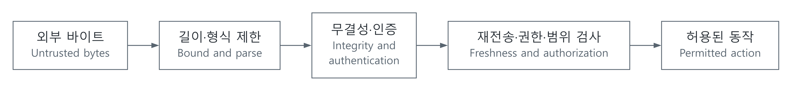

# 오류를 찾는 것과 공격을 막는 것: 신뢰성·보안의 경계

[상위 주제](../README.md) · [프레임·CRC](../../20-인터페이스통신_interfaces-communications/해설_notes/바이트가메시지가되려면_framing-uart-crc.md) · [HMAC 검증 모델](../../../예제_examples/공학기초_foundations/systems/systems_models.py)

## 한국어

### 먼저 무엇을 막을지 정합니다

센서 케이블의 잡음으로 한 비트가 바뀌는 경우와 누군가 모터 명령을 의도적으로 바꾸는 경우는 다릅니다. 첫 문제에는 오류 검출이나 정정이 필요하고, 두 번째에는 누가 어떤 명령을 보낼 수 있는지 확인하는 인증과 권한 검사가 필요합니다. 같은 데이터가 통신 오류와 공격 모두를 겪을 수도 있습니다.

위협 모델은 보호할 자산, 공격자가 할 수 있는 행동, 신뢰하는 경계와 실패의 영향을 정리한 것입니다. 예를 들어 “외부 포트에서 바이트를 주입할 수 있지만 비밀 키를 읽지는 못한다”는 가정과 “장치를 분해해 Flash까지 읽을 수 있다”는 가정은 필요한 설계가 다릅니다. 어떤 방어를 평가하든 이 가정을 먼저 적어야 결과를 해석할 수 있습니다.

| 수단 | 주로 확인하거나 제공하는 것 | 이것만으로 보장하지 않는 것 |
| --- | --- | --- |
| parity·checksum·CRC | 정해진 오류 패턴의 검출 | 공격자가 만든 변경의 인증 |
| ECC | 코드의 능력 안에서 오류 검출·정정 | 모든 오류의 정정, 명령 권한 |
| 공개 hash | 기준 digest와 내용의 일치 | digest까지 바꾸는 공격자에 대한 인증 |
| MAC / HMAC | 공유 키에 근거한 메시지 인증 | 비밀성, 재전송 방지, 사용자 권한 전체 |
| 디지털 서명 | 검증 키에 대응하는 서명 검증 | 내용 자체의 사실성, 실행의 안전성 |
| 암호화 | 정한 모델에서의 비밀성 | 임의 방식의 암호화가 자동으로 무결성까지 주는 것은 아님 |

CRC가 붙은 메시지를 바꾼 뒤 CRC를 다시 계산하는 데는 비밀이 필요하지 않습니다. 공개 hash도 신뢰하는 비교 기준이 없으면 같은 문제가 있습니다. 보안 설계에서는 키와 신뢰할 기준이 어디서 오는지가 중요합니다.

### 오류 정정 능력은 거리로 생각할 수 있습니다

길이가 같은 두 비트열에서 다른 위치의 수를 Hamming distance라 합니다. 코드워드 사이 최소 거리가 $`d_{\min}`$이면, 서로 다른 코드워드가 섞이지 않게 반지름 $`t`$의 오류 영역을 나누려면

$$2t<d_{\min}$$

이어야 합니다. 따라서 최소 거리 $`2t+1`$ 이상인 코드는 그 범위에서 $`t`$개 비트 오류의 유일 정정을 보장할 수 있습니다. $`d_{\min}-1`$개 이하 오류는 다른 코드워드로 곧바로 바뀔 수 없어 검출할 수 있습니다. 이는 고정 길이 비트 오류 모델의 수학적 조건이며, 실제 decoder가 어떤 정정·검출 정책을 구현하는지는 별도 문제입니다. burst 오류, 지워진 위치를 아는 erasure, 하드웨어 고장 모델도 구분합니다.

### HMAC은 비밀 키로 메시지를 묶습니다

HMAC은 hash를 단순히 `hash(key + message)`로 쓰지 않고 다음 구조로 결합합니다.

$$\mathrm{HMAC}(K,m)=H\bigl((K'\oplus opad)\,\Vert \,H((K'\oplus ipad)\,\Vert \,m)\bigr).$$

$`K'`$는 hash block 크기에 맞춰 처리한 키, $`\Vert `$는 바이트 연결입니다. HMAC-SHA-256은 32바이트 tag를 만들 수 있습니다. 구조와 규칙은 RFC2104, SHA-256을 사용하는 검증 벡터는 RFC4231에서 확인할 수 있습니다. 여기서는 검증된 표준 라이브러리를 사용합니다. [RFC2104 §2](https://www.rfc-editor.org/rfc/rfc2104.html), [RFC4231 §4](https://www.rfc-editor.org/rfc/rfc4231.html)

메시지에 장치 식별자, 동작, sequence 등을 모호하지 않게 인코딩하고 tag에 포함하면 다른 맥락으로 바꾸는 것을 제한할 수 있습니다. 그러나 과거의 정상 메시지와 tag를 그대로 다시 보내면 MAC 검증은 다시 성공합니다. 재전송 방지는 sequence·nonce와 수신 측 상태, 재부팅·롤오버 규칙까지 설계해야 합니다. MAC이 맞더라도 해당 동작의 범위와 권한 검사를 통과해야 실행합니다.

### 입력을 파싱하는 순간에도 경계가 필요합니다

[SVG](../../../그림자료_assets/도식_diagrams/security-and-reliability-boundaries.svg) · [그림 원본 / Diagram source](../../../그림자료_assets/도식_diagrams/security-and-reliability-boundaries.mmd)

직접 작성한 흐름도입니다. 실제 순서는 프로토콜과 인증 범위에 따라 달라질 수 있지만, 인증되지 않은 길이만 믿고 큰 메모리를 할당하거나 명령을 실행해서는 안 됩니다. 앞 글의 파서는 payload 상한을 넘으면 버리고 경계에서 복구합니다. 여기에 오류 응답과 요청 횟수 제한을 더할 수 있습니다. 입력 하나가 유효하다는 것과 시스템이 과도한 요청을 견딘다는 것도 서로 다른 성질입니다.

펌웨어 갱신에서는 유효성 확인뿐 아니라 중단된 갱신과 손상 이후의 복구도 다룹니다. NIST SP800-193은 플랫폼 펌웨어 회복력을 protection, detection, recovery로 나누어 설명합니다. CRC 통과 하나로 안전한 업데이트가 완성되는 것은 아닙니다. [NIST SP800-193](https://csrc.nist.gov/pubs/sp/800/193/final)

### 구현과 검증

`verify_tag()`는 `hmac.digest(..., sha256)`와 `compare_digest()`를 사용합니다. 이 예제는 32바이트 이상 키를 입력 정책으로 요구합니다. 이는 모든 HMAC 구현의 최소 키 길이를 정의한 것이 아니며, 길이가 충분해도 예측 가능한 값이면 안전한 비밀 키가 아닙니다. 테스트에 등장하는 반복 바이트 키는 공개 검증 벡터입니다.

검증은 RFC4231 case 6의 tag와 비교하고, 메시지 변경·다른 키·잘린 tag의 거부를 확인합니다. 같은 정상 메시지는 두 번째에도 통과하는 것을 테스트해 재전송 방지의 별도 필요성을 보여 줍니다. 해시 연산은 메시지 길이에 대해 $`O(N)`$이며 실제 서비스의 요청 크기도 제한해야 합니다. 키 생성·저장·교체, fault injection과 side channel, secure boot 구현은 이 작은 함수의 검증 범위에 포함되지 않습니다. [실행과 검증 범위](../../../예제_examples/공학기초_foundations/systems/README.md)

## English

### Define the failure or adversary first

A noise-induced bit flip in a sensor cable differs from deliberate modification of a motor command. The first calls for error detection or correction; the second requires authentication and authorization. One system may face both.

A threat model identifies assets, adversary capabilities, trust boundaries, and failure consequences. An adversary who can inject external bytes but cannot read a secret key differs from one who can dismantle the device and read Flash. State these assumptions before interpreting a defense's results.

| Mechanism | Main role | Not guaranteed by this alone |
| --- | --- | --- |
| Parity, checksum, CRC | Detect specified error patterns | Authentication against deliberate changes |
| ECC | Detect/correct within the code's capability | Correction of all errors or command authority |
| Public hash | Match content to a reference digest | Authentication if the digest is also replaceable |
| MAC / HMAC | Shared-key message authentication | Confidentiality, replay prevention, full authorization |
| Digital signature | Verify a signature against a verification key | Truth of the content or safe execution |
| Encryption | Confidentiality under a defined model | Automatic integrity for every encryption construction |

An adversary needs no secret to modify data and recalculate its CRC. A public hash has the same authentication problem without a trusted reference. Key origin and trusted comparison values matter.

### Distance explains error-correction capability

Hamming distance counts differing positions between equal-length bit strings. If codewords have minimum distance $`d_{\min}`$, nonoverlapping error neighborhoods of radius $`t`$ require

$$2t<d_{\min}.$$

A code with minimum distance at least $`2t+1`$ can therefore guarantee unique correction of up to $`t`$ bit errors in that model. Up to $`d_{\min}-1`$ changed bits cannot directly turn one valid codeword into another and can be detected. Actual decoder policy is a separate implementation choice. Burst errors, erasures with known missing positions, and hardware fault models require their own treatment.

### HMAC binds a message to a secret key

HMAC does not simply compute `hash(key + message)`. Its construction is

$$\mathrm{HMAC}(K,m)=H\bigl((K'\oplus opad)\,\Vert \,H((K'\oplus ipad)\,\Vert \,m)\bigr),$$

where $`K'`$ is the block-sized processed key and $`\Vert `$ denotes byte concatenation. HMAC-SHA-256 can produce a 32-byte tag. RFC2104 defines the construction; RFC4231 provides SHA-256 test vectors. The example uses the standard library rather than a new cryptographic implementation. [RFC2104 §2](https://www.rfc-editor.org/rfc/rfc2104.html), [RFC4231 §4](https://www.rfc-editor.org/rfc/rfc4231.html)

Unambiguously encoding device identity, operation, and sequence within authenticated data helps bind context. However, replaying an unchanged valid message and tag still passes MAC verification. Replay defense needs sequence or nonce tracking, receiver state, and reboot and rollover rules. A valid MAC does not remove action-specific authorization and range checks.

### Parsing is a trust boundary too

The original diagram above connects bounded parsing, authentication, freshness and authorization checks, and permitted execution. Exact ordering depends on the protocol and authenticated envelope, but untrusted lengths must not cause unlimited allocation or premature command execution. The companion parser drops oversized payloads and recovers at a delimiter. Error reporting and request-rate controls address additional concerns; one valid input is not evidence of resilience to excessive traffic.

Firmware updates also need recovery from interruption and damage. NIST SP800-193 organizes firmware resilience around protection, detection, and recovery. A passing CRC alone does not deliver a secure update process. [NIST SP800-193](https://csrc.nist.gov/pubs/sp/800/193/final)

### Implementation and verification

`verify_tag()` uses `hmac.digest(..., sha256)` and `compare_digest()`. This example's input policy requires at least 32 key bytes; it does not define a universal HMAC minimum. Sufficient length does not make predictable bytes a safe secret. Repeated-byte keys in tests are public verification vectors.

Tests compare RFC4231 case 6 and reject altered messages, a different key, and a truncated tag. They deliberately confirm that a valid message passes again, exposing the separate replay-defense requirement. Hashing is $`O(N)`$ in message length, so real services also need request-size limits. Key generation, storage and rotation, fault injection, side channels, and secure boot implementation are outside this small function's verification scope. [Commands and scope](../../../예제_examples/공학기초_foundations/systems/README.md)

## 출처와 교차 확인 / Sources and cross-check

- RFC2104와 RFC4231: HMAC 구성과 독립 검증 벡터 / HMAC construction and independent test vectors.
- NIST SP800-193: 펌웨어 보호·탐지·복구의 구분 / firmware protection, detection, and recovery.
- 오류 정정 거리 조건은 코드워드 주변 오류 영역이 겹치지 않아야 한다는 조건에서 유도했습니다. / The distance condition follows from requiring disjoint error neighborhoods around codewords.
