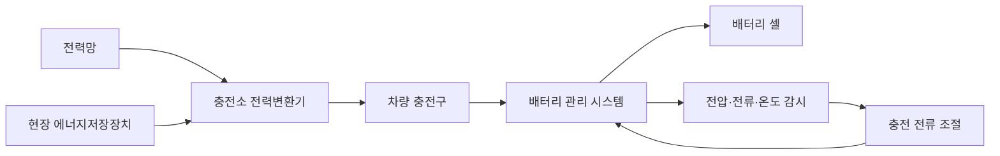

# 전기차 배터리: 초고속 충전 발표와 실제 충전 곡선의 차이 / EV batteries and real charging curves

2026년 10월 20일 기준으로 BYD Blade Battery 2.0·FLASH Charging, CATL 3세대 Shenxing 발표와 자동차 독립 시험을 함께 읽습니다. 충전 시연, 셀 연구, 판매 차량의 시험은 서로 다른 근거입니다. 이 글에서 차량이나 배터리를 직접 충방전하지 않았습니다.


그림 1. BYD가 2세대 Blade Battery 발표에서 공개한 충전 성능 자료입니다. 제조사의 발표 자료이므로 시험 조건과 독립 차량 시험은 본문의 비교 표에서 따로 확인합니다. [BYD 공식 발표와 이미지 출처](https://prod.byd.com/mea/news-list/BYD%20Unveils%202nd%20Generation%20Blade%20Battery%20and%20FLASH%20Charging%20Technology)



그림 2. 전기차 급속 충전의 일반적인 에너지·제어 흐름입니다. 특정 BYD 차량이나 충전기의 내부 회로를 나타내지 않습니다. 충전기는 전력을 변환하고, 차량의 배터리 관리 시스템은 셀 상태와 온도를 확인해 충전 허용 전류를 조절합니다.

## 2026년 발표는 어디까지 확인되나요?

BYD는 3월 5일 Blade Battery 2.0을 발표하며 상온 10→70% 5분, 10→97% 9분과 −30°C의 20→97% 12분을 제시했습니다. CATL은 4월 21일 Shenxing 3세대를 공개하며 10→80% 3분 44초와 10→98% 6분 27초를 제시했습니다. 시작·종료 충전량이 다르므로 제목의 분 수만 나란히 놓고 동일 시험의 승자를 정할 수 없습니다. [BYD 공식 발표](https://prod.byd.com/mea/news-list/BYD%20Unveils%202nd%20Generation%20Blade%20Battery%20and%20FLASH%20Charging%20Technology), [CATL 공식 발표](https://www.catl.com/en/news/6811.html)

BYD는 전용 충전 인프라와 대응 차량을 함께 설명하고, CATL 자료는 배터리 기술의 발표입니다. 확인한 자료만으로 모든 국가·모든 판매 차량에서 같은 시간이 제공된다고 쓰지 않습니다. 설치 예정 충전소와 이미 운영 중인 충전소, 발표한 셀과 양산 차량은 따로 기록해야 합니다.

## 배터리는 에너지를 저장하고 충전기는 전력을 전달합니다

kWh는 저장·전달한 에너지의 양이고 kW는 단위 시간당 전달하는 속도입니다. SOC는 충전 상태를 정격 또는 사용 가능한 용량에 대해 표시한 비율입니다. 표시 SOC와 셀의 실제 여유 용량·보호 구간은 다를 수 있습니다.

가상으로 사용 가능한 100kWh 배터리를 10%에서 80%까지 올리려면 약 70kWh를 저장합니다. 손실을 무시하고 10분이면 평균 420kW, 5분이면 840kW입니다. 최고 1MW를 잠깐 찍었다고 평균도 1MW가 되는 것은 아닙니다.

```math
P_{avg}=\frac{\Delta E}{\Delta t}
\qquad \frac{70\ \mathrm{kWh}}{10/60\ \mathrm{h}}=420\ \mathrm{kW}
```

배터리로 들어가는 전력과 충전기 입구의 전력은 변환 손실·보조 장치 소비 때문에 다를 수 있습니다. 차의 표시값, 충전기 로그, 외부 전력계 중 무엇을 측정했는지 적어야 같은 값인지 판단할 수 있습니다.

## C-rate를 분 수로 바꾸는 데에는 조건이 있습니다

C-rate는 정격 용량에 대한 전류의 크기를 나타냅니다. 이상적으로 1C로 정격 용량을 모두 채우는 데 한 시간이 걸린다고 생각할 수 있습니다. 하지만 실제 충전은 전류가 일정하지 않고 끝부분에서 전압 제한 등으로 줄어듭니다. 10C 표기가 0→100%를 언제나 6분에 끝낸다는 보장은 아닙니다.

가상 100Ah 셀에 500A를 흘리면 5C입니다. 전압이 3.2V라고 임의로 두면 순간 전력은 약 1.6kW입니다. 팩에서는 셀을 직렬·병렬로 연결하므로 셀 전류와 차량 충전 단자의 전류를 같다고 읽지 않습니다. 직렬은 전압을, 병렬은 전류를 나누는 관계를 먼저 확인합니다.

고전압 시스템이 같은 전력에서 전류를 줄일 수 있다는 설명도 여기에 연결됩니다. 자체 가정으로 400kW를 400V에서 전달하면 1,000A, 800V에서는 500A입니다. 동일 저항이라면 저항 손실의 단순 모델은 다음과 같습니다.

```math
P=VI,\qquad P_{loss}=I^2R
```

저항을 0.01Ω으로 가정하면 각각 10kW와 2.5kW입니다. 실제 차량의 케이블·접촉부·셀·인버터 손실을 측정한 값은 아닙니다. 높은 전압은 절연·부품·안전 설계 조건도 바꾸므로 장점만으로 전체 비용이 줄었다고 말할 수 없습니다.

## 빨리 충전할수록 열과 반응의 균형이 중요합니다

리튬 이온은 충전 중 전극 내부로 이동합니다. 빠른 충전·낮은 온도 같은 조건에서는 금속 리튬이 표면에 석출될 위험이 있으며, 높은 온도에 오래 노출되면 다른 열화 반응이 빨라질 수 있습니다. “차갑게 유지하면 언제나 최선”과 “뜨겁게 하면 언제나 안전” 모두 지나친 단순화입니다.

Yang 등의 2019년 Joule 연구는 충전 중 짧게 온도를 높이고 나머지 시간의 노출을 줄이는 비대칭 온도 제어를 시험했습니다. 이는 구체적인 셀·재료·프로토콜의 연구이며 BYD나 CATL의 내부 기술을 확인한 자료는 아닙니다. 일반 차량을 임의로 가열하라는 사용법도 아닙니다. [논문 원문](https://ecec.me.psu.edu/Pubs/2019_Yang_Joule.pdf)

수명 주장의 비교에는 종료 기준이 필요합니다. 1,000회 뒤 용량 90%라는 발표를 읽을 때에도 SOC 범위, 온도, 휴지 시간, 충전 속도, 방전 부하를 봅니다. 20→80%를 반복한 횟수와 완전 등가 사이클을 구분하며, 한 번의 고속 충전 시연으로 긴 수명을 증명할 수는 없습니다.

## 기자가 본 시연과 독립 충전 시험

TechRadar의 Leon Poultney는 6월 영국 BYD 본사의 Z9 GT 시연에서 10→70% 약 5분, 97%까지 약 9분을 관찰했다고 기록합니다. 회사 직원이 스톱워치를 시작한 제조사 행사이며, 외부 계측기로 전체 충전 곡선·배터리 온도·열화를 통제한 장기 시험은 아닙니다. [현장 관찰 기사](https://www.techradar.com/vehicle-tech/hybrid-electric-vehicles/ive-witnessed-byd-fully-charge-its-denza-z9-gt-in-under-10-minutes-and-its-going-to-change-how-people-view-evs)

기자의 직접 관찰은 보도자료를 그대로 읽은 것보다 구체적이지만, 제조사가 준비한 배터리 상태와 충전기라는 조건을 지우면 안 됩니다. 해당 매체의 제휴 링크도 공개되어 있습니다. 삽입 영상을 이 글에서 시청한 것으로 쓰지 않았습니다.

ADAC의 2026년 IONIQ 5 84kWh RWD 겨울 시험은 10→80% 19분과 20분 동안 보충한 시험 조건의 주행거리 231km를 보고합니다. 이는 BYD·CATL 신형 배터리의 대조군을 동일 조건에서 측정한 결과가 아닙니다. 실제 차량의 소비 전력과 충전 성능을 함께 보는 별도 사례입니다. [차량별 독립 시험](https://www.adac.de/rund-ums-fahrzeug/elektromobilitaet/elektroauto/elektroauto-reichweite-im-winter-adac-test-2026/hyundai-ioniq-5-84-kwh-rwd-id-5117/), [공통 시험 설명](https://www.adac.de/rund-ums-fahrzeug/elektromobilitaet/elektroauto/elektroauto-reichweite-im-winter-adac-test-2026/)

“20분에 231km”도 주행 소비 전력이 달라지면 달라집니다. 60kWh를 넣었을 때 15kWh/100km를 쓰는 조건은 400km, 25kWh/100km 조건은 240km라는 자체 계산이 가능합니다. 광고의 추가 주행거리에는 시험 주행 기준을 함께 붙여야 합니다.

## 충전 곡선에서 볼 다섯 가지

| 구간 | 판단할 내용 |
| --- | --- |
| 연결 전 | 배터리 예열·주행 여부가 무엇인가요? |
| 낮은 SOC | 최고 전력이 얼마나 빨리 올라가나요? |
| 중간 SOC | 높은 전력을 얼마나 오래 유지하나요? |
| 높은 SOC | 전력 감소와 셀 균형 조정에 시간이 얼마나 드나요? |
| 충전소 | 출력 공유·냉각·전력망·고장이 결과를 제한하나요? |

급속 충전 한 번이 끝나는 시간 외에 대기·우회 거리·인증·연결·결제·종료 시간이 여행 시간에 들어갑니다. 가상으로 충전 5분이더라도 대기 15분과 우회 왕복 10분이면 총 30분입니다. 넓게 설치된 보통 속도 충전망과 드문 최고속 장치를 비교할 때 이 시간을 빼면 체감이 달라집니다.

## 비용과 화학을 하나의 순위로 묶지 않습니다

LFP는 인산철 계열 양극을 사용하는 리튬 이온 배터리입니다. 니켈계 배터리와 에너지 밀도·재료 비용·열 특성 등이 다르지만, 화학 이름 하나로 충전·수명·안전의 완성품 순위를 정할 수는 없습니다. 셀 구조와 팩 냉각·감시·보호 설계가 함께 작용합니다.

충전기·배전 설비·현장 저장 배터리를 추가하면 순간 수전 용량을 분산할 수 있으나 에너지를 공짜로 만들지는 않습니다. 저장 손실과 설비 비용·유지보수가 남습니다. 확인한 공식 발표와 제한된 시연만으로 모든 차량에서 5분 충전이 실현되었다고 결론 내리지 않습니다.

## 스스로 확인하기

1. 최고 충전 전력이 같으면 10→80% 시간도 같나요?
2. 10C면 어떤 차량도 0→100%를 정확히 6분에 채우나요?
3. 한 번의 시연으로 수천 회 뒤 용량과 겨울 성능까지 확인되나요?

<details>
<summary>답과 이유</summary>

1. 아닙니다. 용량·전력 유지 시간·온도·제어 조건이 다릅니다.
2. 아닙니다. 전류가 변하고 SOC 범위와 전압·온도 제한이 있습니다.
3. 아닙니다. 별도의 통제된 충방전·온도 시험이 필요합니다.

</details>
