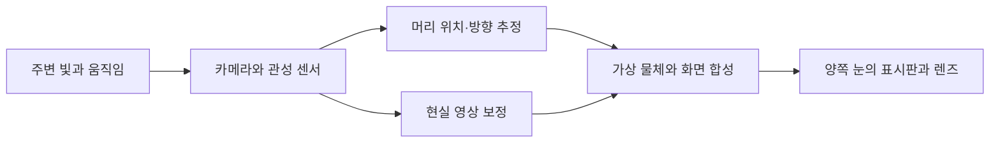

# XR 헤드셋: 선명한 화면과 정확한 공간 추적은 다른 성능입니다 / XR display clarity and spatial tracking

2026년 10월 20일 기준으로 Galaxy XR와 M5 탑재 Apple Vision Pro의 공개 사양, 외부 매체의 실사용기, 공간 추적 논문의 계측을 함께 살펴봅니다. 이 글은 헤드셋을 직접 착용하거나 지연을 측정한 기록이 아닙니다. 특히 2024년 M2 기기의 논문 결과를 2025년 M5나 Galaxy XR의 성적으로 바꾸지 않습니다.

## 현재 제품에서 확인할 수 있는 차이

삼성 영국 사양은 Galaxy XR를 눈당 3,552×3,840 Micro OLED, 72Hz 기본·최대 90Hz의 조건부 지원, XR2+ Gen 2, 메모리 16GB·저장 256GB로 안내합니다. 본체 545g과 외장 배터리 302g은 별도입니다. Apple의 M5 발표는 최대 120Hz와 이전 세대보다 10% 많은 렌더링 픽셀을 설명합니다. 이는 물리 패널 화소가 10% 늘었다는 뜻과 다릅니다. [삼성 사양](https://www.samsung.com/uk/xr/galaxy-xr/galaxy-xr-silver-shadow-sm-i610nzsaeub/), [Apple M5 발표](https://www.apple.com/newsroom/2025/10/apple-vision-pro-upgraded-with-the-m5-chip-and-dual-knit-band/)

두 제품은 공식 판매 자료와 실제 사용 리뷰가 있습니다. 국가별 판매·보증·앱 제공 조건은 따로 확인해야 하며, 한 국가 페이지의 제공 기능을 모든 지역에 적용하지 않습니다. 화면 주사율의 “최대”도 모든 앱이 항상 그 속도로 표시된다는 약속은 아닙니다.

Micro OLED는 작은 반도체 기반 표시판에 고밀도로 화소를 배치하는 방식입니다. 이를 렌즈로 확대해 눈 가까이에 보여 줍니다. 화소 수가 많아도 렌즈의 선명한 영역, 눈과 렌즈 사이 거리, 반사·색 번짐, 소프트웨어의 실제 렌더링 해상도에 따라 글자가 다르게 보입니다.

## 현실을 보여 주는 동안에도 계산이 들어갑니다

패스스루는 카메라 영상을 화면에 보여 주어 주변을 보게 하는 방식입니다. 투명한 유리 너머를 직접 보는 것과 다릅니다. 카메라의 노출·읽기, 영상 처리, 위치 추정, 화면 합성, 표시 과정이 이어지므로 지연과 영상 왜곡을 함께 고려해야 합니다.



직접 만든 흐름도는 모든 제품의 내부 회로 배선을 그대로 나타낸 것은 아닙니다. 관성 센서는 빠른 회전을 짧은 시간 간격으로 감지하고, 카메라는 주변의 특징을 이용해 누적된 위치 오차를 줄이는 데 기여합니다. 벽지가 없는 흰 벽과 조명이 어두운 방은 시각적인 단서를 줄일 수 있습니다.

Apple의 R1 관련 12ms는 제조사가 설명한 센서·영상 처리 경로의 수치입니다. 게임 입력부터 최종 광자가 눈에 도달하는 모든 구간을 독립 시험한 전체 지연으로 바꾸어 인용하지 않습니다. [발표의 R1 설명](https://www.apple.com/newsroom/2025/10/apple-vision-pro-upgraded-with-the-m5-chip-and-dual-knit-band/)

## 주사율과 지연을 직접 계산해 보기

한 장을 표시하는 주기의 자체 환산은 72Hz 약 13.89ms, 90Hz 약 11.11ms, 120Hz 약 8.33ms입니다. 주기가 짧으면 새 화면을 표시할 기회가 자주 오지만, 그 앞의 추적·앱 계산이 자동으로 사라지는 것은 아닙니다.

```math
T_{frame}=\frac{1000}{f}\ \mathrm{ms}
```

가상 예제로 사람이 초당 100도 회전하고 영상이 20ms 늦는다면 그동안 약 2도 움직입니다. 예측과 보정이 전혀 없다는 단순 가정에서의 값이며 실제 제품의 잔여 오차 측정은 아닙니다. 시간 지연이 공간적인 어긋남으로 이어질 수 있다는 관계를 설명합니다.

고정 화면에서 글자가 잘 보였다는 평가는 움직이며 주변을 볼 때의 안정성을 대신하지 않습니다. 반대로 위치 오차가 작아도 작은 글자를 읽는 렌즈 주변부가 흐릴 수 있습니다. 화면·추적·상호작용·착용감을 따로 확인한 뒤 실제 작업에서 함께 평가해야 합니다.

## 연구실의 독립 측정은 무엇을 보여 주나요?

Duke 연구진의 「XR Reality Check」는 여러 기기를 동기화해 모션 캡처와 비교합니다. 표 4의 Vision Pro는 M2·visionOS 2.2이며 Galaxy XR는 포함하지 않습니다. 표 3은 해당 Vision Pro의 평균 상대 위치 오차 0.52cm와 절대 위치 오차 3.62cm를 보고합니다. 서로 다른 오차를 한 정확도 점수로 합치지 않습니다. [저자 원문 3–6절과 표 3–4](https://arxiv.org/html/2508.08642v1)

상대 오차는 짧은 이동이 얼마나 맞는지를, 절대 오차는 전체 궤적이 기준 좌표와 얼마나 어긋나는지를 보는 방식입니다. 방 안에서 한 발씩 잘 이동해도 방 전체 지도가 조금씩 돌아가면 두 지표가 다를 수 있습니다. 위 숫자는 특정 실험들의 집계이며 모든 방·모든 사용자의 최대 오차가 아닙니다.

이 논문은 시험 장치와 자료·코드를 공개하지만, 사람 머리 위에 여러 기기를 배치하는 구성이 일상 착용과 완전히 같지는 않습니다. 이를 Galaxy XR와 M5 Vision Pro의 우열 근거로 쓰는 대신, 최신 제품도 같은 조건의 추적 시험이 필요하다는 분석 틀로 사용합니다. 논문을 읽은 것과 자체 재현을 수행한 것도 구분합니다.

## 외부 매체의 사용기와 측정 범위

Android Central의 Nick Sutrich는 Galaxy XR를 일상적인 모니터·Android 앱 용도로 사용하고, 시선과 손가락 선택은 편리하지만 창 배치와 Gemini의 실제 조작 범위에는 제약이 있다고 기록합니다. 이는 해당 리뷰어의 사용 관찰이며 계측된 오류율은 아닙니다. [2026년 2월 리뷰](https://www.androidcentral.com/gaming/virtual-reality/samsung-galaxy-xr-review)

해당 페이지는 제휴 구매 링크를 공개합니다. 확인한 본문에서 샘플 제공 조건은 명확하게 찾지 못했으므로 자비 구매 제품이라고 단정하지 않습니다. 영상이 삽입되어 있어도 이 글은 본문을 읽었으며 그 영상을 시청했다고 주장하지 않습니다.

“시험한 앱이 잘 동작했다”와 “모든 Android 앱이 완전히 호환된다”는 범위가 다릅니다. 센서 접근, DRM 영상, 로그인, PC 스트리밍, 전용 컨트롤러처럼 기능별 조건이 있기 때문입니다. 원격 PC 화면은 헤드셋의 처리 외에 네트워크·영상 압축·호스트 지연도 추가합니다.

## 무게·눈 위치·배터리의 실제 의미

545g을 머리에서 5cm 앞에 집중시킨 가상 모델의 토크는 약 0.267N·m입니다. 중력가속도 9.81m/s²를 쓴 자체 계산이며 실제 Galaxy XR의 무게중심을 측정한 값이 아닙니다. 같은 질량도 지지 위치와 끈 장력에 따라 얼굴 압력과 목의 부담이 달라지는 이유를 설명합니다.

```math
\tau=mgr=0.545\times9.81\times0.05\approx0.267\ \mathrm{N\,m}
```

외장 배터리는 머리의 하중을 줄일 수 있지만 선과 주머니의 무게를 없애지는 않습니다. 공식 Galaxy XR의 일반 사용 최대 2시간, 영상 최대 2.5시간과 M5 Vision Pro의 일반 최대 2.5시간·영상 최대 3시간은 서로 다른 제조사 시험 조건의 수치입니다. 같은 앱·밝기·연결을 사용한 공동 배터리 시험으로 취급하지 않습니다. [삼성 배터리 사양](https://www.samsung.com/uk/xr/galaxy-xr/galaxy-xr-silver-shadow-sm-i610nzsaeub/), [Apple 배터리 각주](https://www.apple.com/newsroom/2025/10/apple-vision-pro-upgraded-with-the-m5-chip-and-dual-knit-band/)

안경과 렌즈 삽입물, IPD 조정도 비용과 선명도에 영향을 줍니다. IPD는 양쪽 동공 중심 사이 거리입니다. 눈이 렌즈가 의도한 위치에서 벗어나면 광학 특성이 달라질 수 있으므로 개인의 짧은 착용 경험을 다른 사람에게 그대로 적용하기 어렵습니다.

실제 비교 과제로 30분 문서 읽기, 작은 글자의 주변부 선명도, 같은 가상 창의 위치 유지, 어두운 곳의 손 추적을 정할 수 있습니다. 이 과제들은 제안이며 실행 결과는 없습니다. 의료적 효과나 모든 사람에게 편안하다는 결론 대신 수행 작업·환경·시간에 맞는 근거를 읽습니다.

## 스스로 확인하기

1. 120Hz면 입력부터 눈까지의 지연은 항상 8.33ms인가요?
2. M2 Vision Pro의 추적 실험을 M5와 Galaxy XR의 직접 비교로 써도 되나요?
3. 외장 배터리는 시스템 전체 무게까지 없애 주나요?

<details>
<summary>답과 이유</summary>

1. 아닙니다. 8.33ms는 표시 주기이며 센서·앱·전달 등의 시간이 남습니다.
2. 안 됩니다. 시험한 기기·운영체제·조건이 다릅니다.
3. 아닙니다. 머리에 실리는 하중을 옮기는 선택이며 케이블과 배터리는 남습니다.

</details>
