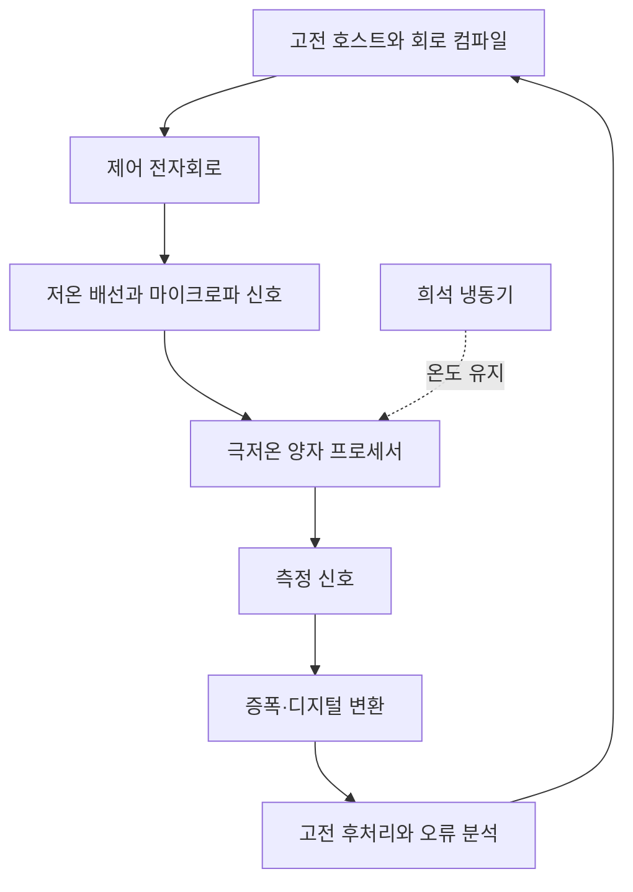

# IBM·Google 양자컴퓨터: 오류 정정과 계산 우위의 근거 / Quantum error correction and computational advantage

[분류 목차](README.md) · [제품·기술 분석](../README.md)

기준일: 2026년 10월 20일. 현재 장치 문서, 원논문과 고전 시뮬레이션 후속 연구를 검토했습니다. 양자 장치를 직접 사용하거나 논문의 대규모 계산을 재현하지 않았습니다.


그림 1. IBM이 2025년 RIKEN 설치 행사에서 공개한 Quantum System Two 사진입니다. 당시 시스템은 156큐비트 Heron 프로세서를 사용한다고 발표했습니다. 여기의 사진은 설치된 시스템을 보여 주며, 뒤에서 설명하는 2026년 회로 실험 장치의 내부 배치 사진으로 제시하는 것은 아닙니다. [IBM·RIKEN 발표와 이미지 출처](https://newsroom.ibm.com/2025-06-23-ibm-and-riken-unveil-first-ibm-quantum-system-two-outside-of-the-u-s)



그림 2. 초전도 큐비트 컴퓨터의 일반적인 제어·측정 흐름입니다. 특정 IBM 시스템의 배선 수, 전자회로 구성이나 냉동기 단면을 재현한 도면은 아닙니다. 양자 프로세서만으로 계산이 끝나는 것이 아니라 고전 제어, 측정과 후처리가 함께 필요합니다.

## 큐비트 수만으로 비교할 수 없는 이유

큐비트는 측정 결과가 0 또는 1로 나타나는 양자 정보의 단위입니다. 측정 전 상태의 진폭과 상대적인 위상이 이후 결과의 확률에 영향을 줍니다. 여러 큐비트의 얽힘과 간섭을 알고리즘에 이용하지만, ‘모든 정답을 동시에 읽습니다’라는 설명은 맞지 않습니다. 측정하면 제한된 결과만 얻습니다.

양자 게이트는 상태를 바꾸는 연산입니다. 연결된 큐비트끼리 가능한 두 큐비트 게이트, 게이트 오류, 측정 오류, 상태를 유지하는 시간, 반복 실행 속도가 계산 범위를 제한합니다. 100개의 오류 많은 큐비트와 100개의 오류 정정된 논리 큐비트는 같은 자원이라고 비교할 수 없습니다.

[IBM의 현재 프로세서 문서](https://quantum.cloud.ibm.com/docs/en/guides/processor-types)는 2026년 9월 Nighthawk r2를 120개 프로그래밍 가능 큐비트와 458개 물리 큐비트로 구분합니다. 여기에 적힌 120을 자동으로 오류 정정된 논리 큐비트 수라고 바꾸지 않습니다. 문서는 Heron의 개정도 구분합니다. 칩 계열 이름, 개정, 실제 사용한 부분 집합을 함께 기록해야 합니다.

Google의 Willow를 이용한 아래 연구들도 같은 장치에서 같은 과제를 한 하나의 시험이 아닙니다. 오류 정정 메모리, 특정 무작위 회로의 계산, 분자 연구의 개념 증명은 서로 다른 증거입니다. 로드맵의 미래 장치를 현재의 상용 범용 컴퓨터처럼 설명하지 않습니다.

## 오류를 정정하는 원리

물리 큐비트 여러 개에 하나의 논리 정보를 나누어 담으면 일부 오류를 알아챌 수 있습니다. 복사할 수 없는 임의의 양자 상태를 단순히 여러 장 복제하는 방식은 아닙니다. 보조 큐비트에서 서로의 일치 관계에 해당하는 신드롬을 측정하고, 고전 디코더가 어떤 오류가 났는지 추정합니다.

오류 정정 장치도 오류를 일으키므로 큐비트를 늘리기만 하면 항상 좋아지지는 않습니다. 물리 오류가 충분히 작은 임계값 아래에 있어야 더 큰 코드에서 논리 오류를 줄일 수 있습니다. 코드 거리는 구별할 수 있는 오류 패턴의 규모와 관련되며, 거리 증가에는 더 많은 물리 자원이 필요합니다.

[Willow 표면 코드 논문](https://www.nature.com/articles/s41586-024-08449-y)은 2024년 12월 온라인 공개, 2025년 Nature 권·쪽으로 출판됐고 출판사 페이지에 2026년 정정 링크가 표시됩니다. [2024년 저자 원고의 초록과 본문](https://arxiv.org/pdf/2408.13687)에서 거리 7 메모리의 101개 큐비트와 주기당 논리 오류 약 0.143%를 대조했습니다. 이는 메모리 실험이며 많은 논리 큐비트로 긴 범용 알고리즘 전체를 완료했다는 결과는 아닙니다.

신드롬을 처리하는 고전 계산도 병목입니다. 오류 정보가 생기는 속도보다 디코더 처리가 계속 느리면 밀린 자료가 쌓입니다. 모든 오류 정정의 성능을 하나의 디코더 지연 숫자로 판단하지 않고, 처리량·지연·제어 반영 방식과 실험 조건을 함께 봐야 합니다. 상관된 오류나 상태 누설도 단순 독립 오류 모형의 예측을 어긋나게 합니다.

## Google의 Quantum Echoes가 계산한 것

[Google의 원연구 설명](https://research.google/blog/a-verifiable-quantum-advantage/)은 103개 큐비트에서 전진 연산, 작은 교란, 역방향 연산을 결합해 시간 순서가 뒤섞인 상관함수인 OTOC를 측정했다고 설명합니다. 이는 작은 교란이 양자계에 어떻게 퍼지는지를 알아보는 관측량입니다. 모든 경우의 분자 구조나 신약 후보를 한 번에 찾은 실험이 아닙니다.

회사를 대표하는 ‘13,000배’라는 설명도 해당 회로와 정확도, 당시 비교한 고전 알고리즘의 계산 비용에 붙는 주장입니다. 양자 우위는 정해진 과제를 특정 기준보다 적은 자원으로 수행했다는 뜻으로 읽어야 합니다. 사무용 프로그램이나 모든 최적화 문제에 같은 배수를 적용할 수 없습니다.

[2026년 TNBP 시뮬레이션 연구](https://arxiv.org/abs/2604.15427)는 특정 텐서망·믿음 전파 방법으로 이 실험을 효율적으로 모사하기 어렵다는 분석입니다. 저자에 Google Quantum AI 관계자가 있으므로 회사와 무관한 독립 재현이라고 부르지 않습니다. 한 고전 알고리즘의 어려움을 보인 것과 가능한 모든 미래 고전 알고리즘의 불가능성을 증명한 것도 다릅니다.

## IBM의 2026년 발표와 개정 논문

[7월 30일 보도자료](https://newsroom.ibm.com/2026-07-30-ibm-and-the-university-of-chicago-demonstrate-quantum-advantage,-establishing-trusted-quantum-computation-on-logical-circuits)는 70개 논리 큐비트와 468개 T 게이트를 사용한 결과를 소개합니다. 그러나 기준일에 확인한 [논문 v3](https://arxiv.org/html/2607.25941v3)의 본 실험은 고리 형태의 연결에서 데이터 큐비트 64개, T 게이트 314개, 전체 물리 큐비트 76개입니다. 두 판본의 수치를 한 실험처럼 섞으면 안 됩니다.

이 방법은 검사 신호가 조건에 맞는 실행만 남기는 사후선택을 사용합니다. v3 표 S1에서 실험 1의 무도핑 기준상태 DFE 행은 수용 비율 0.0383%, 즉 확률 약 0.000383입니다. 같은 실험의 314개 T 게이트 행은 0.040%로 별도 표시됩니다. 아래 역수 계산은 앞의 기준상태 비율을 쓰는 예이며, 전체 실험에 공통된 고정 성공률은 아닙니다. 이 방식의 오류 검출을 모든 실행의 오류를 실시간으로 고쳐 계속 계산하는 범용 내결함성 컴퓨터와 동일하게 보지 않습니다. 버린 실행을 포함한 장치 시간과 검증 비용이 필요합니다.

## 제조사 밖의 고전 계산이 바꾼 해석

[Manabe·Gu·Pan의 2026년 원시뮬레이션](https://arxiv.org/html/2608.13110v1)은 초기 IBM 회로가 일렬로 열린 연결이라는 점을 활용했습니다. 공개된 2,051개 출력에 대응하는 진폭 묶음을 H100 GPU 256개에서 37.3분에 계산했습니다. 이는 임의의 새 표본 생성 전체와 완전히 같은 과제는 아니며, 논문의 10.6분 자원 환산도 직접 측정한 37.3분과 구분됩니다.

계산한 확률의 지표는 일정한 가정 아래 IBM의 충실도 하한과 양립했습니다. 양자 장치의 결과가 모두 가짜라는 뜻이 아니라, 최초의 고전 계산 비용 추정과 ‘재현 불가능’ 주장을 다시 평가할 이유입니다. 저자에는 SUTD와 NVIDIA 소속이 포함됩니다. 제조사와 별개 연구라는 점과 경쟁 계산 기술 업체의 참여를 함께 밝혀야 합니다.

IBM v3의 Note added와 보충절 S2.6도 이 후속 연구를 인정하고, 취약했던 열린 연결 대신 주기적 경계를 사용합니다. 변경된 회로가 같은 고전 방법에 더 어렵다는 것과 실제 유용한 산업 과제의 우위가 증명됐다는 것은 다릅니다. 비교 기준도 연구와 함께 바뀌는 사례입니다.

## 자원 비용을 직접 계산합니다

수용 확률 0.000383이 일정하고 실행이 독립이라고 단순화한 자체 계산에서는 유효 실행 한 번을 얻는 평균 시도 수가 다음과 같습니다.

```math
E[N]=\frac{1}{0.000383}\approx2611
```

약 2,611회입니다. 실제 실험의 모든 측정 설정과 시간 비용을 재구성한 값은 아니지만, 남은 결과의 품질만 보고 전체 자원을 무시하면 안 된다는 점을 보여 줍니다.

또 다른 자체 예로 고전 비트가 독립적으로 1% 확률로 뒤집힐 때 세 번 복사해 다수결을 쓰면 실패율은 `3p²(1−p)+p³`인 0.0298%입니다. 실제 양자 표면 코드가 이 고전 반복 코드와 같은 장치는 아닙니다. 양자 오류에는 위상 오류와 측정·게이트 오류까지 있어 더 복잡한 부호화가 필요합니다.

## 실제 사용을 판단하는 질문

주장한 과제가 무엇인지, 정답을 어느 정확도로 확인했는지, 고전 기준이 최신인지부터 봅니다. 상태 수가 지수적으로 크다는 설명만으로 실제 과제가 어렵다고 증명되지는 않습니다. 회로 구조와 허용 오차에 따라 고전적인 압축 계산이 가능할 수 있습니다. 장치 이용에는 준비·냉각·교정·반복 측정·고전 후처리도 포함됩니다. 큐비트 수와 보도자료의 배수 하나로 제품 전체의 가치를 정하지 않습니다.

## 스스로 확인해 보세요

1. 120개 프로그래밍 가능 큐비트를 120개 내결함성 논리 큐비트로 바꿔 써도 됩니까?
2. 공개 출력의 진폭을 계산한 결과가 모든 새로운 양자 표본을 같은 시간에 생성했다는 뜻입니까?
3. 사후선택 확률이 두 배가 되면 단순 모형의 평균 시도 수는 어떻게 됩니까?

<details>
<summary>정답과 해설</summary>

1. 안 됩니다. 프로그램 대상, 물리 장치 수, 오류 정정된 논리 정보 수는 다른 값입니다.
2. 아닙니다. 확률 평가·표본 생성·충실도 검증은 연결되지만 구별해야 하는 과제입니다.
3. 절반이 됩니다. 평균 시도 수는 수용 확률의 역수입니다.

</details>
