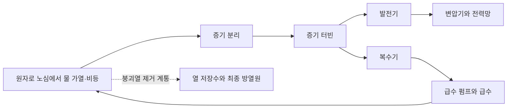

# 소형 원자로의 냉각·건설·발전 조건 / Cooling, construction and power delivery of small modular reactors

소형 모듈 원자로(SMR)는 작은 원자로를 반복 제작하고 현장에서 조립하는 방식을 추구합니다. 작은 크기는 계통에 한 번에 추가되는 출력을 줄이고 일부 제작을 공장으로 옮길 수 있게 하지만, 전기 단가와 건설 기간이 자동으로 낮아지는 것은 아닙니다. 원자로 한 기와 여러 기를 연결한 발전소, 첫 호기와 반복 건설 호기를 구분해야 합니다.

기준일은 2026년 10월 20일입니다. GE Vernova Hitachi의 BWRX-300과 캐나다 Darlington 사업을 중심으로, 중국 HTR-PM의 상업운전 사례 및 ITER 핵융합 실험의 목적을 비교합니다. 제조사 설명을 규제기관의 허가 상태·공공 기술 검토·사업자 현장 보고와 대조한 문헌 분석입니다.

그림 1. BWRX-300 원자로 건물의 제조사 렌더링입니다. 실제 완공 시설의 사진은 아니며, 건물 외형과 설계 구상을 보여 줍니다. 내부 구조와 안전계통은 [GE Vernova Hitachi의 설계 설명서 2장 그림 2-1·2-2](https://www.gevernova.com/content/dam/gevernova-nuclear/global/en_us/documents/carbon-free-power/005N9751-BWRX-300-General-Description.pdf)에서 확인할 수 있습니다.

그림 2. 비등수형 원자로의 직접 증기 사이클을 단순화한 설명도입니다. BWRX-300 설계 전체의 배관도나 안전 분석 도면은 아니며, 정상 발전 경로와 정지 뒤 잔열 제거 경로를 구분해 보여 줍니다.

## 핵분열에서 콘센트까지의 흐름

핵분열은 무거운 원자핵이 나뉘며 에너지와 중성자를 내놓는 반응입니다. 연료에서 나온 열을 냉각재가 받아 증기를 만들고, 증기가 터빈을 돌리며, 발전기가 전기를 만듭니다. 터빈을 지난 증기는 응축기에서 열을 내놓고 물로 돌아갑니다. 원자로의 열출력 MWth와 송전 가능한 전기출력 MWe가 다른 이유입니다. 펌프와 보조 설비가 쓰는 전기를 뺀 순출력인지도 확인합니다.

BWR은 비등수형 원자로입니다. 원자로 안의 물이 끓어 생긴 증기를 터빈에 보내는 경로를 사용합니다. PWR은 가압수형이며, 높은 압력으로 1차 물이 끓지 않게 하고 증기발생기를 통해 별도 물에 열을 넘깁니다. 두 방식은 증기가 생기는 위치와 설비 구성이 다르므로 SMR이라는 분류만으로 같은 원리라고 볼 수 없습니다.

BWRX-300의 자연순환은 뜨거워져 밀도가 낮아진 물·증기 혼합물이 위로 움직이고 상대적으로 차가운 물이 내려오는 차이를 이용합니다. [제조사 제품 설명](https://www.gevernova.com/nuclear/carbon-free-power/bwrx-300-small-modular-reactor)은 이 설계를 300MWe급 비등수형으로 소개합니다. 자연순환이라는 말이 발전소의 모든 펌프를 없앴거나 모든 상황에서 냉각이 영구히 유지된다는 뜻은 아닙니다. 순환 높이·압력 손실·열을 최종적으로 버릴 곳이라는 조건이 남습니다.

제어봉 등으로 연쇄 반응을 멈춰도 핵분열 생성물의 방사성 붕괴가 열을 냅니다. 이를 잔열 또는 붕괴열이라고 합니다. 정상 운전의 열 수송과 정지 뒤 잔열 제거는 구분해야 합니다. 수동 안전 계통은 중력·압력차·자연순환 등을 활용하지만, 작동 조건과 물·열 저장원의 지속 시간, 다른 방호 수단을 함께 검토합니다.

## 실제 건설과 목표 시점을 구별합니다

| 대상 | 기준일까지 확인한 단계 | 그 자료로 확정할 수 없는 것 |
|---|---|---|
| Darlington BWRX-300 1호기 | CNSC 건설허가, 원자로 건물 기초 설치 단계 진행 | 상업 발전 실적·확정 전기 단가 |
| Darlington 추가 3기 | 향후 허가를 전제로 한 사업 계획 | 네 기 모두의 건설·운영 승인 |
| 중국 Shidaowan HTR-PM | IAEA가 2023년 12월 상업운전 개시를 기록 | BWRX-300의 현장 성능·안전성 입증 |
| ITER | [건설 중인 핵융합 연구 장치](https://www.iter.org/few-lines), Q≥10이라는 설계 목표 | 상업 전력 판매나 순발전 실적 |

[캐나다 CNSC 현황](https://www.cnsc-ccsn.gc.ca/eng/reactors/new-reactor-power-plant-projects/new-reactor-power-plant-facilities/darlington-new-nuclear-project/)은 한 기가 건설 중이라고 밝힙니다. 2025년 4월 건설허가 뒤 규제 정지점 중 기초 설치 조건이 2026년 3월 30일 해제되었습니다. 운영허가 신청은 접수되었으나 신청과 발급은 다릅니다. [OPG의 4월 현장 보고](https://www.opg.com/news-resources/newsroom/our-stories/story/laying-the-foundation-for-the-g7s-first-small-modular-reactor/)는 4월 22일 기초 모듈을 내려놓은 작업을 보여 줍니다. [사업자 일정](https://www.opg.com/projects-services/projects/nuclear/smr/darlington-smr/)의 2030년 말 계통 연결은 계획 목표입니다.

HTR-PM은 물 대신 헬륨으로 열을 운반하고, 흑연으로 중성자의 속도를 낮추며, 코팅한 작은 연료 입자를 구형 연료 요소에 담는 고온가스로 계열입니다. 구조는 [IAEA 기술 로드맵의 A–2.1절·표 A–2](https://www-pub.iaea.org/MTCD/Publications/PDF/PUB1944_web.pdf)(인쇄 93–95쪽)에서 확인했습니다. 그 문서의 과거 가동 예상 시점 대신 [2024년 기술회의 안내서](https://www.iaea.org/sites/default/files/24/03/evt2304522_information_sheet_tm_intouch.pdf) 1쪽에 기록된 2023년 12월 상업운전 개시를 사용했습니다. 일부 SMR 계열의 운영 사례가 냉각재·연료·기기가 다른 BWRX-300의 결과를 대체하지는 않습니다. 해당 발전소의 원시 운전 자료나 냉각 시험 논문을 재분석하지 않았습니다.

## 출력 300MW를 연간 전력과 냉각 조건으로 바꿉니다

다음은 BWRX-300의 운전 예측이 아닌 자체 계산입니다. 순전력 300MW가 1년 8760시간의 90%에 해당하는 전력량을 낸다고 가정하면 `300×8760×0.9=236만5200MWh`, 약 2.3652TWh입니다. 이 비율이 이용률입니다. 같은 출력에서 이용률 60%라면 1.5768TWh입니다. 정격 300MW라는 숫자만으로 연간 판매 전력이나 공급 계약 이행을 확정할 수는 없습니다.

가상의 발전소가 열 900MW를 받아 전기 300MW를 만들고 나머지 열 600MW를 냉각수로 전달한다고 놓겠습니다. 물의 비열을 4.2kJ/(kg·℃), 물의 온도 상승을 10℃로 근사하면 필요한 유량은 `600,000kJ/s÷(4.2×10)=약 14,286kg/s`입니다. 이는 열 전달 모형의 순환 유량이며 물 소비량과 같지 않습니다. 개방 취수인지 냉각탑 순환인지에 따라 취수·증발·방류 조건이 달라집니다. 물을 덜 쓰는 건식 냉각도 외기 온도와 송풍 동력 등의 대가가 있습니다.

이 계산에서 해안·강변 입지, 여름 냉각 조건, 취수구와 송전선이 원자로 내부 기술만큼 중요하다는 점이 드러납니다. 대형 터빈 하나를 작게 만든다는 생각만으로 실제 부지의 허가와 공사가 사라지지는 않습니다.

## 공장에서 만들면 어디까지 반복할 수 있나요?

모듈 제작은 같은 도면·절차로 품질을 관리하고 현장 작업 일부를 미리 끝내려는 방식입니다. 그러나 모듈을 옮기는 도로·항만·크레인, 용접과 검사, 기초·배관·계통 연결은 여전히 필요합니다. 첫 호기에서 설계와 제작 절차가 바뀌면 공장 작업도 다시 확인해야 합니다. 동일한 제품 주문이 충분히 이어져야 반복 생산의 학습과 공급망 투자가 회수됩니다.

[IAEA SMR 규제기관 포럼의 공개 검토](https://gnssn.iaea.org/regnet/SMR-Forum/Pages/Our-Publications.aspx)는 첫 설계와 반복 설계의 허가, 다중 모듈의 공용 계통, 수동 안전 성능의 불확실성과 통합 시험을 별도로 다룹니다. 출력이 작다는 이유만으로 심사 범위가 비례해 사라지는 것은 아닙니다. 연료 공급·핵물질 관리·사용후핵연료·해체 책임도 계약과 제도에 포함됩니다.

규모의 경제와 반복 생산은 서로 다른 효과입니다. 대형 원전은 큰 터빈과 공용 설비를 여러 출력 단위가 나누어 쓰는 이점이 있고, SMR은 단계적 증설과 반복 제작을 추구합니다. 네 기 중 한 기가 정지하면 단순 출력 합계는 1200MW에서 900MW로 줄지만, 공통 취수구나 외부 재해·송전 고장은 여러 기에 동시에 영향을 줄 수 있습니다. 여러 모듈을 통계적으로 완전히 독립인 설비처럼 계산하지 않습니다.

자체 비용 예로 연간 고정 부담을 1억 달러라고 가정하면 위 90% 이용률에서는 약 42.28달러/MWh, 60%에서는 약 63.42달러/MWh입니다. 연료·정비·폐기물·변동비는 뺀 가상 값입니다. 실제 자금 조달에서는 공사 중 이자와 지연, 위험을 부담하는 전력 구매자·정부·투자자의 계약이 중요합니다. “작아서 싸다” 대신 비용 범위와 생산량 분모를 확인해야 합니다.

## 경쟁 전원과 핵융합의 목표는 무엇이 다른가요?

기존 대형 원전의 계속운전·설비 교체, 신규 대형 원전, 재생에너지와 저장·송전, 가스 발전 등은 지역의 전력 공급 방식에서 경쟁하거나 서로 보완합니다. 비교 단위는 장치의 정격만이 아니라 필요한 시간대에 전달되는 전력, 계통 보강, 연료·배출·지역 제약까지 포함해야 합니다. 이미 원전 운용 인력과 부지가 있는 곳과 신규 도입 국가는 같은 SMR을 선택해도 준비 비용이 다릅니다. 다른 공급사로 바꾸면 연료·정비·시뮬레이터·허가 문서까지 영향을 받을 수 있습니다.

핵융합은 가벼운 원자핵을 결합하는 다른 반응입니다. ITER는 플라스마를 자기장으로 가두어 그 물리를 연구합니다. 플라스마는 원자가 전자와 이온으로 나뉜 상태입니다. [ITER의 Q 설명](https://www.iter.org/faqs?thematic=68)에서 목표 500MW/50MW=10은 핵융합 열출력과 플라스마 외부 가열의 비입니다. 전력망에서 받은 전체 전기와 판매 전기의 비가 아닙니다. 자석·냉각·전원 장치와 발전 변환이 이 분모에 모두 들어 있지는 않습니다. ITER에는 전기를 생산하는 발전기를 붙이지 않으므로 Q 목표를 달성하더라도 그 자체가 상업 순발전을 뜻하지 않습니다.

## 확인 문제

1. 자연순환 설계이면 원자로가 정지한 뒤 열을 제거할 필요도 없어지나요?
2. 300MW 모듈 네 기를 계획했다면 현재 1200MW 발전소가 운영 중이라고 적어도 되나요?
3. 핵융합의 Q=10이면 전기 판매량이 발전소 소비 전력의 열 배인가요?

해설 보기

1. 아닙니다. 연쇄 반응이 멈춰도 붕괴열이 남습니다. 자연순환은 열을 옮기는 방식이며 최종 방열 경로와 지속 조건을 확인해야 합니다.
2. 아닙니다. 계획·호기별 건설허가·시운전·운영허가·상업운전은 구별합니다. Darlington의 현재 상태는 한 기 건설 중이며 나머지는 추가 허가가 필요합니다.
3. 아닙니다. 여기서 Q의 분모는 플라스마에 주입하는 외부 가열입니다. 순전력의 평가에는 전체 설비 전력과 열을 전기로 바꾸는 장치가 더 필요합니다.

제조사와 OPG의 본문·현장 작업 설명, CNSC의 현황·허가 절차, IAEA 안내서의 도입 현황과 포럼의 공개 요약, ITER FAQ의 출력 정의를 읽었습니다. 영상 전체 시청·운전 데이터 재계산·안전성 심사 재현은 포함하지 않습니다. 실제 운영 단계와 사업자 목표, 단순 열·전력·비용 계산을 각각 구분했습니다.
