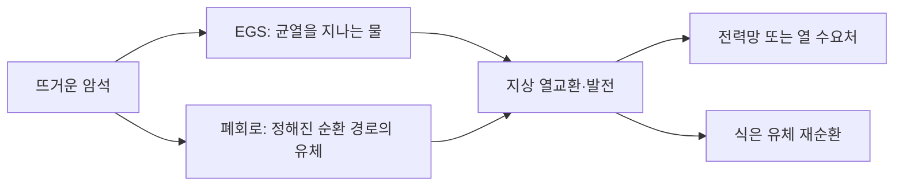

# 차세대 지열은 물길을 만들까요, 관 안에서 순환시킬까요? / Enhanced and closed-loop geothermal

2026년 10월 20일 기준으로 Fervo의 Cape Station, Eavor의 Geretsried와 Utah FORGE 공개 연구를 비교합니다. 발전용 심부 지열을 다루며 주택용 지열 히트펌프와 구분합니다. 현장을 방문하거나 장비를 측정한 글이 아니라 운영 발표·공개 연구·계산을 대조한 리뷰입니다.

## 뜨거운 암석만 있으면 발전할 수 있나요?

열을 꺼내려면 암석의 온도 외에 열을 옮길 유체와 경로가 필요합니다. 자연 지열에서는 지하의 뜨거운 물과 투수성 구조를 이용합니다. EGS는 유체가 흐를 통로를 조성하거나 활용해 더 넓은 암석에서 열을 회수하려는 방식입니다. 폐회로 지열은 유체를 설계된 관정 경로 안에서 순환시키며 주변 암석의 열을 받습니다.

투수성은 암석과 균열이 유체를 통과시키는 성질입니다. 열전도는 물질이 크게 이동하지 않아도 뜨거운 쪽에서 찬 쪽으로 열이 전달되는 현상입니다. 유체의 이동이 열을 운반하면 이류라고 합니다. EGS와 폐회로의 차이를 단순히 “구멍을 깊게 판다”로 설명하면 이 열 전달 경로가 사라집니다.



이는 원리를 단순화한 자체 그림입니다. 폐회로라는 이름만으로 모든 현장에서 유체 손실이 정확히 0이라고 추정하지 않습니다. 실제 구현의 밀봉과 암석 접촉, 누출·보충 자료를 확인해야 합니다. EGS 역시 모든 유량을 같은 균열로 보내는 단순 관과 다르므로 유로별 분포와 단락을 살펴야 합니다.

## 현재 단계: Cape Station의 첫 블록

Fervo는 2026년 10월 1일 발표에서 첫 GeoBlock이 9월 30일 계약상 상업운전에 들어갔으며 순출력 33 MW를 냈다고 밝혔습니다. 나머지 두 블록의 운전과 추가 400 MW는 후속 일정입니다. 첫 블록의 결과를 전체 증설분의 가동 실적으로 합치지 않습니다. 이 수치는 공급사 운영 발표이며 독립 재계량값은 아닙니다. [Fervo 공식 운영 발표](https://ir.fervoenergy.com/news-releases/news-release-details/fervo-energy-declares-commercial-operation-cape-station-ahead)

이전의 30일 우물 시험과 발전소의 상업운전도 서로 다른 성과입니다. 우물 시험은 유량·온도·압력의 가능성을 보여 주지만, 지상 설비·송전·계약 조건을 포함한 발전사업의 운전을 그대로 대체하지 못합니다. 반대로 상업운전이 시작되어도 저장층의 수십 년 열수명까지 관측한 것은 아닙니다.

PPA는 발전자와 구매자가 전력을 사고파는 조건을 정한 장기 계약입니다. 현물시장 가격이 낮은 시간에도 일정한 전력 가치와 수입 예측 가능성을 제공할 수 있습니다. 다만 출력·이용 가능성·인도 시점 등 계약 조건을 충족해야 하므로 계약 체결량과 실제 전력량은 구분해야 합니다.

## 폐회로의 다른 병목

Eavor는 Geretsried에서 2025년 12월 첫 전력을 공급했다고 보고합니다. 2026년 5월 기술 설명에서는 초기 Loop #1의 평균 열출력 11.8 MWth와 그 부하에서 약 4.3%의 발전 변환을 제시합니다. 열과 전기의 단위를 바꾸어 같은 숫자로 쓰면 안 됩니다. 지상 발전기가 여러 루프를 위한 설계점보다 낮은 부하에서 돌아간다는 설명도 함께 읽어야 합니다. [Eavor 현장 기술 설명](https://eavor.com/blog/technical-update-from-geretsried-what-we-built-what-we-learned-and-what-comes-next/) · [2025 운영 회고](https://eavor.com/year-in-review-2025/)

이 발표는 기술 개발자의 해석입니다. 계획보다 적게 연결한 루프, 드릴링 경로 문제, 유체 손실과 향후 더 낮은 발전단가 전망을 섞어 이미 달성한 완성 상태로 요약하지 않습니다. 자체 예제로 11.8×0.043을 곱하면 약 0.5074 MWe입니다. 평균값의 곱으로 크기를 보는 계산이며, 시계열을 적분한 독립 순발전 실측은 아닙니다.

ORC는 유기 작동유체를 쓰는 랭킨 사이클입니다. 지열수가 터빈을 직접 돌리지 않고 열교환기를 통해 다른 유체에 열을 넘깁니다. 이용 가능한 열의 온도와 냉각 조건, 부분 부하가 전기 변환에 영향을 줍니다. 낮은 온도의 열은 지역난방에 직접 사용할 때와 전기로 바꿀 때의 가치가 다를 수 있습니다.

## 공개 현장 연구가 검사하는 것

Utah FORGE는 대학이 이끄는 공공 지원 연구 현장입니다. 2024년의 자극·순환 시험은 두 관정 사이의 유동과 열 전달, 미소지진·광섬유 계측을 보고했습니다. 이것은 Fervo나 Eavor 제품을 동일 조건에서 비교한 시험이 아닙니다. 공급사 발표와 별개로 지하 유로를 어떻게 관측하는지 이해할 근거입니다. [Utah FORGE 시험 발표](https://utahforge.com/press-release-stimcirc-tests/) · [2024년 광섬유 계측 보고서와 자료](https://data.openei.org/submissions/7743)

2026년 Munday 등의 Stanford Geothermal Workshop 논문은 2024년 순환 자료에 맞춘 균열망 모형으로 열적 돌파를 예측합니다. 열적 돌파는 주입한 찬 물이 충분히 가열되지 않은 채 생산정에 영향을 주기 시작하는 현상입니다. 논문의 공개 서지·초록에서 확인한 범위이며, 모형의 180일 예측을 180일 현장 실측이라고 옮기지 않습니다. [학회 원문 안내](https://pangea.stanford.edu/ERE/db/IGAstandard/record_detail.php?id=38352)

## 자체 계산: 총열량과 순전력

가상의 생산 유량 80 kg/s, 유효 온도 차 100 K, 물 비열 4.2 kJ/(kg·K)를 놓으면 열 회수율은 약 33.6 MWth입니다. 비열을 일정하게 둔 근사이며 실제 고온 유체의 물성은 상태에 따라 달라집니다.

```math
\dot Q=\dot m c_p(T_{hot}-T_{return})
\qquad
80\times4.2\times100=33{,}600\ \mathrm{kW_{th}}
```

가상 발전 변환율을 12%로 놓으면 총전력은 4.032 MWe입니다. 순환펌프·냉각·기타 부하가 0.8 MWe면 계통 순출력은 3.232 MWe입니다. 논문·제품의 실측 성능이 아니라 열출력·총출력·순출력의 관계를 보여 주는 계산입니다. 다른 설비의 33 MWth와 33 MWe를 같은 규모라고 비교하면 이 변환을 생략하게 됩니다.

유량을 높이면 열을 더 꺼낼 수 있지만 펌프 일과 압력 손실도 증가합니다. 단순 가정으로 압력차 5 MPa, 부피 유량 0.08 m³/s, 펌프 효율 80%라면 펌프 전력은 Δp×Q/η=0.5 MW입니다. 유량을 두 배로 늘릴 때 압력차까지 커진다면 펌프 전력이 두 배보다 더 커질 수 있습니다. 유량만 최대화하는 설계가 순전력 최대화와 같지는 않습니다.

## 장기간의 열은 어디에서 오나요?

지열은 재생에너지로 분류되더라도 특정 유로 주변에서 꺼내는 속도가 열이 보충되는 속도보다 빠르면 온도가 내려갈 수 있습니다. 지구 전체의 열량과 한 관정의 경제 수명은 다른 질문입니다. 균열이 넓게 분포하면 열교환 면적이 늘 수 있지만, 유체가 짧은 통로로 집중되면 뜨거운 암석의 상당 부분을 건드리지 못합니다.

지상에서 같은 유량과 온도가 측정되어도 내부 유로는 여러 가지일 수 있습니다. 추적자 회수, 압력 응답, 광섬유 온도와 미소지진을 결합하는 이유입니다. 모형이 과거 자료를 잘 맞췄다는 사실과 미래의 온도 감소를 정확히 예측한다는 사실도 구분해야 합니다. 긴 기간의 새로운 자료로 예측을 검사해야 합니다.

## 산업 경쟁은 천공과 계약에서 이어집니다

EGS는 방향성 시추·다단 자극·계측 등 다른 지하 산업의 장비와 인력을 활용합니다. 이것은 학습과 공급망을 이용할 기회이지만, 석유·가스 현장과 지열의 암석·온도·수명 요구가 같다는 뜻은 아닙니다. 단단하고 뜨거운 암석에서 공구 수명과 관정 건전성은 여전히 비용 변수입니다.

Eavor는 2026년 기술 설명에서 특허·전문 서비스·공급업체 계약과 기술 라이선스 사업모형을 공개합니다. 제품을 구매하는 쪽은 장치 가격 외에 설계 데이터와 특정 서비스에 대한 의존, 후속 확장·정비 권한을 보게 됩니다. 표준 장비와 여러 시공업체를 활용하면 일부 종속을 줄일 수 있지만, 지하 설계의 노하우를 즉시 호환할 수 있다는 뜻은 아닙니다.

지역 조건도 선택을 바꿉니다. 가까운 열 수요처는 전기 변환 없이 열을 팔 기회를 주고, 먼 곳에서는 열관로가 부담입니다. 물 이용권·지진 감시·환경 검토·계통 연결과 금융 조달의 순서가 공정표를 바꿀 수 있습니다. “항상 발전한다”는 물리적 가능성과 정비·계약·계통 제약을 포함한 공급 신뢰도는 나누어 평가해야 합니다.

## 전력보다 열 수요가 유리한 경우

지열의 사용처가 전기가 아니라 지역난방이라면 발전 변환 단계를 거치지 않을 수 있습니다. 대신 수요처까지의 열관로와 계절 수요를 봐야 합니다. 가상의 열원 20 MWth를 한 해 8,000시간 이용할 수 있어도 고객이 그중 3,000시간만 같은 열을 필요로 한다면 판매한 열은 60,000 MWh입니다. 나머지 시간의 열을 판매 실적으로 셀 수 없습니다.

전기는 비교적 먼 수요처로 보낼 수 있지만 계통 연결과 변환 효율이 부담입니다. 열은 가까운 수요처와 긴 사용시간이 중요합니다. 같은 관정도 도시 난방·온실·산업 열 수요가 가까운 곳과 외딴 지역에서 다른 사업이 됩니다. 열과 전기를 함께 공급하면 배분 방식도 정해야 하므로 총 에너지 하나만으로 경쟁 기술을 평가하기 어렵습니다. 이 수치는 해당 두 운영사의 사업을 재계산한 것이 아니라 사용처의 차이를 보여 주는 가상 사례입니다.

## 확인 문제

1. 33.6 MWth의 열을 얻었다고 33.6 MWe를 파는 것은 아닌 이유가 무엇인가요?
2. 짧은 순환 시험만으로 수십 년의 열수명을 확정할 수 없는 이유는 무엇인가요?
3. 폐회로 지열도 실제 유체 손실 자료를 확인해야 하는 이유는 무엇인가요?

<details><summary>해설 보기</summary>

1. 열을 전기로 바꾸는 손실과 펌프·냉각의 자체 소비가 있기 때문입니다.
2. 열적 돌파와 주변 암석의 열 보충은 긴 시간에 걸쳐 나타나며 유로도 변할 수 있기 때문입니다.
3. 실제 구현의 밀봉·관정·암석 접촉 조건이 다르며 이름만으로 누출 0을 보장하지 않기 때문입니다.

</details>

자료 범위는 운영사 발표와 기술 설명의 본문, FORGE의 시험·계측 안내, 2026 학회 초록입니다. 학회 전문과 비공개 저장층 자료는 읽지 않았고, 공급사 수치를 독립 인증한 것으로 표시하지 않았습니다.

[기술 분석 목록](README.md)
