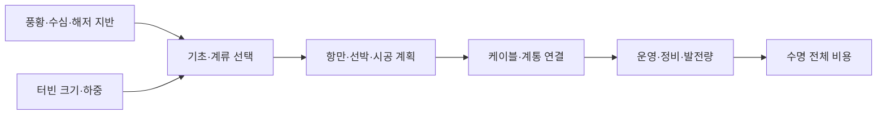

# 해상풍력은 큰 터빈만으로 경쟁력이 생기나요? / Offshore wind turbines and project economics

2026년 10월 20일까지 확인한 공개 자료로 Vestas V236-15.0 MW, 고정식·부유식 기초와 공급망을 살펴봅니다. 제조사 사양, 설치 사업자의 발표와 공공 연구를 구분한 문헌 분석입니다. 터빈을 직접 운전하거나 발전량을 측정하지 않았습니다.

## 바람에서 꺼낼 수 있는 전력

풍력 터빈은 바람이 가진 운동에너지의 일부를 회전과 전기로 바꿉니다. 로터는 날개와 허브가 함께 회전하는 부분입니다. 날개가 훑는 원의 면적을 수풍 면적이라고 부릅니다. 지름이 두 배라면 면적은 네 배가 되지만, 터빈 질량·하중·운송비가 같은 비율로 움직이는 것은 아닙니다.

단순한 균일 바람의 전력식은 다음과 같습니다. ρ는 공기 밀도, A는 면적, v는 풍속이며 Cₚ는 흐르는 에너지 중 로터가 꺼내는 몫입니다. η는 뒤쪽 기계·전기 변환의 비율로 따로 두었습니다.

```math
P\simeq\tfrac12\rho A v^3 C_p\eta
```

풍속의 세제곱이라는 관계는 정격 제어 전의 단순 구간을 이해하는 데 유용합니다. 강풍에서 이 식을 끝없이 적용해 출력이 무한히 커진다고 생각하면 안 됩니다. 정격에 도달하면 날개 각도를 바꾸어 하중과 출력을 제한하고, 매우 강한 바람에서는 정지할 수 있습니다. 이때 출력 감소는 반드시 고장이 아니라 보호·제어의 결과입니다.

## V236의 숫자와 연구용 기준 터빈

공식 V236 사양은 정격 15 MW, 로터 지름 236 m, 수풍 면적 43,742 m², 중속 기어박스와 전출력 변환기입니다. 제조사의 연간 80 GWh 가능 수치는 위치 조건에 달린 값입니다. 모든 설치 지점에서 달성한 연간 실측값이 아닙니다. [Vestas 공식 사양](https://www.vestas.com/en/energy-solutions/offshore-wind-turbines/V236-15MW)

Gaertner 등의 2020년 IEA 15 MW 기준 터빈은 지름 240 m의 직접 구동 연구용 설계입니다. 같은 15 MW라는 이유로 이 모델의 질량·제어·하중을 V236의 사양으로 쓰면 안 됩니다. 이 기준 설계는 공개 비교를 위한 공공 연구이며, 특정 상용 기계의 분해 실측 자료가 아닙니다. [NREL/TP-5000-75698, 요약·§3·§6](https://www.nlr.gov/docs/fy20osti/75698.pdf)

기어박스는 로터와 발전기의 회전수를 연결하는 장치입니다. 직접 구동은 큰 저속 발전기를 쓰며, 기어 방식은 회전수·토크를 바꾸는 장치를 둡니다. 부품 하나를 없애는 장점과 발전기 크기·자석·구조·정비의 부담을 함께 비교해야 합니다. 어느 방식이 항상 더 오래간다고 기관명이나 구조 이름만으로 결론 낼 수 없습니다.

## 자체 계산: 풍속과 연간 발전량

앞의 면적 43,742 m²에 가상의 ρ=1.225 kg/m³, v=10 m/s, Cₚ=0.45, η=0.94를 넣으면 약 11.33 MW입니다. 풍속만 11 m/s로 바꾸고 다른 수를 고정하면 약 15.08 MW입니다. 실제 터빈은 정격 제어와 위치별 공력·밀도의 영향을 받으므로 이를 제조사의 출력 곡선이라고 부르지 않습니다.

설비 이용률은 실제 전력량을 정격으로 계속 운전했을 때의 전력량으로 나눈 비율입니다. 15 MW 터빈의 365일 정격 전력량은 15×8,760=131,400 MWh입니다. 제조사의 조건부 80,000 MWh를 대입하면 약 60.88%입니다. 이는 변환 효율 60.88%라는 뜻이 아니며, 정격 대비 한 해의 에너지 비율입니다.

후류는 앞 터빈이 바람에서 에너지를 꺼낸 뒤 남는 느리고 난류가 많은 흐름입니다. 가상 단지의 총발전량이 1,000 GWh이고 후류·전기·정지 손실이 각각 순차적으로 10%·3%·4%라면 계통에 보내는 양은 1,000×0.90×0.97×0.96=838.08 GWh입니다. 단순히 손실률을 더한 17%와 조금 다릅니다. 각 비율의 분모가 앞 단계인지 원래 총량인지 확인해야 합니다.

## 고정식과 부유식은 서로 다른 부지에 답합니다

고정식은 말뚝·재킷 등으로 해저에 연결됩니다. 부유식은 부체를 물에 띄우고 계류선과 앵커로 위치를 잡습니다. 깊은 바다에서 고정식의 구조·설치 부담이 커질 때 부유식이 선택지가 됩니다. 다만 어떤 깊이부터 무조건 더 싸다는 하나의 경계는 지반·파랑·항만·터빈·계류 기술에 따라 달라집니다.

부유식은 터빈의 바람 하중뿐 아니라 파도와 부체 운동, 계류선과 동적 전력 케이블의 피로를 함께 다룹니다. 육상에서 큰 부분을 조립해 예인하는 장점이 있을 수 있지만, 항구의 수심과 조립 공간, 예인 경로·기상창이 필요합니다. 부유체를 선택했다고 모든 해상 작업이 사라지는 것은 아닙니다.



자체 그림처럼 정격 kW는 설비를 구성하는 하나의 조건입니다. 큰 터빈은 같은 단지 용량에 필요한 기초 수를 줄일 수 있지만, 한 대가 멈췄을 때 잃는 출력과 대형 크레인·선박의 필요성을 키울 수도 있습니다. 교체 부품의 크기가 항만·선박의 한계를 넘으면 공급망 전체를 바꿔야 합니다.

## 설치와 상업운전 사이의 단계

EnBW는 He Dreiht의 64기·960 MW 계획에서 첫 V236 설치를 발표했습니다. 설치업체 Cadeler는 2026년 8월 12일 최종 터빈 설치를 발표했습니다. 기초 설치, 기계 조립, 케이블 연결, 첫 송전, 정격 시험, 단지 전체의 계약상 상업운전은 다른 단계입니다. 마지막 설치 발표만으로 전체 단지의 연간 발전량과 수익이 확정되었다고 말하지 않습니다. [사업자 발표](https://www.enbw.com/press/enbw-he-dreiht-offshore-wind-farm.html) · [설치업체의 최종 설치 발표](https://www.cadeler.com/news/cadeler-installs-final-turbine-at-he-dreiht-offshore-wind-farm)

배가 작업할 수 있는 날씨를 기다리는 동안 인건비와 임차료는 계속 들 수 있습니다. 육상에서 몇 시간이 걸리는 교체도 해상에서는 접근·기상·장비 예약 때문에 오래 걸릴 수 있습니다. 장기 정비 계약과 예비품 위치가 제품 선택에 영향을 주는 이유입니다. 단순 고장률만 비교하면 복구 시간의 차이를 놓칩니다.

## 발전단가와 사업의 위험

LCOE는 수명 동안의 비용을 할인된 전력량으로 나눈 비교 지표입니다. 전력 판매가격이나 시간대별 가치와 같은 양은 아닙니다. 바람이 강한 시간에 주변 단지가 함께 발전하면 그 시간의 시장가격이 낮아질 수 있습니다. 발전량이 많아도 매출이 같은 비율로 늘지 않는 이유입니다.

자체 예제로 연간 고정 부담이 1억이고 발전량이 2,000 GWh라면 고정비 몫은 50/GWh가 아니라 50 화폐단위/MWh입니다. 1GWh=1,000MWh로 바꿔 분모를 맞춘 결과입니다. 같은 비용에 발전량이 1,500 GWh로 줄면 약 66.67/MWh입니다. 금융비·정비비가 고정적으로 남아 있으면 기상과 가동률이 단가에 크게 반영됩니다.

NREL의 2024 시장 보고서는 2021~2023년 금리·공급망·원자재 비용의 상승과 계약 재조정 문제를 다룹니다. 이는 터빈 설계 발전과 프로젝트 비용 하락이 항상 같은 방향이 아님을 보여 줍니다. 보고서의 비용은 연도·지역·예측 가정이 달라 현행 모든 입찰에 적용할 가격표가 아닙니다. [보고서 44~50쪽](https://www.nlr.gov/docs/fy24osti/90897.pdf)

## 경쟁을 결정하는 산업 조건

터빈 제조사 사이의 경쟁에는 인증, 실적, 보증과 금융기관의 신뢰가 포함됩니다. 새로운 대형 설계가 시험장에서 전기를 만들었다는 사실과 수십 기를 일정에 맞게 생산·운송·정비할 수 있다는 사실은 다릅니다. 제조사를 바꾸면 기초 하중, 케이블 인터페이스와 설치선 계획을 다시 검토해야 할 수 있습니다. 이 의존성이 전환비용을 만듭니다.

반대로 사업자는 여러 공급업체 견적과 공개 설계·성능 평가를 활용하고, 부품 공급망을 넓히거나 장기 계약에서 위험을 배분해 의존을 낮추려 합니다. 다만 서로 다른 터빈의 부품을 자유롭게 호환할 수 있다는 뜻은 아닙니다. 설계 인증과 보증의 경계가 있기 때문입니다.

정책에서는 해역 이용, 어업과 항로, 생태 영향, 송전망 건설의 시점이 얽힙니다. 터빈이 준비되어도 계통 연결이 늦으면 전력을 팔지 못합니다. 입찰가에 물가 조정이 없는데 건설이 오래 걸리면 공급망 가격 위험이 사업자에게 집중될 수 있습니다. 큰 기계의 물리학과 지역의 제도·계약을 함께 봐야 경쟁 대안의 실제 조건을 이해할 수 있습니다.

## 보증 곡선과 실제 발전량을 연결하는 검사

출력 곡선은 풍속 구간별 출력 관계입니다. 풍속 10 m/s에서의 출력을 한 해 시간 전체에 곱하려면 한 해 내내 그 바람이 불었다는 조건이 필요합니다. 실제 바람은 시간에 따라 바뀌므로 구간별 시간과 출력을 곱해 합칩니다. 같은 평균 풍속을 가진 두 장소도 변동성과 정격 제한·정지 구간이 다르면 에너지가 달라집니다.

자체 예제로 하루 12시간은 5 MW, 나머지 12시간은 15 MW를 공급하면 240 MWh입니다. 하루 평균 출력은 10 MW이지만 평균 풍속을 곡선에 한 번 넣어 같은 값을 얻는다는 보장은 없습니다. 후류·가동 중단·계통 출력 제한은 그 뒤의 실적을 다시 바꿉니다. 보증 시험에서 제외한 고장·기상 구간과 사업자가 감당한 실제 손실의 경계를 맞추어야 계약 성과를 판단할 수 있습니다.

## 확인 문제

1. 설비 이용률 60%는 터빈의 에너지 변환 효율 60%인가요?
2. 연구용 IEA 15 MW와 상용 V236의 수치를 섞으면 안 되는 이유는 무엇인가요?
3. 마지막 터빈 설치와 단지 전체 상업운전이 다른 이유는 무엇인가요?

<details><summary>해설 보기</summary>

1. 아닙니다. 정격으로 연중 운전한 가상 에너지에 대한 실제 에너지의 비율입니다.
2. 로터·구동계·제어·하중 가정이 서로 다른 설계이기 때문입니다.
3. 연결·시운전·정격·인수 시험과 계약 조건이 남을 수 있기 때문입니다.

</details>

열람 범위는 Vestas 사양과 사업자·설치업체 발표, 기준 설계의 요약·제어·하중 절, 시장 보고서의 비용·공급망 절입니다. 독립 기관의 설계·시장 연구를 썼으며 V236의 공개되지 않은 장기 실측 성능을 대신 만들어 넣지 않았습니다.

[기술 분석 목록](README.md)
