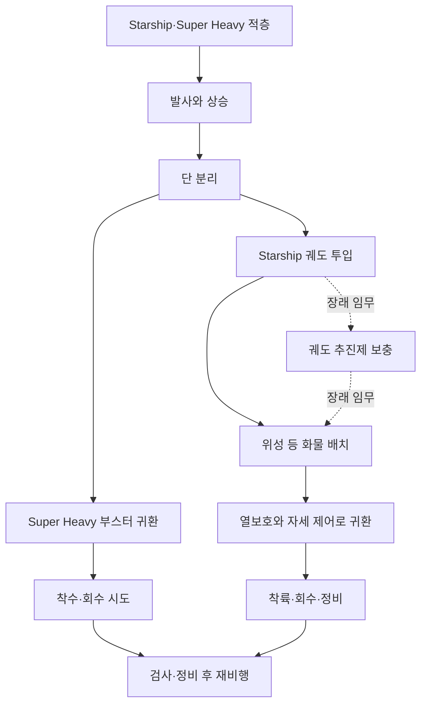

# Starship: 궤도 비행과 완전 재사용 사이에 남은 기술 / Starship orbital flight and full reuse

확인일은 2026-10-20입니다. Starship과 Super Heavy의 구조, Raptor 엔진, 귀환·열보호·재비행을 살펴봅니다. 공개 비행 기록과 독립적인 발사체 분석을 읽은 분석 글이며 내부 설계나 원가를 직접 검증한 자료는 아닙니다.

그림 1. 완전 재사용 발사체가 목표로 하는 단계와 회수 뒤의 정비 흐름을 단순화했습니다. Flight 14에서 궤도 진입과 화물 배치는 확인됐지만 두 단의 회수 후 재비행까지 입증된 것은 아닙니다. 궤도 추진제 보충도 실제 운용 성과와 구분되는 장래 임무입니다.

## 현재 무엇을 확인할 수 있나요?

[SpaceX의 Flight 14 결과](https://www.spacex.com/launches/starship-flight-14)에 따르면 2026-09-28 첫 궤도 비행과 Starlink V3 위성 26기 배치를 수행했습니다. 상단 엔진 하나의 조기 정지 뒤 남은 엔진으로 준궤도에 도달하고, 상태 확인 후 별도 삽입 연소로 궤도에 진입했습니다. 궤도 체류를 일찍 끝내고 태평양에 착수했으므로 같은 페이지의 사전 일정표를 실제 비행 시간으로 읽으면 틀립니다.

위성들은 통신을 확인했지만 점검과 궤도 상승 뒤 고객 서비스에 들어가는 단계입니다. 부스터도 이번 비행에서는 해상 착륙 시험이었고 이후 비행종료 체계가 작동했습니다. 이 결과를 두 단이 모두 회수되어 즉시 재발사한 실적으로 바꾸면 안 됩니다. 위성 배치, 궤도 진입, 귀환, 회수, 정비 후 재비행은 이어지는 서로 다른 검증입니다.

## 큰 로켓에서 공통화한 것과 달라진 것

차량의 일반 설명은 9 m 지름, 부스터의 Raptor 33개와 상단의 엔진 6개를 제시합니다. 상단에는 지상 조건용과 진공용 엔진이 함께 있습니다. 일반 차량 개요의 길이·추진제·탑재량을 특정 시험체 버전의 확정 사양으로 합치지 않아야 합니다. [공식 차량 설명](https://www.spacex.com/vehicles/starship)

Raptor는 액체산소·메탄을 쓰는 전유량 단계식 연소 엔진입니다. 전유량은 연료와 산화제 흐름을 각각 예연소기·터빈 계통에 통과시키는 구조를 가리킵니다. 터빈은 펌프를 돌리고, 펌프는 추진제를 높은 압력의 연소실로 보냅니다. 높은 성능을 노리는 대신 시작·정지 과정, 뜨거운 산소와 접하는 재료, 냉각과 여러 계통의 상호작용이 어려워집니다. [DLR의 2024년 분석 2.1–2.2절](https://elib.dlr.de/209271/1/IAC-24_Launcher_Options_for_Europe_in_a_World_of_Starship.pdf)

[Everyday Astronaut의 엔진 사이클 글](https://everydayastronaut.com/rocket-engine-cycles/)은 이 흐름을 그림으로 이해하는 데 도움이 됩니다. 여기서는 단계식 연소와 전유량 절의 글을 대조했으며 삽입된 인터뷰 영상 전체를 시청했다고 주장하지 않습니다. 2022년 해설을 2026년 Raptor 버전의 내부 치수·수명 자료로 사용하지도 않습니다.

엔진 수가 많으면 하나가 멈춘 뒤에도 추진력을 유지할 여지가 생깁니다. 그러나 엔진 수만큼 배관·점화·진동·제어·배치 문제가 더해집니다. 한 번의 엔진 정지 보완 성공이 모든 고장 조합에 대한 내성을 입증하지는 않습니다. 고장 위치와 시점, 잔여 추진제, 목표 궤도가 달라지면 결과도 달라집니다.

## 상단이 돌아오는 일은 왜 더 어렵나요?

1단과 상단은 분리 시점의 속도·고도·운동 상태가 다릅니다. 궤도에 가는 일은 단순히 높이 올라가는 일과 다릅니다. 옆으로 충분히 빨리 움직여 지구를 계속 빗나가는 상태를 만들어야 합니다. 그 운동에너지를 귀환 때 처리해야 합니다. [NASA의 궤도 비행 설명](https://www1.grc.nasa.gov/beginners-guide-to-aeronautics/flight-to-orbit/)

자체 예제로 질량 1 kg당 운동에너지를 `v²/2`로 계산하겠습니다. 속도 2 km/s면 2 MJ/kg이고, 8 km/s면 32 MJ/kg입니다. 속도는 네 배지만 에너지는 16배입니다. 두 속도는 이해를 위한 가상 값이며 실제 Flight 14의 단계별 속도 기록이 아닙니다.

이 에너지가 모두 타일에 들어가는 것은 아닙니다. 충격파와 주변 유동, 복사와 대류, 기체 자세가 열 전달을 바꿉니다. 재진입 가열을 일상적인 두 물체의 마찰열 한 가지로만 설명하면 부족합니다. 열보호재는 견디는 온도뿐 아니라 균열·접합부·국소적인 틈·검사와 교체 작업까지 포함한 체계입니다. [NASA의 열보호 시스템 설명](https://www.nasa.gov/reference/jsc-thermal-protection-systems/)

## 탑재량과 재사용을 함께 읽습니다

| 확인할 항목 | 숫자와 함께 필요한 조건 |
| --- | --- |
| 궤도 탑재량 | 궤도 높이·경사각, 버전, 회수 추진제, 어댑터와 배치 장치 |
| 회수 성과 | 부스터·상단 중 어느 쪽인지, 착수인지 회수인지 |
| 재사용 성과 | 같은 기체의 다음 비행, 교체 부품과 정비 범위 |
| 발사 비용 | 운영 빈도·신뢰성·시설·검사·보험·실제 지불 조건 |
| 우주에서 연료 보충 | 저장·이동·누설·열관리·추가 발사의 성공 |

DLR의 Sippel 등은 공개 비행 자료와 가정으로 당시 V1·V2를 분석했습니다. 논문은 장치 질량 등을 뺀 순수 탑재량과 총 탑재량을 구분하고, 실제 내부 정보가 부족해 여러 매개변수가 유일하게 결정되지 않음을 설명합니다. 이는 제조사 발표와 별개인 분석이지만 2024년 모형입니다. 그 예측값을 Flight 14의 실제 계량 결과로 쓰지 않습니다. [DLR 2.3절과 표 3](https://elib.dlr.de/209271/1/IAC-24_Launcher_Options_for_Europe_in_a_World_of_Starship.pdf)

이 차이를 자체 가상 예로 계산하면 총 여유 120 t에서 배치 장치 10 t, 임무 여유 5 t를 빼면 고객 화물은 105 t입니다. 120과 105는 같은 항목의 다른 측정값이 아닙니다. 실제 장치 질량이 바뀌면 결과도 바뀝니다.

## 우주에서 보충하면 모든 문제가 풀리나요?

궤도 보충은 지구에서 싣고 출발할 질량의 부담을 여러 발사로 나눌 수 있는 방법입니다. 하지만 액체를 옮기는 장치뿐 아니라 극저온 저장과 증발, 접합, 측정, 여러 비행의 일정과 신뢰성을 함께 해결해야 합니다. 일반 차량 페이지가 제시하는 미래 심우주 능력과 반복 운용한 임무 실적을 구별하셔야 합니다.

설명용으로 독립적인 필수 작업이 각각 98% 성공하고 여덟 개가 모두 필요하다면 전체 성공 확률은 `0.98⁸≈85.1%`입니다. 실제 임무의 성공 확률 추정이 아니며 독립성도 가정입니다. 많은 단계를 연결할 때 개별 성과뿐 아니라 실패 복구와 여유가 왜 필요한지 보여 줍니다. 예비 발사나 재시도·공통 원인 고장이 있으면 이 식도 바뀝니다.

## 왜 경쟁사도 같은 크기부터 만들지 않나요?

크기는 수요·발사장·제작 설비·운송·환경·시험 예산과 연결됩니다. 작은 위성의 지정 궤도에 자주 가는 서비스와 거대한 공통 운송수단은 다른 가치를 제공합니다. 큰 화물을 한 번에 올려도 최종 궤도로 나눠 옮기는 장치와 일정이 필요할 수 있습니다. DLR 논문의 유럽 대안 분석도 임무와 개발 시점을 나누어 비교합니다.

SpaceX의 강점을 평가할 때에는 엔진 한 개의 신기함과 반복 시험·생산·수요·시설의 결합을 함께 보아야 합니다. 현재 확인한 궤도 비행은 중요한 성과입니다. 완전 재사용의 비용·정비·회전율은 같은 기체를 반복 운용한 추가 근거로 평가해야 합니다.

## 스스로 확인하기

1. 궤도에 도달했다는 발표는 두 단의 재비행까지 증명하나요?
2. 같은 질량에서 속도를 네 배로 높이면 운동에너지도 네 배인가요?
3. 2024년 독립 모형의 순수 탑재량을 2026년 시험의 실측으로 써도 되나요?

답과 이유

1. 아닙니다. 궤도 진입·귀환·회수·다음 비행을 각각 확인해야 합니다.
2. 아닙니다. 속도의 제곱에 비례하므로 16배입니다.
3. 안 됩니다. 버전·가정·임무와 근거의 종류가 다릅니다.

[항공우주 시스템 목록](README.md) · [제품·기술 분석](../README.md)
