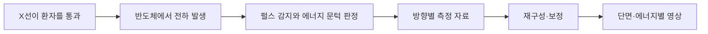

# 광자 계수 CT: 광자를 세는 검출기가 영상과 선량을 바꾸는 조건

2026년 10월 20일 기준으로 Siemens NAEOTOM Alpha 계열과 GE Photonova Spectra의 공개 자료를 살펴봅니다. 허가·판매 자료, 외부 병원 연구진의 팬텀 계측을 구분합니다. 기술과 근거를 설명하는 글이며 개인의 검사 선택이나 방사선량을 정하는 진료 안내는 아닙니다.

## 시제품 단계와 허가된 제품을 나누기

NAEOTOM Alpha.Peak·Pro·Prime은 FDA의 K243523·K251061 문서에서 확인할 수 있습니다. GE Photonova Spectra·Select는 K253520에서 2026년 3월 20일 clearance를 받았습니다. 2025년 RSNA 발표 당시 pending이었다는 자료만 보고 2026년에도 미허가라고 쓰면 시점이 틀립니다. [Siemens 2025년 허가 요약](https://www.accessdata.fda.gov/cdrh_docs/pdf24/K243523.pdf), [추가 FDA 기록](https://www.accessdata.fda.gov/scripts/cdrh/cfdocs/cfpmn/pmn.cfm?id=K251061), [GE FDA 기록](https://www.accessdata.fda.gov/scripts/cdrh/cfdocs/cfpmn/pmn.cfm?ID=K253520)

허가가 있다는 사실은 모든 병원에서 설치·가동 중이라는 뜻이 아닙니다. 소프트웨어 옵션과 국가별 적응증·구성도 따로 확인해야 합니다. 허가 심사는 모든 경쟁 CT보다 같은 조건에서 임상 우월하다는 주장과도 다릅니다.

## CT가 영상을 만드는 과정

CT는 여러 방향에서 X선을 통과시켜 물체가 얼마나 감쇠시키는지 측정하고 단면을 계산합니다. 같은 지점을 여러 각도에서 관찰한 자료를 조합한다는 점이 핵심입니다. 검출기가 얻은 신호를 곧바로 사진처럼 붙이는 과정은 아닙니다.

기존 에너지 적분형 검출기는 들어온 X선이 만든 빛을 전기 신호로 바꾸고 일정 시간 동안 모은 신호를 읽는 방식이 일반적입니다. 광자 계수 검출기는 개별 광자가 만든 전하 펄스를 검출하고 에너지 문턱에 따라 나눌 수 있습니다. [FDA NAEOTOM 기술 설명](https://www.accessdata.fda.gov/cdrh_docs/pdf22/K220814.pdf), [GE 공개 기술 요약](https://www.accessdata.fda.gov/cdrh_docs/pdf25/K253520.pdf)



그림은 직접 만든 원리 설명이며 특정 회사의 실제 회로를 복제한 것이 아닙니다. 반도체 재료와 두께·읽기 회로·보정 방식에 따라 성능이 달라집니다. “광자를 센다”는 말도 모든 광자를 오류 없이 정확한 에너지로 검출한다는 뜻은 아닙니다.

## 재료와 구조가 다른 경쟁 방식

Siemens 문서의 검출기는 CdTe를 사용하며, GE는 Deep Silicon과 8개 에너지 구간을 설명합니다. 같은 PCCT라는 이름 안에서도 재료와 신호 처리 구조가 다릅니다. 에너지 구간 수만으로 공간 해상도나 진단 정확도 순위를 정할 수는 없습니다. [Siemens FDA 문서](https://www.accessdata.fda.gov/cdrh_docs/pdf22/K220814.pdf), [GE 2026년 발표](https://www.gehealthcare.com/en-us/about/newsroom/press-releases/ge-healthcares-photonova-spectra-photon-counting-ct-receives-fda-clearance)

Siemens Prime 공식 사양의 Quantum HD 모드 0.11mm 평면 내 해상도는 모드와 방향이 붙은 수치입니다. 모든 방향의 실제 병변이 0.11mm까지 같은 정확도로 보인다는 약속은 아닙니다. 검출기 행 수·재구성 절편 두께·평면 내 해상도를 서로 바꾸어 쓰면 안 됩니다. [Prime 공식 사양](https://www.siemens-healthineers.com/computed-tomography/naeotom/naeotom-alpha-prime)

스펙트럴 영상은 X선 에너지에 따른 감쇠 차이를 이용합니다. 물·요오드 등의 기여를 추정하거나 특정 에너지의 영상처럼 재구성할 수 있습니다. 에너지 적분형 CT도 이중 에너지·이중층 등의 방식으로 스펙트럴 정보를 얻을 수 있으므로, 광자 계수 이전에는 재료 정보를 전혀 얻지 못했다고 설명하면 틀립니다.

## 펄스가 겹치면 세기가 달라 보일 수 있습니다

광자가 너무 짧은 간격으로 들어오면 전기 펄스가 겹쳐 개수나 에너지를 잘못 읽을 수 있습니다. 이를 pile-up이라고 부릅니다. 한 광자의 전하가 이웃 화소로 나뉘는 charge sharing도 에너지와 위치 해석에 영향을 줍니다. 정교한 회로와 보정이 필요한 이유입니다.

설명용으로 40keV와 50keV 광자가 거의 동시에 들어왔다고 가정하겠습니다. 전기 신호가 구별되지 않으면 한 번의 더 큰 사건처럼 보일 수 있습니다. 실제 제품이 항상 90keV로 읽는다는 뜻은 아니며, 펄스 모양·검출 시간·회로에 따라 결과가 다릅니다. 광자 수와 에너지 구간의 정확성을 함께 확인해야 합니다.

## 독립 계측은 조건에 따라 다른 결론을 보입니다

van der Bie 등의 2024년 Medical Physics 연구는 임상 선량 자료와 26·31·36cm 팬텀을 이용해 SOMATOM Force와 NAEOTOM Alpha를 비교했습니다. PCCT 120kV·0.4mm 절편과 기존 CT 70/80/90kV·0.6mm 절편을 선량 수준에 맞추어 비교합니다. 이는 완전히 같은 재구성 영상을 사용한 비교는 아닙니다. [원문 Methods·표 1–3](https://aapm.onlinelibrary.wiley.com/doi/10.1002/mp.16992)

같은 논문의 Bv40·QIR4·55keV 조건에서 작은 팬텀의 검출성 지표 d′는 기존 34·PCCT 29, 큰 팬텀은 기존 17·PCCT 20이었습니다. 이 네 값은 3mm 조영 혈관을 가정한 특정 과제의 지표입니다. 모든 질병의 민감도나 환자의 완치율이 아닙니다. [Results 3.2](https://aapm.onlinelibrary.wiley.com/doi/10.1002/mp.16992)

| 팬텀과 조건 | 기존 CT의 d′ | PCCT의 d′ |
| --- | --- | --- |
| 작은 팬텀·위의 설정 | 34 | 29 |
| 큰 팬텀·위의 설정 | 17 | 20 |

Erasmus MC는 Siemens의 PCCT 연구 기관 지원을 공개했습니다. 제조사 밖 연구진의 실제 계측이라는 점과 경제적으로 완전히 독립됐다는 주장은 구분합니다. 이 글은 논문의 원시 스캔을 다시 촬영하거나 분석하지 않았으며, 영상 설명만 본 유튜브 시청을 근거로 삼지 않았습니다.

## 지표의 차이를 해석하는 자체 산술

위 작은 팬텀에서 29/34≈0.853, 큰 팬텀에서 20/17≈1.176입니다. 이는 각 기준값에 대한 약 14.7% 낮음과 17.6% 높음이라는 단순 계산입니다. 원문은 다른 에너지·커널 조건도 시험하므로 이 값 하나를 제품 전체의 고정 성능으로 만들지 않습니다.

```math
\frac{29-34}{34}\times100\approx-14.7\%,
\qquad\frac{20-17}{17}\times100\approx17.6\%
```

작은 팬텀과 큰 팬텀의 결과가 다른 이유를 이해하려면 비교한 에너지·조영 물질·재구성·노이즈를 함께 보아야 합니다. 특정 모드에서 높은 해상도와 스펙트럴 정보를 얻는 장점이 있어도, 모든 환자 크기에서 같은 선량으로 모든 지표가 좋아진다는 결론은 나오지 않습니다.

## 노이즈·해상도·선량은 연결됩니다

광자 수가 독립적인 포아송 통계를 따른다는 단순 가정에서는 개수의 표준편차가 제곱근에 비례합니다. 가상으로 평균 100개를 셌다면 상대 표준편차는 약 10%, 400개면 약 5%입니다. 실제 CT에는 재구성·전자 잡음·산란·보정·상관관계 등이 있으므로 환자 선량 처방에 그대로 적용하지 않습니다.

```math
\sigma_N\approx\sqrt{N},\qquad
\frac{\sigma_N}{N}\approx\frac{1}{\sqrt{N}}
```

화소나 절편을 더 작게 나누면 작은 구조를 표현할 여지는 늘지만 한 요소에 기여하는 측정 정보도 줄어들 수 있습니다. 더 강한 반복 재구성이나 학습 기반 처리는 노이즈를 줄이는 대신 질감과 미세 구조의 표현을 바꿀 수 있습니다. 영상이 매끈해 보인다는 사실만으로 진단에 필요한 구조가 모두 보존됐다고 단정하지 않습니다.

CTDIvol은 표준 팬텀을 기준으로 하는 선량 지표이며 개인 장기의 실제 흡수선량과 동일하지 않습니다. DLP, 스캔 길이, 환자 크기, 장기 위치도 서로 다른 정보입니다. mGy와 mSv를 설명 없이 바꾸거나 단일 변환 상수로 모든 검사를 같은 위험으로 환산하지 않습니다.

## 병원이 지불하는 비용과 작업 흐름

제품 가격 외에 차폐·전력·냉각·설치 공간·데이터 저장·재구성 서버·교육·서비스가 필요합니다. 여러 에너지 영상과 얇은 절편을 모두 저장하면 읽을 정보뿐 아니라 자료량과 판독 부담도 늘 수 있습니다. 이 글은 공개되지 않은 한국 병원의 장비 가격이나 검사비를 만들지 않습니다.

자체 예제로 512×512화소·16비트 영상 1,000장은 압축·DICOM 부가정보를 빼고 약 524MB입니다. 같은 크기의 재구성 계열이 네 개면 약 2.10GB입니다. 실제 제품의 저장 파일 크기나 병원 서버 사용량을 측정한 결과는 아니지만 영상 계열이 늘어날 때의 비용을 생각하는 기준이 됩니다.

이 기술의 가치는 검사 목적에 맞춘 프로토콜과 임상 성과로 판단해야 합니다. 허가·팬텀·환자 비교·판독자 정확도·장기 결과는 서로 다른 층의 근거입니다. 최신 검출기라는 이유 하나로 모든 환자에게 특정 기기를 추천하는 결론은 내리지 않습니다.

## 스스로 확인하기

1. 광자 계수 CT면 모든 조건에서 같은 선량으로 더 나은 영상인가요?
2. 팬텀의 d′ 20은 환자의 진단 민감도 20%라는 뜻인가요?
3. CTDIvol이 개인 장기의 실제 흡수선량과 같나요?

<details>
<summary>답과 이유</summary>

1. 아닙니다. 크기·관전압·절편·커널·검출 과제에 따라 달라집니다.
2. 아닙니다. 특정 과제와 영상 특성으로 계산한 검출성 지표입니다.
3. 아닙니다. 표준 팬텀 기반 지표이며 개인의 장기 선량과 구분해야 합니다.

</details>
