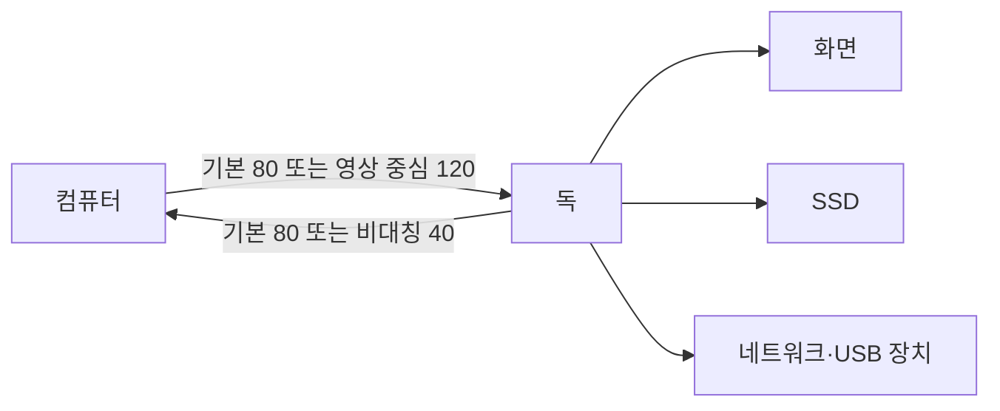

# Thunderbolt 5·USB4: 한 케이블의 속도·영상·전력을 나누어 보기

2026년 10월 20일 기준으로 USB4 Version 2.0과 Thunderbolt 5, 실제 판매 중인 Razer Thunderbolt 5 Dock을 살펴봅니다. 표준기관·Intel 기술 자료와 독립 파일 전송 시험을 비교합니다. 이 글에서 독이나 케이블을 직접 시험하지는 않았습니다.

## USB-C 모양은 기능 보증이 아닙니다

USB-C는 단자의 형태입니다. 데이터 전송 규격, 영상 전송 방식, 충전 전력은 별도 조건입니다. 똑같이 생긴 케이블이라도 충전 위주이거나 낮은 데이터 속도만 지원할 수 있습니다. 호스트·케이블·독·주변기기가 공통으로 지원하는 조건 안에서 연결됩니다.

Intel은 Thunderbolt 5의 기본 양방향 80Gbps와 영상 중심 Bandwidth Boost 최대 120Gbps를 설명합니다. USB4 v2도 더 높은 속도와 비대칭 동작을 포함하지만 USB4라는 이름만으로 모든 장치의 80Gbps·모든 선택 기능을 보장하지 않습니다. [Intel 기술 설명](https://www.intel.com/content/dam/www/central-libraries/us/en/documents/2023-09/thunderbolt-5-technology-brief.pdf), [USB-IF 규격](https://usb.org/document-library/usb4r-specification-v20)

| 확인 항목 | 의미 |
| --- | --- |
| USB-C | 단자 모양과 연결 구조입니다. |
| USB 40Gbps·80Gbps | 데이터 연결 능력을 확인할 표시입니다. |
| Thunderbolt 5 | 인증에서 요구하는 기능과 성능 조건을 포함합니다. |
| USB Power Delivery | 전압·전류·전력 협상 조건입니다. |

독은 주변기기를 여러 개 연결하는 확장 장치입니다. 포트가 열 개 있어도 열 개가 각각 호스트와 독립된 최대 속도를 갖는 것은 아닙니다. 어느 포트끼리 내부 자원을 공유하는지에 따라 동시 사용 결과가 달라집니다.

## 80·120·40이라는 숫자를 같은 방향으로 더하지 않습니다

기본 양방향 연결을 양쪽 각각 80Gbps라고 보면 두 방향의 합은 160Gbps입니다. 비대칭 모드는 영상 요구에 따라 한쪽에 120Gbps를 배정하고 반대쪽은 40Gbps가 되는 구성을 사용합니다. 이는 두 방향 모두 120Gbps가 되는 것도, SSD가 언제나 120Gbps로 읽히는 것도 아닙니다. [Intel 발표](https://newsroom.intel.com/client-computing/intel-introduces-thunderbolt-5-standard)



직접 만든 그림의 각 숫자는 연결 모드를 설명합니다. 장치별로 고정 대역폭을 예약한 실제 내부 배선도가 아닙니다. PCIe·DisplayPort 등의 데이터를 연결 위로 실어 보내는 터널링에는 프로토콜 비용과 자원 배분이 있습니다.

비트와 바이트도 구분해야 합니다. 자체 환산으로 80Gbps를 8로 나누면 10GB/s이지만, 부호화·제어·터널링·저장 장치 비용을 뺀 파일 속도는 아닙니다. 컴퓨터의 PCIe 경로, 독 컨트롤러, SSD 자체 성능과 파일 시스템이 실제 전달량을 제한할 수 있습니다.

## 화면은 얼마만큼의 데이터를 요구하나요?

설명용으로 3,840×2,160·120Hz·RGB 10비트씩을 압축 없이 세면 다음과 같습니다. 실제 링크의 블랭킹·부호화·메타데이터는 생략한 화소 본문 계산입니다.

```math
3840\times2160\times120\times30
=29,859,840,000\ \mathrm{bit/s}\approx29.86\ \mathrm{Gbps}
```

두 화면이면 단순 합은 약 59.72Gbps입니다. 그러나 실제 제품의 지원 여부는 이 산술만으로 확정되지 않습니다. DSC는 Display Stream Compression으로, 화면 전송에 필요한 데이터량을 줄이는 압축 방식입니다. DSC 사용 여부, GPU의 표시 엔진 수, 운영체제의 다중 화면 방식, 독의 영상 출력 구조가 영향을 줍니다. “8K 지원”이라고만 적힌 사양은 해상도·주사율·색심도·압축·화면 수를 함께 읽어야 합니다.

한 화면을 독에서 먼저 출력하고 나머지 링크를 저장 장치에 나누어 쓸 때에는 연결 방향에 따라 경쟁이 달라질 수 있습니다. 마우스나 키보드는 부담이 작아도 고속 SSD 여러 개와 영상·네트워크를 동시에 쓰는 상황은 따로 평가해야 합니다.

## 판매 중인 독의 사양과 실제 파일 전송

Razer의 현행 자료는 Thunderbolt 5 연결과 최대 140W의 호스트 전력 공급, 능동 냉각을 안내합니다. 이 전력은 독의 모든 포트에 각각 140W를 공급한다는 뜻이 아닙니다. 호스트도 해당 전력 협상을 지원해야 합니다. [Razer 공식 제품](https://www.razer.com/gaming-pc-accessories/razer-thunderbolt-5-dock)

PC Gamer의 Jacob Ridley는 Solidigm P44 Pro를 독에 넣어 147GB의 게임 파일을 Alienware로 옮기는 데 2분 38초를 기록했습니다. 합성 순차 쓰기 사양과 실제 파일 묶음의 속도는 다르며, 같은 파일 시험에서 USB4 연결도 차이가 뚜렷하지 않았다고 적습니다. [2026년 1월 직접 시험](https://www.pcgamer.com/hardware/razer-thunderbolt-5-dock-review/)

147GB를 십진 단위로 보고 158초로 나눈 자체 평균은 약 0.930GB/s입니다. 원문의 용량 표시가 이진 단위인지 확정하지 않았으므로 정밀한 원시 대역폭 측정으로 쓰지 않습니다. 동일 파일 시험의 결과가 비슷하다는 사실만으로 고부하 동시 사용에서도 두 규격이 같다고 일반화할 수 없습니다.

```math
v_{avg}\approx\frac{147}{158}=0.930\ \mathrm{GB/s}
```

리뷰에는 제휴 링크가 있으며 팬 소음과 구형 모니터의 연결 경험도 기록되어 있습니다. 소음계 수치는 공개하지 않아 몇 dBA라고 덧붙이지 않습니다. 샘플의 구매·대여 계약을 본문만으로 확인하지 못했으므로 자비 구매라고 단정하지 않습니다.

## 다른 비교 시험도 장치 경로를 확인합니다

Tom’s Hardware는 2026년 7월 Keychron·Plugable·UGREEN 독을 비교하며 SSD 모델·호스트·외장함 경로를 적었습니다. 다만 본문에는 Micron 2500과 2400의 표기가 섞여 있습니다. 따라서 세 제품의 정밀한 저장 성능 순위를 이 글에서 확정하지 않습니다. [비교 시험의 구성과 원래 수치](https://www.tomshardware.com/peripherals/docking-stations-hubs/testing-three-sub-usd400-thunderbolt-5-docking-stations)

시험 장치의 표기가 모호할 때 제품의 차이와 SSD의 차이를 구별하기 어렵습니다. 같은 파일·디스크·쓰기 캐시·온도·호스트·포트에서 반복해야 독 자체의 영향을 더 잘 분리할 수 있습니다. 스크린샷 하나의 최고 속도보다 짧은 버스트와 긴 연속 전송을 구분하는 편이 유용합니다.

직접 비교할 과제로 100GB 단일 파일, 작은 파일 10만 개, 두 SSD 동시 복사, 화면을 켠 상태의 전송을 정할 수 있습니다. 이 글은 그런 시험을 실행하지 않았습니다. 파일 개수와 크기를 함께 적어야 메타데이터 처리와 링크 대역폭의 차이를 볼 수 있습니다.

## PAM-3와 열을 쉬운 말로 읽기

Intel 기술 자료의 PAM-3는 신호를 세 가지 진폭 수준으로 표현하는 기술입니다. 동일한 선로에서 정보를 더 많이 보내려면 송수신 회로가 신호를 더 정확하게 구별하고 손실·반사를 처리해야 합니다. 단자 모양이 같다고 전기적 품질 조건이 같아지는 것은 아닙니다. [기술 자료의 신호 설명](https://www.intel.com/content/dam/www/central-libraries/us/en/documents/2023-09/thunderbolt-5-technology-brief.pdf)

능동 케이블은 신호 처리를 위한 회로를 포함할 수 있고 길이·지원 모드·소비 전력이 달라집니다. 짧은 수동 케이블 한 개의 성공 사례를 긴 케이블의 모든 조합으로 확대하지 않습니다. 충전 중인 독과 SSD의 열도 함께 발생하므로 통풍과 장시간 안정성은 별도 조건입니다.

가상으로 전원 변환에서 140W 출력을 95% 효율로 공급하면 입력은 약 147.37W, 손실은 약 7.37W입니다. 이는 실제 Razer 효율 측정이 아닌 설명용 계산입니다. 팬이 있는 이유를 생각할 근거는 되지만 팬 소음이나 표면 온도를 그 값만으로 예측할 수는 없습니다.

## 비용과 호환성의 실제 경계

독 가격 외에 인증 케이블, 영상 어댑터, SSD, 전원 장치, 필요한 호스트 교체 비용이 들어갈 수 있습니다. 140W라는 공급 능력도 고부하 노트북의 요구 전력이 더 크다면 배터리 충전을 보장하지 않습니다. 단자당 전력과 전원 어댑터의 총량을 별도로 봅니다.

구입 전 가장 구체적인 질문은 “내 컴퓨터의 이 포트에서 이 화면 두 개와 이 SSD가 동시에 필요한 방식으로 동작하나요?”입니다. 같은 USB-C 연결이라는 답변으로는 부족합니다. 이 글에는 모든 Windows·macOS·Linux 조합의 실측이 없으므로 보편적인 무오류 호환성을 주장하지 않습니다.

## 스스로 확인하기

1. 120Gbps Boost면 양방향 각각 120Gbps인가요?
2. 80Gbps/8이라는 계산이 파일 전송 속도 10GB/s를 보장하나요?
3. 같은 파일 시험에서 USB4와 결과가 같으면 모든 작업도 같나요?

<details>
<summary>답과 이유</summary>

1. 아닙니다. 해당 비대칭 구성은 120/40Gbps입니다.
2. 아닙니다. 프로토콜·호스트·저장 장치·동시 사용 비용이 남습니다.
3. 아닙니다. 파일 구성과 병목·동시 영상 부하에 따라 달라집니다.

</details>
