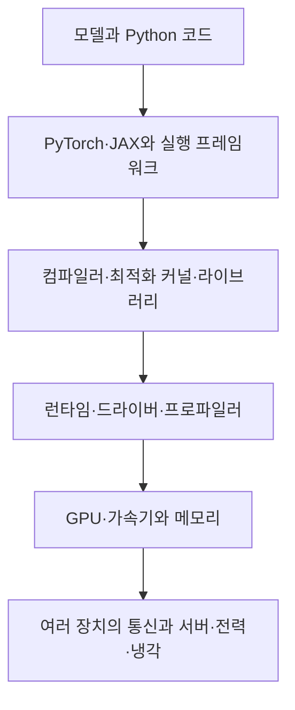

# NVIDIA·AMD·자체 AI 가속기: 성능 경쟁이 생태계 경쟁이 되는 이유

NVIDIA가 축적한 우위는 연산 장치의 성능, 잘 맞물린 소프트웨어와 통신, 공급·지원 체계가 함께 만든 결과로 보아야 합니다. 이미 있는 코드와 인력을 다른 환경으로 옮기는 비용도 선택에 들어갑니다. 동시에 AMD의 ROCm, Google TPU, AWS Trainium 같은 대안은 실제로 사용되고 있습니다. 이 글은 어느 칩이 모든 상황에서 이긴다는 순위 대신, 기업이 왜 특정 환경을 선택하고 어떻게 의존도를 줄이는지 분석합니다. 자료 확인일은 2026년 10월 20일입니다.

## 먼저 무엇과 무엇을 비교하는지 정합니다

게임용 그래픽카드의 렌더링 성능과 대형 AI 학습의 성능은 같은 지표가 아닙니다. GPU는 병렬 연산이 가능한 프로세서이고, AI용 제품은 메모리 용량·대역폭·행렬 연산·장치 간 통신·운영 기능이 중요한 설계 조건이 됩니다. 같은 업체의 소비자 GPU와 데이터센터 가속기도 목적과 지원 조건이 다릅니다.

ASIC은 특정 응용을 위해 설계한 집적회로입니다. TPU·Trainium·Gaudi·Ascend를 모두 게임용 그래픽카드의 종류처럼 설명하면 경쟁의 범위가 흐려집니다. 어떤 장치는 범용 병렬 처리의 유연성을, 어떤 장치는 정해진 AI 연산과 대규모 배치의 효율을 더 중시합니다.

| 선택지 | 함께 살펴볼 소프트웨어·운영 환경 | 경쟁을 읽을 때의 구분 |
| --- | --- | --- |
| NVIDIA 데이터센터 GPU | CUDA, cuBLAS·cuDNN, NCCL, Nsight, 추론·배포 도구 | 단일 칩과 랙·통신·도구를 결합한 시스템을 구분합니다. |
| AMD Instinct | ROCm, HIP, 행렬·통신 라이브러리, AITER·Primus 등 | Radeon 게임 성능으로 Instinct 학습 성능을 추정하지 않습니다. |
| Intel GPU와 Gaudi | GPU 계열의 지원 환경과 Gaudi 소프트웨어는 구별합니다. | Gaudi를 Intel 게임용 GPU의 다른 이름으로 보지 않습니다. |
| Google TPU | JAX·PyTorch와 TPU용 컴파일러·커널·클라우드 운영 | 외부 GPU 대체와 Google Cloud 의존의 변화를 함께 봅니다. |
| AWS Trainium | Neuron과 지원 프레임워크·컴파일·배포 도구 | 칩 선택과 AWS 서비스·계약 선택이 함께 일어납니다. |
| Huawei Ascend | CANN, 프레임워크 연동과 Ascend용 실행 환경 | NPU와 렌더링 GPU, 지원 발표와 실제 과제 성능을 구분합니다. |
| Moore Threads GPU | MUSA, torch_musa, torchada 등 | 공개 호환 목록·지원 버전과 실제 모델의 결과를 확인합니다. |

각 계열의 실제 기능 근거는 [NVIDIA 소프트웨어](https://developer.nvidia.com/deep-learning-software), [AMD ROCm 7 소개](https://rocm.blogs.amd.com/ecosystems-and-partners/rocm-7.0-blog/README.html), [Intel Gaudi 3 기술 자료](https://cdrdv2-public.intel.com/817486/gaudi-3-ai-accelerator-white-paper.pdf), [TPU7x 문서](https://docs.cloud.google.com/tpu/docs/tpu7x), [AWS 고객 사례](https://aws.amazon.com/ai/machine-learning/trainium/customers/), [PyTorch의 2026년 중국 개발 생태계 소개](https://pytorch.org/blog/pytorch-conference-china-2026-advancing-the-open-source-ai-stack/), [Moore Threads의 공식 저장소](https://github.com/MooreThreads/torchada)에서 확인했습니다. 표는 매출·점유율·종합 성능 순위가 아닙니다.

중국 업체의 칩도 국적 하나로 성능을 묶지 않습니다. 개발 중인 제품, 렌더링 GPU, 학습·추론용 가속기, 드라이버·커널 상태는 서로 다릅니다. 같은 모델·정밀도·메모리·장치 수·소프트웨어 버전의 공개 시험 없이 ‘전부 매우 느립니다’나 ‘이미 완전히 대체했습니다’라고 일반화할 근거는 없습니다.

## Python 한 줄 아래에는 여러 층이 있습니다

개발자는 `y = x @ w`처럼 행렬곱을 요청할 수 있습니다. 그러나 실제 실행에는 자료형과 크기 판단, 메모리 배치, 적절한 커널 선택, 컴파일·실행, 다른 장치와의 통신이 필요합니다. API는 프로그램이 요청을 표현하는 약속이고, 커널은 장치에서 그 작업을 수행하는 연산 코드입니다. 컴파일러는 표현된 작업을 실행 가능한 코드로 바꿉니다.



이 그림은 자체적으로 정리한 실행 경계입니다. 실제 제품에서는 층 사이의 최적화가 섞입니다. 연산 자체는 지원하지만 특정 모양의 행렬이 느리거나, 단일 장치에서는 빠르지만 여러 장의 통신에서 기다리는 경우도 생길 수 있습니다. ‘같은 Python으로 씁니다’는 말은 중요한 이식성의 출발점이며, 모든 실행 경로의 성능 보장은 아닙니다.

그래픽카드의 최고 FLOPS는 초당 가능한 부동소수점 연산의 이론값입니다. 큰 메모리에 들어가는지, 입력·가중치를 얼마나 빨리 가져오는지, 실제로 그 연산 유닛을 얼마나 사용하는지까지 결정하지는 못합니다. [GPU 기술 리뷰](../반도체와산업컴퓨팅_chips-industrial/gpu.md)와 [HBM 리뷰](../반도체와산업컴퓨팅_chips-industrial/hbm.md)에서 이 물리적 병목을 먼저 읽으실 수 있습니다.

## NVIDIA는 개발과 운영에 필요한 일을 함께 줄여 왔습니다

NVIDIA의 공개 자료에서 확인되는 대응을 기술·사업 측면으로 나누면 다음과 같습니다. 오른쪽의 효과는 자료를 종합한 이 글의 산업적 해석이며, 개별 프로그램이 매출을 얼마나 늘렸는지 측정한 인과 추정값은 아닙니다.

| 축적한 요소 | 실제로 제공·확장한 대상 | 선택에 들어가는 이유 |
| --- | --- | --- |
| 프로그래밍 환경 | CUDA와 컴파일·실행 도구 | 연구자가 그래픽 파이프라인 대신 계산 문제를 표현할 수 있습니다. |
| 반복해서 쓰는 연산 | cuBLAS·cuDNN과 관련 최적화 | 각 연구팀이 기본 연산을 새로 최적화하는 부담을 줄입니다. |
| 분산 통신 | NCCL과 NVLink·네트워크 시스템 | 칩 여러 개를 한 작업에 쓰는 과정의 통신·검증 부담에 대응합니다. |
| 관찰과 수정 | Nsight 계열 분석 도구 | 느린 이유를 찾고 실제 처리시간을 줄이는 데 필요합니다. |
| 교육과 초기 채택 | 교육 자료·워크숍·DLI 대학 프로그램 | 학습 자료와 경험자가 늘어 다음 프로젝트의 시작 비용이 낮아질 수 있습니다. |
| 배포와 지원 | 서버·클라우드 공급망, 기업용 소프트웨어 | 장치 구매 후 실제 서비스를 계속 운영하는 부담에 대응합니다. |

[2026 연차보고서](https://s201.q4cdn.com/141608511/files/doc_financials/2026/ar/2026-annual-report-web-Hyperlinks.pdf)의 사업 설명·경쟁·공급망 부분과 주주서한을 읽었습니다. 회사는 CUDA를 중심으로 개발자·응용·설치 기반이 서로 확대되는 구조를 전략적 강점으로 설명합니다. 이는 회사 자신의 전략 설명이며 독립적인 시장 효과 검증과 구분합니다. [NVIDIA의 교육·연구 프로그램](https://developer.nvidia.com/higher-education-and-research)은 실제 교육 자료와 대학 워크숍 지원을 보여 줍니다.

하드웨어 투자도 빠뜨리면 안 됩니다. 행렬 연산, HBM, 통신과 랙 설계가 좋아져 실제 작업이 빨라지는 것은 가치입니다. 회사는 2020년 Mellanox 인수와 네트워크 확장을 자사 데이터센터 전략의 일부로 설명합니다. 소프트웨어 때문에만 선택된다는 주장도, 성능 숫자 하나만으로 모든 채택이 설명된다는 주장도 실제 제품 묶음을 충분히 보지 못합니다.

CUDA라는 이름 안의 모든 구성 요소가 같은 공개·라이선스 조건을 갖는 것도 아닙니다. 예컨대 NCCL의 [소스 저장소](https://github.com/NVIDIA/nccl)는 공개되어 있지만 NVIDIA GPU에 맞춘 구현입니다. 소스가 공개되었다는 사실과 다른 업체의 장치에서 그대로 작동한다는 사실은 별개입니다. 반대로 공개 프로젝트를 활용한다고 특정 공급자의 영향에서 완전히 벗어나는 것도 아닙니다.

## 사용자가 모이면 다음 사용자의 비용이 바뀝니다

간접 네트워크 효과는 사용자가 늘어 관련 도구·예제·인력·지원이 늘고, 이것이 다음 사용자의 가치를 바꾸는 현상입니다. 전환비용은 다른 환경에서 같은 일을 하려고 새로 지출할 학습·변환·검증·운영 비용입니다. 둘은 연결되지만 같은 개념은 아닙니다.

대학에서 접한 환경으로 첫 프로젝트를 만들고, 회사가 그 환경의 경험자를 채용하고, 도구 업체가 그 사용자를 위해 기능을 만들면 다음 프로젝트도 그 환경을 택하기 쉬워집니다. 이 연결은 앞서 확인한 도구·교육의 존재와 경제학을 결합한 해석입니다. 모든 개발자가 강제로 한 환경을 쓰거나, 고객에게 다른 선택이 없다는 증명은 아닙니다.

[Arthur의 채택 누적 모형](../../논문해설_papers/산업과표준_industry-standards/arthur1989.md)과 [Katz·Shapiro의 시스템 경쟁](../../논문해설_papers/산업과표준_industry-standards/systems-competition1994.md)은 이 구분을 설명합니다. 두 논문 모두 NVIDIA의 현재 전략이나 점유율을 추정한 연구는 아닙니다. 이론에서 가능한 메커니즘을 실제 문서와 사례에 하나씩 맞추는 데 사용합니다.

실무에서는 이미 투자한 시간이 아깝다는 감정만이 아니라 새 환경의 회귀 시험과 장애 복구 체계를 만드는 비용이 있습니다. 회귀 시험은 바꾼 뒤 예전 기능이 망가지지 않았는지 확인하는 시험입니다. 모델 결과의 허용 오차, 정밀도, 양자화, 사용자 정의 연산, 분산 체크포인트와 관찰 도구를 다시 확인할 수 있습니다. 검증된 기본값이 많은 환경은 출시까지의 불확실성을 줄여 줄 수 있습니다.

## 싼 칩과 싼 작업은 다릅니다

아래 값은 어떤 기업의 실제 가격이나 측정치가 아닌 자체 예제입니다. 같은 품질·응답시간 조건을 만족한 출력만 처리량으로 세겠습니다.

| 가상 환경 | 시간당 비용 | 조건을 만족한 출력 토큰/시간 | 100만 토큰당 비용 |
| --- | ---: | ---: | ---: |
| N | 4 | 360,000 | 약 11.11 |
| A | 3 | 240,000 | 12.50 |

```math
\mathrm{cost}_N=\frac{4}{0.36}\approx11.11,
\qquad \mathrm{cost}_A=\frac{3}{0.24}=12.50
```

시간당 장치 비용은 A가 낮지만 이 조건에서는 작업당 비용이 높습니다. 반대로 A의 처리량을 개선하거나 더 큰 메모리 덕분에 필요한 장치 수가 줄어들면 결론은 달라질 수 있습니다. 모델·문맥 길이·배치·정밀도·응답시간 조건·호스트·통신과 이용률이 없는 가격 비교는 의사결정에 필요한 분모를 잃습니다.

학습의 지표도 다릅니다. 한 단계가 빠르다는 것과 같은 품질에 도달하는 전체 학습이 싸다는 것은 같은 질문이 아닙니다. 긴 실행의 장애, 재시작, 자료 준비와 실험 반복이 영향을 줍니다. 추론에서는 첫 토큰 지연과 이후 생성 속도, 동시에 처리한 요청 수, 지연 목표를 넘긴 요청의 비율도 봅니다. 품질을 낮춘 출력까지 같은 양의 유용한 결과로 세면 비용이 싸 보일 수 있습니다.

## AMD는 칩만이 아니라 옮기는 경로를 만듭니다

AMD의 ROCm은 라이브러리·컴파일·런타임·프레임워크 연동을 포함합니다. HIP은 CUDA로 작성한 코드를 이식 가능한 C++ 형태로 옮기는 부담을 줄이는 경로입니다. [PyTorch 2.14의 HIP 설명](https://docs.pytorch.org/docs/2.14/notes/hip.html)은 ROCm에서도 의도적으로 `torch.cuda` 인터페이스를 재사용한다고 명시합니다. 따라서 코드에 `.cuda()`가 있다는 이유만으로 NVIDIA 장치에서 실행했다고 판단할 수 없습니다.

이름이 같다고 NVIDIA용 실행 바이너리가 AMD에서 모두 그대로 실행된다는 뜻도 아닙니다. 프레임워크 수준의 연동, 소스 변환, 컴파일러의 다른 장치용 코드 생성과 바이너리 호환은 서로 다른 층입니다. 사용자 정의 CUDA 확장, 특정 정밀도, 연산 조합과 통신 경로는 지원·검증이 남을 수 있습니다. 같은 PyTorch 문서는 TF32의 하드웨어 수치 차이와 일부 기능의 제약도 따로 적습니다.

AMD의 [ROCm 7 소개](https://rocm.blogs.amd.com/ecosystems-and-partners/rocm-7.0-blog/README.html)는 AITER의 최적화 연산, 추론 프레임워크 지원, Primus 학습 환경을 설명합니다. [ROCm 7.2.4의 Primus·Megatron 안내](https://rocmdocs.amd.com/en/docs-7.2.4/how-to/rocm-for-ai/training/benchmark-docker/primus-megatron.html)는 장치·컨테이너·버전을 함께 제시합니다. 이는 고객이 각각 조립·조율하던 일을 줄이려는 구체적인 대응입니다. 업체 내부의 성능 향상률을 다른 모든 모델의 독립 비교 결과로 바꾸지는 않습니다.

역사적 외부 사례로 [SemiAnalysis의 2024년 12월 MI300X·H100·H200 학습 시험](https://newsletter.semianalysis.com/p/mi300x-vs-h100-vs-h200-benchmark-part-1-training)의 공개 열람 구간을 읽었습니다. 이 매체는 자체 시험에서 공개 배포판·개발 분기·특별 조정 이미지가 다른 결과를 내는 문제를 보고했고 AMD와 수정 작업도 했다고 밝혔습니다. 당시의 소프트웨어 구성과 작업 부담을 보여 주는 사례이며, 이를 2026년 ROCm이나 모든 AMD 작업의 현재 성능으로 적용하지 않습니다. 유료 상세 자료 전체를 열람한 범위로 표시하지도 않습니다.

## 자체 가속기는 선택권을 늘리면서 다른 의존도 만듭니다

자체 칩을 설계하는 대형 클라우드는 반복되는 작업량을 모아 설계·컴파일러·운영 투자의 고정비를 나눌 수 있습니다. 모델과 실행 환경을 함께 조정할 수도 있습니다. 이런 조건은 소규모 연구팀이 가속기를 직접 만드는 경우와 다릅니다. 자체 칩이 GPU의 모든 장점을 자동으로 대체한다는 뜻도 아닙니다.

Google의 [TPU7x 문서](https://docs.cloud.google.com/tpu/docs/tpu7x)는 Ironwood 세대의 학습·추론과 JAX·PyTorch 실행 경로를 설명합니다. [공식 출시 기록](https://docs.cloud.google.com/tpu/docs/release-notes)은 TPU7x의 2026년 3월 31일 일반 제공을 명시합니다. 2025년 발표문의 향후 제공 표현과 이 기록을 구별합니다. 문서에 없는 프레임워크까지 모두 같은 상태라고 쓰지 않습니다.

[AWS의 Anthropic 고객 사례](https://aws.amazon.com/ai/machine-learning/trainium/customers/)는 Project Rainier에서 Trainium2로 Claude를 학습·서비스한다고 설명합니다. 공급사에 게시된 고객 진술이며 독립적인 전력·원가 감사 결과는 아닙니다. 그래도 NVIDIA 이외의 장치에서 실제 중요한 AI 작업이 이루어진다는 구체적인 사례입니다. Google과 AWS 사례를 한데 묶어 ‘모든 AI 기업이 CUDA만 씁니다’라고 설명할 수 없는 이유입니다.

고객 관점에서는 의존 대상이 바뀔 수 있습니다. 칩 공급자를 다양화하더라도 특정 클라우드의 컴파일러·운영 기능·예약 계약·자료 이동에 더 의존할 수 있습니다. 다른 서비스로 옮기는 데 필요한 검증과 자료 이동 비용도 보아야 합니다. NVIDIA GPU 구매와 자체 칩 개발을 병행하는 전략 역시 가능한 선택입니다.

## Intel·중국 업체·개방형 도구도 다른 경로를 택합니다

[Intel Gaudi 3 기술 문서](https://cdrdv2-public.intel.com/817486/gaudi-3-ai-accelerator-white-paper.pdf)는 PyTorch 연동과 통합 Ethernet 통신 구조를 설명합니다. 범용 표준을 활용하는 것은 특정 통신 공급자에 대한 의존을 줄일 가능성이 있지만, 표준 케이블을 쓴다는 사실만으로 모든 장치·소프트웨어의 조합이 검증되는 것은 아닙니다. 제품의 현재 판매·지원 조건은 구매 시점과 서버 구성에서도 확인해야 합니다.

[PyTorch Foundation의 2026년 행사 기록](https://pytorch.org/blog/pytorch-conference-china-2026-advancing-the-open-source-ai-stack/)은 Huawei·Cambricon 등 여러 업체의 프레임워크·다중 백엔드 활동을 보여 줍니다. 회원 자격과 행사 발표는 모든 연산의 성능 인증이 아닙니다. [Moore Threads의 torchada](https://github.com/MooreThreads/torchada)는 PyTorch의 CUDA 인터페이스를 MUSA로 연결하는 어댑터를 공개하고, 필요한 torch_musa·장치와 버전별 보정 사항을 문서화합니다. 이것을 CUDA 프로그램 전체의 무조건적 호환으로 확대하지 않습니다.

공통 프레임워크·컴파일러는 개발자가 하드웨어 세부를 매번 직접 작성하지 않게 하여 공급자를 바꾸는 부담을 줄일 수 있습니다. 동시에 새 장치용 커널, 수치 시험과 장애 분석은 누군가 계속 유지해야 합니다. 코드 생성 AI가 이식 작업을 돕더라도 결과의 정확성·성능·유지보수 검증을 대신한 것은 아닙니다. ‘개방이므로 무료로 끝납니다’와 ‘CUDA 경험이 있으므로 영원히 못 옮깁니다’ 모두 실제 작업을 보기 전의 단정입니다.

## 통신 표준의 경쟁도 함께 진행됩니다

scale-up은 한 계산 묶음 안의 가속기를 긴밀하게 연결하는 쪽에, scale-out은 묶음 사이를 더 크게 확장하는 쪽에 초점을 둔 말입니다. 실제 시스템의 경계는 제품에 따라 달라집니다. Python 모델이 이식되어도 장치 간 통신까지 같은 성능으로 이어지는지 따로 확인해야 합니다.

[UALink의 2026년 4월 발표](https://ualinkconsortium.org/wp-content/uploads/2026/04/UALink-2.0-Specification-PR_FINAL.pdf)는 네트워크 내 계산·칩렛·관리 규격을 포함한 추가 표준을 설명합니다. 이는 대안 가속기·스위치·시스템의 접점을 공통으로 만들려는 산업적 대응입니다. 규격 발표는 서로 다른 업체의 모든 완제품이 이미 대규모 환경에서 같은 신뢰성으로 검증되었다는 증거는 아닙니다.

다중 공급 전략도 형태가 다릅니다. 서로 다른 작업을 다른 장치군에 배치하는 것과, 하나의 학습 작업에서 다른 업체의 가속기를 촘촘히 섞어 쓰는 것은 난도가 다릅니다. 전자는 조직의 구매·배포 선택권을 늘릴 수 있지만 후자의 성능·통신·동기화를 자동으로 보장하지는 않습니다. 이 경계를 지워 ‘멀티벤더 지원’을 말하면 전환 범위가 과장됩니다.

## 공급망·계약·사회적 비용이 성능표 밖에 있습니다

칩은 설계 회사 혼자 만들지 않습니다. 파운드리, HBM, 첨단 패키징, 서버 조립과 네트워크·전력·냉각의 공급 능력이 필요합니다. NVIDIA의 연차보고서는 외부 제조·메모리·패키징 의존과 고객 자체 가속기 경쟁을 모두 위험 요인으로 설명합니다. 경쟁 업체가 좋은 설계와 소프트웨어를 갖췄더라도 정해진 시점에 필요한 수량을 공급할 수 있는지는 다른 문제입니다.

[Berkeley의 「An Evolving AI Supply Chain」](https://gspp.berkeley.edu/archived/files/page/An_Evolving_AI_Supply_Chain_-_Berkeley.pdf)은 2025년의 자료·컴퓨트·하드웨어·광물·자본의 연결을 분석합니다. 여기서는 하드웨어와 공급 관계 부분을 읽었으며 2026년 실적 자료로 바꾸어 사용하지 않습니다. 투자·공급 약정·장기 예약이 얽히면 고객과 공급자의 이해관계가 단순한 일회성 구매와 달라질 수 있다는 점을 함께 생각할 수 있습니다.

전력망 접속과 냉각·물 이용, 설비 건설의 지역 조건도 운영 가능량을 바꿉니다. 더 효율적인 장치가 생겼다고 전체 수요 증가에 따른 전력 부담이 반드시 줄지는 않습니다. 기술 선택의 이익이 특정 기업에 돌아가고 기반 시설 비용은 다른 지역·이용자와 나누어 부담할 수도 있습니다. 구체적인 평가에는 현장 전력·물·계약 자료가 필요하며, 이 글에서 그 비용을 추정해 기업별 순위를 만들지는 않습니다.

표준·교육·공개 도구에는 접근성의 문제도 있습니다. 새 연구자가 어떤 장비에 접근할 수 있는지, 재현 가능한 시험이 공개되는지, 다른 플랫폼으로 옮긴 결과를 서로 비교할 수 있는지가 경쟁과 연구의 폭에 영향을 줍니다. 산업의 경쟁은 더 싼 칩을 출시하는 일과 더불어, 새 사용자가 위험을 감당할 수 있는 대안을 만드는 일이기도 합니다.

## 전환비용의 회수기간을 따로 계산합니다

자체 예로 현재 월비용을 100, 대안의 같은 작업 월비용을 70이라고 하겠습니다. 대안 운영에 매월 추가 인력·검증 비용 10이 들고, 일회성 이식 비용이 120이면 순절감은 월 20입니다. 할인·가격 변동·장애 위험을 제외한 단순 회수기간은 6개월입니다.

```math
\text{월 순절감}=100-70-10=20,
\qquad \text{회수기간}=120/20=6\text{개월}
```

전환 중단 비용 60을 별도로 추가하면 9개월이 됩니다. 같은 품질을 유지하려면 장치를 더 써야 하는 경우에는 처음의 70부터 다시 계산해야 합니다. 반면 일회성 이식 성과를 여러 팀이 공유하면 각 팀이 부담할 비용이 줄 수 있습니다. 이런 검증 자산의 재사용은 경쟁 생태계가 커지는 구체적인 경로입니다.

이미 있는 계약의 해지 가능성, 예약 비용, 실제 수요, 운영 기간과 모델 변화까지 확인해야 회사의 결정이 됩니다. 위 수치는 특정 공급자의 실제 견적이나 투자 수익 예측이 아닙니다. 장치 할인율만으로 종속을 벗어날 수 있는지를 판단하기 어려운 이유를 보여 주는 계산입니다.

## 같은 제품도 사용자에 따라 선택이 달라집니다

| 사용자 상황 | 특히 큰 비용·위험 | 대안을 시험하는 현실적인 단위 |
| --- | --- | --- |
| 새 모델 구조를 자주 바꾸는 연구팀 | 새 연산 지원과 디버깅, 짧은 실험 일정 | 대표 모델·사용자 정의 연산과 실패 복구까지 비교합니다. |
| 고정 모델을 반복 서비스하는 팀 | 지연 목표를 만족한 출력당 비용, 장애 대응 | 한 모델·한 정밀도·실제 입력 분포에서 운영 시험을 합니다. |
| 매우 큰 자체 수요의 클라우드 | 공급 안정성, 전력·설비, 장기 총비용 | 자체 칩 투자와 외부 GPU 구매를 병행해 비교할 수 있습니다. |
| 공공·지역 산업의 도입 | 조달 가능성, 자료·운영의 통제, 지원 인력 | 성능·상호운용·유지보수와 정책 조건을 함께 검증합니다. |

여기서 비교의 성공은 다른 회사 로고의 장치에서 한 번 답이 나온 것만을 뜻하지 않습니다. 같은 품질·규모·운영 조건을 얼마의 시간과 비용으로 유지했는지가 핵심입니다. 반대로 한 번의 실패나 오래된 배포판의 한계로 대안 전체의 미래를 닫아서도 현재 경쟁을 제대로 읽기 어렵습니다.

## 스스로 확인합니다

1. PyTorch 코드에 `torch.cuda`가 있으면 NVIDIA 하드웨어에서 실행된 증거입니까?
2. 대안 장치의 시간당 가격이 25% 낮으면 동일한 유용한 출력의 비용도 언제나 25% 낮습니까?
3. 자체 가속기와 개방형 규격을 쓰면 공급자 의존과 검증 비용이 모두 없어집니까?

<details>
<summary>정답과 해설</summary>

1. 아닙니다. ROCm PyTorch는 같은 인터페이스를 재사용합니다. 실제 빌드·장치·백엔드를 확인해야 합니다.
2. 아닙니다. 처리량·품질·지연·이용률·장치 수와 운영 비용을 같은 조건으로 비교해야 합니다.
3. 아닙니다. 의존이 칩에서 클라우드·컴파일러·운영 체계로 이동할 수 있습니다. 규격과 실제 상호운용·성능 검증도 다릅니다.

</details>
