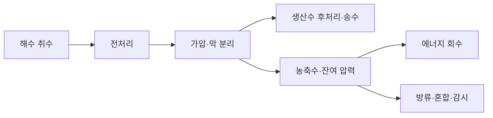

# 담수화 설비는 물·전력·해양 영향을 어떻게 함께 계산하나요? / Desalination and water supply choices

해수 역삼투, 열 담수화와 재이용·수요 관리를 비교합니다. 사례는 미국 Carlsbad 해수 담수화 설비이며 2026년 10월 20일까지 확인한 기관 자료를 사용합니다. 장비를 운전하거나 해수를 분석하지 않았고, 공공 계약·연구·환경 검토를 읽은 문헌 리뷰입니다.

## 물이 사라지는 것이 아니라 흐름이 나뉩니다

담수화는 해수에서 염을 제거해 물을 얻는 공정입니다. 역삼투는 압력을 가해 물을 막 너머로 보내고 대부분의 염을 남깁니다. 열 담수화는 증발과 응축을 활용합니다. 두 방법 모두 생산수와 남은 농축수, 에너지·약품·폐기물의 경계를 확인해야 합니다.

막은 단순한 체처럼 물보다 큰 알갱이만 거르는 것으로 설명하기 어렵습니다. 상용 복합막의 얇은 선택층에서는 성분이 재료 안에 들어가 이동하는 성질이 다릅니다. 잘 통하는 물과 덜 통하는 염의 차이를 이용합니다. 막이 빨리 물을 보내도 최종 염도나 붕소 조건을 충족하지 못하면 후처리 부담이 생깁니다.

기술적으로 “물 생산”을 달성한 뒤에도 음용수의 미네랄 조정·소독, 송수·저장이 필요합니다. 매우 낮은 염도의 물이 관로와 만날 때의 부식 성질도 검토해야 합니다. 원수의 수질과 생산수의 이용 목적을 적지 않은 전력 숫자는 공정한 비교에 불충분합니다.

## 실제 설비와 계약을 함께 봅니다

San Diego County Water Authority는 Carlsbad가 2015년 상업운전을 시작했으며 2012년에 승인한 30년 물 구매계약으로 연간 최대 56,000 acre-feet를 구매한다고 설명합니다. 공개 설명에는 기본 구매량의 고정·변동 비용과 추가 물량의 비용 구분도 있습니다. 이는 장비를 사는 대신 물 공급 성과를 장기 구매하는 사업모형입니다. [공공 구매기관의 사업·계약 안내](https://www.sdcwa.org/your-water/local-water-supplies/seawater-desalination/)

이 계약은 물이 최종 수질 조건을 충족하는지와 설비 유지 조건을 연결합니다. 물 생산 단가가 낮아지는 기술이 나와도 기존 관로·허가·금융·장기 계약이 즉시 사라지지는 않습니다. 반대로 장기 구매 약정은 초기 건설에 필요한 자금을 조달할 기반이 될 수 있습니다. 수요가 줄어드는 상황에서는 고정 부담을 누구에게 어떻게 나눌지가 별도 문제가 됩니다.

구매기관과 제조·운영업체는 사업 이해관계가 있습니다. 기관의 공급 안정성 설명을 독립적인 생태 영향 실측이라고 취급하지 않습니다. 환경 영향에는 별도의 관측과 검토가 필요합니다. 과거 규제 페이지에 남은 “현재”라는 문구도 작성 시점의 맥락을 확인해야 합니다.

## 에너지 숫자의 경계

Elimelech·Phillip의 2011년 Science 검토는 막 단계의 열역학적 제약과 취수·전후 처리 부담을 나눕니다. 좋은 막만으로 분리의 최소 일을 없앨 수 없으며, 전체 설비의 전력과 막 단계만의 전력을 구별해야 한다는 분석입니다. 여기서 옛 논문의 설비 값을 현행 Carlsbad의 전력계 실측으로 쓰지 않습니다. [논문 DOI](https://doi.org/10.1126/science.1200488) · [논문 해설](../../논문해설_papers/에너지와환경_energy-environment/desalination2011.md)

전력 원단위는 보통 생산수 1 m³당 kWh로 표현합니다. 가상 설비의 막 단계가 2.1, 취수·전후 처리가 0.8, 송수가 0.6 kWh/m³라면 공급 장소까지 3.5 kWh/m³입니다. 다른 설비가 막 단계만 1.9라고 보고했을 때 두 값을 그대로 비교하면 안 됩니다. 회수율과 최종 수질까지 맞추어야 합니다.

열 담수화의 증기 사용량도 전기와 같은 단위로만 바꾸어 더하면 비용과 배출이 흐려질 수 있습니다. 발전소의 폐열처럼 다른 용도가 제한된 열인지, 별도로 연료를 태워 만든 열인지가 중요합니다. 사용 가능한 열이 가까이 있다는 사실도 장기 공급 계약과 배관 손실을 확인해야 의미가 있습니다.

## 자체 계산: 생산수와 농축수

35 kg/m³의 염을 가진 해수 100 m³가 들어오고 회수율 45%, 염의 생산수 유출은 무시한다고 합시다. 생산수는 45 m³, 농축수는 55 m³입니다. 농축수의 염은 3,500/55≈63.64 kg/m³입니다. 이는 물질수지 예제이며 실제 복합 해수의 침전과 부피 변화까지 계산한 값은 아닙니다.

농축수 55 m³에 같은 염도의 원수 55 m³를 추가하면 농도는 (3,500+1,925)/110≈49.32 kg/m³입니다. 희석은 주변의 순간 농도를 낮추지만 물의 총 염 질량을 없애지는 않습니다. 취수 유량을 늘려 희석한다면 추가 펌프와 해양 생물 유입 부담이 생길 수 있습니다. 한 환경 지표만 낮추려는 조치가 다른 부담을 늘릴 수 있습니다.

이 자체 그림에서 에너지 회수는 농축수의 압력을 다시 활용하는 과정입니다. 염을 제거하는 과정과 같지 않습니다. 펌프·에너지 회수기의 성능은 전력에, 선택층과 추가 처리의 성능은 수질에도 영향을 줍니다. 기능이 다른 부품을 한 가지 “효율”로 덮지 않는 것이 중요합니다.

## 환경 자료를 읽을 때의 독립성

규제기관이 공개한 2018년 Science Advisory Panel 보고서는 취수에 의한 생물 영향과 보상 서식지 계산의 가정을 검토합니다. 검토진은 독립 전문가이지만 비용은 사업자가 부담했다는 점이 규제기관 안내에 명시됩니다. 중립적 검토와 자금 제공의 경계를 함께 적어야 하며, 협찬 여부를 확인하지 않은 개인 후기를 독립 실측으로 대신하지 않았습니다. [규제기관의 자료와 검토진 안내](https://www.waterboards.ca.gov/sandiego/water_issues/programs/regulatory/carlsbad_desalination.html)

해당 검토는 물고기가 헤엄칠 능력이 있다는 가정과 실제로 빠져나간다는 관측이 다르다고 지적합니다. 기술이 할 수 있는 일과 현장에서 실제 한 일을 나누는 좋은 사례입니다. 취수량에 비례해 모든 생물 영향이 선형 증가한다고 가정해도 표본의 계절·종·드문 대량 유입 사건이 결과에 영향을 줄 수 있습니다. [2018년 독립 검토 PDF](https://www.waterboards.ca.gov/sandiego/water_issues/programs/regulatory/docs/SAP/Poseidon_Carlsbad_SAP_report.pdf)

여기서는 그 검토를 2026년까지 모든 해양 영향이 없었다는 증거로 사용하지 않습니다. 건설 전의 예측 검토, 허가 조건, 운영 후 감시는 서로 다른 자료입니다. 최신 허가 전체나 해양 원시자료를 재분석하지 않았으므로 규정 준수의 최종 판정도 하지 않습니다. 출처를 읽을 때 자료의 시점과 역할을 표시하는 것이 수치 자체만큼 중요합니다.

## 대안은 같은 서비스로 비교합니다

| 방식 | 원리·역할 | 비교에서 맞출 조건 |
|---|---|---|
| 해수 역삼투 | 압력으로 물과 염을 분리합니다 | 염도·회수율·수질·에너지 경계 |
| 열 담수화 | 증발·응축과 열 회수를 이용합니다 | 열의 출처·전기·증기 가치 |
| 하수 재이용 | 이미 모인 물을 용도에 맞게 처리합니다 | 미량오염물·인증·이용처 |
| 누수 감소·절수 | 기존 물의 손실과 수요를 줄입니다 | 실제 절감량·지속성·가뭄 신뢰도 |

재이용은 도시 근처에 이미 모인 물을 활용할 수 있지만 사용 목적에 맞는 처리와 사회적 신뢰가 필요합니다. 절수는 저렴한 선택일 수 있어도 모든 수요를 무한히 줄일 수는 없습니다. 담수화는 비가 적은 시기에 공급을 다변화하지만 전력과 해양·부지의 부담을 가집니다. 하나의 승자를 정하기보다 지역의 물 공급 포트폴리오로 보는 편이 정확합니다.

## 운영비와 지역 조건의 숫자 예

가상 전력 원단위 3.5 kWh/m³에 전력 단가 0.10 화폐단위/kWh를 곱하면 전력비는 0.35/m³입니다. 전력이 0.20이면 0.70/m³가 됩니다. 그러나 이것은 물 총생산비가 아닙니다. 금융·인건비·막 교체·약품·관로·감시가 남습니다. 설비비가 대부분인 공정에서는 전기료 절반이 물 가격 절반을 뜻하지 않습니다.

송수 높이도 무시할 수 없습니다. 물 1 m³를 100 m 올리는 최소 위치에너지는 1,000×9.81×100 J≈0.2725 kWh입니다. 펌프 효율 75%면 약 0.3633 kWh이며 배관 마찰은 별도입니다. 해안 생산원가와 내륙 고지대 공급원가가 다른 이유입니다. 바닷가 물을 풍부하게 만들었다는 성과와 모든 지역에 싼 물을 보내는 성과는 구분해야 합니다.

일정량을 안정적으로 구매하는 계약은 설비 금융을 돕지만 새로운 재이용수나 절수로 수요가 바뀌면 비용 배분에 영향을 줍니다. 경쟁 입찰에서는 최저 단가뿐 아니라 수질 미달 시 책임, 에너지 가격 조정, 장기 정비·막 공급과 정보 공개를 봅니다. 특정 막·제어기에 의존하면 교체 때 재검증 비용이 생길 수 있습니다. 이런 산업 조건이 물리적 원리와 함께 기술 선택을 만듭니다.

물 수요가 시간에 따라 바뀌면 저장조로 일부 생산을 옮길 수 있습니다. 그러나 생산 중단 뒤 재가동, 막의 상태와 수질, 물의 저장 한계가 있으므로 언제나 싼 전력 시간에만 운전할 수 있는 것은 아닙니다. 전력 수요 유연성과 안정된 물 공급의 조건을 함께 계산해야 합니다.

## 확인 문제

1. 농축수 희석이 염 질량을 없애는 것은 아닌 이유는 무엇인가요?
2. 막 공정 1.9 kWh/m³와 최종 공급 3.5 kWh/m³를 그대로 비교하면 안 되는 이유는 무엇인가요?
3. 독립 전문가 검토와 운영 후 현장 감시는 어떻게 다른가요?

해설 보기

1. 더 큰 물 부피에 같은 염을 나누는 것이며 질량수지는 그대로 남기 때문입니다.
2. 취수·후처리·송수 등 포함 범위가 다르기 때문입니다.
3. 전자는 자료·가정·예측을 검토할 수 있고 후자는 실제 운영 중 변화를 측정합니다. 서로 대체하지 않습니다.

[기술 리뷰 목록](README.md)
