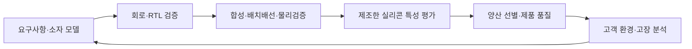

# 칩 설계와 평가·분석 | Chip design, characterization and failure analysis

[직무 목차](README.md) · [반도체 설계·제조 직무](02-반도체설계와제조의직무_semiconductor-design-manufacturing-roles.md) · [제조·패키지 검사](07-공정설비와패키지의검사_process-equipment-package-tests.md) · [언어가 쓰이는 위치](10-C와Python이쓰이는위치_languages-in-the-workflow.md) · [공개 칩·메모리 검사 코드 사례](사례_cases/03-칩과메모리의공개검사코드_chip-memory-test.md)

칩을 검증한다는 말에는 설계 모델의 기능 확인, 레이아웃·시간 검증, 실제 실리콘의 특성 측정, 제조 결함 선별, 고장 위치 추적이 함께 들어갈 수 있습니다. 어떤 대상을 어떤 조건에서 관찰하는지 나누어야 C·Python·Verilog 같은 도구의 역할도 보입니다.

칩 개발에서는 회로·RTL 설계, 신호 처리 알고리즘, 공정과 설계 환경, 실리콘 특성 평가가 서로 다른 결과물을 만듭니다. 이 글은 설계 중의 검증과 제조 후의 평가를 자극·관측값·기대값·판정 기준으로 나누어 설명합니다. 검사 원리는 공식 기술 자료에 연결하며, 제품별 시험 한계·장비 조합은 해당 제품의 요구와 시험 계획에 따라 정합니다. [자료 판본과 확인 범위](출처와검토범위_SOURCES.md)

## 1. 설계에서 출하까지 서로 다른 질문

| 단계 | 입력·자극 | 관측·판정 | 결과를 받는 사람의 다음 작업 |
| --- | --- | --- | --- |
| 기능 검증 | 요구사항, RTL, 트랜잭션·경계 입력입니다. | 응답 순서·데이터·상태·assertion을 기준 모델과 비교합니다. | 논리·인터페이스·검증 환경을 수정합니다. |
| 타이밍·물리검증 | netlist, 라이브러리, 배선·클록·제약·공정 규칙입니다. | setup/hold 여유, DRC·LVS 결과, 기생 성분을 확인합니다. | 회로·배치·배선·제약·모델을 구분해 수정합니다. |
| 특성 평가 | 실제 시료, 동작 패턴, 전원·온도·주파수입니다. | 전류·전압·오류·지연과 조건별 분포를 측정합니다. | 모델 적합성과 제품 동작 여유를 판단합니다. |
| 생산 테스트 | 검증한 프로그램·치구·한계·패턴입니다. | 제품별 pass/fail·bin과 시간·원시 결과를 기록합니다. | 선별과 공정·제품별 실패 추세를 관리합니다. |
| 고장 분석 | 재현 가능한 실패와 시료 이력입니다. | 전기적 위치 후보와 실제 구조·재료 관찰을 연결합니다. | 원인을 검증하고 설계·공정·시험으로 되돌아갑니다. |

기능 검증의 전형적인 testbench·monitor·scoreboard·coverage 관계는 [Accellera UVM 1.2 User’s Guide 1.1절](https://www.accellera.org/images/downloads/standards/uvm/uvm_users_guide_1.2.pdf)에 있습니다. 이 문서는 학습용 구조 설명에 사용했으며 현재 모든 팀이 같은 UVM 판본을 쓴다는 뜻은 아닙니다.

## 2. RTL 검증에서 Verilog·C·Python이 만나는 곳

RTL은 클록에 따라 상태와 데이터가 이동하는 하드웨어 동작을 기술합니다. 소프트웨어 함수의 결과가 맞더라도, 하드웨어가 매 주기 데이터를 받는 순서·동시성·reset·backpressure까지 자동으로 맞는 것은 아닙니다.

FIFO를 예로 들면 데이터 값뿐 아니라 가득 찼을 때 쓰기를 거절하는지, 비었을 때 읽기를 거절하는지, read/write가 겹칠 때 점유량을 올바르게 갱신하는지를 확인해야 합니다. reset 직후와 포인터가 끝에서 처음으로 돌아가는 순간도 별도 입력입니다.

| 구성 요소 | 구체적인 역할 | 언어가 필요한 이유 |
| --- | --- | --- |
| DUT의 RTL | 플립플롭·조합논리·인터페이스를 기술합니다. | Verilog/SystemVerilog 같은 HDL은 클록·비트 폭·동시 동작을 표현합니다. |
| 자극·driver | 유효한 요청과 금지/경계 조건을 순서대로 만듭니다. | 검증 코드는 데이터와 프로토콜 시점을 함께 제어해야 합니다. |
| monitor | 실제 핀의 handshake와 데이터를 관측합니다. | 요청한 값이 아닌 실제 수락된 거래를 읽어야 합니다. |
| 기준 모델·scoreboard | 수락된 입력으로 독립 기대값을 만들고 출력과 맞춥니다. | C/C++·Python 등으로 산술·큐·알고리즘 모델을 표현할 수 있습니다. 시뮬레이터와의 연결 방식은 환경마다 다릅니다. |
| coverage·회귀 실행 | 어떤 조건을 관측했는지와 실행 실패를 모읍니다. | Python·셸은 입력·seed·판본·로그를 묶는 데 쓰일 수 있습니다. coverage 숫자만으로 결과의 정확성을 증명하지는 않습니다. |

SystemVerilog/UVM·C++ 모델·Python 연동은 위 원리를 구현하는 도구 예입니다. 자극 생성·기준 모델·신호 관측을 어느 환경에서 실행할지 검증 대상과 인터페이스에 맞추어 정합니다. [기존 RTL 비교 사례](../설계와검증사례_engineering-cases/프레임오류와FPGA검증_fpga-frame-validation.md)에서는 입력 형식·순서·폭 오류와 기준값의 경계를 읽으실 수 있습니다.

중요한 실패 예는 DUT와 기준 모델에 같은 잘못된 주소식을 복사하는 경우입니다. 둘이 항상 같은 값을 내더라도 요구사항과 함께 틀렸을 수 있습니다. 작은 입력의 수동 기대값, 다른 표현으로 작성한 모델, 경계 조건이 필요한 이유입니다.

## 3. 모델과 레이아웃에서 확인하는 것

| 용어 | 뜻과 검사 대상 | 통과만으로 알 수 없는 것 |
| --- | --- | --- |
| SPICE | 소자 모델과 회로 연결로 전압·전류·시간·주파수 응답을 계산하는 회로 시뮬레이션입니다. | 모델의 적용 범위 밖 실제 소자·배선·열화까지 맞는다고 보장하지 않습니다. |
| TCAD | 공정·재료·구조·소자 물리를 계산하여 제조 과정과 소자 특성을 연구하는 시뮬레이션입니다. | 소자 모델과 실측의 교정·경계 조건이 필요합니다. SPICE와 같은 크기의 문제를 같은 방식으로 푸는 도구는 아닙니다. |
| PDK | 해당 공정의 소자 모델·설계 규칙·추출·검증 자료를 묶은 설계용 kit입니다. | PDK 판본이 바뀌면 같은 설계의 결과가 달라질 수 있습니다. |
| DRC | 도형의 폭·간격 등 제조 규칙 위반을 찾습니다. | 올바른 회로 연결과 기능까지 증명하지 않습니다. |
| LVS | 레이아웃에서 읽은 소자·연결을 기준 회로와 비교합니다. | 타이밍·잡음·실리콘 품질까지 검사한 것은 아닙니다. |
| PEX | 배선·구조의 기생 저항·정전용량 등을 추출합니다. | 추출 모델과 실제 공정 편차·동작 조건은 추가로 맞춰야 합니다. |
| STA | 라이브러리·배선·클록·제약으로 경로의 지연과 타이밍 여유를 분석합니다. | 기능 입력을 모두 시뮬레이션한 결과는 아닙니다. |

TCAD의 공정·소자 시뮬레이션과 교정은 [Synopsys TCAD의 Overview·Calibration·Process Simulation](https://www.synopsys.com/manufacturing/tcad.html)에서 확인했습니다. DRC·LVS·PEX·PDK는 설계와 제조 공정을 잇는 기술이며, 구체적인 rule deck이나 모델 계수는 해당 공정의 설계 환경을 따릅니다.

STA에서 setup은 캡처 에지 전에 데이터가 충분히 일찍 도착해야 하는 조건이고, hold는 그 에지 뒤에도 데이터가 필요한 시간 동안 유지되어야 하는 조건입니다. 느린 경로뿐 아니라 너무 빠른 경로도 문제가 됩니다. 제약의 단위·클록·예외가 잘못되면 보고서가 좋아도 실제 요구를 확인한 것이 아닙니다. [Synopsys의 STA 정의와 setup/hold·timing exception 설명](https://www.synopsys.com/glossary/what-is-static-timing-analysis.html), [setup·hold 학습 본문](../전자컴퓨터공학_ece/15-FPGA-ASIC설계_fpga-asic/해설_notes/너무늦어도너무빨라도문제다_setup-hold-static-timing.md)

여기서 Tcl은 회로를 대체하는 언어가 아니라 도구의 설계 읽기·제약 적용·실행·보고서 생성 흐름을 제어하는 데 쓰일 수 있습니다. Python·Perl은 보고서를 구조화하고 실행 조건별 차이를 모으는 데 쓰일 수 있습니다. 실제 도구의 지원 명령과 파일 형식은 해당 판본 문서에 맞춥니다.

## 4. 실리콘 특성 평가는 조건과 기준면을 맞춥니다

PVT의 P는 process, V는 voltage, T는 temperature입니다. 시뮬레이션에서는 공정 corner 모델을 선택하고, 실측에서는 제조된 시료·로트의 차이를 비교합니다. 이미 만든 한 칩의 공정을 온도 설정처럼 바꾸는 것은 아닙니다.

| 관측량 | 단위의 예 | 사용하는 자원과 시험 조건 | 실패 원인의 후보 |
| --- | --- | --- | --- |
| 누설·소비전류 | A·mA·µA 등 | 전원·SMU, 동작/대기 모드, DUT 실제 전압입니다. | 소자·회로 상태·온도·누설 경로·치구 오염입니다. |
| I–V 특성 | V와 A | SMU의 인가·측정·compliance, 접촉·settling 조건입니다. | 소자 차이 외에 접촉·배선·측정 범위 문제입니다. |
| 지연·주파수 한계 | s·Hz | 패턴·클록·전원·온도를 맞춘 기능 시험입니다. | 데이터 경로·클록·전원 강하·시험 타이밍입니다. |
| eye·jitter·BER | V·s·오류/전송 bit | 오실로스코프·오류율 시험기·시험 패턴·수신 기준면입니다. | 채널 손실·반사·잡음·클록·송수신기 설정입니다. |
| 전원 응답 | V·s·A | 부하 변화와 전원·보드 측정 위치입니다. | 공급기·배선·PDN·레귤레이터·디커플링입니다. |

SMU는 전압 또는 전류를 인가하면서 응답을 측정하는 장비입니다. remote/Kelvin sense는 DUT 쪽 전압을 따로 읽어 전류선의 저항성 전압 강하 영향을 줄이는 데 사용합니다. 이것이 고속 파형의 모든 전원 오차를 제거한다는 뜻은 아닙니다. [Keysight, Selecting the Right SMU의 기능·4-wire 설명](https://www.keysight.com/us/en/assets/3122-1709/white-papers/Selecting-the-Right-SMU.pdf), [SMU 기초와 연결](../현장계측과검증_measurement-validation/계측기_instruments/전압전류인가와소자특성측정_keithley-2450.md)

### 전압·주파수 shmoo의 학습 예

shmoo는 조건 두 개를 바꾸며 동작 결과를 격자로 정리한 것입니다. 아래는 설명용으로 구성한 판정이며 실측값이 아닙니다. 각 칸은 같은 기능 패턴을 정해진 횟수·시간·온도에서 실행했다고 가정합니다.

| 실제 DUT 전압 / 시험 주파수 | 100 MHz | 150 MHz | 200 MHz |
| --- | --- | --- | --- |
| 0.75 V | 통과 | 실패 | 실패 |
| 0.80 V | 통과 | 통과 | 실패 |
| 0.85 V | 통과 | 통과 | 통과 |

이 표에서 0.80 V·150 MHz가 통과해도 온도·패턴·시료를 바꾸면 경계가 달라질 수 있습니다. 칩 전압이 설정값에 도달했는지, thermal settling이 충분한지, 시험 프로그램이 실제 경로를 자극하는지도 확인합니다. 오류·통신 중단·측정값 누락은 ‘실패한 기능’과 별도 상태로 기록합니다. [조건별 오동작과 수율](../현장계측과검증_measurement-validation/칩과시스템시험_chip-system-testing/조건별오동작과수율의경계_pvt-shmoo-characterization.md)

| 이 시험에서의 코드 | 구체적인 입력·처리·출력 |
| --- | --- |
| DUT의 C 펌웨어 | 문서화된 제어 인터페이스로 IP를 초기화하고 알려진 입력·메모리 패턴·오류 상태를 실행합니다. |
| 호스트 Python | 장비와 DUT 통신을 조율하고 조건·실행 ID·원시 응답·예외를 저장한 뒤 격자와 분포를 만듭니다. |
| C/C++ 라이브러리·tester API | 지원 환경에서는 빠른 계산·벤더 API·기존 시험 자원을 연결합니다. |

Python이 고속 패턴의 모든 에지를 직접 만들어야 한다는 뜻은 아닙니다. 결정적인 시간 분해능은 해당 tester·FPGA·장비가 담당할 수 있습니다. PyVISA의 `query`는 메시지 전송과 읽기를 합친 동작이며, 이를 지원하는 장비를 제어하는 한 가지 방법입니다. [PyVISA 공식 communication 문서](https://pyvisa.readthedocs.io/en/latest/introduction/communication.html)

## 5. DFT와 ATE는 역할이 다릅니다

DFT는 제조 뒤 내부 상태를 제어·관찰하기 쉽도록 설계에 넣는 구조입니다. ATE는 제품에 자극을 가하고 응답을 측정하는 시험 장비입니다. DFT를 넣는 일, 패턴을 만드는 일, ATE에서 그 패턴을 실행하는 일은 연결되지만 같은 작업은 아닙니다.

| 용어·작업 | 무엇을 확인하나요 | 결과를 잘못 읽기 쉬운 부분 |
| --- | --- | --- |
| Scan | 내부 상태를 넣고 읽을 수 있는 경로를 사용합니다. | 일반 동작과 다른 시험 모드의 조건을 확인해야 합니다. |
| ATPG | 선택한 고장 모형이 출력에 드러나도록 입력 패턴을 만듭니다. | 선택한 고장 목록·제외 항목이 검출률의 분모를 바꿉니다. |
| MBIST | 칩 내부 시험 회로로 메모리의 주소·데이터·순서 문제를 찾습니다. | 짧은 패턴만으로 모든 retention·온도·결합 문제를 검사하지는 않습니다. |
| Parametric test | 전압·전류·타이밍 등의 규격을 검사합니다. | 숫자가 범위 안에 있어도 기능·장기 신뢰성은 별도입니다. |
| Functional test | 제품이 정한 기능과 시퀀스를 실행합니다. | 기능 하나의 통과가 모든 내부 결함 검출을 뜻하지 않습니다. |
| Test interface | probe card·load board·socket·배선으로 장비와 DUT를 연결합니다. | 접촉 실패와 실제 제품 실패를 구분해야 합니다. |

scan·ATPG·BIST의 관계는 [Synopsys DFT의 Definition·How Does Design for Test Work?](https://www.synopsys.com/glossary/what-is-design-for-test.html)에서 확인했습니다. 검출률과 관측 가능성은 [scan·ATPG 본문](../전자컴퓨터공학_ece/51-반도체테스트제조_test-manufacturing/해설_notes/보이지않는내부상태를검사하기_scan-atpg-fault-coverage.md), 시험 삽입은 [웨이퍼 검사](../반도체제조공정_semiconductor-fabrication/07-웨이퍼검사와수율_eds-yield.md)에서 이어집니다.

ATE 프로그램 개발에서는 자원 설정·범위·시간·전원 안정화·패턴·판정 한계·bin·정리 동작을 연결합니다. 시험 시간을 줄였더니 특정 settling이나 결함 검출이 사라졌다면 생산성이 높아졌다는 이유만으로 채택할 수 없습니다. 실패·미실행·무효 측정이 섞이지 않게 하는 프로그램 상태 관리도 필요합니다.

## 6. SI·PI와 보드는 칩 밖의 조건을 만듭니다

SI, signal integrity는 수신 지점에서 신호의 전압·시간 정보가 보존되는 문제입니다. PI, power integrity는 회로가 요구하는 전원·귀환 경로를 제공하는 문제입니다. 빠른 에지에서는 칩·패키지·보드·케이블을 함께 보아야 합니다. 전기·열 모델의 경계와 실제 측정 기준면도 함께 맞춥니다.

예를 들어 고속 인터페이스에 오류가 생겼다면 송신 설정, 채널 반사·손실, 수신 등화, 클록, 전원 잡음을 경쟁 원인으로 둡니다. C 펌웨어는 초기화·훈련·패턴 실행을 담당하고, Python은 설정별 오류·온도·파형·장비 상태를 묶을 수 있습니다. 오류 카운터가 0인 결과도 전송 bit 수와 시험 시간을 함께 적어야 비교할 수 있습니다.

[PCB·귀환 경로](../전자컴퓨터공학_ece/12-PCB하드웨어설계_pcb-hardware/README.md), [S11·S21과 기준면](../현장계측과검증_measurement-validation/계측기_instruments/반사와전달의기준면측정_keysight-e5061b.md), [파형과 프로브 조건](../현장계측과검증_measurement-validation/계측기_instruments/오실로스코프로신호와리플관측_keysight-dsox1204g.md)에서 각 관측의 의미를 공부하실 수 있습니다.

## 7. 전기적 실패를 물리적 원인과 연결합니다

EFA, electrical failure analysis는 전기적 증상·위치·경로를 좁히는 분석이고, PFA, physical failure analysis는 구조·재료의 관찰로 원인을 조사하는 분석입니다. 불량 코드 하나를 곧바로 특정 공정의 책임으로 바꾸는 과정이 아닙니다.

| 조사 단계 | 보존할 자료 | 다음 분석을 정하는 기준 |
| --- | --- | --- |
| 재현 | 시료·기능·전원·온도·순서·최초 실패입니다. | 보드·접촉·프로그램 문제인지 제품 증상인지 나눕니다. |
| 전기적 위치 좁히기 | 누설 경로·주소 bitmap·조건 민감도·접속 정보입니다. | 어느 영역을 물리적으로 볼지 후보를 줄입니다. |
| 비파괴 관찰·위치 추정 | 해당 시료에 가능한 광학·열·방사선·음향 증거입니다. | 시료를 손상시키기 전에 얻을 수 있는 정보를 모읍니다. |
| 단면·재료 분석 | 선택한 위치의 SEM/TEM·조성·계면 자료입니다. | 관찰한 구조가 전기적 증상을 설명하는지 대조합니다. |
| 원인 검증·재평가 | 공정/설계/재료/시험 이력과 정상 대조입니다. | 조치가 같은 고장 기구를 줄였는지와 다른 문제가 생겼는지 확인합니다. |

FIB는 특정 위치를 가공해 단면·TEM 시료 등을 준비하는 데 쓰이고, SEM·TEM은 관찰 범위와 시료 준비 조건이 다릅니다. [Thermo Fisher의 결함 위치 추적·FIB·SEM/TEM 설명](https://www.thermofisher.com/us/en/home/semiconductors/defect-localization.html)은 장비 기능의 근거입니다. 공급사의 분석 속도·수율 홍보 수치를 모든 제품의 결과로 옮기지는 않습니다.

시간 분해 발광 분석은 회로 동작과 관련된 빛을 관찰하는 접근입니다. 빛이 약해지고 여러 소자의 신호가 겹치는 문제도 있어 ‘밝은 점이 보이면 원인이 확정된다’고 이해하지 않습니다. [NIST TREM 연구의 Summary](https://www.nist.gov/programs-projects/time-resolved-emission-microscopy-circuit-evaluation-and-failure-analysis)

## 8. 신호·영상 알고리즘은 무엇을 검사하나요

신호 처리 알고리즘을 칩에 구현할 때는 입력 데이터 형식·정밀도·지연·메모리·전력 제약을 함께 맞추어야 합니다. 아래는 통신·영상 처리와 하드웨어 구현이 만나는 경계를 설명하는 예이며 실제 제품의 알고리즘 선택·성능 수치가 아닙니다.

| 개념 | 하는 일 | 비교할 입력·출력과 실패 예 |
| --- | --- | --- |
| Synchronization | 송수신 시간·주파수 기준의 어긋남을 추정·보정합니다. | 주파수 오차·지연·잡음을 바꾸어 검출·복조 결과를 비교합니다. |
| FFT | 시간 신호를 주파수 성분으로 바꾸는 빠른 계산입니다. | 고정소수점 폭·스케일·오버플로가 기준 모델과 맞는지 봅니다. |
| Modulation·Detection | bit를 심벌로 표현하고 관측값에서 심벌·bit를 추정합니다. | 잡음·채널 조건별 오류율과 soft decision 값을 비교합니다. |
| Channel estimation | 전송 경로의 변화·왜곡을 추정합니다. | 알려진 입력과 실제 채널 조건의 차이, 추정 오차를 봅니다. |
| Channel coding | 오류 복원을 위한 구조를 추가하고 복호합니다. | 오류 패턴·복호 실패·처리 지연을 확인합니다. |
| Beamforming | 여러 안테나 신호의 위상·크기를 조합합니다. | 방향·채널 변화에서의 신호 품질과 연산량을 봅니다. |
| Demosaicing | Bayer처럼 화소마다 일부 색만 가진 자료에서 색 영상을 복원합니다. | 배열 순서·색 채널·경계의 가짜 색을 비교합니다. |
| Noise reduction·WDR | 잡음을 줄이거나 밝고 어두운 영역을 함께 표현합니다. | 세부 무늬 손실·움직임 잔상·포화와 표현 범위를 함께 봅니다. |
| AF·AE·AWB | 초점·노출·화이트밸런스를 조절합니다. | 장면 변화에서의 안정화·지연과 과도한 진동을 확인합니다. |
| DVS·SLAM | DVS는 밝기 변화 사건을 출력하는 센서 방식이고, SLAM은 위치와 지도를 함께 추정하는 문제입니다. | 센서 시간·이동·오류 누적과 기준 경로를 대조합니다. 둘을 같은 센서 이름으로 묶지 않습니다. |

OpenCV 4.12의 [공식 색 변환·demosaicing 문서](https://docs.opencv.org/4.12.0/d8/d01/group__imgproc__color__conversions.html)는 C++와 Python 인터페이스, Bayer 패턴·입력 bit 깊이·출력 채널을 함께 보여 줍니다. 이것은 언어가 이미지 버퍼의 형식·연산·결과 비교에 쓰이는 구체적인 예입니다. 소프트웨어 라이브러리의 결과와 실제 ISP 구현은 정밀도·처리 순서·경계 조건을 맞추어 비교합니다.

통신에서는 표준의 판본도 입력 조건입니다. 예를 들어 [ETSI TS 138 214 V19.2.0(2026-02), 1절·2절](https://etsi.org/deliver/etsi_ts/138200_138299/138214/19.02.00_60/ts_138214v190200p.pdf)은 5G NR 데이터 채널의 물리 계층 절차와 관련 규격을 구분합니다. 확정된 규격에 맞춘 구현과 차세대 통신 방식의 연구는 목표·입력·판정 근거가 다릅니다.

## 9. 보안 IP도 기능과 보안 주장을 나누어 봅니다

TRNG는 물리적 잡음 등에서 난수를 얻는 하드웨어 구성과 연결되고, PUF는 소자별 물리적 차이를 식별 등에 이용하는 접근입니다. 난수원은 편향·예측 가능성을, PUF 응답은 환경 변화에서의 재현성과 장치 간 차이를 구분해 평가합니다. [NIST SP 800-90B 개요](https://csrc.nist.gov/pubs/sp/800/90/b/final), [IEEE의 PUF 정의](https://technav.ieee.org/topic/physical-unclonable-function/)를 함께 읽으실 수 있습니다. 메모리 보호 IP는 접근 권한·주소 범위·예외 처리처럼 금지된 동작을 차단하는 조건도 검사합니다.

PQC 가속기는 양자컴퓨터 공격을 고려한 암호 계산을 구현하는 하드웨어입니다. [NIST의 PQC 공식 개요](https://csrc.nist.gov/Projects/Post-Quantum-Cryptography)는 ML-KEM·ML-DSA·SLH-DSA의 목적을 구분합니다. 암호 알고리즘의 기준 벡터 일치, 하드웨어 기능, 구현의 부채널·고장 내성을 서로 다른 검증 항목으로 둡니다. 특정 인증 취득이나 내부 공격 평가를 수행했다고 주장하지 않습니다.

## 10. 한 검사 과제를 끝까지 설명하는 예

다음은 실제 측정 기록이 아닌 학습용 조사 경로입니다. ‘특정 온도에서 메모리 읽기 오류가 증가한다’는 문제를 가정합니다.

1. C 펌웨어의 주소·패턴·캐시·오류 보고 경로가 요구와 맞는지 작은 입력으로 확인합니다.
2. 온도·전압·주파수·시료를 분리하고 호스트에서 실제 조건과 최초 실패를 기록합니다.
3. 제품 오류와 통신 timeout·치구 접촉 실패를 나눕니다.
4. 오류 주소·데이터 bit·패턴 의존성·전원 파형으로 설계·셀·접속·시험계 후보를 좁힙니다.
5. 필요한 전기·물리 분석을 선택하고 정상 시료와 대조합니다.
6. 조치 뒤 같은 시험과 추가 경계 조건을 실행하고, 설명하지 못한 현상도 남깁니다.

산출물은 ‘Python으로 분석했다’라는 문장이 아니라 시험 계획·입력·실행 판본·원시 결과·판정·원인 가설·재평가의 연결입니다. [검사 결과의 판정과 기록](11-검사결과의판정과기록_test-decisions-evidence.md)에서 공통 형식을 이어서 읽으실 수 있습니다.

## 출처와 읽은 범위

| 자료 | 확인 범위 |
| --- | --- |
| [Accellera UVM 1.2 User’s Guide](https://www.accellera.org/images/downloads/standards/uvm/uvm_users_guide_1.2.pdf) | 2015-10-08, 1.1절의 testbench·scoreboard·agent, 4.9–4.10절의 scoreboard·coverage 구성입니다. 구조 설명에 사용했으며 최신 표준 전체의 적합성을 검토한 것은 아닙니다. |
| [Synopsys STA](https://www.synopsys.com/glossary/what-is-static-timing-analysis.html) | Definition·How Does STA Work?의 경로·setup/hold·예외 구분입니다. |
| [Synopsys DFT](https://www.synopsys.com/glossary/what-is-design-for-test.html) | Definition·How Does Design for Test Work?의 scan·ATPG·BIST입니다. |
| [Synopsys TCAD](https://www.synopsys.com/manufacturing/tcad.html) | Overview·Calibration·Process Simulation의 공정·소자 모델과 교정 역할입니다. |
| [Keysight SMU](https://www.keysight.com/us/en/assets/3122-1709/white-papers/Selecting-the-Right-SMU.pdf) | 공개 설명의 인가·측정과 4-wire sensing입니다. 등록을 요구하는 handbook 전체를 읽었다는 뜻은 아닙니다. |
| [PyVISA communication](https://pyvisa.readthedocs.io/en/latest/introduction/communication.html) | ResourceManager·리소스 열기·query/write/read의 역할입니다. 장비 명령 자체는 해당 장비 문서가 기준입니다. |
| [Thermo Fisher 반도체 FA](https://www.thermofisher.com/us/en/home/semiconductors/defect-localization.html) | 결함 위치 추적과 SEM/TEM·FIB·나노프로빙의 기능 구분입니다. 지역별 페이지가 일본어로 연결되는 경우도 있습니다. |
| [NIST TREM](https://www.nist.gov/programs-projects/time-resolved-emission-microscopy-circuit-evaluation-and-failure-analysis) | Summary의 발광 분석·감도·신호 중첩 문제입니다. |
| [OpenCV 4.12 색 변환](https://docs.opencv.org/4.12.0/d8/d01/group__imgproc__color__conversions.html) | Bayer 변환·demosaicing API의 입력·출력·C++/Python 표기입니다. |
| [ETSI TS 138 214 V19.2.0](https://etsi.org/deliver/etsi_ts/138200_138299/138214/19.02.00_60/ts_138214v190200p.pdf) | 2026-02, 1절 Scope·2절 References만 확인하여 물리 계층 절차의 범위를 설명했습니다. 전체 무선 적합성 요구를 옮긴 것은 아닙니다. |
| [NIST PQC](https://csrc.nist.gov/Projects/Post-Quantum-Cryptography) | Overview·PQC Standards의 키 설정·서명 구분입니다. |
| [NIST SP 800-90B](https://csrc.nist.gov/pubs/sp/800/90/b/final) · [IEEE PUF](https://technav.ieee.org/topic/physical-unclonable-function/) | 난수원에 관한 공식 초록과 장치별 제조 차이를 사용하는 PUF의 정의입니다. 인증 시험 전체를 검토하거나 실제 수행한 결과는 아닙니다. |

날짜가 없는 웹 자료의 확인일은 2026-10-26입니다. 표·shmoo·조사 경로는 자체 설명이며 실물 칩이나 ATE를 실행한 결과가 아닙니다.

## English

The chapter separates RTL verification, physical/timing checks, silicon characterization, production screening and failure analysis. It connects each activity to its stimuli, observables, limits, artifacts and programming roles. C firmware, HDL testbenches, EDA scripts and Python instrument/data workflows solve different parts of a test problem. Communication, imaging and security IP illustrate the connections between algorithms, implementation and evidence.
