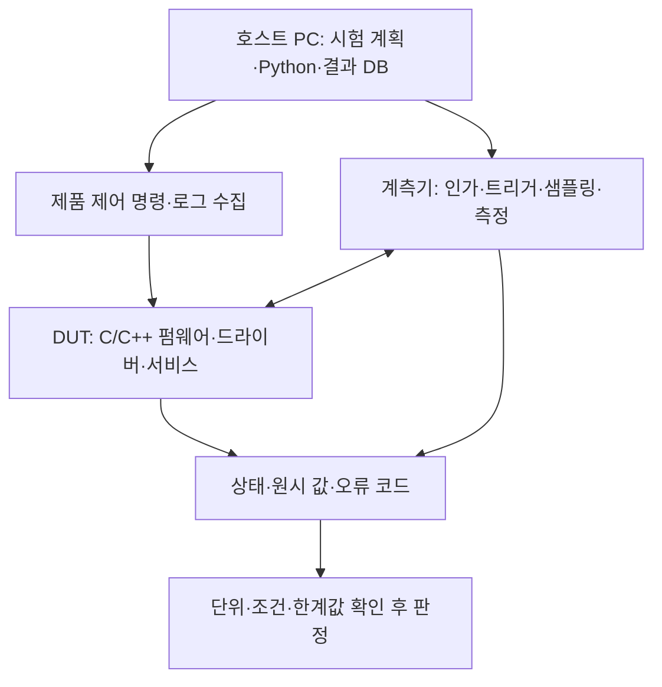

# C·C++·Python이 업무에서 쓰이는 위치 | Languages in the engineering workflow

[직무 목차](README.md) · [직무기술서 읽기](00-JD의업무와기술을읽는법_role-work-evidence.md) · [검사 결과의 판정](11-검사결과의판정과기록_test-decisions-evidence.md) · [공개 코드의 출처와 수정 범위](사례_cases/코드출처와이용조건_CODE_SOURCES.md)

‘검사에 Python이 필요합니다’라는 말은 검사 대상의 물리 원리가 Python으로 바뀐다는 뜻이 아닙니다. 코드는 장비에 조건을 전달하고, 제품의 동작을 실행하고, 측정값을 읽거나 판정·분석을 반복하는 데 사용합니다. 어느 컴퓨터에서 실행하고 어떤 권한·시간 제약을 갖는지부터 나누면 언어의 역할이 명확해집니다.

## 1. 제품 안의 코드와 밖에서 제어하는 코드는 다릅니다



DUT는 device under test, 즉 검사 대상 장치입니다. 호스트는 그 장치를 밖에서 제어하는 PC·서버입니다. 같은 Python 스크립트라도 직접 장비를 제어하는지, 이미 저장한 데이터를 분석하는지에 따라 검증할 위험과 오류가 달라집니다.

| 위치 | 대표적인 코드·언어 | 코드가 실제로 하는 일 | 확인할 오류 |
| --- | --- | --- | --- |
| MCU·SoC의 펌웨어 | C·C++·필요한 Assembly입니다. | 주변 장치 설정, 인터럽트 처리, 버퍼 관리, 통신과 복구를 구현합니다. | 비트 위치, 수명·소유권, 경쟁 상태, 정수 폭과 시간 제약입니다. |
| OS 장치 드라이버 | OS가 정한 언어·API입니다. | 장치 자원·메모리·DMA·중단·전원을 관리합니다. | 주소 공간 혼동, 동기화, 캐시 일관성과 종료 순서입니다. |
| RTL 기능 검증 | SystemVerilog·검증 라이브러리, C/C++ 기준 모델 등입니다. | 입력을 만들고 RTL의 상태·출력을 기대 동작과 비교합니다. | 기준 모델 오류, 누락 시나리오, 타이밍·초기화 가정입니다. |
| 실물 시험·계측 호스트 | Python·장비 API·회사 시험 플랫폼 언어 등입니다. | 조건을 반복하고 명령·응답·측정값·원시 파형을 기록합니다. | 타임아웃, 이전 응답, 단위, 잘못된 채널과 실제 조건입니다. |
| 생산용 테스터 | 테스터가 지원하는 개발 언어와 API입니다. | 핀 자원·패턴·타이밍·계측·bin을 실행합니다. | 자원 매핑, 프로그램 판본, 테스트 시간과 사이트 차이입니다. |
| 통계·AI·데이터 처리 | Python·R·SQL 등입니다. | 데이터를 연결하고 분포·회귀·모델·이상 징후를 평가합니다. | 잘못된 분모·조인, 누설 데이터, 결측·중복과 시간 경계입니다. |
| 서비스·제조 IT | Java·C#·C/C++·Python·JavaScript·SQL 등입니다. | 업무 API·데이터베이스·운영 화면·장비 연계·서비스를 구현합니다. | 재시도 중복, 권한, 상태 불일치와 운영 중 복구입니다. |

이 표는 일반적인 역할 구분입니다. 각 회사 JD의 언어 명시 여부와 필수·우대 구분은 [DX](01-삼성DX의직무와요구역량_samsung-dx-role-map.md), [DS](02-삼성DS의직무와요구역량_samsung-ds-role-map.md), [SK하이닉스](03-SK하이닉스의직무와요구역량_sk-hynix-role-map.md) 표에서 따로 확인합니다.

## 2. C가 레지스터·버퍼와 가까운 이유

레지스터는 하드웨어의 설정·상태·데이터가 노출되는 접점입니다. 장치 설명서에 정해진 비트와 접근 폭을 사용하여 값을 읽거나 씁니다. C의 정수형·비트 연산·포인터는 이 인터페이스를 표현하는 데 쓰입니다. 실제 접근은 MCU의 HAL이나 OS의 장치 접근 API를 따라야 합니다.

다음은 설명을 위해 직접 작성한 비트 해석 코드입니다. 하드웨어를 읽는 공개 드라이버의 발췌가 아니며, 상태값 `0b0101`에서 비트 0은 준비, 비트 2는 과열로 정한 자체 규칙입니다. 제조사 원문 C 드라이버와 Python 계측 코드는 [공개 코드 계측 사례](사례_cases/01-회로와소자의계측코드_circuit-device-measurement.md)에서 별도로 읽으실 수 있습니다.

```c
#include <stdint.h>                         // #include는 고정 폭 정수형을 선언한 헤더를 포함합니다.
#include <stdio.h>                          // printf의 선언을 포함하여 계산한 결과를 화면에 출력합니다.
int main(void) {                            // main은 실행 시작 함수이며, void는 전달받는 인수가 없다는 뜻입니다.
    uint32_t status = 0x5u;                 // uint32_t는 32비트 부호 없는 정수이며, 0x는 16진수·u는 unsigned 리터럴입니다.
    uint32_t ready = (status & (1u << 0)) != 0u; // <<로 마스크를 만들고 &로 비트를 고른 뒤 !=로 참·거짓을 정합니다.
    uint32_t hot = (status & (1u << 2)) != 0u;   // 비트 2를 독립적으로 검사하며 다른 비트를 지우거나 장치를 제어하지 않습니다.
    printf("%u %u\n", (unsigned)ready, (unsigned)hot); // unsigned로 형을 맞추고 두 값을 출력하며 \n은 줄바꿈입니다.
    return 0;                              // 0을 반환하여 정상 종료를 알립니다.
}                                          // 중괄호로 함수의 범위를 끝냅니다.
```

이 예의 `ready`와 `hot`은 모두 1입니다. 준비 비트만 보고 합격 처리하면 과열 상태를 놓칠 수 있습니다. 실제 장치에서는 읽으면 지워지는 비트, 1을 쓰면 지워지는 비트, 예약 비트와 접근 순서도 확인해야 합니다.

`volatile`은 특정 접근에 대한 컴파일러 최적화와 관련됩니다. 스레드 간 원자성·상호 배제·DMA 버퍼의 캐시 동기화를 모두 해결하는 키워드는 아닙니다. GCC의 [When is a Volatile Object Accessed?](https://gcc.gnu.org/onlinedocs/gcc/Volatiles.html)는 비휘발성 메모리 접근과의 순서를 보장하는 메모리 배리어로 사용할 수 없다고 설명합니다.

DMA는 CPU가 매 바이트를 직접 복사하지 않고 장치가 메모리 전송을 수행하는 방식입니다. CPU 가상 주소와 장치가 사용하는 DMA 주소가 같다고 가정할 수 없고, 버퍼가 CPU 소유인지 장치 소유인지도 관리해야 합니다. [Linux DMA API Howto의 CPU and DMA addresses·Using Streaming DMA mappings](https://docs.kernel.org/core-api/dma-api-howto.html)가 이 경계를 설명합니다. 이어서 [DMA 버퍼와 캐시](../현장계측과검증_measurement-validation/펌웨어와디버깅_firmware-debugging/DMA버퍼와캐시의경계_cortex-m7-cache-dma.md)를 읽으실 수 있습니다.

## 3. C++이 회로 검증에도 등장하는 이유

C++이 적혀 있다고 항상 제품의 최종 펌웨어라는 뜻은 아닙니다. 알고리즘 기준 모델, 시뮬레이터에 연결할 실행 환경, 테스트 플랫폼의 라이브러리에 사용될 수 있습니다.

예를 들어 덧셈기 RTL에 대해 입력 A·B와 기대 결과를 계산하는 소프트웨어 모델을 만들 수 있습니다. 부호·비트 폭·오버플로·반올림 규칙을 맞추지 않으면 C++ 계산이 맞아도 RTL과 비교할 기준으로는 틀릴 수 있습니다. `int` 하나로 임의 정밀도 하드웨어를 모두 표현할 수는 없습니다.

Verilator는 RTL에서 생성한 모델의 입출력을 C++ 쪽에서 제어하는 연결 방식을 설명합니다. C++ 래퍼는 모델을 생성하고 입력·실행·출력 관찰을 관리합니다. 이는 특정 회사가 Verilator를 사용한다는 주장이 아니라 언어의 위치를 보여 주는 공개 예입니다. [Verilator 5.052, Connecting to C++](https://verilator.org/guide/latest/connecting.html#connecting-to-c)

회로의 병렬성·클록·이벤트를 표현하는 HDL과, 그 회로를 제어하거나 기대값을 계산하는 호스트 코드는 역할이 다릅니다. 실제 비교 예제는 [RTL·하드웨어 검증](../분야_topics/14-하드웨어검증_hardware-verification/README.md)과 기존 [설계·검증 사례](../설계와검증사례_engineering-cases/README.md)에서 연결합니다.

## 4. Python은 계측을 어떻게 반복하나요

Python 호스트가 가상의 전원 시험을 진행한다고 가정하면 다음 작업이 필요합니다.

| 단계 | 코드가 맡는 일 | 코드만으로 확정할 수 없는 것 |
| --- | --- | --- |
| 시험 준비 | DUT·보드·프로그램·장비 식별자와 조건표를 읽습니다. | 배선·프로브·부하가 올바르게 연결됐는지는 별도 확인이 필요합니다. |
| 조건 설정 | 지원 API나 명령으로 설정을 요청합니다. | 요청값과 실제 인가값은 다를 수 있습니다. |
| 완료 동기화 | 완료 상태·트리거·정착 시간을 확인합니다. | 일정 시간 기다렸다는 사실만으로 모든 장비가 완료된 것은 아닙니다. |
| 취득 | 측정값·상태·단위를 함께 읽습니다. | 문자열을 숫자로 바꾼 성공이 유효 측정을 뜻하지는 않습니다. |
| 판정 | 조건·규격 판본과 측정값을 대조합니다. | 누락·범위 초과·통신 오류를 정상값으로 처리해서는 안 됩니다. |
| 기록 | 원시 결과와 판정·예외·재시도 이력을 저장합니다. | 합격 행만 남기면 원인 분석에 필요한 실패가 사라집니다. |

SCPI는 계측기에 명령을 전달하는 체계이고 VISA는 통신 자원 접근을 위한 인터페이스 계열입니다. PyVISA는 Python에서 그 자원과 통신하도록 돕습니다. `query()`는 일반적으로 명령 쓰기와 응답 읽기를 묶습니다. 타임아웃·종료 문자·응답 형식은 장비 설명서에 맞춰야 합니다. [PyVISA, Communicating with your instrument](https://pyvisa.readthedocs.io/en/latest/introduction/communication.html)

호스트에서 USB·네트워크 명령을 보내는 속도가 계측기의 샘플링 속도와 같지는 않습니다. 빠른 파형은 장비의 샘플러·메모리와 트리거가 취득하고, Python은 취득 설정과 결과 전달을 관리할 수 있습니다. 실제 명령·응답 예는 [SCPI·PyVISA 계측 자동화](../현장계측과검증_measurement-validation/계측자동화_instrument-automation/명령응답과시험결과기록_scpi-pyvisa-automation.md)에 있습니다.

## 5. 측정 이후에도 데이터의 뜻을 지켜야 합니다

CSV에서 읽은 값은 기본적으로 문자열일 수 있습니다. `"1.20"`을 전압으로 사용하려면 숫자 변환뿐 아니라 V인지 mV인지, 실제 측정값인지 오류 표시인지 확인해야 합니다. Python의 [csv 문서](https://docs.python.org/3/library/csv.html)는 기본 읽기에서 자동 형 변환을 하지 않는다고 설명합니다.

SQL은 장비·로트·다이·시험 결과처럼 여러 표의 관계를 연결하는 데 쓰입니다. 같은 로트라는 이유만으로 모든 행을 조인하면 다이별 결과가 곱으로 늘어날 수 있습니다. 로트·웨이퍼·다이 좌표·시험 항목·실행 ID·반복 번호 등 실제 식별 단위를 정해야 합니다. 이런 데이터 계약은 [시험 데이터의 식별자](../설계와검증사례_engineering-cases/시험데이터의식별자와오판율_test-data-identity-metrics.md)에서 다룹니다.

외부 테스트 프로그램을 실행할 때에는 출력 파일 존재뿐 아니라 종료 상태·시간초과·실행 ID를 확인해야 합니다. Python의 [subprocess.run](https://docs.python.org/3/library/subprocess.html#subprocess.run)은 자식 프로세스 실행·반환 코드·타임아웃을 다루는 공개 인터페이스 예입니다. 이 기능을 사용했다는 사실만으로 시험의 물리적 타당성이 보장되지는 않습니다.

## 6. 언어 공부를 업무에 연결하는 순서

1. C에서는 정수 폭·부호·비트 연산·배열 경계·포인터·수명부터 익힙니다.
2. 펌웨어에서는 인터럽트·상태 머신·버퍼 소유권·통신·예외 복구와 연결합니다.
3. Python에서는 함수·컨테이너·파일·예외·단위 변환·시간초과를 익힙니다.
4. 장비 제어에서는 요청·응답·완료 동기화·상태·로그를 함께 설계합니다.
5. 데이터 분석에서는 먼저 키·분모·조건·결측을 확인한 뒤 통계·그래프·모델을 만듭니다.
6. 결과 설명에서는 입력·예상값·관측값·판정 규칙·재실행 조건을 남깁니다.

## 출처와 확인 범위

| 자료 | 사용한 범위 |
| --- | --- |
| [GCC Volatiles](https://gcc.gnu.org/onlinedocs/gcc/Volatiles.html) | volatile 접근과 비휘발성 메모리 순서의 구분입니다. |
| [Linux DMA API Howto](https://docs.kernel.org/core-api/dma-api-howto.html) | CPU·장치 주소 공간과 streaming DMA의 소유권·동기화입니다. |
| [Verilator Connecting to Verilated Models](https://verilator.org/guide/latest/connecting.html) | 확인 시 표시된 5.052 문서의 C++ 모델 연결입니다. |
| [PyVISA 통신 문서](https://pyvisa.readthedocs.io/en/latest/introduction/communication.html) | 자원·명령/응답·통신 설정입니다. 문서의 latest는 개발판이므로 설치 버전의 지원도 확인합니다. |
| [Python csv](https://docs.python.org/3/library/csv.html) · [subprocess](https://docs.python.org/3/library/subprocess.html) | 문자열·딕셔너리 읽기와 자식 프로세스 결과·타임아웃의 공식 동작입니다. |

확인일은 2026-10-26입니다. 순수 비트 예시와 가상의 시험 흐름은 회사의 실제 장비 실행 결과가 아닙니다.

## English

Languages occupy different execution layers: device firmware, drivers, RTL reference models, instrument control, tester programs, data analysis and production services. The examples explain what each layer controls and what evidence it must preserve. They do not infer a company's internal toolchain from a language name in a job description.
