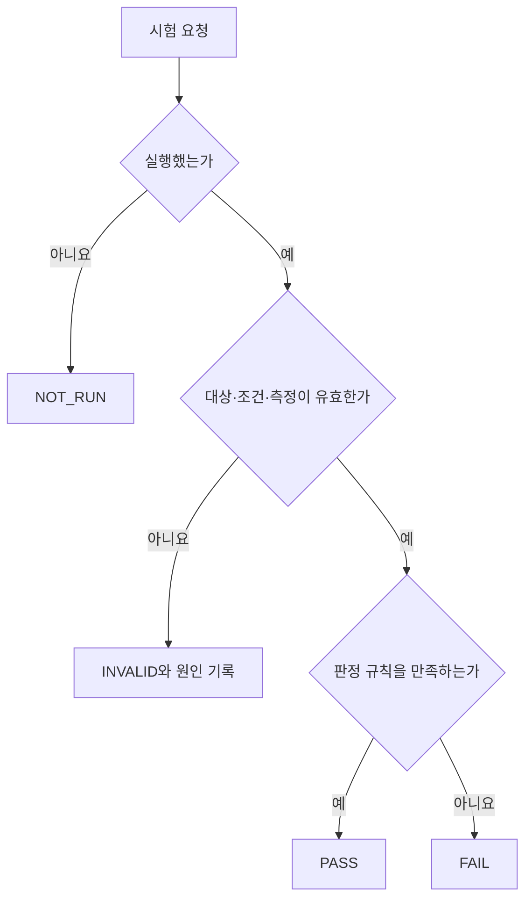

# 검사 결과의 판정과 기록 | Test decisions and evidence

[직무 목차](README.md) · [제품·시스템 검사](04-제품회로와시스템검사_product-circuit-system-tests.md) · [칩 평가](06-칩설계와평가분석_chip-design-characterization.md) · [공정·설비 검사](07-공정설비와패키지의검사_process-equipment-package-tests.md)

검사는 측정값 하나를 얻는 일로 끝나지 않습니다. 어떤 제품에 어떤 조건을 적용했고, 측정이 유효했는지, 어느 규칙으로 판정했는지를 남겨야 결과를 다시 해석할 수 있습니다. 이 글의 숫자는 판정 원리를 설명하기 위한 자체 가정이며 회사의 내부 출하 규격이 아닙니다.

## 1. 측정 전에 결정할 항목

| 항목 | 적을 내용 | 빠졌을 때 생기는 문제 |
| --- | --- | --- |
| 시험 대상 | 제품·실리콘·보드·부품·펌웨어 판본입니다. | 다른 시제품의 결과가 섞입니다. |
| 인가 조건 | 전압·온도·부하·클록·패턴·시간·반복 수입니다. | 서로 다른 조건의 숫자를 성능 차이로 읽게 됩니다. |
| 관측량 | 전류·지연·오류 수·선폭 등과 단위입니다. | mA와 A, peak와 RMS, 지름과 피치를 혼동합니다. |
| 측정 경로 | 장비·채널·프로브·치구·기준면·교정 정보입니다. | 제품의 변화와 측정 경로의 변화를 구분하기 어렵습니다. |
| 판정 규칙 | 규격 판본, 상·하한, 포함 경계와 불확도 처리입니다. | 같은 값에 프로그램마다 다른 결론을 냅니다. |
| 유효성 규칙 | 타임아웃·접촉 실패·범위 초과·결측의 처리입니다. | 측정하지 못한 값을 0이나 정상으로 바꿉니다. |
| 반복·재검사 | 허용 조건, 최초 결과 보존과 중지 조건입니다. | 통과할 때까지 반복한 결과가 최초 수율로 둔갑합니다. |

측정 경로의 교정과 반복성은 제품 자체의 규격 충족과 다른 질문입니다. NIST는 통상적인 Gage R&R 분석과 실제 측정불확도의 차이를 설명합니다. [Doiron, 2016, Dimensional Measurement Uncertainty from Data. Part 2의 공식 초록](https://www.nist.gov/publications/dimensional-measurement-uncertainty-data-part-2-uncertainty-rr)

## 2. PASS·FAIL·INVALID·NOT_RUN을 나눕니다

| 상태 | 뜻 | 예 |
| --- | --- | --- |
| PASS | 필요한 측정이 유효하며 정한 판정 조건을 만족합니다. | 지정 부하·온도에서 유효하게 얻은 전압이 합격 범위에 들어갑니다. |
| FAIL | 필요한 측정이 유효하지만 정한 조건을 만족하지 않습니다. | 접촉·상태가 정상인 시험에서 누설 상한을 넘습니다. |
| INVALID | 결과를 제품 특성의 합격·불합격으로 사용할 수 없습니다. | 통신 끊김, 접촉 불안정, 입력 범위 초과, 단위·판본 불명입니다. |
| NOT_RUN | 해당 항목이 실행되지 않았습니다. | 앞 단계 중단이나 지원하지 않는 구성으로 시험을 건너뛰었습니다. |

이 상태 이름은 이 자료의 기록 예시입니다. 실제 시스템의 상태 코드는 다를 수 있지만, 통신 실패와 유효한 불합격을 같은 숫자로 만드는 문제는 공통적입니다. INVALID의 세부 원인·재시도·복구 기록도 남깁니다.

## 3. 규격 한계와 관리 한계는 다릅니다

규격 한계는 제품·고객·설계가 요구하는 허용 범위입니다. 관리 한계는 공정의 통계적 상태 변화를 감지하기 위해 정하는 경계입니다. 공정이 안정적이어도 규격을 벗어나는 분포일 수 있고, 개별 값이 규격 안에 있어도 공정 평균이 이동한 징후가 나타날 수 있습니다.

NIST의 [Variables Control Charts, Control limits vs. specifications](https://www.itl.nist.gov/div898/handbook/pmc/section3/pmc32.htm)는 두 목적을 구분합니다. 공정 능력의 `Cp`·`Cpk`는 안정성·분포·표본 조건을 고려하여 해석해야 합니다. [NIST, What is Process Capability?](https://www.itl.nist.gov/div898/handbook/pmc/section1/pmc16.htm)

따라서 ‘관리도 경보가 없으니 제품이 모두 합격입니다’와 ‘평균이 목표이니 산포는 괜찮습니다’는 다른 근거가 필요한 결론입니다. 공정·설비에서의 적용은 [공정 검사와 통계](07-공정설비와패키지의검사_process-equipment-package-tests.md)로 연결합니다.

## 4. 경계값에서는 불확도와 의사결정 규칙이 필요합니다

규격 범위를 `0.950–1.050 V`로 가정합니다. 측정값을 x, 해당 결과에 부여한 확장불확도를 U라고 하겠습니다. 설명을 위해 `[x−U, x+U]`가 규격 안에 들어오는 경우에만 합격으로 받는 자체 규칙을 선택합니다.

| 설명용 측정 | 규격과의 단순 비교 | 선택한 구간 포함 규칙 |
| --- | --- | --- |
| x=1.044 V, U=0.005 V | 1.044 V는 규격 안입니다. | 구간은 1.039–1.049 V여서 합격입니다. |
| x=1.048 V, U=0.005 V | 1.048 V는 규격 안입니다. | 구간이 1.043–1.053 V여서 합격으로 받지 않습니다. |

이 예에서 합격으로 받는 측정값 범위는 `0.955–1.045 V`입니다. 원래 규격이 바뀐 것이 아니라 측정과 의사결정 사이에 여유를 둔 것입니다. 이를 guard band로 설명할 수 있습니다. 다만 확장불확도는 가능한 오차의 절대 상한을 보증하는 값이 아니며, 실제 규칙은 요구되는 소비자·생산자 위험과 적용 조건에 맞춰 정해야 합니다. [JCGM 106:2012 8.3.1–8.3.2절](https://www.bipm.org/en/doi/10.59161/jcgm106-2012)은 이런 여유와 잘못된 수락·거부의 관계를 설명합니다.

이 표는 회사의 실제 출하 판정이나 특정 장비의 정확도 사양을 제시하지 않습니다. 중요한 것은 숫자의 경계 포함 여부와 불확도 규칙도 프로그램 입력이라는 점입니다.

## 5. 재검사 전후에는 분모를 고정합니다

제품 100개를 첫 검사하여 PASS 90개, FAIL 6개, INVALID 4개를 얻었다고 가정합니다.

| 집계 이름 | 계산 | 설명 |
| --- | --- | --- |
| 투입 대비 합격 확인율 | 90/100=90% | 처음 투입한 제품 중 합격을 확인한 비율입니다. |
| 유효 결과 안의 합격 비율 | 90/(90+6)=93.75% | 유효한 판정을 얻은 96개 안의 비율입니다. |
| 유효 결과 확보율 | 96/100=96% | INVALID를 숨기지 않고 시험 완료 상태를 보여 줍니다. |

이후 최초 FAIL 중 2개가 승인된 재검사에서 PASS가 되고, INVALID 4개 중 3개가 유효한 PASS가 되었다고 가정합니다. 최종 상태는 PASS 95개·FAIL 4개·INVALID 1개입니다. 최초 PASS가 95개였던 것으로 기록하지 않습니다.

같은 제품의 재시도를 새 제품처럼 세면 분모가 늘어납니다. 반대로 실패한 제품을 집계에서 빼면 비율이 높아 보입니다. 제품 ID·실행 ID·시도 번호를 나누고 최초 결과와 최종 결과를 함께 보존합니다. 이는 교육용 집계 정의이며 실제 회사의 지표 명칭·출하 규칙을 대신하지 않습니다.

## 6. 오류가 0개여도 시험량이 중요합니다

비트 오류 확률 p가 일정하고 각 비트가 독립이라고 가정하면, N비트를 검사해 오류를 하나도 보지 못할 확률은 `(1−p)^N`입니다. 0개 관측에 대한 단측 95% 신뢰 상한을 같은 이항 모형으로 구성하면 다음과 같습니다.

    (1−p_upper)^N = 0.05
    p_upper = 1 − 0.05^(1/N)

N=3,000,000,000비트라는 자체 예에서는 약 `9.99×10⁻¹⁰`입니다. 작은 p의 근사로는 `−ln(0.05)/N`을 사용할 수 있습니다. 이 계산은 무오류를 보증하는 문장이 아니라 시험량을 반영한 통계적 경계입니다. [NIST의 이항 비율 추정·신뢰구간 설명](https://www.itl.nist.gov/div898/handbook/prc/section2/prc241.htm)

실제 통신·메모리 오류는 특정 패턴·온도·전원 이벤트에 묶여 발생할 수 있습니다. 위 계산의 독립·동일 확률 가정과 조건을 바꿔가며 찾는 고장 검출은 다른 문제입니다. 같은 비트 수라도 실제 시험 패턴·조건·초기 상태를 함께 기록해야 합니다.

## 7. 원인 가설을 줄이는 대조를 만듭니다

| 관찰 | 아직 나뉘지 않은 원인 | 다음 대조 |
| --- | --- | --- |
| 특정 보드에서만 실패합니다. | 보드·제품·치구·전원·프로그램 차이입니다. | DUT 교환과 치구·채널 교환을 분리하고 바뀐 항목을 기록합니다. |
| 재부팅하면 정상입니다. | 초기화·전원 이력·상태·열·타이밍 문제입니다. | cold/warm reset과 전원 파형·로그를 구분합니다. |
| 어느 장비에서만 불량률이 높습니다. | 실제 공정 차이와 검사기의 경로·한계 차이입니다. | 기준 시편·장비 상관·동일 조건 재측정과 공정 이력을 대조합니다. |
| 모델 점수는 좋은데 현장 경보가 많습니다. | 기저율·데이터 분포·시간 누설·문턱값·중복 경보입니다. | 실제 기간·대상별 precision·미탐·경보 묶음을 확인합니다. |

한 번에 여러 조건을 바꾸면 좋아진 결과와 원인을 연결하기 어려워집니다. 반대로 상호작용이 큰 문제에서 한 변수씩만 바꾸는 방식도 충분하지 않을 수 있습니다. 어떤 원인들을 구별할 대조인지 먼저 정하고 실험 설계를 선택합니다.

## 8. 한 결과에 남길 정보

| 분류 | 기록 예 |
| --- | --- |
| 식별 | 제품·로트·웨이퍼·다이·보드·샘플·실행 ID입니다. |
| 판본 | 설계·펌웨어·시험 프로그램·한계표·분석 코드의 판본입니다. |
| 조건 | 요청값과 확인한 실제값, 단위, 패턴·부하·온도·시간입니다. |
| 장비 | 모델·일련번호·채널·치구·교정·설정과 필요한 원시 파형입니다. |
| 결과 | 원시 값, 유효성, 판정, 실패 항목, 예외와 재시도 관계입니다. |
| 해석 | 확인된 사실, 남아 있는 가설, 조치와 재검증 범위입니다. |

분석표·그래프는 이 원시 관계를 요약한 결과입니다. 원본 데이터와 판정 규칙을 남겨야 한계값·단위·집계 오류가 발견되었을 때 결과를 다시 계산할 수 있습니다.

## English

Test evidence includes identity, conditions, measurement validity, decision rules and original outcomes. Product limits differ from statistical control limits. Guard bands, retests, invalid results and zero-error observations require explicit definitions and denominators. Numerical examples are hypothetical, not company specifications or measured production data.
