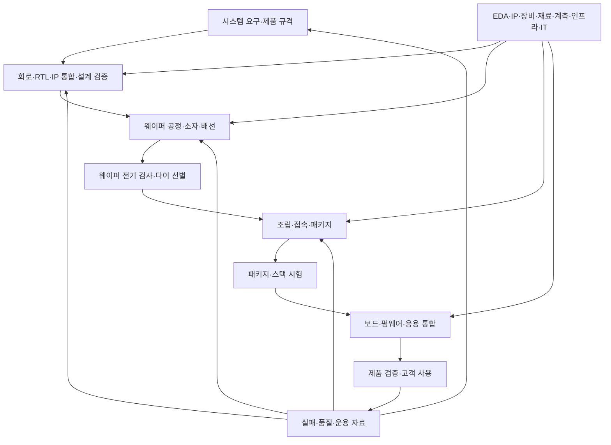

# 반도체 산업과 직무의 연결 | Semiconductor value chain and engineering roles

[직무 목차](README.md) · [제품·시스템 개발](01-전자제품과시스템개발의직무_product-system-roles.md) · [반도체 설계·제조](02-반도체설계와제조의직무_semiconductor-design-manufacturing-roles.md) · [메모리 제품·양산](03-메모리제품과양산의직무_memory-product-production-roles.md) · [반도체 공정](../반도체제조공정_semiconductor-fabrication/README.md)

반도체 산업은 칩을 설계하는 일, 웨이퍼에 만드는 일, 조립·검사하는 일, 제품과 서비스에서 사용하는 일이 연결된 구조입니다. 기업 이름을 한 칸에 외우기보다 어느 단계의 어떤 결과물을 다음 단계에 넘기는지 보면 직무와 필요한 기술도 이해하기 쉽습니다.

입문 연결은 글로벌소프트웨어캠퍼스의 [반도체 기초 통합편 - 반도체 기초 과정](https://www.youtube.com/watch?v=NNp8xuh1lic)입니다. 제목·설명에서 반도체 소개·생산기업·전공정·후공정이라는 구성을 확인했습니다. 아래 설명은 공식 산업·기업 자료로 가치사슬과 기술의 관계를 정리한 내용이며 영상의 모든 발언을 받아 적은 요약은 아닙니다.

## 1. 제품 종류·재료·사업 방식은 다른 분류입니다

| 분류의 기준 | 예 | 그 이름으로 알 수 있는 것 | 별도로 확인할 것 |
| --- | --- | --- | --- |
| 기능·제품 | 메모리, 로직, 아날로그, 센서, 전력 소자 등 | 저장·연산·감지·전력 변환 같은 주된 용도입니다. | 실제 칩 안에 결합한 다른 기능과 소자입니다. |
| 재료·소자 구조 | Si·SiC·GaN, FinFET·GAA 등 | 재료 또는 전류를 제어하는 구조입니다. | 제품의 기능, 설계·제조를 누가 하는지입니다. |
| 산업의 사업 방식 | IDM·팹리스·파운드리·OSAT 등 | 가치사슬에서 맡는 역할과 보유 역량입니다. | 제품별 분업·외주·협력 범위입니다. |
| 제조·개발 단계 | 설계·Fab·웨이퍼 검사·패키지·제품 검증 | 지금 만들거나 평가하는 대상입니다. | 구체적인 공정 순서·시험 범위·판정 기준입니다. |

메모리 반도체는 데이터·명령을 저장하는 제품군입니다. DRAM과 NAND는 대표적인 예이지만 저장 방식·휘발성·공정은 다릅니다. 비메모리는 메모리를 제외한 넓은 분류이고, 시스템반도체는 국내 산업·교육 문맥에서 연산·제어·신호 처리 등 여러 용도를 묶어 사용하는 표현입니다. 개별 자료가 로직·아날로그·센서·개별 소자를 어떻게 나누는지 먼저 확인해야 합니다.

한 SoC, system on chip에는 프로세서·제어 로직뿐 아니라 SRAM·인터페이스·아날로그 블록 등이 들어갈 수 있습니다. 따라서 ‘로직 제품에 메모리 회로가 있다’는 것은 분류의 모순이 아닙니다. [SIA의 What are Semiconductors?](https://www.semiconductors.org/semiconductors-101/what-are-semiconductors/)도 제품이 여러 범주의 구성요소를 결합할 수 있음을 설명합니다. 로직·DRAM·NAND·HBM의 구조 차이는 [공정과 단면 비교](../반도체제조공정_semiconductor-fabrication/10-로직과메모리의공정차이_logic-memory-integration.md)에서 이어집니다.

## 2. 기업은 가치사슬의 여러 역할에 참여합니다

| 역할 | 주로 제공하는 결과 | 고객·협력사와 맞출 경계 |
| --- | --- | --- |
| IDM, integrated device manufacturer | 칩의 설계·제조·판매를 결합한 제품·제조 역량입니다. | 제품 규격·공정·시험·공급과 외부 협력 범위입니다. |
| 팹리스, fabless | 웨이퍼 제조 역량이 없거나 제한된 상태에서 설계 중심으로 제공하는 칩 제품입니다. | 제조 공정·설계 규칙·제조 및 조립·시험 파트너입니다. |
| 파운드리, foundry | 고객 설계를 웨이퍼에 구현하는 위탁 제조 역량입니다. | 공정·PDK·설계 규칙·IP·수율·패키지 연결 등입니다. |
| OSAT, outsourced semiconductor assembly and test | 다른 회사에 제공하는 조립·패키지·시험 서비스입니다. | 다이·웨이퍼 입고 조건, 접속·재료·열·검사와 추적 정보입니다. |
| 반도체 IP, intellectual property | 설계 지식재산을 뜻하며 여기서는 재사용할 수 있는 회로·인터페이스 등의 설계 블록입니다. | 기능·타이밍·공정·검증·통합 제약과 사용 조건입니다. |
| EDA, electronic design automation | 전자 설계 자동화이며 설계·시뮬레이션·합성·배치배선·검증 등을 돕는 도구와 흐름입니다. | 입력 모델·규칙·도구 판본·제약과 결과의 정확성입니다. |
| 장비·계측 | 증착·노광·식각·검사·조립 등 특정 작업을 수행하거나 관측하는 장비입니다. | 처리할 재료·형상·조건·처리량·검출 범위·유지보수입니다. |
| 소재·기판 | 웨이퍼·가스·약액·금속·레지스트·패키지 재료 등의 입력입니다. | 순도·물성·보관·공정 호환성·품질·공급 이력입니다. |

IDM을 ‘모든 제품의 모든 단계를 항상 사내에서만 한다’로 읽지 않습니다. 내부 패키지 역량이 있는 기업도 OSAT에 일부 작업을 맡길 수 있고, 고객 칩을 제조하는 파운드리도 설계·IP·패키지 파트너와 협업합니다. [SIA 생태계 용어집의 IDM·Foundry·OSAT](https://www.semiconductors.org/industry-impact/)에서 이 역할과 외주 관계를 확인할 수 있습니다.

PDK, process design kit는 특정 제조 공정에서 설계할 때 사용하는 소자 모델·설계 규칙·기술 파일 등의 묶음입니다. 설계자가 원하는 모양을 임의로 그리는 대신 실제 공정이 지원하는 소자·치수·층·배선 조건에 맞추도록 연결합니다. 지원 범위와 구성은 공정·제공자에 따라 다릅니다. [Cadence의 PDK 구성 설명](https://community.cadence.com/cadence_blogs_8/b/cic/posts/what-s-all-the-hoopla-with-pdks)에서 모델·규칙·기술 파일의 관계를 확인할 수 있습니다.

EDA의 시뮬레이션·합성·배치배선·DFM은 실제 웨이퍼 제조와 연결되지만 서로 같은 작업은 아닙니다. DFM, design for manufacturing은 제조 가능성과 변동을 고려해 설계·패턴을 검토하는 관점입니다. [Synopsys의 EDA 설명](https://www.synopsys.com/glossary/what-is-electronic-design-automation.html)은 설계 흐름과 도구·IP의 역할을 구분합니다. 한 도구에서 오류가 없다는 결과를 이후 모든 공정·실물 검사의 통과로 확대하지 않습니다.

장비·재료 기업도 반도체 산업의 주변 목록에만 있는 것은 아닙니다. 노광·식각·증착·검출 능력, 소모품·공급 안정성·청정도는 실제 공정과 생산 가능 범위를 결정하는 조건입니다. [SEMI의 공급망 활동 범위](https://www.semi.org/en/industry-groups/supply-chain-management)는 설계·소자 제조·장비·재료·소프트웨어·물류·연구기관 등을 함께 다룹니다. 직무 자료에서도 설비·Utility·IT·구매·생산관리가 공정·제품 기술과 연결되는 이유입니다.

## 3. 설계에서 고객 사용까지의 인계

이는 인계 관계를 단순화한 그림입니다. 검사는 여러 단계 사이에 반복해서 들어가고, wafer-level packaging이나 HBM 등에서는 웨이퍼 가공·선별·조립·접합이 더 촘촘히 연결됩니다. 조립 전에 한 번, 완제품에서 한 번만 시험하는 보편적 순서라는 뜻은 아닙니다.

[SIA의 제조 흐름 개요](https://www.semiconductors.org/semiconductors-101/how-are-semiconductors-made/)는 연구·설계·웨이퍼 제조·조립/시험/패키지와 이후 보드 조립을 연결합니다. 아래 표는 각 단계에서 전달할 정보와 그것을 확인하는 업무를 연결한 학습용 정리입니다.

| 인계 단계 | 전달하는 정보·결과물의 예 | 인계할 때 확인할 내용 | 직무 학습 연결 |
| --- | --- | --- | --- |
| 제품 요구→설계 | 기능·전력·성능·인터페이스·사용 조건입니다. | 만족해야 할 값과 그 값이 적용되는 조건입니다. | [칩 설계·평가](06-칩설계와평가분석_chip-design-characterization.md), [제품 회로 검사](04-제품회로와시스템검사_product-circuit-system-tests.md) |
| 설계→제조 | 회로·레이아웃·규칙·마스크 관련 데이터와 판본입니다. | 사용할 공정·소자 모델·설계 규칙과의 일치 여부입니다. | [반도체 설계·제조 직무](02-반도체설계와제조의직무_semiconductor-design-manufacturing-roles.md), [공정 통합](../반도체제조공정_semiconductor-fabrication/09-공정통합과품질관리_integration-process-control.md) |
| 공정 모듈→다음 공정 | 재료·막 두께·치수·표면·열 이력·결함 자료입니다. | 다음 증착·식각·접합이 가능한 입력 상태인지 확인합니다. | [공정·설비·패키지 검사](07-공정설비와패키지의검사_process-equipment-package-tests.md) |
| 웨이퍼→조립 | 다이 좌표·시험 결과·등급·조건과 추적 정보입니다. | 검사 결과와 실제 선택한 다이의 대응 관계입니다. | [웨이퍼 검사](../반도체제조공정_semiconductor-fabrication/07-웨이퍼검사와수율_eds-yield.md), [메모리 테스트](08-메모리제품과테스트개발_memory-product-test-engineering.md) |
| 다이→패키지 | 두께·pad·범프·접합·열·기계 조건입니다. | 전기 접속과 구조·열 경로가 요구 조건에 맞는지 확인합니다. | [패키징](../반도체제조공정_semiconductor-fabrication/08-패키징과첨단집적_packaging.md), [HBM 적층](../반도체제조공정_semiconductor-fabrication/14-HBM의TSV와적층공정_hbm-tsv-stacking.md) |
| 칩→보드·펌웨어 | pin·전원·초기화·명령·오류·타이밍 규격입니다. | 장치가 요구한 순서·전압·시간을 SW와 PCB가 함께 만족하는지 확인합니다. | [제품·시스템 개발](01-전자제품과시스템개발의직무_product-system-roles.md), [펌웨어·SW 검증](05-펌웨어와소프트웨어검증_firmware-software-validation.md) |
| 시험→품질·고객 | 원시 결과·시험 판본·이력·조건·실패 분석입니다. | 실패 원인을 설명하는 근거와 재발 방지 조치의 확인 범위입니다. | [결과 판정·기록](11-검사결과의판정과기록_test-decisions-evidence.md) |

예를 들어 wafer map이 좌우로 뒤집히거나 다른 시험 판본의 결과를 잘못 연결하면, 각각의 검사 장비가 정상이어도 잘못된 다이가 다음 단계로 넘어갈 수 있습니다. 오류가 물리 공정뿐 아니라 좌표·식별자·판본의 인계에서도 생긴다는 뜻입니다. 이것은 특정 회사 사고가 아닌 교육용 실패 예입니다.

## 4. 사업 방식과 직무의 책임을 나누어 봅니다

| 개발·제조에서의 역할 | 직접 다루는 대상과 결과물 | 다른 역할과 맞출 경계 |
| --- | --- | --- |
| 칩·IP 설계 | 기능·회로·RTL·레이아웃과 검증 결과입니다. 팹리스·IP 기업뿐 아니라 IDM·파운드리의 설계 관련 조직에도 연결될 수 있습니다. | 제품 규격, 공정 모델·규칙, 통합 인터페이스와 시험 가능성을 맞춥니다. |
| 소자·공정·웨이퍼 제조 | 재료·구조·단위 공정·통합 조건과 전기 특성·수율 자료입니다. | 설계가 요구한 소자 특성과 실제 공정 변동·품질을 연결합니다. |
| 제품 엔지니어링·시험 | 설계·공정·패키지의 결과를 제품 규격·시험·불량 분석과 연결합니다. | 검사 위치·한계·등급·추적 정보와 고객 조건을 맞춥니다. |
| 조립·패키지·시험 서비스 | 다이·기판·접속·봉지·열 경로와 선별 결과입니다. 내부 조직 또는 외부 조립·시험 파트너가 담당할 수 있습니다. | 입고 다이·재료·조립 조건과 최종 전기 기능·신뢰성을 연결합니다. |
| 메모리 솔루션 HW·SW | 컨트롤러·보드·펌웨어·호스트 인터페이스와 데이터 보존 동작입니다. | 셀·패키지의 특성과 명령·오류·성능·복구 요구를 맞춥니다. |
| 완제품·시스템 개발 | PCB·전원·통신·펌웨어·응용·서비스와 제품 전체의 검증입니다. | 칩·모듈의 사양을 실제 사용 환경·부하·사용자 기능과 연결합니다. |
| 제조 지원·IT·운영 | 장비·인프라·생산계획·데이터·품질·조달의 운영 결과입니다. | 제품·공정·설비의 상태를 같은 식별자·단위·시각·판본으로 연결합니다. |

한 기업이 위 역할을 여러 개 맡을 수 있으며, 같은 직무 이름도 제품·공정·고객에 따라 책임 범위가 달라집니다. 공개 사업 사례로 삼성 반도체의 [Business Areas](https://semiconductor.samsung.com/about-us/business-area/)·[Foundry 소개](https://semiconductor.samsung.com/foundry/)는 메모리·응용 칩·위탁 제조와 설계·IP·EDA·패키지 협업을 구분합니다. [SK하이닉스 회사 소개](https://www.skhynix.com/company/UI-FR-CP02/)는 메모리 제품·제조/판매와 DRAM·NAND 기술을 설명합니다. 이 자료는 사업 역할의 예이며 다른 회사의 조직 구조나 채용 요건을 정하는 기준은 아닙니다.

그림은 일반적인 역할의 연결이며 특정 제품의 실제 공급선·사내 거래·독점 관계를 지정하지 않습니다. 같은 기업·조직도 제품에 따라 고객·공급자·개발 협력자의 역할이 달라질 수 있습니다.

## 5. 전공정·후공정과 FEOL·MOL·BEOL은 범위가 다릅니다

| 용어의 문맥 | 구분 | 대표 작업 |
| --- | --- | --- |
| 산업의 큰 제조 흐름 | 전공정, front-end manufacturing | 웨이퍼에 소자와 배선을 형성하는 Fab 가공입니다. |
| 산업의 큰 제조 흐름 | 후공정, back-end assembly/test/packaging | 다이·웨이퍼의 조립·접속·패키지·시험입니다. 검사 삽입 위치는 제품·구조에 따라 달라집니다. |
| 웨이퍼 안의 공정 통합 | FEOL, front end of line | 트랜지스터 등 소자를 형성하는 구간입니다. |
| 웨이퍼 안의 공정 통합 | MOL, middle of line | 소자의 단자와 초기 배선을 잇는 contact 등의 구간입니다. |
| 웨이퍼 안의 공정 통합 | BEOL, back end of line | 소자 위 다층 금속배선·절연막·via를 형성하는 구간입니다. |

BEOL의 ‘back end’를 들었다고 곧바로 다이싱·몰딩·완제품 패키지라고 번역하지 않습니다. 산업의 전공정 안에 FEOL·MOL·BEOL이 들어갈 수 있습니다. 패키지용 RDL·본딩·TSV처럼 경계를 가로지르는 기술에서는 현재 가공하는 물체와 결과물을 함께 봅니다. [공정 통합의 용어 구분](../반도체제조공정_semiconductor-fabrication/09-공정통합과품질관리_integration-process-control.md#1-feolmolbeol과-조립)과 그 절에 연결한 제조사 원문에서 이어집니다.

8대 공정도 여덟 작업을 한 번씩 수행하는 고정 레시피가 아닙니다. 한 제품에서 포토·식각·증착·세정·계측·평탄화가 반복되고, 로직·DRAM·NAND·HBM에서는 만드는 구조와 순서가 달라집니다. [8대 공정 목차](../반도체제조공정_semiconductor-fabrication/README.md), [제품별 공정 순서](../반도체제조공정_semiconductor-fabrication/10-로직과메모리의공정차이_logic-memory-integration.md), [단면 아틀라스](../반도체제조공정_semiconductor-fabrication/11-단면으로보는공정흐름_cross-section-atlas.md)를 함께 읽으시면 됩니다.

## 6. 회로 설계를 하지 않아도 C가, Fab 밖에서도 Python이 쓰입니다

| 업무의 위치 | 구체적으로 실행하는 일 | 언어가 필요한 이유 | 확인할 산출물 |
| --- | --- | --- | --- |
| 설계 검증 | 입력을 만들고 C/C++ 참조 모델의 값과 RTL·실물 결과를 비교합니다. | 계산·정수 폭·상태의 기대값을 프로그램으로 표현합니다. | 모델 범위·비교 항목·실패 입력·coverage입니다. |
| SSD·메모리 시스템 SW | 장치 명령·주소·캐시·오류 복구·자원 수명을 구현합니다. | C/C++·저수준 지식으로 장치와 시스템의 경계를 다룹니다. | 명령 계약·중단·재시작·데이터 보존 시험입니다. |
| 제품·보드 검증 | 전원·부하·통신·환경 조건을 바꾸고 계측값을 모읍니다. | Python 등으로 계측기·시험 순서·분석을 연결합니다. | 설정·원시 파형·단위·판정·재시험 이력입니다. |
| 공정·제품 분석 | 결함·전기 특성·설비 이력을 조건별로 비교합니다. | Python/R·SQL 등으로 서로 다른 데이터와 통계적 판단을 연결합니다. | join 키·표본·분모·분포·시계열 조건입니다. |
| 제조 IT·생산관리 | 작업·자재·장비·물류 상태와 계획을 맞춥니다. | 서버·DB·SQL·Python 등으로 데이터와 실제 운영 상태를 연결합니다. | 상태 전이·추적·일정·예외 처리·데이터 품질입니다. |
| 응용·AI·서비스 | 모델·사용자 입력·도구 호출·서버와 장치를 연결합니다. | 서비스 언어와 AI 도구를 실행 위치에 맞게 조합합니다. | 기능·품질·지연·자원·권한·오류 복구 결과입니다. |

위 표는 작업의 일반적인 연결 예입니다. 실제 도구·언어는 장치·호스트·시험 환경에 따라 달라지며 [언어가 쓰이는 위치](10-C와Python이쓰이는위치_languages-in-the-workflow.md)에서 그 차이를 읽으실 수 있습니다. 회사에 Fab이 있다는 사실이 모든 직원의 업무를 클린룸 작업으로 만들지 않으며, 반도체 기업의 SW 업무가 모두 회로 설계인 것도 아닙니다.

## 7. 제품 하나에서 여러 직무가 만나는 예

### SSD가 전원 차단 뒤 이전 데이터를 돌려줍니다

이것은 원인 분리를 연습하는 가상 상황입니다. 같은 증상에도 NAND 셀 특성, 컨트롤러·FTL 펌웨어, host의 명령·flush 사용, 전원 회로, 시험 도구의 완료 해석이 후보입니다. FTL은 논리 주소를 실제 플래시 위치로 연결하는 관리 계층입니다.

- 설계·소자·공정은 셀·회로·접속의 전기적·물리적 조건을 조사합니다.
- Solution SW는 기록 순서·복구·주소 매핑·완료 통지를 조사합니다.
- Solution HW·제품 평가는 전원 변화·장치 로그·명령·데이터 보존을 같은 시간축에서 비교합니다.
- 품질은 영향 조건·판본·재현성과 조치 후 확인 범위를 연결합니다.

즉시 ‘NAND 공정 불량’ 또는 ‘Python 시험 오류’라고 결론 내리기보다 실패가 처음 생긴 경계를 찾는 것입니다. 관련 검사는 [메모리 제품·테스트 개발](08-메모리제품과테스트개발_memory-product-test-engineering.md), [NVMe 완료·영속성](../설계와검증사례_engineering-cases/NVMe의쓰기완료와영속성_nvme-write-persistence.md), [FTL 매핑·전원 중단](../설계와검증사례_engineering-cases/FTL의매핑게시와전원중단_ftl-map-publication.md)으로 이어집니다.

### 양산 데이터에서 결함이 줄었는데 고객 오류는 남습니다

이 또한 교육용 상황입니다. 검사 감도·분류 기준·제품 구성·시험 판본·표본 조건이 바뀌면 단순한 결함 개수 비교가 맞지 않을 수 있습니다. 공정의 물리적 결함, 전기적 실패, 시스템 오류와 고객 사용 조건의 연결을 확인해야 합니다. 생산 이력·좌표·시험 결과·판본을 잇는 데이터 업무가 필요한 이유입니다. [AI·데이터·제조 IT](09-AI데이터와제조IT_ai-data-manufacturing-it.md)와 [검사 결과 기록](11-검사결과의판정과기록_test-decisions-evidence.md)에서 그 경계를 읽습니다.

## 출처와 확인 범위

| 자료 | 확인한 내용 |
| --- | --- |
| [글로벌소프트웨어캠퍼스 입문 영상](https://www.youtube.com/watch?v=NNp8xuh1lic) | 2024년 게시, 길이 17분55초의 제목·설명과 네 가지 주제 구성을 확인했습니다. 전문 자막은 확보하지 못했으므로 개별 발언의 전사·사실 판정 근거로 사용하지 않았습니다. |
| [SIA, What are Semiconductors?](https://www.semiconductors.org/semiconductors-101/what-are-semiconductors/) | 제품 기능의 분류와 SoC의 로직·아날로그·메모리 결합을 확인했습니다. |
| [SIA, How are Semiconductors Made?](https://www.semiconductors.org/semiconductors-101/how-are-semiconductors-made/) | 연구·설계·전공정·후공정과 이후 보드 조립의 큰 흐름입니다. |
| [SIA, Industry Impact의 용어집](https://www.semiconductors.org/industry-impact/) | EDA·Fabless·Foundry·IDM·OSAT·장비·재료의 역할과 내부 역량·외주 관계입니다. 시장점유 수치는 사용하지 않았습니다. |
| [SEMI Supply Chain Management](https://www.semi.org/en/industry-groups/supply-chain-management) | Who should Participate의 소재·제조·설계·장비·SW·물류·연구 등 참여 범위를 확인했습니다. |
| [Synopsys EDA 개요](https://www.synopsys.com/glossary/what-is-electronic-design-automation.html) | simulation·synthesis·place-and-route·verification·DFM·IP의 역할입니다. 공급사의 시장 순위·생산성 홍보 수치는 사용하지 않았습니다. |
| [Cadence, What’s all the Hoopla with PDKs?](https://community.cadence.com/cadence_blogs_8/b/cic/posts/what-s-all-the-hoopla-with-pdks) | 2009-03-31 자료의 PDK 구성 설명에서 소자 모델·검증 규칙·기술 파일을 확인했습니다. 이후의 시장·고객 경험 논평은 근거로 사용하지 않았습니다. |
| [삼성 반도체 Business Areas](https://semiconductor.samsung.com/about-us/business-area/) · [Foundry](https://semiconductor.samsung.com/foundry/) | Memory·System LSI·Foundry의 설명과 설계·제조·IP·EDA·패키지 협업 범위입니다. |
| [SK하이닉스 회사 소개](https://www.skhynix.com/company/UI-FR-CP02/) | 반도체 제조·판매와 DRAM·NAND·MCP, 메모리 개발·제품 방향입니다. |
| [기존 반도체 공정 본문](../반도체제조공정_semiconductor-fabrication/README.md) | 물리 공정·소자별 통합·검사와 각 절의 공식 원문으로 이어집니다. |

날짜가 없는 웹페이지의 확인일은 2026-10-26입니다. 표·흐름도·실패 상황은 근거를 연결하기 위한 자체 설명이며, 회사 내부 조직·계약·검증 절차를 그대로 재현한 자료가 아닙니다.

## English

The guide separates product categories, device structures, business models and process stages. IDM, fabless, foundry, OSAT, IP, EDA, equipment and materials describe participation in a shared value chain rather than mutually exclusive company labels. Role handoffs connect design, wafer fabrication, staged testing, packaging, board integration and field feedback. C/C++ and Python appear at different execution and evidence boundaries. The introductory video's title and description were checked; its full transcript was not obtained.
